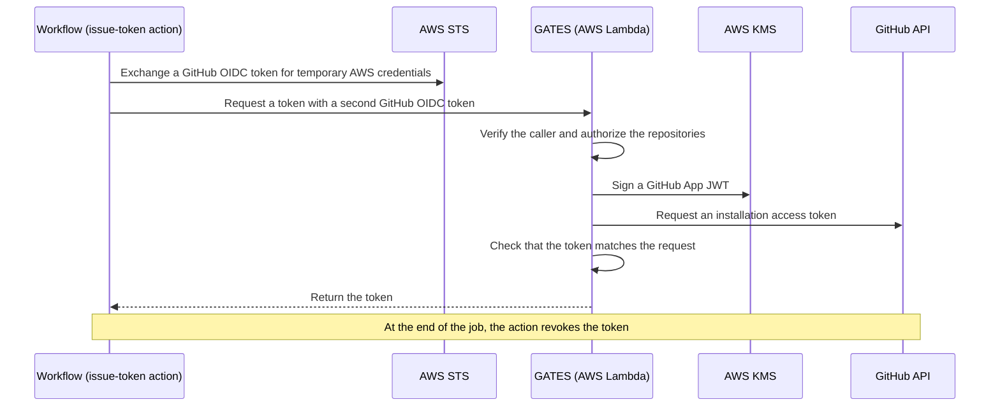

# GATES

**GitHub App Token Exchange System**

Give your GitHub Actions workflows short-lived, read-only access to other repositories, without ever handing them a GitHub App private key.

## Why GATES

The `GITHUB_TOKEN` that GitHub Actions provides can only reach the repository the workflow runs in.
To read another repository, such as a shared configuration repository or a private dependency, teams usually reach for one of two workarounds:

- a personal access token stored as a secret, tied to one person's account and often broader and longer-lived than needed
- a GitHub App private key stored as a secret, which lets anyone who obtains it act with every permission of the GitHub App until someone rotates the key

GATES replaces both.
A workflow asks GATES for the repositories it needs and receives a GitHub App installation access token for only those repositories, with read-only access.

## Benefits

- **No long-lived secrets in workflows**: Workflows prove who they are with GitHub OIDC. There is no private key, personal access token, or AWS access key to store, rotate, or leak.
- **Private key locked in AWS KMS**: The GitHub App private key is imported into AWS KMS and signs only inside it, so no workflow, runner, secret, or even the GATES Lambda function holds the key.
- **Least-privilege tokens**: Each token covers only the repositories you list, with `contents:read`. GATES never widens a request on its own, and it rejects the whole request if any listed repository is not allowed.
- **Short-lived tokens, revoked when the job ends**: Tokens expire on GitHub's schedule (one hour), and the action also tries to revoke them when the job ends, even after a failed or canceled step.
- **Fail closed**: If GATES cannot verify the caller, authorize the request, or confirm that the token GitHub issued matches the request, the workflow gets no token.
- **Auditable**: Every request is recorded with the calling repository, workflow run, requested repositories, and result, never the token itself. Every response carries a request ID that points to its record.
- **One step to use**: Workflow authors add one action and read one output. Authentication, signing, and issuance stay inside GATES.

## How it works



GATES trusts a caller by its immutable GitHub owner ID, not by its name, so renaming or re-creating an account cannot impersonate an allowed owner.

## Usage

### Prerequisites

- The GATES operator has deployed GATES for your organization or user account and registered its connection information as GitHub Secrets and Variables (`GATES_AWS_ACCOUNT_ID`, `GATES_ROLE_NAME`, `GATES_FUNCTION_NAME`, `GATES_AWS_REGION`, `GATES_AUDIENCE`).
- The repositories you request belong to the same owner as the calling repository, and the GATES GitHub App is installed on them.
- The calling repository uses GitHub's immutable OIDC subject claims. Repositories created after 2026-07-15 use them by default; older repositories need `use_immutable_subject` enabled on the organization or repository.
- The job declares `id-token: write`.
- The job runs on a Linux runner with Docker, such as `ubuntu-latest`. Self-hosted runners also need the network access listed in [Runner Requirements](docs/design/github-actions.md#54-runner-requirements).

### Example

```yaml
name: Read another repository
on: workflow_dispatch

jobs:
  read-repository:
    runs-on: ubuntu-latest
    permissions:
      id-token: write
    steps:
      - name: Issue token
        id: gates
        uses: tmknom/gates/.github/actions/issue-token@<PINNED_COMMIT_SHA>
        with:
          repositories: example-org/repo-a,example-org/repo-b
          permissions: contents:read
          role-arn: arn:aws:iam::${{ secrets.GATES_AWS_ACCOUNT_ID }}:role/${{ vars.GATES_ROLE_NAME }}
          function-name: ${{ vars.GATES_FUNCTION_NAME }}
          aws-region: ${{ vars.GATES_AWS_REGION }}
          audience: ${{ vars.GATES_AUDIENCE }}

      - name: Read a file from repo-a
        env:
          GH_TOKEN: ${{ steps.gates.outputs.token }}
        run: gh api repos/example-org/repo-a/contents/README.md
```

Pin the action to a full commit SHA rather than a tag or branch, because a tag or branch can later point to a different commit.

### Inputs

All inputs are required.

| Input | Description |
|---|---|
| `repositories` | Comma-separated `owner/repo` list of the repositories the token can access (up to 500) |
| `permissions` | Comma-separated `permission:level` list. Currently only `contents:read` is supported |
| `role-arn` | ARN of the IAM role to assume. Build it from the operator's Secrets and Variables as in the example |
| `function-name` | Name of the GATES Lambda function |
| `aws-region` | AWS region of the GATES Lambda function |
| `audience` | Audience of the OIDC token sent to GATES |

### Outputs

| Output | Description |
|---|---|
| `token` | The installation access token, masked in logs |
| `expires-at` | Expiration time of the token, in RFC 3339 |
| `repositories` | Comma-separated `owner/repo` list the token can access |
| `permissions` | Comma-separated `permission:level` list the token grants. It may include `metadata:read`, which GitHub adds automatically |

### When the action fails

The action fails the step and writes the cause as an `::error::` annotation.
When GATES itself rejects the request, the annotation reads `GATES returned a failure response` and includes an error code, a message, and a `request_id`.
Share the `request_id` with your GATES operator so they can find the matching audit record.

If the action cannot revoke the token at the end of the job, it writes a `::warning::` annotation but does not fail the job.
The token still stops working at `expires-at`.

## Security notes

- Use the `token` output only in later steps of the same job. GitHub refuses to pass masked values through job `outputs`.
- Do not run untrusted code, such as pull request code checked out under `pull_request_target`, in a job that requests a token. Any code in that job can request its own token from GATES and read the token you received.
- Workflows triggered by Dependabot cannot read GitHub Actions secrets. Register `GATES_AWS_ACCOUNT_ID` as a Dependabot secret too if Dependabot workflows need tokens.
- The action masks the token, but not a substring of it that you print yourself.

## Scope

GATES issues `contents:read` tokens for repositories of a single allowed owner to GitHub Actions workflows of that owner.
It does not serve clients outside GitHub Actions, manage other kinds of secrets, or change GitHub App installations and permissions for you.

Authorization is currently per owner: any workflow of the allowed owner can request read access to any repository the GitHub App is installed on.
Keep this in mind before installing the GitHub App on highly sensitive repositories.
Finer-grained authorization per caller or team, and permissions beyond `contents:read`, are planned for the future.

## Documentation

- [Docs](docs/README.md): For people who deploy, operate, or develop GATES. Purpose and design principles, requirements, design, deployment and key import procedures, and research on GitHub and AWS behavior
- [Issue Token action](.github/actions/issue-token/README.md): Detailed reference for the action, including input validation and every failure annotation
- [Formal models](formal/README.md): Models that check the authorization and token issuance rules
- [llms.txt](llms.txt): Index of the repository for coding agents

## License

[Apache License 2.0](LICENSE)

## Release notes

See [GitHub Releases](https://github.com/tmknom/gates/releases).

Each release includes the Lambda deployment package `gates-lambda-linux-arm64.zip`, its `SHA256SUMS`, and a build provenance attestation.
To verify the package, see [Release](docs/contributing/release.md).
