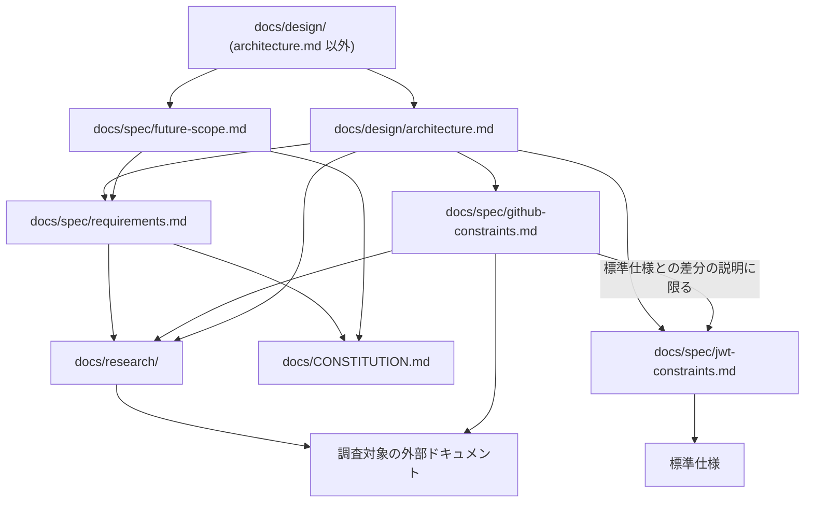
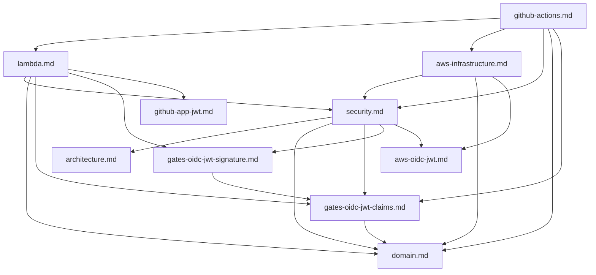

# Documentation Policy

`docs/` 配下のドキュメントは、依存を少なく、片方向に保ちます。
コードと同じく、相互依存が増えるほど、一つの変更で確かめる範囲が広がるためです。
本ドキュメントは、各ドキュメントの責務、依存してよい範囲、記述が食い違ったときに正とするドキュメント、定義に付ける ID の扱い、定義と参照の書き方、テストが検査対象とする受け入れ条件の宣言を定めます。

## 1. Definition of Dependency

ドキュメント A が B に **依存する** とは、次のいずれかが成り立つことをいいます。

- A を理解するために B を読む必要がある
- B の変更によって A の変更が必要になる
- A が B をリンクや文書名で参照している

案内だけのリンク（「詳細は B に記述します」）や、リンクのない文書名と節番号の参照（「B §7.1」）も依存に含めます。
B のファイル名、節、記述の変更によって A の修正が必要になるうえ、参照の有無で機械的に確かめられるためです。

個別に許可していない依存は禁止します。

## 2. Dependency Rules by Document

依存の主な向きは次のとおりで、依存してよい範囲は各節に定めます。
`docs/design/` 内の向きは [§3](#3-dependencies-within-docsdesign) に示します。

### 2.1 docs/research/

外部仕様の調査結果を保持します。

- 各ファイルは自己完結させ、リポジトリ内の他のドキュメントに依存しない
- 調査対象である GitHub や AWS などの外部ドキュメントには依存してよい

### 2.2 docs/spec/

- `docs/design/` に依存しない。`docs/design/` を変更しても `docs/spec/` の変更が必要ない状態を保つ
- `docs/spec/` 内の依存は、次の各ドキュメントの規則で許可したものに限る

| ドキュメント | 責務 | 依存してよい範囲 |
|---|---|---|
| `requirements.md` | 目的、対象範囲、要求、受け入れ条件 | `CONSTITUTION.md`、`docs/research/` |
| `future-scope.md` | 現在のスコープと、将来取り込む想定の機能 | `CONSTITUTION.md`、`requirements.md` |
| `jwt-constraints.md` | JWT / JWS / JWK / OpenID Connect の標準仕様の規定 | 標準仕様のドキュメント |
| `github-constraints.md` | GitHub の仕様 | `docs/research/github/`、GitHub の公式ドキュメント。標準仕様との差分を説明する箇所に限り `jwt-constraints.md` |

`requirements.md` が技術の選択（Lambda、KMS、Terraform など）を制約として定めることは、`docs/design/` への依存に当たりません。
定めた内容を `requirements.md` だけで読み取れ、`docs/design/` の変更に左右されないためです。

`future-scope.md` には、設計の内容を書きません。
将来の機能が設計に及ぼす影響は、影響を受ける `docs/design/` のドキュメントの側に書きます。

### 2.3 docs/design/

`CONSTITUTION.md`、`docs/spec/`、`docs/research/`、調査対象の外部ドキュメントに依存してよいものとします。

| ドキュメント | 責務 |
|---|---|
| `architecture.md` | コンポーネントの全体構成と処理の流れ |
| `domain.md` | 概念の名前、意味、ルール、不変条件 |
| `security.md` | 信頼境界、認証・認可、資格情報の保護、失敗時の扱い |
| `gates-oidc-jwt-claims.md` | GATES 用 OIDC JWT の Claim の受理条件 |
| `gates-oidc-jwt-signature.md` | GATES 用 OIDC JWT の直列化、JOSE Header、Discovery、JWK の受理条件 |
| `aws-oidc-jwt.md` | AWS 用 OIDC JWT の Claim に課す条件 |
| `github-app-jwt.md` | GitHub App JWT の生成条件 |
| `lambda.md` | Lambda の入出力契約、コンポーネント、外部連携 |
| `aws-infrastructure.md` | AWS リソースの構成 |
| `github-actions.md` | Docker Action の入出力と処理手順 |

`architecture.md` は、`docs/design/` の他のドキュメントと `future-scope.md` に依存しません。
将来の機能を取り込むときは先に `requirements.md` を変更するため、`architecture.md` への影響は `requirements.md` への依存を通じて確かめられます。

例外として、全体構成から詳細な設計へ読み進められるよう、付録に `domain.md` を除く `docs/design/` の他のドキュメントの案内を置きます。
付録は各ドキュメントへのファイル単位のリンクと主題だけで構成し、節へのリンクや設計の内容を書きません。
`docs/design/` の他のドキュメントを参照するのは付録だけとし、本文は付録とそれらのドキュメントを読まずに理解できるようにします。

`domain.md` の扱いは [§4](#4-concept-names-and-domainmd) に定めます。

### 2.4 docs/contributing/

開発と運用の手順を記述します。
`docs/contributing/` は他のドキュメントに依存してよく、`docs/spec/` と `docs/design/` は `docs/contributing/` に依存しません。
手順の変更が仕様や設計の変更を求めないようにするためです。

### 2.5 README.md

`docs/` と、その配下の各ディレクトリに置く `README.md` は、配下のドキュメントを案内します。

- 配下のドキュメントと下位ディレクトリの `README.md` へのファイル単位のリンクと主題だけで構成し、節へのリンクや各ドキュメントの内容を書かない
- `README.md` 以外のドキュメントは `README.md` に依存しない
- ドキュメントを追加、削除、改名したときや、主題が変わったときは、案内している `README.md` も変更する

### 2.6 CONSTITUTION.md

`CONSTITUTION.md` は、GATES の存在理由、解決する問題、提供価値、設計上の判断原則、目的の境界を定めます。
個別の要求、技術の選択、設計の内容は書きません。
それらは目的や原則を具体化した結果であり、`CONSTITUTION.md` に書くと、要求や設計の変更のたびに `CONSTITUTION.md` も変わるためです。

- リポジトリ内の他のドキュメントに依存しない
- `CONSTITUTION.md` に依存してよいのは、`requirements.md`、`future-scope.md`、`docs/design/`、`docs/contributing/` に限る

### 2.7 Docker Action README

`.github/actions/` の各 Docker Action の隣に置く `README.md` は、利用者向けの手引きです。
`docs/` の外にありますが、依存の扱いは [§2.4](#24-docscontributing) と同じとします。
この `README.md` は `docs/` 配下のドキュメントに依存してよく、`docs/` 配下のドキュメントはこの `README.md` に依存しません。

## 3. Dependencies within docs/design

相互依存をなくせない箇所が残ることは、`architecture.md` からの依存を除いて許容し、その箇所も含めて、`docs/design/` 内の依存は次の向きを基準にします。

依存するときは、次の規則を守ります。

- 定める側のドキュメントを一つに決め、使う側がそこへ依存する。たとえば Lambda の応答形式は `lambda.md` が定め、`github-actions.md` がそれに依存する
- 図と逆向きの依存を足す前に、逆向きの記述を定める側へ移せないか、`domain.md` の概念名で言い換えられないかを確かめる
- 参照先の内容を転記しない
- 同じ参照先への依存は、節の冒頭など少数の箇所に集める。文中に散らすと、参照先の変更時に確かめる箇所が増えるためである

## 4. Concept Names and domain.md

`domain.md` には、各ドキュメントから抽出してモデリングした概念を定めます。
内容の面では他のドキュメントから影響を受ける一方、概念の名前と意味の面では他のドキュメントが `domain.md` に従います。

`domain.md` の依存は、次のように扱います。

- `docs/spec/` と `docs/research/` には `docs/design/` の他のドキュメントと同じ範囲で依存してよい
- `docs/design/` の他のドキュメントへの依存は、抽出元を示す根拠の表記と Sources に限る
- 本文の定義やルールは `docs/design/` の他のドキュメントを読まずに理解できるようにする。概念と実装の対応のような、他のドキュメントの責務に当たる記述は、そのドキュメントに書き、そのドキュメントが `domain.md` に依存する

概念名の適用範囲はドキュメントによって異なります。

| 対象 | 概念名の扱い |
|---|---|
| `architecture.md` 以外の `docs/design/`、コード、`formal/` | `domain.md` の概念名を使う |
| `CONSTITUTION.md`、`architecture.md`、`requirements.md`、`future-scope.md` | `domain.md` の概念名を使う。ただし `domain.md` を参照しない |
| `jwt-constraints.md`、`github-constraints.md`、`docs/research/` | 外部仕様の用語を使う。`domain.md` の概念名を持ち込まない |

外部仕様の用語と概念名の対応は、`docs/design/` の側に書きます。

概念名の変更に伴う `CONSTITUTION.md`、`architecture.md`、`requirements.md`、`future-scope.md` の語の置き換えは、`CONSTITUTION.md` が他のドキュメントに依存しないという [§2.6](#26-constitutionmd) の規則と、`docs/spec/` が `docs/design/` に依存しないという [§2.2](#22-docsspec) の規則と、`architecture.md` が `docs/design/` の他のドキュメントに依存しないという [§2.3](#23-docsdesign) の規則の例外です。
例外は語を揃えるだけの変更に限ります。
要求の内容まで変わるなら、`domain.md` の都合で要求を変えることになるため、`requirements.md` の変更として別に判断します。

## 5. Source of Truth

記述が食い違ったときに正とするドキュメントは、扱う内容によって決まります。

| 内容 | 正とするもの | 従う側 |
|---|---|---|
| 外部仕様の事実 | 外部仕様そのもの | リポジトリ内のすべてのドキュメント |
| 存在理由、解決する問題、提供価値、設計上の判断原則、目的の境界 | `CONSTITUTION.md` | `requirements.md`、`future-scope.md`、`docs/design/` |
| GATES が満たす要求 | `requirements.md` | `future-scope.md`、`docs/design/` |
| コンポーネントの全体構成と処理の流れ | `architecture.md` | `docs/design/` の他のドキュメント |
| 概念の名前と意味 | `domain.md` | `requirements.md`、`future-scope.md`、`docs/design/` の他のドキュメント、コード、`formal/` |
| JWT の Claim・JOSE・JWK の受理・生成条件 | `gates-oidc-jwt-claims.md`、`gates-oidc-jwt-signature.md`、`aws-oidc-jwt.md`、`github-app-jwt.md` | `docs/design/` の他のドキュメント、コード |
| Docker Action の入出力と処理手順 | `github-actions.md` | Docker Action の `README.md`、コード |

外部仕様の事実は GATES の文書では決められないため、事実と食い違う要求は `requirements.md` の側を直します。
`domain.md` の定義が要求の内容と食い違うときも、`domain.md` の側を直します。

正とするドキュメント自体に誤りがある可能性は残ります。
食い違いを見つけたら、機械的に合わせず、正とするドキュメントの記述が根拠に照らして正しいかを確かめてから、誤っている側を直します。

## 6. Identifiers and Definitions

要求や受理条件のように、ほかのドキュメント、コード、`formal/` から個別に参照される種類の定義には ID を付けます。
参照元は ID で定義を指すため、ID と意味の対応が崩れると、参照元の記述は変わらないまま、別の意味を指すようになります。

### 6.1 ID Kinds

ID を付ける種類は次のとおりです。

| 接頭辞 | 対象 | 定めるドキュメント | ID の形 |
|---|---|---|---|
| `FR-` | 機能要求 | `requirements.md` | 3 桁の連番（`FR-001`） |
| `QR-` | 品質とセキュリティの要求 | `requirements.md` | 3 桁の連番（`QR-001`） |
| `AC-` | 受け入れ条件 | `requirements.md` | 2 桁の連番（`AC-01`）。99 を超えたら 3 桁で続ける |
| `GOJ-` | GATES 用 OIDC JWT の受理条件 | `gates-oidc-jwt-claims.md`、`gates-oidc-jwt-signature.md` | Claim 名か、規則の内容を表す名前。作り方は `gates-oidc-jwt-claims.md` に定める |
| `AOJ-` | AWS 用 OIDC JWT の Claim に課す条件 | `aws-oidc-jwt.md` | Claim 名か、条件の内容を表す名前 |
| `GAJ-` | GitHub App JWT の生成条件 | `github-app-jwt.md` | Claim 名か、条件の内容を表す名前 |
| `RULE-` | ドメインの規則 | `domain.md` | 3 桁の連番（`RULE-001`） |
| `INV-` | ドメインの不変条件 | `domain.md` | 3 桁の連番（`INV-001`） |

これらの種類の定義には、重要度にかかわらず、すべて ID を付けます。
一部の定義だけに ID がないと、その定義を参照元から指せず、付与漏れも機械的に確かめられないためです。

### 6.2 Assigning and Changing IDs

ID は定義の意味を指し、定義の書き方や置き場所を指しません。

- 見出しのタイトルの変更、ファイルの移動、ファイルの中での並び替えでは ID を変えない
- 連番の ID では、新しい定義に、種類ごとにこれまでに振った最大の番号の次を振る。削除した定義の番号を新しい定義に振らない。古い意味のまま残った参照が、知らないうちに新しい意味を指すためである
- 定義を分割または統合したときは、できた定義のすべてに新しい ID を振り、旧 ID は使わない。旧 ID の参照元は一括で置換せず、参照元ごとに、どの定義が旧 ID の意味を引き継ぐかを判断して付け替える
- ID を変えずに意味を変えたときは、その ID を参照する設計、`formal/`、コード、テストが新しい意味に合うかを確かめる

これらの規則では、新しい定義の番号はファイルの中の位置にかかわらず末尾に続き、削除した番号は欠けたまま残るため、運用を続けると、番号の欠けや、番号の順とファイルの中の並び順が一致しない定義が増えます。
コードのリファクタリングと同じく、これらは番号を振り直して時々整理します。
振り直しは、リポジトリ内の参照の一貫性を保てる場合に限り、次の規則で行います。

- 振り直しは、定義の意味を変える変更と分けた単独の変更にする。意味の変更が番号の置き換えの差分に紛れると、レビューで見落とすためである
- 旧 ID から新 ID への対応表を作り、ドキュメント、`formal/`、コード、テストの参照を、同じ変更で対応表から一度にすべて付け替える。一件ずつ順に置換すると、付け替えた ID がさらに別の ID に置き換わることがあるためである
- 差分が対応表どおりの ID の置き換えだけであることを確かめる
- 振り直しでは、削除した番号を詰めてよい。振り直した後の新しい定義には、振り直した後の最大の番号の次を振る
- 対応表をコミットメッセージに残す。過去のコミット、Issue、Pull Request の記述は旧 ID のまま残るためである

### 6.3 Writing Definitions

- 定義ごとに見出しを置き、見出しは ID、半角スペース、タイトルの順に書く（例：`#### FR-006 許可オーナーの Owner ID による認可`）
- 定義を並べる節の直下の見出しは、定義の見出しだけにする
- 文書の直下は、定義を並べる節に当たらない。定義の見出しを、定義でない節の見出しと同じ階層に並べてよい（例：`github-app-jwt.md` の `## GAJ-ISS` と `## Traceability`）。定義でない節は見出しで区切られ、直前の定義の本文として読まれないためである
- 定義を分類するときは、分類ごとに節を設け、その節の直下に定義の見出しを並べる（例：`requirements.md` の `### 5.2 Authorization` の直下に `#### FR-006 …`）
- 定義を並べる節の説明は、最初の定義の見出しより前に書く。最後の定義の後に書くと、その定義の本文として読まれるためである
- 定義を一覧する表を索引として置いてもよい。その場合も、定義の見出しとその下の本文を正とする

### 6.4 Referring to Definitions

- ほかのファイルの定義を参照するときは、本文に ID を書き、リンクはファイル単位にする（例：`[Requirements](../spec/requirements.md) の FR-006`）。見出しのアンカーは見出しの文字列から作られ、タイトルを変えると切れるためである
- 同じファイルの中では、見出しのアンカーでリンクしてよい。タイトルを変えた差分の中で、切れたリンクを確かめられるためである
- コード、テスト、`formal/` からは、文書名を添えず ID だけで定義を参照する。ID の接頭辞から定めるドキュメントが決まり（[§6.1](#61-id-kinds)）、grep で定義を探せるためである

### 6.5 Declaring Acceptance Criteria in Tests

AC の判定の証拠にするテストには、そのテストが検査対象とする AC を宣言します。
AC の意味を変えたときに確かめ直すテスト（[§6.2](#62-assigning-and-changing-ids)）を、宣言の grep で探せるためです。
宣言はテストの直前に置くため、テストの名前を変えたり分けたりしても、宣言はテストとともに移ります。

- 宣言は、テストの直前の行コメントに `trace:checks` と AC の ID を半角スペース区切りで書く。Go のテスト関数では `//trace:checks AC-03 AC-04`、Terraform の試験の `run` ブロックでは `# trace:checks AC-20` とする
- Go では `//` の直後に空白を置かない。Go はこの形の行をディレクティブとして扱い、doc comment の本文に含めないためである。doc comment を持つテスト関数では、本文の後に空行の `//` を挟んで最後の行に置く。gofmt が整える形である
- 宣言は、AC の判定の証拠にするテストだけに付ける。すべてのテストに付けることは求めない
- 宣言は、そのテストが AC を検査対象とすることだけを表す。テストの合格や、AC の条件の網羅は表さない
- AC の判定の記録には、証拠にしたテストの名前を転記しない。テストは `grep -rnE 'trace:checks.* AC-03( |$)'` で探す。転記すると、テストの名前を変えたり分けたりしたときに記録が古くなるためである
