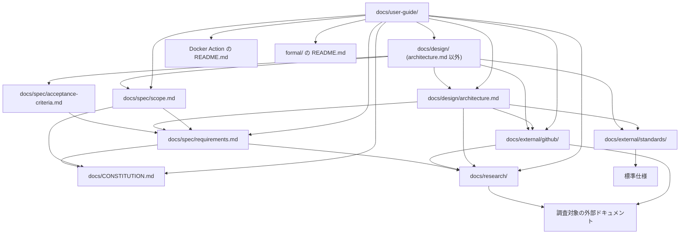
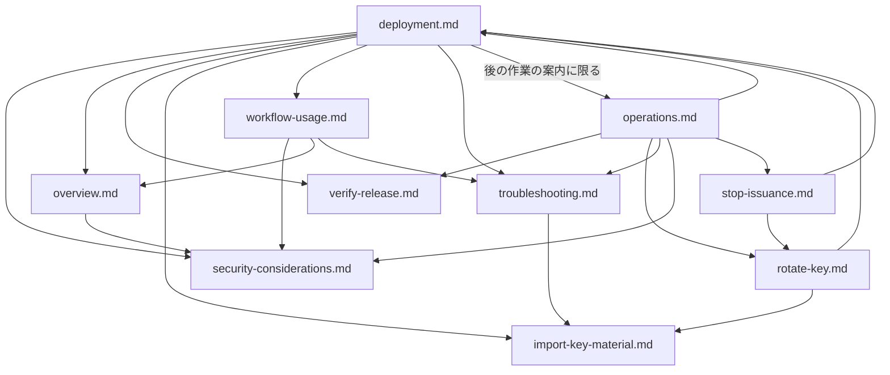
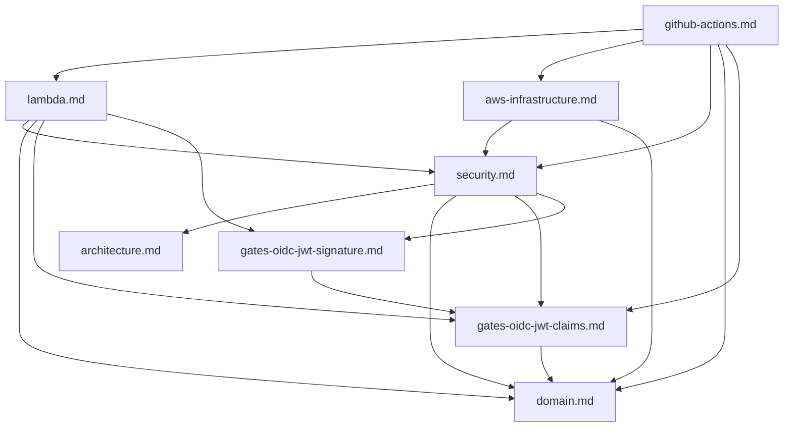

# Documentation Policy

`docs/` 配下のドキュメントは、依存を少なく、片方向に保ちます。
コードと同じく、相互依存が増えるほど、一つの変更で確かめる範囲が広がるためです。
本ドキュメントは、各ドキュメントの責務、依存してよい範囲、概念名の扱い、記述が食い違ったときに正とするドキュメントを定めます。

## 1. Definition of Dependency

ドキュメント A が B に **依存する** とは、次のいずれかが成り立つことをいいます。

- A を理解するために B を読む必要がある
- B の変更によって A の変更が必要になる
- A が B をリンクや文書名で参照している

案内だけのリンク（「詳細は B に記述します」）や、リンクのない文書名と節番号の参照（「B §7.1」）も依存に含めます。
B のファイル名、節、記述の変更によって A の修正が必要になるうえ、参照の有無で機械的に確かめられるためです。

個別に許可していない依存は禁止します。

依存のうち、sdlc の Relationship テーブル（`alignment`・`grounding`）で書いたものは、`sdlc validate` が、リポジトリのルートの `sdlc.yaml` の `allowed_dependencies` と照合します。
`allowed_dependencies` は、本ドキュメントの依存の規則のうち、参照元と参照先のファイルの組で決まる部分を写したものです。
依存の規則を変えるときは、`allowed_dependencies` も同じ変更で直します。
直さないと、規則に反する Relationship テーブルを `sdlc validate` が見逃すか、規則に沿うものを違反と報告するためです。
リンクや文書名による参照と、付録や末尾の案内に限るといった、ドキュメントの中の位置による条件は照合されないため、レビューで確かめます。

## 2. Dependency Rules by Document

依存の主な向きは次のとおりで、依存してよい範囲は各節に定めます。
`docs/design/` 内の向きは [§3](#3-dependencies-within-docsdesign) に、`docs/user-guide/` 内の向きは [§2.8](#28-docsuser-guide) に示します。

### 2.1 docs/research/

外部仕様の調査結果を保持します。

- 各ファイルは自己完結させ、リポジトリ内の他のドキュメントに依存しない
- 調査対象である GitHub や AWS などの外部ドキュメントには依存してよい

### 2.2 docs/spec/

- `docs/design/` に依存しない。`docs/design/` を変更しても `docs/spec/` の変更が必要ない状態を保つ
- `docs/spec/` 内の依存は、次の各ドキュメントの規則で許可したものに限る

| ドキュメント | 責務 | 依存してよい範囲 |
|---|---|---|
| `requirements.md` | 目的、関係者の責任、要求 | `CONSTITUTION.md`、`docs/research/` |
| `acceptance-criteria.md` | 受け入れ条件と、各受け入れ条件が適合を判定する要求 | `requirements.md` |
| `scope.md` | 現在のスコープ、将来取り込む想定の機能、対象外とする範囲 | `CONSTITUTION.md`、`requirements.md` |

`requirements.md` が、GATES の前提とする AWS（Lambda、KMS、IAM）と GitHub（Actions、App）のサービス名を書くことは、`docs/design/` への依存に当たりません。
これらは GATES が動く前提であり、設計の変更では変わらないためです。
構成管理のツールや利用者接点の実装方式のような、設計で選ぶものは `requirements.md` に書きません。

`scope.md` には、設計の内容を書きません。
将来の機能が設計に及ぼす影響は、影響を受ける `docs/design/` のドキュメントの側に書きます。

### 2.3 docs/design/

`CONSTITUTION.md`、`docs/spec/`、`docs/external/`、`docs/research/`、調査対象の外部ドキュメントに依存してよいものとします。

| ドキュメント | 責務 |
|---|---|
| `architecture.md` | コンポーネントの全体構成と処理の流れ |
| `domain.md` | 概念の名前、意味、ルール、不変条件 |
| `security.md` | 信頼境界、認証・認可、資格情報の保護、失敗時の扱い |
| `gates-oidc-jwt-claims.md` | GATES 用 OIDC JWT の Claim の受理条件 |
| `gates-oidc-jwt-signature.md` | GATES 用 OIDC JWT の直列化、JOSE Header、Discovery、JWK の受理条件 |
| `lambda.md` | Lambda の入出力契約、コンポーネント、外部連携、GitHub App JWT の生成条件 |
| `aws-infrastructure.md` | AWS リソースの構成 |
| `github-actions.md` | Docker Action の入出力と処理手順 |

`architecture.md` は、`docs/design/` の他のドキュメントと `scope.md` に依存しません。
将来の機能を取り込むときは先に `requirements.md` を変更するため、`architecture.md` への影響は `requirements.md` への依存を通じて確かめられます。

例外として、全体構成から詳細な設計へ読み進められるよう、付録に `domain.md` を除く `docs/design/` の他のドキュメントの案内を置きます。
付録は各ドキュメントへのファイル単位のリンクと主題だけで構成し、節へのリンクや設計の内容を書きません。
`docs/design/` の他のドキュメントを参照するのは付録だけとし、本文は付録とそれらのドキュメントを読まずに理解できるようにします。

`domain.md` の扱いは [§4](#4-concept-names-and-domainmd) に定めます。

### 2.4 docs/contributing/

GATES の開発で従う規約と手順を記述します。
`docs/contributing/` は他のドキュメントに依存してよく、`docs/spec/` と `docs/design/` は `docs/contributing/` に依存しません。
手順の変更が仕様や設計の変更を求めないようにするためです。

GATES の開発に固有でない運用者の手順は、`docs/user-guide/` を参照し、`docs/contributing/` に重ねて書きません。
`docs/contributing/` に書くのは、検証用の GitHub App の設定や E2E テストのような、開発に固有の差分だけです。

### 2.5 README.md

`docs/` と、その配下の各ディレクトリに置く `README.md` は、配下のドキュメントを案内します。

- 配下のドキュメントと下位ディレクトリの `README.md` へのファイル単位のリンクと主題だけで構成し、節へのリンクや各ドキュメントの内容を書かない
- `README.md` 以外のドキュメントは `README.md` に依存しない
- ドキュメントを追加、削除、改名したときや、主題が変わったときは、案内している `README.md` も変更する

### 2.6 CONSTITUTION.md

`CONSTITUTION.md` は、GATES の存在理由、解決する問題、提供価値、設計上の判断原則、目的の境界を定めます。
個別の要求、技術の選択、設計の内容は書きません。
それらは目的や原則を具体化した結果であり、`CONSTITUTION.md` に書くと、要求や設計の変更のたびに `CONSTITUTION.md` も変わるためです。

- リポジトリ内の他のドキュメントに依存しない
- `CONSTITUTION.md` に依存してよいのは、`requirements.md`、`scope.md`、`docs/design/`、`docs/contributing/`、`docs/user-guide/` に限る

### 2.7 Docker Action README

`.github/actions/` の各 Docker Action の隣に置く `README.md` は、利用者向けの手引きです。
`docs/` の外にありますが、依存の扱いは [§2.4](#24-docscontributing) と同じとします。
この `README.md` は `docs/` 配下のドキュメントに依存してよく、`docs/` 配下のドキュメントはこの `README.md` に依存しません。

例外として、`docs/user-guide/` はこの `README.md` に依存してよく、この `README.md` は `docs/user-guide/` に依存しません。
入力、出力、失敗の注釈のような Action のリファレンスをこの `README.md` の一か所に保ち、`docs/user-guide/` に転記しないためです。
逆向きを禁じるのは、相互依存を作らないためです。

この `README.md` も利用者が読むため、[§2.8](#28-docsuser-guide) の書き方の規則に従います。
ただし、`docs/user-guide/` に依存しないため、概念名の説明は `overview.md` に任せず、この `README.md` の中で添えます。
`docs/` 配下へのリンクも、利用者が作業と判断に使わない設計の詳細には張りません。

### 2.8 docs/user-guide/

導入を判断する人、GATES 運用者、ワークフロー利用者に向けて、判断の材料と作業の手順を記述します。
読者は GATES を初めて使う人で、実装を知りません。
多くの読者に欠かせないことを、最小の労力で得られるように書きます。
詳細を知りたい読者は、`docs/user-guide/` の外のドキュメントを読みます。

依存は次の範囲に限ります。

- 依存してよいのは、`docs/user-guide/` の他のドキュメント、Docker Action の `README.md`、GitHub や AWS などの公式ドキュメントである。Action のリファレンスは Docker Action の `README.md` を参照させ、転記しない
- `CONSTITUTION.md`、`docs/spec/`、`docs/design/`、`docs/external/`、`docs/research/`、`formal/` の `README.md` への依存は、`overview.md` と `security-considerations.md` の末尾に置く、根拠や内部の設計を知りたい読者への案内に限る。本文から参照すると、読者が根拠をたどって本筋を見失い、設計の変更も利用者向けの文書に波及するためである
- `docs/contributing/` に依存しない。開発の都合で変わる手順や規約の変更が、利用者向けの文書に波及しないようにするためである
- `docs/spec/`、`docs/design/`、`docs/external/`、`docs/research/` は `docs/user-guide/` に依存しない

書き方は次の規則に従います。

- **主題から始める**：各ドキュメントは、読者とそのドキュメントで得られることを一、二文で述べて始める。GATES とは何かは `overview.md` に一度だけ書き、他のドキュメントで繰り返さない
- **用語の説明は一か所**：概念名の平易な説明は `overview.md` の用語の節に一度だけ置き、他のドキュメントは説明を繰り返さずに概念名を使う。概念名を使うことは、`overview.md` への依存に数えない。概念名が変わるときは、`domain.md` に合わせてすべてのドキュメントを直すことになり、依存に数えても確かめる範囲は変わらないためである
- **本筋と例外を分ける**：多くの読者が通る作業は、リンク先を読まずに完了できるように書く。一部の読者だけが通る作業（環境によって要る作業、途中で止まったときの扱い）は、ドキュメントの末尾の節か `troubleshooting.md` に置き、本筋には案内の一文だけを残す
- **参照は作業に要る箇所にだけ**：本文中の他の節や他のドキュメントへの参照は、読まないと作業を誤るか進められない箇所と、例外への案内に限る。すぐ前後の節や目次で分かる位置は参照しない。指すときも、節の番号より対象の名前（「最小のワークフロー」など）で書く。補足や詳細への案内は、本文に挟まずドキュメントの末尾の References に置く。参照が多いと、読者がどれを読むべきか判断できず、本筋を見失うためである
- **一つの話題は一つのドキュメント**：同じ話題を複数のドキュメントで説明しない。説明するドキュメントを一つに決め、他のドキュメントは案内だけを置く
- **安全に関わる注意は目立たせる**：トークンで操作できる範囲と権限を決めるもの、トークンを受け取るジョブの分け方、Action の参照の仕方のように、守らないと被害につながる注意は、但し書きに埋めず、見出しか箇条書きで示す
- **理由は必要な箇所にだけ**：理由は、省くと誤りや危険を招く手順にだけ添える
- **実装の詳細を書かない**：内部の処理、検証のアルゴリズム、読者が操作しない設定の値は書かない。読者が実行して確かめる出力に現れるもの（Plan に現れるリソースの名前など）は書いてよい
- **検証の有無を書かない**：検証環境で確かめたかどうかの注記は書かない。根拠は `docs/research/` が持つ。公式ドキュメントか GATES の設計に基づく事柄は、注記を添えずに書き、どちらにも基づかない推測は書かない。確かめていないことが導入の判断を変えるとき（たとえば、Organization を許可オーナーにした構成）に限り、`overview.md` の制約として一度だけ書く

`docs/user-guide/` の中の依存は、次の向きを基準にします。

図にないドキュメントを加えるときや、図と逆向きの依存を足すときは、先にこの図を変更します。

`deployment.md` と `operations.md` は、図で唯一の相互依存です。
`deployment.md` から `operations.md` への依存は、デプロイを終えた運用者に後の作業の在りかを示す、主題だけを添えたファイル単位のリンク一つに限ります。
節へのリンクや手順の内容を書かなければ、`operations.md` の節や手順を変えても `deployment.md` を直す必要がないためです。
`troubleshooting.md` と `security-considerations.md` は、`operations.md` と `stop-issuance.md` に依存しません。
`operations.md` はこれらに依存するため、逆向きに依存すると相互依存になります。
`stop-issuance.md` に依存すると、停止の手順を変えるたびにこれらも直すことになります。
`stop-issuance.md` の手順で止めた発行を、Troubleshooting の読者が障害と取り違えないよう、`troubleshooting.md` には意図した停止かを確かめる但し書きを書きます。

### 2.9 docs/external/

GATES が従う外部仕様を、規定として整理して保持します。
`docs/research/` が外部仕様を調査して取得した値の記録であるのに対し、`docs/external/` はそれらと公式資料を根拠に、外部仕様を規定として整理したものです。
`docs/spec/` は GATES の判断が変わると変わりますが、`docs/external/` は外部仕様が変わったときか、読み違いを直すときにだけ変わります。
変更のきっかけが異なるため、`docs/spec/` とディレクトリを分けます。

| ディレクトリ | 責務 | 依存してよい範囲 |
|---|---|---|
| `standards/` | JWT / JWS / JWK / OpenID Connect の標準仕様の規定 | 標準仕様のドキュメント |
| `github/` | GitHub の仕様 | `docs/research/github/`、GitHub の公式ドキュメント |

- `docs/external/` は、GATES の他のドキュメントに依存しない。`docs/spec/` や `docs/design/` に依存すると、規定を GATES の都合で選んだり読んだりできるようになるためである
- `github/` は、標準仕様との差分を説明するためにも `standards/` に依存しない。GitHub の仕様と標準仕様を比べた結論は、`docs/design/` の側に書く
- `docs/external/` に依存してよいのは、`docs/design/`、`docs/user-guide/`、`formal/` と、他のドキュメントへの依存を一般に認めた `docs/contributing/`、`README.md`、Docker Action の `README.md` に限る。`docs/spec/` からの依存は、必要が生じるまで許可しない

## 3. Dependencies within docs/design

相互依存をなくせない箇所が残ることは、`architecture.md` からの依存を除いて許容し、その箇所も含めて、`docs/design/` 内の依存は次の向きを基準にします。

依存するときは、次の規則を守ります。

- 定める側のドキュメントを一つに決め、使う側がそこへ依存する。たとえば Lambda の応答形式は `lambda.md` が定め、`github-actions.md` がそれに依存する
- 図と逆向きの依存を足す前に、逆向きの記述を定める側へ移せないか、`domain.md` の概念名で言い換えられないかを確かめる
- 参照先の内容を転記しない
- 同じ参照先への依存は、節の冒頭など少数の箇所に集める。文中に散らすと、参照先の変更時に確かめる箇所が増えるためである

## 4. Concept Names and domain.md

`domain.md` には、各ドキュメントから抽出してモデリングした概念を定めます。
内容の面では他のドキュメントから影響を受ける一方、概念の名前と意味の面では他のドキュメントが `domain.md` に従います。

`domain.md` の依存は、次のように扱います。

- `docs/spec/`、`docs/external/`、`docs/research/` には `docs/design/` の他のドキュメントと同じ範囲で依存してよい
- `docs/design/` の他のドキュメントへの依存は、抽出元を示す根拠の表記と References に限る
- 本文の定義やルールは `docs/design/` の他のドキュメントを読まずに理解できるようにする。概念と実装の対応のような、他のドキュメントの責務に当たる記述は、そのドキュメントに書き、そのドキュメントが `domain.md` に依存する

概念名の適用範囲はドキュメントによって異なります。

| 対象 | 概念名の扱い |
|---|---|
| `architecture.md` 以外の `docs/design/`、コード、`formal/` | `domain.md` の概念名を使う |
| `CONSTITUTION.md`、`architecture.md`、`requirements.md`、`acceptance-criteria.md`、`scope.md` | `domain.md` の概念名を使う。ただし `domain.md` を参照しない |
| `docs/external/`、`docs/research/` | 外部仕様の用語を使う。`domain.md` の概念名を持ち込まない |
| `docs/user-guide/` | `domain.md` の概念名を使い、`overview.md` の用語の節で一度だけ平易な説明を添える（例：「許可オーナー：GATES がトークンを発行してよいと設定した GitHub のアカウント」）。`domain.md` へのリンクは求めない |

外部仕様の用語と概念名の対応は、`docs/design/` の側に書きます。

概念名の変更に伴う `CONSTITUTION.md`、`architecture.md`、`requirements.md`、`acceptance-criteria.md`、`scope.md` の語の置き換えは、`CONSTITUTION.md` が他のドキュメントに依存しないという規則と、`docs/spec/` が `docs/design/` に依存しないという規則と、`architecture.md` が `docs/design/` の他のドキュメントに依存しないという規則の例外です。
例外は語を揃えるだけの変更に限ります。
要求や受け入れ条件の内容まで変わるなら、`domain.md` の都合でそれらを変えることになるため、`requirements.md` や `acceptance-criteria.md` の変更として別に判断します。

## 5. Source of Truth

記述が食い違ったときに正とするドキュメントは、扱う内容によって決まります。

| 内容 | 正とするもの | 従う側 |
|---|---|---|
| 外部仕様の事実 | 外部仕様そのもの | リポジトリ内のすべてのドキュメント |
| 存在理由、解決する問題、提供価値、設計上の判断原則、目的の境界 | `CONSTITUTION.md` | `requirements.md`、`scope.md`、`docs/design/`、`docs/user-guide/` |
| GATES が満たす要求 | `requirements.md` | `acceptance-criteria.md`、`scope.md`、`docs/design/`、`docs/user-guide/` |
| 現在のスコープ、将来取り込む想定の機能、対象外とする範囲 | `scope.md` | `docs/design/`、`docs/user-guide/` |
| 受け入れ条件 | `acceptance-criteria.md` | `docs/design/`、テスト、`formal/` |
| コンポーネントの全体構成と処理の流れ | `architecture.md` | `docs/design/` の他のドキュメント、`docs/user-guide/` |
| 概念の名前と意味 | `domain.md` | `requirements.md`、`acceptance-criteria.md`、`scope.md`、`docs/design/` の他のドキュメント、`docs/user-guide/`、コード、`formal/` |
| GATES 用 OIDC JWT の Claim・JOSE・JWK の受理条件 | `gates-oidc-jwt-claims.md`、`gates-oidc-jwt-signature.md` | `docs/design/` の他のドキュメント、`docs/user-guide/`、コード |
| Docker Action の入出力と処理手順 | `github-actions.md` | Docker Action の `README.md`、`docs/user-guide/`、コード |
| 運用者の手順（デプロイ、鍵素材のインポート、鍵の更新、配布物の検証） | `docs/user-guide/` | `docs/contributing/` |

外部仕様の事実は GATES の文書では決められないため、事実と食い違う要求は `requirements.md` の側を直します。
`domain.md` の定義が要求の内容と食い違うときも、`domain.md` の側を直します。
受け入れ条件が要求と食い違うときは、受け入れ条件は要求への適合を判定するためのものなので、`acceptance-criteria.md` の側を直します。
`docs/user-guide/` は、`docs/spec/` と `docs/design/` が定めた振る舞いを利用者に向けて説明します。
振る舞いの記述が食い違うときは、`docs/user-guide/` の側を直します。

正とするドキュメント自体に誤りがある可能性は残ります。
食い違いを見つけたら、機械的に合わせず、正とするドキュメントの記述が根拠に照らして正しいかを確かめてから、誤っている側を直します。
