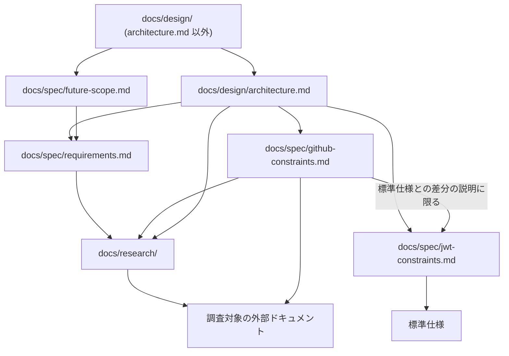
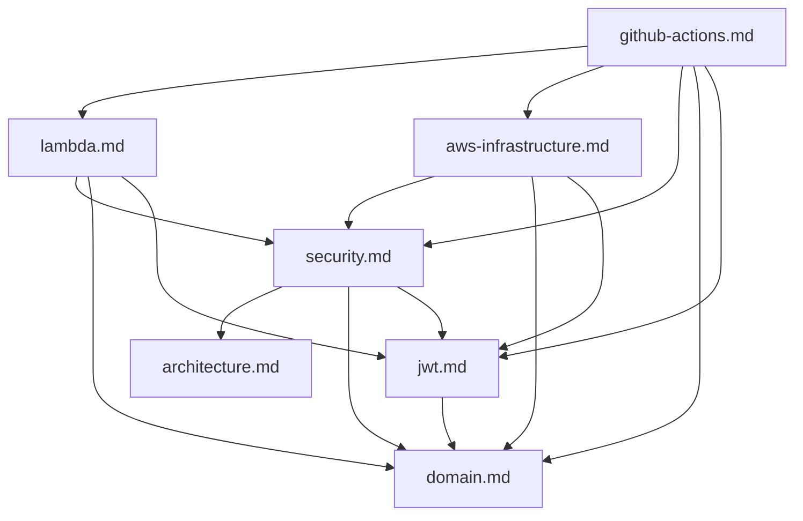

# Documentation Policy

`docs/` 配下のドキュメントは、依存を少なく、片方向に保ちます。
コードと同じく、相互依存が増えるほど、一つの変更で確かめる範囲が広がるためです。
本ドキュメントは、各ドキュメントの責務、依存してよい範囲、記述が食い違ったときに正とするドキュメントを定めます。

## 1. Definition of Dependency

ドキュメント A が B に **依存する** とは、次のいずれかが成り立つことをいいます。

- A を理解するために B を読む必要がある
- B の変更によって A の変更が必要になる
- A が B をリンクや文書名で参照している

案内だけのリンク（「詳細は B に記述します」）や、リンクのない文書名と節番号の参照（「B §7.1」）も依存に含めます。
B のファイル名、節、記述の変更によって A の修正が必要になるうえ、参照の有無で機械的に確かめられるためです。

個別に許可していない依存は禁止します。

## 2. Dependency Rules by Document

依存の主な向きは次のとおりで、依存してよい範囲は各節に定めます。
`docs/design/` 内の向きは [§3](#3-dependencies-within-docsdesign) に示します。

### 2.1 docs/research/

外部仕様の調査結果を保持します。

- 各ファイルは自己完結させ、リポジトリ内の他のドキュメントに依存しない
- 調査対象である GitHub や AWS などの外部ドキュメントには依存してよい

### 2.2 docs/spec/

- `docs/design/` に依存しない。`docs/design/` を変更しても `docs/spec/` の変更が必要ない状態を保つ
- `docs/spec/` 内の依存は、次の各ドキュメントの規則で許可したものに限る

| ドキュメント | 責務 | 依存してよい範囲 |
|---|---|---|
| `requirements.md` | 目的、対象範囲、要求、受け入れ条件 | `docs/research/` |
| `future-scope.md` | 現在のスコープと、将来取り込む想定の機能 | `requirements.md` |
| `jwt-constraints.md` | JWT / JWS / JWK / OpenID Connect の標準仕様の規定 | 標準仕様のドキュメント |
| `github-constraints.md` | GitHub の仕様 | `docs/research/github/`、GitHub の公式ドキュメント。標準仕様との差分を説明する箇所に限り `jwt-constraints.md` |

`requirements.md` が技術の選択（Lambda、KMS、Terraform など）を制約として定めることは、`docs/design/` への依存に当たりません。
定めた内容を `requirements.md` だけで読み取れ、`docs/design/` の変更に左右されないためです。

`future-scope.md` には、設計の内容を書きません。
将来の機能が設計に及ぼす影響は、影響を受ける `docs/design/` のドキュメントの側に書きます。

### 2.3 docs/design/

`docs/spec/`、`docs/research/`、調査対象の外部ドキュメントに依存してよいものとします。

| ドキュメント | 責務 |
|---|---|
| `architecture.md` | コンポーネントの全体構成と処理の流れ |
| `domain.md` | 概念の名前、意味、ルール、不変条件 |
| `security.md` | 信頼境界、認証・認可、資格情報の保護、失敗時の扱い |
| `jwt.md` | JWT の Claim・JOSE・JWK の受理・生成条件 |
| `lambda.md` | Lambda の入出力契約、コンポーネント、外部連携 |
| `aws-infrastructure.md` | AWS リソースの構成 |
| `github-actions.md` | Composite Action の入出力と処理手順 |

`architecture.md` は、`docs/design/` の他のドキュメントと `future-scope.md` に依存しません。
将来の機能を取り込むときは先に `requirements.md` を変更するため、`architecture.md` への影響は `requirements.md` への依存を通じて確かめられます。

例外として、全体構成から詳細な設計へ読み進められるよう、付録に `domain.md` を除く `docs/design/` の他のドキュメントの案内を置きます。
付録は各ドキュメントへのファイル単位のリンクと主題だけで構成し、節へのリンクや設計の内容を書きません。
`docs/design/` の他のドキュメントを参照するのは付録だけとし、本文は付録とそれらのドキュメントを読まずに理解できるようにします。

`domain.md` の扱いは [§4](#4-concept-names-and-domainmd) に定めます。

### 2.4 docs/contributing/

開発と運用の手順を記述します。
`docs/contributing/` は他のドキュメントに依存してよく、`docs/spec/` と `docs/design/` は `docs/contributing/` に依存しません。
手順の変更が仕様や設計の変更を求めないようにするためです。

### 2.5 README.md

`docs/` と、その配下の各ディレクトリに置く `README.md` は、配下のドキュメントを案内します。

- 配下のドキュメントと下位ディレクトリの `README.md` へのファイル単位のリンクと主題だけで構成し、節へのリンクや各ドキュメントの内容を書かない
- `README.md` 以外のドキュメントは `README.md` に依存しない
- ドキュメントを追加、削除、改名したときや、主題が変わったときは、案内している `README.md` も変更する

## 3. Dependencies within docs/design

相互依存をなくせない箇所が残ることは、`architecture.md` からの依存を除いて許容し、その箇所も含めて、`docs/design/` 内の依存は次の向きを基準にします。

依存するときは、次の規則を守ります。

- 定める側のドキュメントを一つに決め、使う側がそこへ依存する。たとえば Lambda の応答形式は `lambda.md` が定め、`github-actions.md` がそれに依存する
- 図と逆向きの依存を足す前に、逆向きの記述を定める側へ移せないか、`domain.md` の概念名で言い換えられないかを確かめる
- 参照先の内容を転記しない
- 同じ参照先への依存は、節の冒頭など少数の箇所に集める。文中に散らすと、参照先の変更時に確かめる箇所が増えるためである

## 4. Concept Names and domain.md

`domain.md` には、各ドキュメントから抽出してモデリングした概念を定めます。
内容の面では他のドキュメントから影響を受ける一方、概念の名前と意味の面では他のドキュメントが `domain.md` に従います。

`domain.md` の依存は、次のように扱います。

- `docs/spec/` と `docs/research/` には `docs/design/` の他のドキュメントと同じ範囲で依存してよい
- `docs/design/` の他のドキュメントへの依存は、抽出元を示す根拠の表記と Sources に限る
- 本文の定義やルールは `docs/design/` の他のドキュメントを読まずに理解できるようにする。概念と実装の対応のような、他のドキュメントの責務に当たる記述は、そのドキュメントに書き、そのドキュメントが `domain.md` に依存する

概念名の適用範囲はドキュメントによって異なります。

| 対象 | 概念名の扱い |
|---|---|
| `architecture.md` 以外の `docs/design/`、コード、`formal/` | `domain.md` の概念名を使う |
| `architecture.md`、`requirements.md`、`future-scope.md` | `domain.md` の概念名を使う。ただし `domain.md` を参照しない |
| `jwt-constraints.md`、`github-constraints.md`、`docs/research/` | 外部仕様の用語を使う。`domain.md` の概念名を持ち込まない |

外部仕様の用語と概念名の対応は、`docs/design/` の側に書きます。

概念名の変更に伴う `architecture.md`、`requirements.md`、`future-scope.md` の語の置き換えは、`docs/spec/` が `docs/design/` に依存しないという [§2.2](#22-docsspec) の規則と、`architecture.md` が `docs/design/` の他のドキュメントに依存しないという [§2.3](#23-docsdesign) の規則の例外です。
例外は語を揃えるだけの変更に限ります。
要求の内容まで変わるなら、`domain.md` の都合で要求を変えることになるため、`requirements.md` の変更として別に判断します。

## 5. Source of Truth

記述が食い違ったときに正とするドキュメントは、扱う内容によって決まります。

| 内容 | 正とするもの | 従う側 |
|---|---|---|
| 外部仕様の事実 | 外部仕様そのもの | リポジトリ内のすべてのドキュメント |
| GATES が満たす要求 | `requirements.md` | `future-scope.md`、`docs/design/` |
| コンポーネントの全体構成と処理の流れ | `architecture.md` | `docs/design/` の他のドキュメント |
| 概念の名前と意味 | `domain.md` | `requirements.md`、`future-scope.md`、`docs/design/` の他のドキュメント、コード、`formal/` |
| JWT の Claim・JOSE・JWK の受理・生成条件 | `jwt.md` | `docs/design/` の他のドキュメント、コード |

外部仕様の事実は GATES の文書では決められないため、事実と食い違う要求は `requirements.md` の側を直します。
`domain.md` の定義が要求の内容と食い違うときも、`domain.md` の側を直します。

正とするドキュメント自体に誤りがある可能性は残ります。
食い違いを見つけたら、機械的に合わせず、正とするドキュメントの記述が根拠に照らして正しいかを確かめてから、誤っている側を直します。
