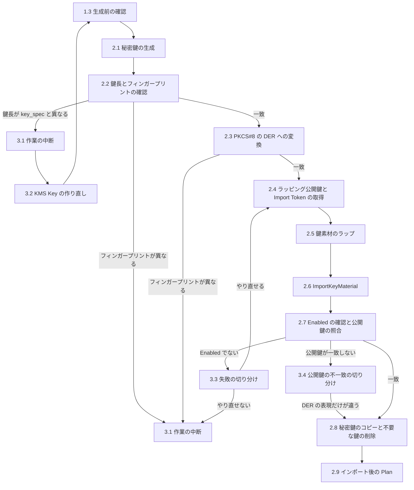

# Key Material Import

GATES の署名鍵の KMS Key は、鍵素材を持たない `PendingImport` の状態で Terraform が作ります。
本ドキュメントでは、GitHub App Private Key を生成して、その KMS Key に鍵素材として取り込むまでの手順を扱います。

インポートした非対称 KMS Key の鍵素材は、別の鍵素材に交換できません。
誤った鍵を入れると KMS Key から作り直すことになるため、各手順で結果を確かめ、期待と異なれば先へ進みません。

## 1. Prerequisites

### 1.1 Working Environment

作業は、運用者の手元の macOS の端末から、ひとつのシェルで行います。
次を満たしてから始めます。

| 前提 | 確かめ方 | 期待する結果 |
|---|---|---|
| OpenSSL 3.x 以降を使う | `openssl version` | `OpenSSL` で始まり、バージョンが 3 以上である |
| ディスクが暗号化されている | `fdesetup status` | `FileVault is On.` |
| 他のユーザーがログインしていない | `who` | 運用者のユーザー名だけが並ぶ |
| プロセスのコマンドラインを端末の外へ送る監視（EDR など）が動いていない | 端末の管理者に確かめる | 動いていない |
| ダウンロードの保存先が Time Machine の対象外である | `tmutil isexcluded "$HOME/Downloads"` | `[Excluded]` が表示される。または `tmutil destinationinfo` が `No destinations configured` を返す |
| ダウンロードの保存先をクラウドストレージに同期していない | 同期ツールの設定を確かめる | 同期の対象に入っていない |
| AWS CLI v2 と jq がある | `aws --version`、`jq --version` | `aws-cli/2.` で始まり、jq のバージョンが表示される |
| [Testing Environment Setup](setup-environment.md) のデプロイが済んでいる | 1.3 の確認 | 1.3 の期待する結果になる |

macOS に標準で入っている `openssl` は LibreSSL で、鍵素材のラップに使う `-id-aes256-wrap-pad` がありません。
`openssl version` が `LibreSSL` で始まるときは、Homebrew で OpenSSL を入れ、このシェルでだけ優先させます。

```bash
brew install openssl@3
export PATH="$(brew --prefix openssl@3)/bin:$PATH"
```

他のユーザーのログインと監視を確かめるのは、鍵素材のラップに使う AES 鍵が、2.5 のコマンドの引数としてプロセスの一覧に一時的に現れるためです。
ダウンロードの保存先を確かめるのは、秘密鍵が 2.1 で作業ディレクトリへ移すまでのあいだそこに置かれ、バックアップや同期の先に残ったコピーは 2.8 で削除できないためです。
ダウンロードの保存先を `$HOME/Downloads` 以外にしているときは、その場所で確かめます。

### 1.2 Variables

手順で使う値を、シェルの変数に設定します。
コマンドはリポジトリのルートで実行します。

```bash
umask 077
export AWS_PAGER=""
export AWS_REGION=ap-northeast-1
export KMS_KEY_ARN="$(jq -r '.outputs.kms_key_arn.value' terraform/local/terraform.tfstate)"
export DOWNLOAD_DIR="$HOME/Downloads"
export WORK_DIR="${TMPDIR%/}/gates-key-import"
```

| 変数 | 値 |
|---|---|
| `AWS_REGION` | `terraform.tfvars` の `region`（既定値は `ap-northeast-1`） |
| `KMS_KEY_ARN` | インポート先の KMS Key の ARN。初回のインポートでは State の `kms_key_arn` を読む。鍵の更新では、新しく追加した KMS Key の ARN を設定する |
| `DOWNLOAD_DIR` | ブラウザがファイルを保存するディレクトリ |
| `WORK_DIR` | 秘密鍵と一時ファイルを置くディレクトリ。ユーザーごとの一時ディレクトリの下に置く |

`umask 077` により、以後このシェルで作るファイルは運用者だけが読み書きできます。

一時認証情報（`AWS_ACCESS_KEY_ID`、`AWS_SECRET_ACCESS_KEY`、`AWS_SESSION_TOKEN`）は、取得し直したものをこのシェルに設定します。
秘密鍵を生成してからインポートを終えるまでのあいだに、期限が切れないようにするためです。

途中で端末を閉じたら、新しいシェルで、1.1 の `PATH` の設定（OpenSSL を Homebrew で入れた場合）、1.2 の変数、一時認証情報を設定し直してから続けます。
どれもシェルごとの設定のため、端末を閉じると失われます。

### 1.3 Checks before Generating the Private Key

秘密鍵を生成する前に、次をすべて確かめます。
一つでも期待と異なれば、秘密鍵を生成せずに止まり、原因を取り除いてから 1.3 をやり直します。

| 確認 | コマンド | 期待する結果 |
|---|---|---|
| 対象のアカウント | `aws sts get-caller-identity --query Account --output text` | `KMS_KEY_ARN` に含まれるアカウント ID と一致する |
| KMS Key の状態 | `aws kms describe-key --key-id "$KMS_KEY_ARN" --query 'KeyMetadata.[KeyState,Origin,KeyUsage,KeySpec]' --output text` | `PendingImport`、`EXTERNAL`、`SIGN_VERIFY`、`kms_key_spec` の値が並ぶ |
| Terraform の差分 | `make tf-plan` | `No changes` |
| ダウンロードの保存先 | `find "$DOWNLOAD_DIR" -maxdepth 1 -name '*.private-key.pem'` | 何も表示されない |
| 作業ディレクトリ | `mkdir -m 700 "$WORK_DIR"` | エラーなく作られる |

ダウンロードの保存先に `*.private-key.pem` があれば、それは削除されずに残った秘密鍵です。
どの GitHub App の鍵かを確かめて削除するまで、この手順を始めません。
`mkdir` が `File exists` で失敗したときは、前回の作業の一時ファイルが残っています。
[3.1](#31-suspending-the-work) の手順で削除してから、1.3 をやり直します。

最後に、GitHub App の設定ページの `Credentials` → `Key pairs` を開き、すでにある鍵のフィンガープリントを控えます。
2.1 で生成した鍵を一覧の中から見分けるためと、2.8 で不要な鍵を削除するためです。

## 2. Procedure

手順の流れは次のとおりです。



図では、手順の途中で止まる箇所のうち主なものだけを示しています。
各手順の本文に書いた止まる条件が、図より優先します。

2.1 から 2.8 までは、間を空けずに続けて行います。
秘密鍵が運用者の手元に残る時間を短くするためです。
途中で作業を止めるときは、[3.1](#31-suspending-the-work) の手順に従います。

### 2.1 Generating the Private Key

GitHub App の設定ページで、`Credentials` → `Key pairs` → `New key` をクリックします。
`<app-name>.<date>.private-key.pem` という名前のファイルが、ダウンロードの保存先に保存されます。

ダウンロードが終わったら、ダウンロードされたファイルを確かめます。

```bash
find "$DOWNLOAD_DIR" -maxdepth 1 -name '*.private-key.pem'
```

1 件だけが表示されることを確かめます。
2 件以上が表示されたら、次のコマンドを実行せずに [3.1](#31-suspending-the-work) の手順で作業を止めます。
どのファイルが生成した鍵か分からない状態で先に進むと、鍵を取り違えるおそれがあるためです。
何も表示されないときは、ダウンロードが終わるのを待って、`find` をやり直します。

1 件だけのときに、そのファイルを作業ディレクトリへ移します。

```bash
mv "$DOWNLOAD_DIR"/*.private-key.pem "$WORK_DIR/private-key.pem"
chmod 600 "$WORK_DIR/private-key.pem"
ls -l "$WORK_DIR"
```

`ls -l` が `-rw-------` の `private-key.pem` だけを表示することを確かめます。

[3.1](#31-suspending-the-work) の 3 で前回の鍵を削除できなかったときは、3.1 で控えたフィンガープリントの鍵を、ここで削除します。

### 2.2 Checking the Key Length and Fingerprint

秘密鍵の鍵長を確かめます。
`-text_pub` は公開鍵の成分だけを出力するオプションで、秘密鍵の値は表示しません。

```bash
openssl pkey -in "$WORK_DIR/private-key.pem" -noout -text_pub | head -n 1
```

出力が `Public-Key: (2048 bit)` のように表示されるので、鍵長が KMS Key の `KeySpec`（`RSA_2048` なら 2048）と一致することを確かめ、鍵長を控えます。
一致しないときは、[3.1](#31-suspending-the-work) の手順で作業を止め、[3.2](#32-recreating-the-kms-key-for-a-different-key-length) の手順で KMS Key を作り直します。

次に、秘密鍵のフィンガープリントを確かめます。

```bash
openssl rsa -in "$WORK_DIR/private-key.pem" -pubout -outform DER | openssl sha256 -binary | openssl base64
```

出力を、`Key pairs` に新しく加わった鍵（1.3 で控えたものにない鍵）のフィンガープリントと比べます。
`Key pairs` のフィンガープリントの先頭に `SHA256:` が付いていれば、この手順で比べるときは常に、それを除いた部分を使います。
一致すれば、出力をインポート後の照合のために控えます。
一致しないときは、ダウンロードしたファイルが生成した鍵ではありません。
[3.1](#31-suspending-the-work) の手順で作業を止めます。

公開鍵の照合はインポートの後にしかできず、その時点で鍵の取り違えに気付いても、鍵素材を交換できません。
そのため、鍵長とフィンガープリントは、インポートの前に手元で確かめます。

### 2.3 Converting to PKCS#8 DER

GitHub がダウンロードさせる秘密鍵は PKCS#1 の PEM です。
KMS は PKCS#8 の DER を求めるため、変換します。

```bash
openssl pkcs8 -topk8 -nocrypt -inform PEM -outform DER -in "$WORK_DIR/private-key.pem" -out "$WORK_DIR/private-key.der"
openssl pkey -inform DER -in "$WORK_DIR/private-key.der" -pubout -outform DER | openssl sha256 -binary | openssl base64
```

2 つ目のコマンドの出力が、2.2 で控えたフィンガープリントと一致することを確かめます。
一致しないとき、またはコマンドがエラーになったときは、[3.1](#31-suspending-the-work) の手順で作業を止めます。

### 2.4 Getting the Wrapping Public Key and Import Token

KMS から、ラッピング公開鍵と Import Token を取得します。
ラッピングアルゴリズムは `RSA_AES_KEY_WRAP_SHA_256`、ラッピング公開鍵は `RSA_4096` にします。
RSA の秘密鍵のラップに使えるのは `RSA_AES_KEY_WRAP_SHA_*` だけで、そのうち SHA-256 のものを選び、ラッピング公開鍵は AWS が推奨する最長のものにします。

```bash
aws kms get-parameters-for-import --key-id "$KMS_KEY_ARN" \
  --wrapping-algorithm RSA_AES_KEY_WRAP_SHA_256 --wrapping-key-spec RSA_4096 \
  --output json > "$WORK_DIR/import-parameters.json"
jq -r .PublicKey "$WORK_DIR/import-parameters.json" | openssl base64 -d -A -out "$WORK_DIR/wrapping-public-key.der"
jq -r .ImportToken "$WORK_DIR/import-parameters.json" | openssl base64 -d -A -out "$WORK_DIR/import-token.bin"
jq -r .ParametersValidTo "$WORK_DIR/import-parameters.json"
openssl pkey -pubin -inform DER -in "$WORK_DIR/wrapping-public-key.der" -noout -text_pub | head -n 1
```

レスポンスには Import Token が含まれるため、画面には出さずファイルに保存します。
最後の 2 つのコマンドの出力が、次のとおりであることを確かめます。

- `ParametersValidTo` が、およそ 24 時間後の日時である。ラッピング公開鍵と Import Token は、この日時を過ぎると使えない
- ラッピング公開鍵が `Public-Key: (4096 bit)` である

`get-parameters-for-import` が失敗したときは、KMS Key の状態を変えていません。
エラーメッセージを確かめ、一時認証情報の期限切れなら取得し直して 2.4 をやり直します。
それ以外のエラーでは、[3.1](#31-suspending-the-work) の手順で作業を止めます。

### 2.5 Wrapping the Key Material

`RSA_AES_KEY_WRAP_SHA_256` では、使い捨ての AES 鍵で鍵素材を包み（RFC 5649 の鍵ラップ）、その AES 鍵をラッピング公開鍵で暗号化します。
KMS には、暗号化した AES 鍵と包んだ鍵素材を、この順に連結したものを渡します。

```bash
openssl rand -out "$WORK_DIR/aes-key.bin" 32
openssl enc -id-aes256-wrap-pad -K "$(xxd -p -c 32 "$WORK_DIR/aes-key.bin")" -iv A65959A6 \
  -in "$WORK_DIR/private-key.der" -out "$WORK_DIR/key-material-wrapped.bin"
openssl pkeyutl -encrypt -pubin -keyform DER -inkey "$WORK_DIR/wrapping-public-key.der" \
  -pkeyopt rsa_padding_mode:oaep -pkeyopt rsa_oaep_md:sha256 -pkeyopt rsa_mgf1_md:sha256 \
  -in "$WORK_DIR/aes-key.bin" -out "$WORK_DIR/aes-key-wrapped.bin"
cat "$WORK_DIR/aes-key-wrapped.bin" "$WORK_DIR/key-material-wrapped.bin" > "$WORK_DIR/encrypted-key-material.bin"
wc -c "$WORK_DIR/private-key.der" "$WORK_DIR/key-material-wrapped.bin" "$WORK_DIR/aes-key-wrapped.bin" "$WORK_DIR/encrypted-key-material.bin"
```

`wc -c` の出力で、次を確かめます。

- `aes-key-wrapped.bin` が 512 バイトである（`RSA_4096` の鍵長）
- `key-material-wrapped.bin` が、`private-key.der` の大きさを 8 の倍数に切り上げて 8 を足した大きさである（2048 bit の鍵では、`private-key.der` が 1217 バイト前後、`key-material-wrapped.bin` が 1232 バイト前後になる）
- `encrypted-key-material.bin` が、上の 2 つの和である

コマンドがエラーになったとき、または大きさが合わないときは、手元の問題のため、2.5 をやり直します。
2.4 で確かめた `ParametersValidTo` を過ぎていたら、2.4 からやり直します。

### 2.6 Importing the Key Material

鍵素材をインポートします。
鍵素材は無期限（`KEY_MATERIAL_DOES_NOT_EXPIRE`）にし、`--valid-to` を指定しません。
有効期限を付けると、Terraform が鍵素材の再インポートを求める差分を出し、その差分は解消できないためです。

```bash
aws kms import-key-material --key-id "$KMS_KEY_ARN" \
  --encrypted-key-material "fileb://$WORK_DIR/encrypted-key-material.bin" \
  --import-token "fileb://$WORK_DIR/import-token.bin" \
  --expiration-model KEY_MATERIAL_DOES_NOT_EXPIRE
```

AWS CLI のバージョンによって、成功したときの出力は空のこともあります。
成否は出力ではなく、2.7 で確かめる KMS Key の状態で判断します。
エラーが表示されたときも、2.7 へ進みます。

### 2.7 Checking the Key State and Public Key

KMS Key の状態を確かめます。

```bash
aws kms describe-key --key-id "$KMS_KEY_ARN" --query 'KeyMetadata.[KeyState,ExpirationModel]' --output text
```

`Enabled` と `KEY_MATERIAL_DOES_NOT_EXPIRE` が並ぶことを確かめます。
`describe-key` が一時認証情報の期限切れ（`ExpiredTokenException`）で失敗したときは、一時認証情報を取得し直してから `describe-key` をやり直します。
`Enabled` でなければ、2.6 で表示されたエラーをもとに、[3.3](#33-when-importkeymaterial-fails) の手順で切り分けます。

次に、KMS Key の公開鍵のフィンガープリントを、GitHub と同じ方法で求めます。
KMS は公開鍵を SubjectPublicKeyInfo の DER で返します。

```bash
aws kms get-public-key --key-id "$KMS_KEY_ARN" --query PublicKey --output text | openssl base64 -d -A | openssl sha256 -binary | openssl base64
```

出力が、2.2 で控えたフィンガープリントと、`Key pairs` に表示された新しい鍵のフィンガープリントの両方と一致することを確かめます。
一致しないときは、2.9 へ進まず、[3.4](#34-when-the-public-key-does-not-match) の手順に従います。

### 2.8 Deleting the Private Key Copies and Unused Keys

秘密鍵のコピーと一時ファイルを削除します。

```bash
rm -r "$WORK_DIR"
ls -ld "$WORK_DIR"
find "$DOWNLOAD_DIR" -maxdepth 1 -name '*.private-key.pem'
```

`ls -ld` が `No such file or directory` を返し、`find` が何も表示しないことを確かめます。

次に、GitHub App の `Key pairs` から、1.3 で控えた鍵のうち、GATES の KMS Key に入っていない鍵を削除します。
初回のインポートでは、控えた鍵をすべて削除します。
鍵の更新では、切り替え前の KMS Key に入っている鍵だけを残し、切り替えが終わってから削除します。
残した鍵の秘密鍵がどこかに残っていると、その秘密鍵を持つ者が GitHub App として認証できるためです。

GATES は、インポートした秘密鍵のコピーを持ちません。
鍵素材は KMS から取り出せないため、KMS Key を失ったときは、新しい鍵を生成して新しい KMS Key にインポートします。

### 2.9 Plan after Import

鍵の状態が `PendingImport` から `Enabled` に変わっても、Terraform の設定に差分が出ないことを確かめます。

```bash
make tf-plan
```

`No changes` を返すことを確かめます。
`aws_kms_external_key` の更新や置換が現れたときは、`make tf-apply` を実行せずに原因を調べます。
鍵素材はインポート済みのため、この段階で手順を戻す必要はありません。

## 3. Failure Handling

### 3.1 Suspending the Work

手順の途中で作業を止めるときは、秘密鍵を手元にも GitHub にも残さないようにします。
再開するときは、1.3 から始め、新しい秘密鍵を生成します。

1. `aws kms describe-key --key-id "$KMS_KEY_ARN" --query 'KeyMetadata.KeyState' --output text` で KMS Key の状態を確かめる。一時認証情報の期限切れ（`ExpiredTokenException`）で失敗したら、取得し直してから実行し直す。`Enabled` なら、インポートは成功しているため作業を止めずに 2.7 の公開鍵の照合へ進む。それ以外なら 2 へ進む
2. 作業ディレクトリとダウンロードしたファイルを削除する

    ```bash
    rm -r "$WORK_DIR"
    find "$DOWNLOAD_DIR" -maxdepth 1 -name '*.private-key.pem' -delete
    ls -ld "$WORK_DIR"
    find "$DOWNLOAD_DIR" -maxdepth 1 -name '*.private-key.pem'
    ```

    `ls -ld` が `No such file or directory` を返し、2 つ目の `find` が何も表示しないことを確かめる。
3. GitHub App の `Key pairs` で、2.1 で生成した鍵（1.3 で控えたものにない鍵）の `Delete` をクリックする。GitHub は App の鍵が 1 つだけのときは削除させないため、削除できなければ、その鍵のフィンガープリントを控えてそのまま残し、再開したときの 2.1 で削除する

ラッピング公開鍵と Import Token は 24 時間で使えなくなるため、AWS 側で消すものはありません。
1 で `PendingImport` と `Enabled` 以外の状態が返ったときは、2 と 3 を終えてから、KMS Key の状態が変わった原因を調べます。

### 3.2 Recreating the KMS Key for a Different Key Length

`key_spec` の変更は KMS Key の置換になるため、`prevent_destroy` が Plan を拒否します。
鍵素材をまだインポートしていない KMS Key に限り、次の手順で作り直します。

1. `aws kms describe-key --key-id "$KMS_KEY_ARN" --query 'KeyMetadata.KeyState' --output text` が `PendingImport` を返すことを確かめる。それ以外の状態なら、この手順を使わずに止まる
2. `terraform/local/terraform.tfvars` の `kms_key_spec` を、2.2 で控えた鍵長に合わせる（2048 bit なら `RSA_2048`、3072 bit なら `RSA_3072`、4096 bit なら `RSA_4096`）
3. `terraform/kms.tf` の `prevent_destroy = true` を手元で一時的に `false` にする。この変更はコミットしない
4. `make tf-plan` を実行し、置換されるのが `aws_kms_external_key` の 1 つだけで、ほかの変更が新しい Key ARN への追従だけであることを確かめてから、`make tf-apply` を実行する
5. `prevent_destroy` を `true` に戻し、`make tf-plan` が `No changes` を返すことを確かめる
6. 1.2 の `KMS_KEY_ARN` を設定し直し、1.3 から始める

置き換えられた古い KMS Key は削除が予約され、Terraform の `deletion_window_in_days` の日数が過ぎると削除されます。

### 3.3 When ImportKeyMaterial Fails

2.7 で KMS Key が `Enabled` にならなかったときは、2.7 で表示された状態と、2.6 で表示されたエラーに応じて、次のように進めます。
2.4 からやり直すのは、ラッピング公開鍵と Import Token の組をインポートのたびに取得し直すことを、KMS が求めているためです。
やり直しは、どの行でも 2 回までとします。
3 回目も失敗するなら、その場で直せる原因ではないため、秘密鍵を手元に残したまま調べることはせず、[3.1](#31-suspending-the-work) の手順で作業を止めます。

| 状態 | エラー | 進め方 |
|---|---|---|
| `PendingImport` | `ExpiredImportTokenException`、`InvalidImportTokenException`、`InvalidCiphertextException` | Import Token とラッピング公開鍵、またはラップの問題である。2.4 からやり直す |
| `PendingImport` | `IncorrectKeyMaterialException` | 鍵素材の問題である。2.3 からやり直す |
| `PendingImport` | `KMSInternalException`、`DependencyTimeoutException`、通信のエラー | 一時的な問題である。2.4 からやり直す |
| `PendingImport` | 一時認証情報の期限切れ（`ExpiredTokenException`） | 一時認証情報を取得し直し、2.4 からやり直す |
| `PendingImport` | 上記以外（`AccessDeniedException` など） | [3.1](#31-suspending-the-work) の手順で作業を止め、エラーの原因を調べる |
| 上記以外 | いずれも | [3.1](#31-suspending-the-work) の手順で作業を止める |

`IncorrectKeyMaterialException` が続くときは、鍵そのものを KMS が受け付けない可能性があります。
KMS は、RSA の素因数が FIPS 186-5 の検査に合わない鍵を拒否することがあると説明しており、この場合は同じ鍵で何度やり直しても成功しません。
作業を止めた後、再開するときは新しい鍵を生成します。

### 3.4 When the Public Key Does Not Match

2.7 で公開鍵のフィンガープリントが一致しないときは、DER の表現の違いと、鍵の取り違えを切り分けます。
KMS の公開鍵を DER に書き直してから、フィンガープリントを求め直します。

```bash
aws kms get-public-key --key-id "$KMS_KEY_ARN" --query PublicKey --output text | openssl base64 -d -A | openssl pkey -pubin -inform DER -outform DER | openssl sha256 -binary | openssl base64
```

| 結果 | 意味 | 進め方 |
|---|---|---|
| 2.2 で控えたフィンガープリントと、`Key pairs` に表示された新しい鍵のフィンガープリントの両方と一致する | 鍵は同じで、DER の表現だけが違う | 一致しなかった出力と一致した出力を記録し、2.8 へ進む |
| どちらかと一致しない | KMS Key に、GitHub App の鍵と異なる鍵素材が入っている | 次の手順で KMS Key を使えない状態にする |

鍵素材が異なるときは、その KMS Key で署名しても GitHub が受け付けないうえ、鍵素材を交換できません。
次の順に進めます。

1. `aws kms disable-key --key-id "$KMS_KEY_ARN"` で KMS Key を無効にし、`describe-key` の `KeyState` が `Disabled` になることを確かめる
2. [3.1](#31-suspending-the-work) の 2 と 3 の手順で、秘密鍵のコピーを削除し、GitHub の鍵を削除する
3. `make tf-plan` を実行し、`No changes` を返すことを確かめる。`enabled` を Terraform の設定に書いていないため、無効にしても差分は出ない

新しい KMS Key へのインポートには、KMS Key を追加する Terraform の変更が要ります。
この手順書の範囲を外れるため、ここで作業を終えます。

## 4. Records

作業の後に、次の値を Git の外に記録します。

- KMS Key ARN、GitHub App の Client ID と App ID
- インポートした鍵のフィンガープリントと鍵長
- 作業の日時と、2.7、2.8、2.9 の確認の結果

秘密鍵、`private-key.der`、AES 鍵、ラップした鍵素材、Import Token、一時認証情報は記録しません。

## 5. Sources

- [GitHub — Managing private keys for GitHub Apps](https://docs.github.com/en/apps/creating-github-apps/authenticating-with-a-github-app/managing-private-keys-for-github-apps)
- [AWS — Importing key material for AWS KMS keys](https://docs.aws.amazon.com/kms/latest/developerguide/importing-keys.html)
- [AWS — Create a KMS key with imported key material](https://docs.aws.amazon.com/kms/latest/developerguide/importing-keys-conceptual.html)
- [AWS — Download the wrapping public key and import token](https://docs.aws.amazon.com/kms/latest/developerguide/importing-keys-get-public-key-and-token.html)
- [AWS — Encrypt the key material](https://docs.aws.amazon.com/kms/latest/developerguide/importing-keys-encrypt-key-material.html)
- [AWS — Import the key material](https://docs.aws.amazon.com/kms/latest/developerguide/importing-keys-import-key-material.html)
- [AWS — GetParametersForImport](https://docs.aws.amazon.com/kms/latest/APIReference/API_GetParametersForImport.html)
- [AWS — ImportKeyMaterial](https://docs.aws.amazon.com/kms/latest/APIReference/API_ImportKeyMaterial.html)
- [AWS — GetPublicKey](https://docs.aws.amazon.com/kms/latest/APIReference/API_GetPublicKey.html)
