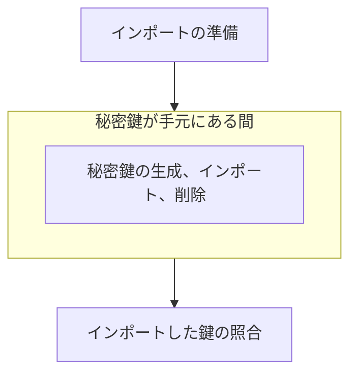

# Key Material Import

本ドキュメントでは、GitHub App Private Key を生成して、Terraform が作った KMS Key に鍵素材として取り込むまでの手順を扱います。

## 1. Order of the Work

作業は次の順に進めます。



コマンドはリポジトリのルートで、ひとつのシェルから実行します。

## 2. Preparing the Import

環境変数を設定し、作業ディレクトリを作ります。
`KMS_KEY_NAME` は、鍵素材をインポートする KMS Key の、`terraform.tfvars` の `kms_keys` での名前です。
初回のインポートでは `key-1`、鍵の更新（[Key Rotation](rotate-key.md)）では新しく加えた鍵の名前にします。

```bash
export KMS_KEY_NAME="key-1"
export KMS_KEY_ARN="$(jq -r --arg name "$KMS_KEY_NAME" '.outputs.kms_key_arns.value[$name]' terraform/local/terraform.tfstate)"
export AWS_REGION="$(echo "$KMS_KEY_ARN" | cut -d: -f4)"
export WORK_DIR="$(mktemp -d)"
```

KMS から、ラッピング公開鍵と Import Token を取得します。
RSA の秘密鍵のラップに使えるのは `RSA_AES_KEY_WRAP_SHA_*` だけで、そのうち SHA-256 のものを選び、ラッピング公開鍵は AWS が推奨する最長の `RSA_4096` にします。
ラッピング公開鍵と Import Token は同じ応答の組でしか使えないため、応答をファイルに保存してから取り出します。

```bash
aws kms get-parameters-for-import --key-id "$KMS_KEY_ARN" \
  --wrapping-algorithm RSA_AES_KEY_WRAP_SHA_256 --wrapping-key-spec RSA_4096 \
  --output json > "$WORK_DIR/import-parameters.json"
jq -r .PublicKey "$WORK_DIR/import-parameters.json" | openssl base64 -d -A -out "$WORK_DIR/wrapping-public-key.der"
jq -r .ImportToken "$WORK_DIR/import-parameters.json" | openssl base64 -d -A -out "$WORK_DIR/import-token.bin"
```

ラッピング公開鍵と Import Token は、取得から 24 時間で使えなくなります。
秘密鍵のインポートは、それまでに行います。

`RSA_AES_KEY_WRAP_SHA_256` では、使い捨ての AES 鍵で鍵素材を包み（RFC 5649 の鍵ラップ）、その AES 鍵をラッピング公開鍵で暗号化します。

```bash
openssl rand -out "$WORK_DIR/aes-key.bin" 32
openssl pkeyutl -encrypt -pubin -keyform DER -inkey "$WORK_DIR/wrapping-public-key.der" \
  -pkeyopt rsa_padding_mode:oaep -pkeyopt rsa_oaep_md:sha256 -pkeyopt rsa_mgf1_md:sha256 \
  -in "$WORK_DIR/aes-key.bin" -out "$WORK_DIR/aes-key-wrapped.bin"
```

## 3. Generating, Importing, and Deleting the Private Key

GitHub App の設定ページで、`Credentials` → `Key pairs` → `New key` をクリックします。
ダウンロードされた秘密鍵のファイルパスを、`GITHUB_PRIVATE_KEY_PATH` 環境変数に設定します。

```bash
export GITHUB_PRIVATE_KEY_PATH="<ダウンロードした秘密鍵のファイルパス>"
```

GitHub がダウンロードさせる秘密鍵は PKCS#1 の PEM で、KMS は PKCS#8 の DER を求めます。
変換した鍵素材を AES 鍵で包み、暗号化した AES 鍵の後ろに連結して、KMS に渡す形にします。
`-id-aes256-wrap-pad` は標準入力を受け付けないため、変換した鍵素材はいったんファイルに書きます。

```bash
openssl pkcs8 -topk8 -nocrypt -in "$GITHUB_PRIVATE_KEY_PATH" -outform DER -out "$WORK_DIR/private-key.der"
openssl enc -id-aes256-wrap-pad -K "$(xxd -p -c 32 "$WORK_DIR/aes-key.bin")" -iv A65959A6 -in "$WORK_DIR/private-key.der" \
  | cat "$WORK_DIR/aes-key-wrapped.bin" - > "$WORK_DIR/encrypted-key-material.bin"
```

鍵素材を無期限（`KEY_MATERIAL_DOES_NOT_EXPIRE`）でインポートします。

```bash
aws kms import-key-material --key-id "$KMS_KEY_ARN" \
  --encrypted-key-material "fileb://$WORK_DIR/encrypted-key-material.bin" \
  --import-token "fileb://$WORK_DIR/import-token.bin" \
  --expiration-model KEY_MATERIAL_DOES_NOT_EXPIRE
```

秘密鍵のコピーと一時ファイルを削除します。

```bash
rm -r "$WORK_DIR" "$GITHUB_PRIVATE_KEY_PATH"
```

## 4. Verifying the Imported Key

次のコマンドを実行し、`Enabled` と `KEY_MATERIAL_DOES_NOT_EXPIRE` が並ぶことを確かめます。

```bash
aws kms describe-key --key-id "$KMS_KEY_ARN" --query 'KeyMetadata.[KeyState,ExpirationModel]' --output text
```

そして、KMS Key の公開鍵のフィンガープリントを求めます。
KMS は公開鍵を SubjectPublicKeyInfo の DER で返します。

```bash
aws kms get-public-key --key-id "$KMS_KEY_ARN" --query PublicKey --output text | openssl base64 -d -A | openssl sha256 -binary | openssl base64
```

出力が、GitHub App の `Key pairs` に新しく加わった鍵のフィンガープリントと一致していれば成功しています。

## 5. Sources

- [GitHub — Managing private keys for GitHub Apps](https://docs.github.com/en/apps/creating-github-apps/authenticating-with-a-github-app/managing-private-keys-for-github-apps)
- [GitHub — REST API endpoints for GitHub Apps](https://docs.github.com/en/rest/apps/apps)
- [AWS — Importing key material for AWS KMS keys](https://docs.aws.amazon.com/kms/latest/developerguide/importing-keys.html)
- [AWS — Create a KMS key with imported key material](https://docs.aws.amazon.com/kms/latest/developerguide/importing-keys-conceptual.html)
- [AWS — Download the wrapping public key and import token](https://docs.aws.amazon.com/kms/latest/developerguide/importing-keys-get-public-key-and-token.html)
- [AWS — Encrypt the key material](https://docs.aws.amazon.com/kms/latest/developerguide/importing-keys-encrypt-key-material.html)
- [AWS — Import the key material](https://docs.aws.amazon.com/kms/latest/developerguide/importing-keys-import-key-material.html)
- [AWS — GetParametersForImport](https://docs.aws.amazon.com/kms/latest/APIReference/API_GetParametersForImport.html)
- [AWS — ImportKeyMaterial](https://docs.aws.amazon.com/kms/latest/APIReference/API_ImportKeyMaterial.html)
- [AWS — GetPublicKey](https://docs.aws.amazon.com/kms/latest/APIReference/API_GetPublicKey.html)
