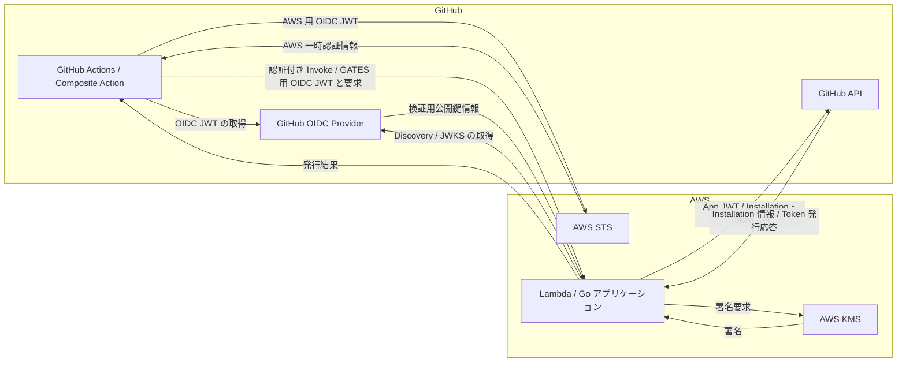
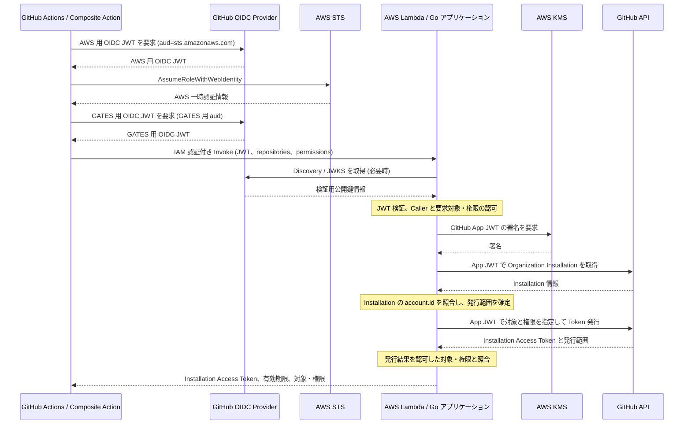

# System Architecture

## 1. Overview

GATES（GitHub App Token Exchange System）は、GitHub Actions から指定したリポジトリを読み取るために、短命な GitHub App Installation Access Token を発行するシステムです。利用者は Composite Action を通じてアクセス先リポジトリと `contents:read` 権限を指定します。Lambda は要求を処理し、対象を限定したトークンを GitHub Actions に返します。

システムは GitHub.com の単一 Organization を対象とし、AWS Lambda 上の Go アプリケーション、AWS STS、AWS KMS、および GitHub API によって構成します。GitHub App Private Key を Lambda や Actions Runner に渡さず、署名操作を KMS に委譲します。

## 2. System Context

Composite Action は AWS 一時認証情報を使用し、AWS Lambda Invoke API から Lambda を直接呼び出します。

## 3. Components

| コンポーネント | 主な役割 | 主な入出力 |
|---|---|---|
| GitHub Actions / Composite Action | 利用者の要求を受け付け、OIDC JWT の取得、AWS 認証、Lambda Invoke、発行結果の受け取りを行う | 対象リポジトリ・権限・接続情報 → GitHub OIDC JWT、AWS 一時認証情報、Installation Access Token |
| GitHub OIDC Provider | GitHub Actions の実行文脈を表す OIDC JWT を発行し、検証用の公開鍵情報を提供する | Audience → OIDC JWT、Discovery / JWKS |
| AWS STS | AWS 向け GitHub OIDC JWT を受け、Lambda 呼び出しに使う AWS 一時認証情報を発行する | OIDC JWT → AWS 一時認証情報 |
| AWS Lambda / Go アプリケーション | GATES 用 OIDC JWT と要求を受け、Caller の識別、対象と権限の確認、GitHub App Token の発行を行う | Invoke Payload → 発行結果またはエラー |
| AWS KMS | インポート済み GitHub App Private Key による署名を実行する | 署名対象のダイジェスト → 署名 |
| GitHub API | GitHub App の Organization Installation を返し、指定した対象・権限で Installation Access Token を発行する | GitHub App JWT、対象・権限 → Installation 情報、Installation Access Token |

Lambda 内の認証・認可・署名処理は [Lambda Design](lambda.md)、Composite Action の設計は [GitHub Actions Design](github-actions.md) に記述します。IAM、Lambda、KMS の AWS リソース設定は [AWS Infrastructure Design](aws-infrastructure.md) に記述します。

## 4. Information and Credentials

| 情報 | 生成元 | 主な利用先・目的 |
|---|---|---|
| 対象リポジトリと要求権限 | ワークフロー利用者 | Composite Action から Lambda へ渡す発行要求 |
| 接続情報（IAM Role ARN、Lambda 関数名、AWS リージョン、GATES 用 Audience） | GATES 運用者が GitHub の Organization 単位の Secrets / Variables に用意 | Composite Action が AWS STS、Lambda Invoke、GATES 用 OIDC JWT の取得に使う |
| AWS 用 GitHub OIDC JWT | GitHub OIDC Provider | AWS STS での一時認証情報の取得。Audience は `sts.amazonaws.com` |
| AWS 一時認証情報 | AWS STS | Composite Action から Lambda Invoke を認証付きで実行 |
| GATES 用 GitHub OIDC JWT | GitHub OIDC Provider | Lambda 内で Caller と実行文脈を確認。GATES 用 Audience を使用 |
| GitHub App JWT | Lambda が作成し、KMS が署名 | GitHub API の Installation 取得と Installation Access Token 発行 |
| Installation 情報 | GitHub API | 発行対象となる GitHub App のインストール先の確認 |
| Installation Access Token | GitHub API | 指定したリポジトリへの読み取りアクセス。Lambda から Composite Action に返却 |

AWS 用と GATES 用の OIDC JWT は、同じ GitHub Actions ジョブから別々の Audience を指定して取得します。GitHub App JWT はこれらとは異なり、Lambda が GitHub App として GitHub API を呼び出すために生成します。各資格情報の信頼条件と保護方針は [Security Design](security.md) に記述します。

## 5. End-to-End Data Flow

AWS 用 OIDC JWT から取得した AWS 一時認証情報で Lambda を呼び出し、GATES 用 OIDC JWT で呼び出し元を識別します。Lambda は KMS 署名で GitHub App JWT を作成し、Installation を確認した後、対象を限定した Installation Access Token を GitHub API から取得します。

Composite Action は応答を処理し、発行されたトークン、有効期限、対象、実効権限を同一ジョブ内の後続ステップへ渡します。

Lambda の応答形式は [Lambda Design](lambda.md)、Composite Action の応答処理は [GitHub Actions Design](github-actions.md)、拒否条件と認可の不変条件は [Security Design](security.md) に記述します。

## 6. Related Designs

| 文書 | 主題 |
|---|---|
| [Requirements](../spec/requirements.md) | 目的、対象範囲、要求、受け入れ条件 |
| [Security Design](security.md) | 信頼境界、認証・認可、資格情報の保護、失敗時の扱い |
| [AWS Infrastructure Design](aws-infrastructure.md) | IAM、Lambda、KMS、Terraform の AWS リソース構成 |
| [Lambda Design](lambda.md) | Lambda Invoke の入出力契約、Go のコンポーネント、ドメインモデル、技術選定 |
| [GitHub Actions Design](github-actions.md) | Composite Action の入出力、処理手順、利用例 |

## 7. Sources

- [GitHub — OpenID Connect reference](https://docs.github.com/en/actions/reference/security/oidc)
- [GitHub — Generating a JSON Web Token (JWT) for a GitHub App](https://docs.github.com/en/apps/creating-github-apps/authenticating-with-a-github-app/generating-a-json-web-token-jwt-for-a-github-app)
- [GitHub — Generating an installation access token](https://docs.github.com/en/apps/creating-github-apps/authenticating-with-a-github-app/generating-an-installation-access-token-for-a-github-app)
- [AWS — AssumeRoleWithWebIdentity](https://docs.aws.amazon.com/STS/latest/APIReference/API_AssumeRoleWithWebIdentity.html)
- [AWS — Lambda Invoke API](https://docs.aws.amazon.com/lambda/latest/api/API_Invoke.html)
- [AWS — KMS Sign API](https://docs.aws.amazon.com/kms/latest/APIReference/API_Sign.html)
