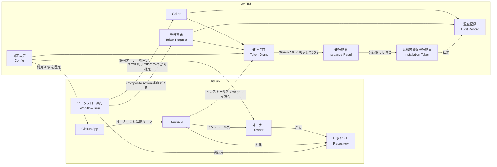
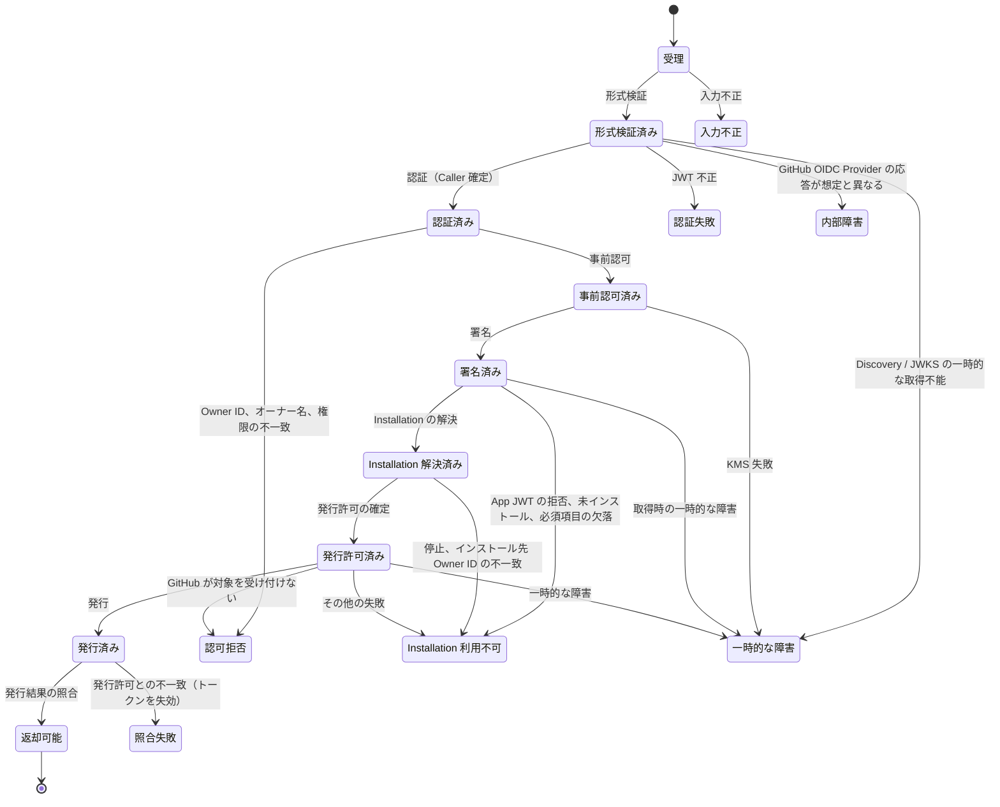
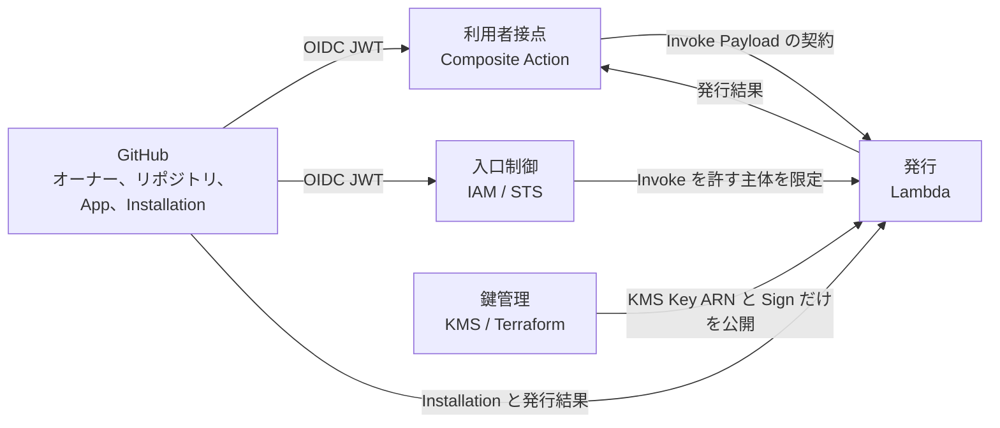

# Domain Model

GATES が扱う問題領域のドメインモデルです。
GATES は、許可された単一のオーナー配下の GitHub Actions ワークフローに、明示されたリポジトリへの `contents:read` に限定した短命な GitHub App Installation Access Token を発行します。

## 1. Purpose and Scope

本ドキュメントの目的は、Lambda 上の Go アプリケーション、Composite Action、Terraform の設計・実装・レビューが、概念の意味と判定のルールを一つのモデルから参照できるようにすることです。
中心に置くのは、Lambda が担う発行の判定です。
Composite Action、AWS IAM、KMS の鍵管理は、発行の判定と語の意味が異なる範囲として境界を示すにとどめます。

モデルが答える問いは次のとおりです。

- 発行要求を誰が出し、何を要求し、何が返るか
- オーナー、リポジトリ、Installation を何で同定するか
- 発行を許可する条件は何か。拒否はどの段階で、どの種別として起きるか
- どの単位の中で、何が常に成り立たなければならないか
- 境界をまたぐと、同じ語の意味がどう変わるか

概念には英語名を併記します。
英語名は概念の名前であり、複数の単語は空白で区切ります（Token Request など）。
実装では空白を除いた形（TokenRequest など）を型名・関数名にし、実装と本ドキュメントの整合はこの対応で確かめます。
概念と実装の名前の対応表は [Lambda Design](lambda.md#5-domain-model) に置きます。

本ドキュメントは、GATES に必要な値を概念として定義し、GitHub や AWS がその値をどのフィールドや Claim で提供するかは書きません。
提供のされ方は手段であり、概念の意味を変えないためです。
概念と GitHub の Claim・フィールドの対応は [Lambda Design](lambda.md#7-external-integrations) に置きます。
GitHub が定めた値そのものを書くのは、ルールがその値に依存する許可権限と付随権限に限ります。
GitHub が定める仕様の内容、出典、未確認事項は [GitHub Constraints](../spec/github-constraints.md) を正本とし、本ドキュメントはそれが GATES のルールに及ぼす影響だけを書きます。
JWT / JWS / JWK / OpenID Connect の標準仕様の規定の整理は [JWT Constraints](../spec/jwt-constraints.md) に置きます。

本ドキュメントの記述は、根拠の種類を次の表記で区別します。

- **事実**：情報源に根拠がある。出典を添える
- **推論**：根拠から導いた判断
- **候補**：本ドキュメントが補った語や区分で、情報源にはない
- **未確認**：情報源で決まっていない、または情報源どうしで食い違う

## 2. Problem Overview

GitHub Actions の `GITHUB_TOKEN` は、ワークフローが動くリポジトリの外を読めません。
別のリポジトリを読むには、GitHub App の Installation Access Token が要ります。
しかし、GitHub App の Private Key をワークフローに渡すと、鍵を持つ者が App の権限全体を使えてしまいます。

GATES は、この二つの要求を同時に満たす仲介者です。
鍵は AWS KMS に置いて署名だけを行わせ、ワークフローには、本人確認を経た上で、明示された対象と権限だけに絞ったトークンを渡します。
問題領域の関係者は 3 者です（事実：Requirements §3）。

- **ワークフロー利用者**：対象リポジトリと権限を指定してトークンを受け取る
- **GitHub App / オーナーの管理者**：Installation の対象リポジトリを管理し、GATES で読める範囲の上限を決める
- **GATES 運用者**：許可オーナー、GitHub App、署名鍵を固定し、認証・認可・発行・監査を担う

GATES が所有する概念は、発行要求、Caller、発行許可、発行結果、監査記録です。
オーナー、リポジトリ、GitHub App、Installation は GitHub が所有する概念で、GATES はそれらを参照し、照合します。

## 3. Concepts

### 3.1 GitHub Entities Referenced by GATES

| 概念 | 英語名 | 同一性 | 主な性質 | 根拠 |
|---|---|---|---|---|
| **オーナー** | Owner | 不変 Owner ID | 名前（変更され得る）、種別（Organization またはユーザーアカウント）。リポジトリを所有する | 事実：Requirements §1、GitHub Constraints §2.1 |
| **リポジトリ** | Repository | 不変 Repository ID | 完全名 `owner/repo`（名前変更・移管で変わり得る）、所有オーナー | 事実：GitHub Constraints §2.1、§3.2、Lambda Design §2.2 |
| **GitHub App** | GitHub App | Client ID | 権限の上限（GitHub 側で設定）、Private Key（複数持てる。上限は GitHub Constraints §4.1） | 事実：Requirements §2.1、Lambda Design §7.2、GitHub Constraints §4.1 |
| **Installation** | Installation | Installation ID | インストール先 Owner ID、対象の選び方、付与された権限、停止状態 | 事実：GitHub Constraints §5 |
| **ワークフロー実行** | Workflow Run | ワークフロー実行 ID と試行番号 | 実行元のリポジトリとオーナー、起動のイベントと ref など。GATES 用 OIDC JWT の主体は実行元とワークフロー起動属性の一部を表し、実行そのものは識別しない | 事実：GitHub Constraints §3.1 |
| **Issuer の公開鍵** | JWKS | 鍵の識別子 | Issuer が GATES 用 OIDC JWT の署名の検証のために公開する鍵の集合。ローテーションで入れ替わる。GATES は Discovery から取得先を知り、取得して実行環境の中で保持する | 事実：Lambda Design §7.1、RFC 7517。語は候補 |
| **Discovery** | Discovery | Issuer | Issuer が公開する設定。GATES はそこから Issuer の値と公開鍵の取得先だけを読む。成功した内容は実行環境の中で再利用し、失敗した内容は保持しない | 事実：Lambda Design §7.1、OpenID Connect Discovery |

オーナーとリポジトリは、どちらも不変 ID と名前の二つの表現を持ちます。
名前は変わり得るため、認可の同一性は不変 ID で判断し、名前は要求の照合と GitHub API の呼び出しに使う表現と位置づけます（事実：Requirements FR-006、FR-002）。
名前が変わると、ID で同じものを指していても名前の照合は失敗します。
この失敗は、GATES では Fail Closed として受け入れます（事実：AWS Infrastructure Design §3.1）。

Installation には、GATES が参照する次の属性があります。

- **インストール先 Owner ID**（Installation Owner ID）：Installation がインストールされているオーナーの不変 Owner ID
- **対象の選び方**（Repository Selection）：対象が選択したリポジトリに限られるか、全リポジトリかの二値。発行結果も同じ属性を持つ
- **停止状態**（Suspended）：オーナーの管理者が Installation を停止しているかどうか

Installation は、GitHub App とオーナーの組に対して高々一つ存在します（推論：GitHub Constraints §5 の、オーナーを指定して単一の Installation を返すエンドポイントが Organization とユーザーアカウントのそれぞれにあることから。GitHub が一意性を明示的に保証したものとは扱わない）。
この性質があるため、GATES は Installation ID を設定に持たず、固定した GitHub App と許可オーナーから実行時に導出します（事実：Requirements FR-024）。

ワークフロー実行は、**ワークフロー実行 ID**（Run ID）と **試行番号**（Run Attempt）の組で特定します。
再実行は同じワークフロー実行 ID のもとで試行番号を増やすため、両方を持って初めて一回の実行を指せます（事実：GitHub Constraints §3.1）。

### 3.2 Fixed Configuration

**固定設定**（Config）は、GATES 運用者がデプロイ時に決め、実行時の入力からは変更できない値の集まりです（事実：Requirements FR-024、FR-009）。
そのうち許可オーナーに関する 3 つの値を **許可オーナー**（Allowed Owner）と呼びます。

| 値 | 英語名 | 使われ方 | 根拠 |
|---|---|---|---|
| 許可オーナーの不変 Owner ID | Allowed Owner ID | Caller の認可、インストール先 Owner ID の照合、実効対象の所有オーナーの Owner ID の照合 | 事実：Requirements FR-006、Security Design §3.1 |
| 許可オーナー名 | Allowed Owner Name | 要求された完全名のオーナー部分の照合、Installation の取得先の指定 | 事実：Lambda Design §6 手順 3、§7.3 |
| 許可オーナーの種別 | Allowed Owner Type | Installation の取得方法の選択（Organization かユーザーアカウントか） | 事実：Lambda Design §7.3 |
| GitHub App の Client ID | Client ID | GitHub App JWT の発行者 | 事実：Lambda Design §7.2 |
| 署名鍵の KMS Key ARN | KMS Key ARN | GitHub App JWT の署名 | 事実：Lambda Design §7.2 |
| GATES 用 Audience | Audience | GATES 用 OIDC JWT の Audience の照合 | 事実：Lambda Design §7.1 |
| Issuer | Issuer | GATES 用 OIDC JWT の Issuer の照合と Discovery / JWKS の取得先。GitHub Actions の OIDC Provider に固定。JWKS は Issuer の Discovery から得るため、独立した値を持たない | 事実：Lambda Design §7.1 |
| GitHub API Host | API Host | Installation の取得、トークンの発行と失効の呼び出し先。GitHub.com の API に固定 | 事実：Requirements FR-009、§2.2、Lambda Design §7.3 |

Authorization が読むのは、固定設定のうち許可オーナー（ID と名前）だけです。
Client ID、KMS Key ARN、Audience、Issuer、API Host は、認証、署名、Installation の解決、発行を担うコンポーネントが読みます。

### 3.3 Request and Decision

| 概念 | 英語名 | 種別 | 内容 | 根拠 |
|---|---|---|---|---|
| **発行要求** | Token Request | 値 | 対象（完全名の集合）と Permissions。利用者が明示する。対象は明示した完全名だけで、全リポジトリを対象にする手段を持たない | 事実：Requirements FR-012、Lambda Design §2.1 |
| **完全名** | Full Name | 値 | `owner/repo` 形式のリポジトリ名。オーナー名とリポジトリ名に分割でき、比較は ASCII の範囲で大文字小文字を区別しない | 事実：Lambda Design §2.2 |
| **オーナー名** | Owner Name | 値 | 完全名のオーナー部分と許可オーナー名の二か所に現れるオーナーの名前。どちらも同じ文字種の規則に従う。比較は ASCII の範囲で大文字小文字を区別しない | 事実：Lambda Design §2.2 |
| **Permission Entry** | Permission Entry | 値 | 権限名と水準の組（`contents:read` など） | 事実：Requirements FR-008 |
| **Permissions** | Permissions | 値 | Permission Entry の集合。権限名ごとに水準を一つ持つ（GitHub の権限の表現が権限名をキーに持つため）。要求では `{contents:read}` だけが許可される。GitHub REST API のスキーマ「App Permissions」に対応する | 事実：Requirements FR-008、Security Design §3.1、GitHub Constraints §6.1、REST API endpoints for GitHub Apps のスキーマ「App Permissions」 |
| **許可権限** | Allowed Permissions | 値 | GATES が発行を許可する Permissions。`{contents:read}` に固定 | 事実：Requirements §2.1 |
| **付随権限** | Implied Permissions | 値 | 要求にかかわらず GitHub が付与する Permission Entry。`metadata:read` だけを許容する | 事実：Requirements FR-018 が除外の枠を定める。`metadata:read` だけを許容するのは GATES の判断。未確認：`metadata:read` が実際に付与されるか（GitHub Constraints §6.2）。語は候補 |
| **Caller** | Caller | 値 | 検証済み GATES 用 OIDC JWT から確定した呼び出し元。不変 Owner ID と Repository ID で識別し、ワークフロー実行 ID と試行番号、およびワークフロー起動属性を監査のためだけに添える | 事実：Requirements FR-002 |
| **ワークフロー起動属性** | Workflow Trigger Attributes | 値 | ワークフロー実行の起動と、GATES 用 OIDC JWT を取得したジョブを示す属性の組。誰が起動したか（行為者の名前と ID）、どのイベントか、どの ref とコミットか、どのワークフロー定義か、どの environment か。どれも欠落し得る | 事実：GitHub Constraints §3.1、Lambda Design §7.1 |
| **発行許可** | Token Grant | 値 | Installation ID、対象の完全名の集合、許可権限。認可が成立した結果であり、GitHub API への発行要求の内容を定める | 事実：Lambda Design §5 の TokenGrant、Security Design §3.1 |

発行要求と Caller は、同じ Invoke Payload から取り出す別の概念です。
Payload に含まれる GATES 用 OIDC JWT は Caller を確定するための資格情報であり、発行要求の一部ではありません（事実：Lambda Design §5）。

Caller は、利用者の自己申告からは作れません（事実：Requirements FR-004）。
Caller の Owner ID は認可に使い、Repository ID、ワークフロー実行 ID、試行番号、ワークフロー起動属性は監査の識別だけに使います（事実：Requirements FR-002、Security Design §3.1）。
ワークフロー実行 ID と試行番号を添えるのは、監査記録から GitHub 上のワークフロー実行にたどり着けるようにするためで、Caller の同一性には含めません（事実：Security Design §5）。
ワークフロー起動属性を添えるのは、`pull_request_target` の悪用のように、どのイベントと ref でトークンを得たかが調査に要る場面で、GitHub 側の記録を参照せずに済ませるためです（事実：Security Design §5）。
ワークフロー起動属性はベストエフォートの属性であり、欠落していても Caller は確定します。
ワークフロー起動属性の値は監査記録に書き写すだけで、GATES は解釈も検証もせず、欠落した属性は欠落のまま持ちます（推論：認可に使わないため）。
値が空文字列の属性は、欠落と同じに扱います（推論：空の値は調査の手がかりにならず、区別する要求がないため）。
値が文字列でない属性も、欠落と同じに扱います（推論：拒否すると、認可に使わない属性の形が変わっただけで発行が止まるため。代わりに、GitHub が属性の型を変えると監査記録から値が消え、変更に気付きにくくなることを受け入れる）。

発行許可は、Caller、発行要求、許可オーナー、取得した Installation の 4 つがそろい、[5.2 Rules](#52-rules) の認可条件と Installation の有効性をすべて満たしたときにだけ作られます。
発行許可があって初めて GitHub API へ発行を要求できる、という順序がこの概念の役割です。

### 3.4 Issuance Result

| 概念 | 英語名 | 種別 | 内容 | 根拠 |
|---|---|---|---|---|
| **発行結果** | Issuance Result | 値 | GitHub API が返した Installation Access Token、有効期限、実効対象の集合、実効権限、対象の選び方 | 事実：GitHub Constraints §6.2 |
| **実効権限** | Effective Permissions | 値 | 発行結果に含まれる Permissions。許可権限と付随権限の範囲内であることを照合する | 事実：Requirements FR-016、FR-018 |
| **実効対象** | Effective Repository | 値 | 発行結果に含まれる各リポジトリ。Repository ID、所有オーナーの Owner ID、完全名を持つ | 事実：Lambda Design §5 |
| **返却可能な発行結果** | Installation Token | 値 | 発行許可との照合を通った発行結果。利用者に返せるのはこれだけ。名前は GitHub REST API の発行応答のスキーマ名で、トークン、有効期限、実効権限、対象の選び方、実効対象の集合を持つ | 事実：Lambda Design §5、REST API endpoints for GitHub Apps のスキーマ「Installation Token」 |

Installation Access Token はトークン文字列そのもの、Installation Token はそれに有効期限・対象・実効権限を添えた応答で、どちらも GitHub の名前です。
照合の条件は [5.3 Invariants](#53-invariants) に置きます。

### 3.5 Credentials

GATES の処理には 5 種類の資格情報が現れ、どれも「トークン」と呼ばれ得ます（事実：System Architecture §4）。
語の衝突を避けるため、本ドキュメントでは次の名前で区別します。

| 資格情報 | 英語名 | 発行元 | 用途 | 発行の判定に現れるか |
|---|---|---|---|---|
| **AWS 用 OIDC JWT** | Web Identity Token | GitHub OIDC Provider（Audience は AWS STS） | IAM Role の引き受け | 現れない。入口制御だけが扱う |
| **AWS 一時認証情報** | AWS Credentials | AWS STS | Lambda Invoke の署名 | 現れない |
| **GATES 用 OIDC JWT** | ID Token | GitHub OIDC Provider（Audience は GATES 用 Audience） | Caller の確定 | 現れる。認証の入力。名前は OIDC の応答名 |
| **GitHub App JWT** | App JWT | Lambda が組み立て、KMS が署名 | GitHub API の呼び出し | 現れる。内部でだけ使い、外に出さない |
| **Installation Access Token** | Installation Access Token | GitHub API | 対象リポジトリの読み取り | 現れる。発行結果の中心。返却可能な発行結果（Installation Token）はこれに有効期限・対象・実効権限を添えたもの |

GATES 用 OIDC JWT は、Payload から取り出した時点では未検証であり、認証を通って初めて Caller の根拠になります。
実装では、未検証の値と検証済みの値を区別します（[Lambda Design](lambda.md#5-domain-model)）。

どの資格情報も、ログとエラー本文に記録しません（事実：Requirements QR-004）。
資格情報のうち利用者に返すのは Installation Access Token だけです（事実：Requirements FR-016）。

### 3.6 Audit Record

**監査記録**（Audit Record）は、一回の発行処理の結果を、資格情報を含めずに残したものです（事実：Requirements FR-021）。

| 項目 | 記録する条件 | 根拠 |
|---|---|---|
| 相関 ID（Request ID） | 常に | 事実：Requirements FR-021 |
| 時刻、結果（成功または失敗の種別） | 常に | 事実：Security Design §5 |
| 拒否の理由 | 拒否で終わった場合。満たさなかった条件を示し、資格情報と Caller、要求、許可オーナー、Installation の値を含めない | 事実：Security Design §5、Lambda Design §6 |
| Caller の Owner ID と Repository ID、ワークフロー実行 ID と試行番号 | 認証に成功した後だけ。認証前の失敗では未検証の値を Caller として記録しない | 事実：Security Design §5 |
| ワークフロー起動属性 | 認証に成功した後で、含まれていた属性だけ | 事実：Security Design §5 |
| 要求対象、要求権限 | 形式検証を通った後 | 事実：Lambda Design §1。時点は推論 |
| 取得した Installation の Installation ID とインストール先 Owner ID | Installation の解決に成功した後 | 推論：インストール先 Owner ID の不一致は運用者かオーナーの管理者が直す失敗であり、どのアカウントの Installation が返ったかを、呼び出しを再現せずに確かめるため。監査記録は応答に出ないため、エラー文言で値を伏せる理由は及ばない |
| 失効の成否 | 照合に失敗し、発行済みのトークンを失効させようとした場合 | 事実：Lambda Design §3.1 |

監査記録の単位は発行処理 1 回です。
相関 ID は成功応答と失敗応答の両方に含め、ワークフローのログから監査記録へ、監査記録からワークフロー実行 ID でワークフロー実行へ、双方向にたどれるようにします（事実：Requirements FR-016、FR-021）。

### 3.7 Relationships

## 4. Behavior

### 4.1 Operations

| 操作 | 英語名 | 主体 | 入力 | 結果 | 根拠 |
|---|---|---|---|---|---|
| トークンを要求する | （Composite Action の責務） | ワークフロー利用者 | 対象、権限、接続情報 | Composite Action が発行処理を起動する | 事実：Requirements §3、FR-019 |
| 形式検証 | Validate | Lambda Handler | Invoke Payload | 発行要求と未検証の GATES 用 OIDC JWT を取り出す、または入力不正 | 事実：Lambda Design §2.2 |
| 認証 | Authenticate | OIDC Verifier | 未検証の GATES 用 OIDC JWT、固定設定、Issuer の公開鍵 | Caller を確定する、または拒否 | 事実：Requirements FR-002 |
| 事前認可 | Authorize | Authorization | Caller、発行要求、許可オーナー | 外部呼び出しに進める、または認可拒否 | 事実：Lambda Design §6 手順 3 |
| 署名 | Sign | KMS Signer | GitHub App JWT の署名入力、KMS Key ARN | GitHub App JWT | 事実：Requirements FR-013 |
| Installation の解決 | Resolve Installation | Token Issuer | GitHub App JWT、許可オーナーの名前と種別 | 取得した Installation、または拒否（App JWT の拒否、未インストール、必須項目の欠落、一時的な障害） | 事実：Lambda Design §3.2、§7.3 |
| 発行許可の確定 | Grant | Authorization | Caller、発行要求、許可オーナー、取得した Installation | 発行許可、または拒否（インストール先 Owner ID の不一致、停止、認可条件の不成立） | 事実：Lambda Design §6、Security Design §3.1 |
| 発行 | Issue | Token Issuer | 発行許可、GitHub App JWT | 発行結果、または失敗 | 事実：Requirements FR-014、FR-015 |
| 発行結果の照合 | Verify | Token Issuer | 発行結果、発行許可、許可オーナー | 返却可能な発行結果、または拒否 | 事実：Requirements FR-018 |
| 失効 | Revoke | Token Issuer | 照合を通らなかった発行結果のトークン | 失効の成否。成否にかかわらず拒否のまま終わる | 事実：Requirements FR-007、FR-018、Lambda Design §3.1 |
| 監査記録の出力 | Audit | Lambda Handler | 発行処理の結果 | 監査記録 | 事実：Requirements FR-021 |
| 署名鍵を更新する | （運用手順） | GATES 運用者 | 新しい Private Key | 新しい KMS Key と、Lambda が参照する Key ARN の切り替え | 事実：Requirements FR-017、AWS Infrastructure Design §4.2 |
| Installation の対象を変える | （GitHub 側の操作） | GitHub App / オーナーの管理者 | 対象リポジトリの選択 | 読み取り可能範囲の上限が変わる | 事実：Requirements §2.3、Security Design §3.2 |

操作の失敗は、[4.2 Failure Kinds](#42-failure-kinds) の種別に次のように対応します（事実：Lambda Design §3.2、§6）。

| 操作 | 失敗の種別 |
|---|---|
| Validate | 入力不正 |
| Authenticate | 認証失敗。Discovery / JWKS を一時的に取得できなければ一時的な障害、GitHub OIDC Provider の応答が想定と異なれば内部障害 |
| Authorize | 認可拒否 |
| Sign | 一時的な障害 |
| Resolve Installation | Installation 利用不可（App JWT の拒否、未インストール、必須項目の欠落）。取得時の一時的な障害は一時的な障害 |
| Grant | Installation 利用不可（インストール先 Owner ID の不一致、停止）。認可条件を満たさなければ認可拒否（Authorize を通った要求では起きないため、[4.3](#43-lifecycle-of-an-issuance) の図には描かない） |
| Issue | 認可拒否（GitHub が対象を受け付けない）。一時的な障害は一時的な障害、その他の失敗は Installation 利用不可 |
| Verify | 照合失敗 |
| Revoke | なし。失効に失敗しても照合失敗のまま終わる |

どの段階にも属さない想定外の障害も内部障害で終わります。

最後の 2 つの操作は GATES の外で行われますが、発行できる範囲を変えるため、モデルに含めます。
認可の境界は GATES の設定だけでは決まらず、Installation の対象に依存します。

### 4.2 Failure Kinds

発行処理がトークンを返さずに終わる失敗を、**失敗の種別**（Failure Kind）で区別します。
種別を分けるのは、区別がルール、監査記録の意味、失効の義務のいずれかを変える場合に限ります（推論：本ドキュメントが答える問いが判定のルールであるため）。
どの外部依存が失敗したかのように、直す主体も次に起きることも変えない区別は、応答契約のエラーコードに任せます。

| 種別 | 英語名 | 起きる条件 | 直す主体と次に起きること | 根拠 |
|---|---|---|---|---|
| **入力不正** | Invalid Request | Payload を GATES が読み取れない | 利用者が要求の形を直す。要求を読み取れていないため、監査記録に要求対象と要求権限を残さない | 事実：Lambda Design §2.2 |
| **認証失敗** | Authentication Failure | GATES 用 OIDC JWT から Caller を確定できない | 利用者がワークフローの設定を直す。OIDC JWT の主体のカスタマイズが原因なら、リポジトリかオーナーの管理者が直す（[4.4](#44-events-outside-gates-that-change-the-outcome)）。監査記録に未検証の値を Caller として残さない | 事実：Requirements FR-002、Security Design §5 |
| **認可拒否** | Authorization Denied | Caller と要求は読み取れたが、認可条件を満たさない。GitHub が要求した対象を受け付けない場合も含む | 利用者が要求の対象か権限を直す。監査記録には、利用者の要求が許可外だったことが残る | 事実：Security Design §3.1、Lambda Design §3.2 |
| **Installation 利用不可** | Installation Unavailable | 固定した GitHub App と許可オーナーから、発行に使える Installation を得られない。取得の失敗、必須項目の欠落、停止、インストール先 Owner ID の不一致、発行の間に Installation か App の状態が変わった場合 | GATES 運用者かオーナーの管理者が、GitHub 側か固定設定を直す。再試行では解消しない | 事実：Lambda Design §3.2 |
| **照合失敗** | Verification Failure | GitHub が発行したトークンの発行結果が、発行許可と一致しない | 運用者が設定か GitHub 側の仕様変更を調べる。発行済みのトークンの失効を試みる | 事実：Requirements FR-018、Lambda Design §3.1 |
| **一時的な障害** | Transient Failure | Discovery / JWKS の取得、KMS の署名、GitHub API の呼び出しのいずれかが一時的に失敗した。通信の失敗、タイムアウト、サーバー側のエラー、レート制限を指す | 呼び出し元の再試行で解消し得る | 事実：Lambda Design §3.2 |
| **内部障害** | Internal Failure | 想定外の失敗。どの段階にも属さない失敗と、GitHub OIDC Provider の応答が想定と異なる失敗（Discovery が示す Issuer が固定した Issuer と異なる、公開鍵の取得先が Issuer と異なるホストかポートを指す、応答を解釈できない、使える公開鍵が一つもない、応答が上限より大きい、再試行では解消しない失敗の応答が返る）を含む | 運用者が調べる。再試行では解消しない | 事実：Lambda Design §3.2 |

Installation 利用不可を認可拒否と分けるのは、利用者の要求に起因しない失敗だからです。
認可拒否に含めると、監査記録では利用者の要求が許可外だったように見えます。
一時的な障害と分けるのは、再試行では解消せず、運用者の対応を要するためです。

Installation 利用不可と照合失敗は、どちらも設定ミスや GitHub 側の仕様変更を示し得る監視対象です。
両者の境界は、GitHub がトークンを発行したかどうかにあります。
Installation の応答が想定と異なれば、トークンが存在しないため Installation 利用不可に、発行結果が想定と異なれば、失効させるべきトークンが存在するため照合失敗に分類します。
照合失敗を一時的な障害と分けるのも、発行結果の不整合が再試行で解消する障害ではなく、監視対象だからです。

一時的な障害は、失敗した依存先が Discovery / JWKS、KMS、GitHub API のどれであっても一つの種別にまとめます。
どれが失敗しても、直す主体は変わらず、次に起きることも再試行で変わらないためです。
依存先の区別は調査のための情報であり、応答契約のエラーコードで表します。

GitHub OIDC Provider の応答が想定と異なる失敗を一時的な障害と分けるのは、再試行では解消せず、一時的な障害にすると利用者に無駄な再実行を促すためです。
新しい種別を設けず内部障害に含めるのは、内部障害と比べて、直す主体（運用者）も、監査記録に残るもの（失敗した段階までに確定した値）も、失効の義務（発行前のため、なし）も変わらないためです。
原因は監査記録の拒否の理由で区別します。

失敗の種別を応答でどう表すかは、[Lambda Design](lambda.md#32-failure) のエラーコードが定めます。
種別とエラーコードは一時的な障害を除いて一対一に対応し、一時的な障害だけは失敗した依存先ごとにエラーコードを分けます。

### 4.3 Lifecycle of an Issuance

一回の発行処理は、次の状態を順にたどります。
各段階で失敗すると、その段階に対応する失敗の種別で終わり、以降の段階には進みません（事実：Requirements QR-003、Lambda Design §6）。

内部障害への遷移は認証の段階のものだけを描き、どの段階でも起き得る想定外の失敗は描きません。

照合失敗だけは、GitHub がトークンを発行した後の拒否です。
そのため、この状態に至るときはトークンの失効を試みます（事実：Lambda Design §3.1）。

認可が事前認可と発行許可の確定の二段に分かれるのは、Installation を取得しないとインストール先 Owner ID を照合できず、Installation の取得には署名済みの GitHub App JWT が要るためです（推論：Lambda Design §6 手順 3 から 5 の順序から）。
事前認可は、KMS と GitHub API を呼ぶ前に、認可の見込みがない要求を落とすための段階です（事実：Lambda Design §6）。

### 4.4 Events Outside GATES That Change the Outcome

発行処理の外で起きる次の出来事は、GATES の設定を変えなくても発行の結果を変えます。

| 出来事 | 影響 | 根拠 |
|---|---|---|
| オーナーの名前変更 | IAM Role の引き受けとオーナー名の照合が失敗し、設定を更新するまで発行が止まる | 事実：AWS Infrastructure Design §3.1 |
| リポジトリの名前変更・移管 | 旧名で要求すると、GitHub が受け付けないか実効対象の完全名が一致しないかのいずれかで返却しない。新しい名前で要求すれば影響しない | 推論：Lambda Design §3.1 の照合条件から。旧名への GitHub の応答は未確認 |
| Installation の対象の追加・削除 | 読み取り可能範囲の上限が変わる。Organization では、制限していなければリポジトリ管理者も追加できる | 事実：Security Design §3.2 |
| GitHub App の再インストール | Installation ID が変わるが、設定変更なしに新しい Installation を導出する | 事実：Security Design §3.2 |
| Installation の停止 | 取得した Installation が停止状態のため、発行許可を作らず Installation 利用不可で閉じる。GitHub の発行 API を呼ばない | 事実：Security Design §3.1、Lambda Design §6 手順 5 |
| GitHub 側での旧 Private Key の失効 | 新しい KMS Key に切り替え済みなら影響しない | 事実：Requirements AC-14 |
| OIDC JWT の主体のカスタマイズ | 実 JWT で確かめた形式から外れると、入口制御の拒否か認証失敗で発行が止まる | 推論：Lambda Design §7.1、AWS Infrastructure Design §3.1 の主体の条件から。実環境では未確認 |
| Issuer の公開鍵のローテーション | 保持している公開鍵で検証できない JWT が来ると取得し直すため、設定変更なしに新しい鍵で検証する | 事実：Lambda Design §7.1 |
| 公開鍵の取得先の変更 | 保持した Discovery は取り直さないため、古い取得先が使えなくなると、実行環境が入れ替わるまで一時的な障害か内部障害で止まる | 推論：Lambda Design §7.1 の Discovery の再利用から |

## 5. Rules and Invariants

### 5.1 Identity Rules

| ルール | 内容 | 根拠 |
|---|---|---|
| ID による同定 | オーナーの同一性は不変 Owner ID で判断し、名前の一致では代用しない | 事実：Requirements FR-006 |
| 名前の照合は補助 | 完全名のオーナー部分と許可オーナー名の照合は、要求の整合性の確認であり、認可の根拠ではない。認可の根拠は Caller の Owner ID にあり、発行に使う Installation はインストール先 Owner ID で確かめる | 推論：Security Design §3.1 の条件 1 と Installation の確認が ID、条件 2 だけが名前であることから |
| ID の整合 | Caller の Owner ID と Repository ID は、GATES 用 OIDC JWT の中で主体を表す属性と個別の属性の両方に現れる。両方がそろい、互いに一致するときに限り Caller を確定する | 事実：GitHub Constraints §3.2、Lambda Design §7.1 |
| 名前の比較規則 | 完全名の比較と重複判定は、ASCII の範囲で大文字小文字を区別しない。要求の重複判定、オーナー名の照合、実効対象の完全名の照合で共通 | 事実：Lambda Design §2.2 |

### 5.2 Rules

| ルール | 適用対象 | 成立条件 | 例外 | 根拠 |
|---|---|---|---|---|
| 認証条件 | 認証 | GATES 用 OIDC JWT が、Issuer の公開する鍵で GATES が許可した署名方式により署名され、Issuer が固定設定の Issuer と一致し、Audience が GATES 用 Audience の一つだけであり、現在時刻が失効時刻を過ぎておらず、有効期間の開始と発行時刻が現在時刻に許容時計差（[Lambda Design](lambda.md#71-oidc-validation)）を足した時刻より後でなく、属性を一意に読み取れ、発行時刻、失効時刻、Caller の確定に要る属性がそろい、[5.1 Identity Rules](#51-identity-rules) の ID の整合を満たす。一つでも満たさなければ認証失敗 | 有効期間の開始は欠落を許す | 事実：Requirements FR-002、FR-003、Lambda Design §7.1、Security Design §2.2 |
| 認可条件 | 事前認可、発行許可の確定 | Caller の Owner ID が許可オーナーの Owner ID と一致し、要求の各完全名のオーナー名が許可オーナー名と一致し、Permissions が許可権限と等しい。満たさなければ認可拒否 | なし | 事実：Security Design §3.1 |
| Installation の有効性 | 発行許可の確定 | 取得した Installation のインストール先 Owner ID が許可オーナーの Owner ID と一致し、停止していない。満たさなければ Installation 利用不可 | なし | 事実：Security Design §3.1 |
| 全件成立 | 複数対象の発行要求 | すべての対象が条件を満たすときだけ発行する。一部だけの発行や対象の縮小をしない | なし | 事実：Requirements FR-011 |
| 明示の要求 | GitHub API への発行要求 | 対象と権限を必ず明示し、省略による全対象・全権限の継承を起こさない | なし | 事実：Requirements FR-015、GitHub Constraints §6.1 の省略時の継承 |
| 付随権限の許容 | 発行結果の照合 | 実効権限は許可権限に等しいこと | 付随権限 `metadata:read` が含まれる場合だけ許容する | 事実：Requirements FR-018、Lambda Design §3.1 |
| 有効期限 | 発行結果 | GitHub が定めた有効期限をそのまま返し、延長しない | なし | 事実：Requirements FR-014 |
| 対象の上限 | 発行要求 | 対象は 500 件以下 | なし | 事実：Lambda Design §2.1、GitHub Constraints §6.1 |
| 入力不正と認可拒否の区別 | 形式検証と認可 | 値を読み取れない形は入力不正、読み取れて許可条件に合わない値は認可拒否 | なし | 事実：Lambda Design §2.2 |
| 設定の固定 | 固定設定 | 実行時の入力から許可オーナー、GitHub App、Installation、KMS Key、Issuer、JWKS、Audience、API Host を指定できない | なし | 事実：Requirements FR-009、FR-024 |
| Fail Closed | 発行処理 | いずれかの段階が成立しなければトークンを返さない | なし | 事実：Requirements QR-003 |
| 資格情報の非記録 | 監査記録、エラー本文 | 5 種類の資格情報と Private Key を含めない | なし | 事実：Requirements QR-004 |

Installation に対象リポジトリが含まれることを、GATES は発行前に確認しません（事実：Security Design §2 の Authorization の行）。
含まれない対象は、GitHub API が発行要求を受け付けないか、発行結果の対象一覧が要求と一致しないかのどちらかで検出します（推論）。
GitHub がどちらの振る舞いをするかで、失敗の種別が認可拒否と照合失敗のどちらになるかは変わりますが、トークンを返さない点は変わりません。
後者では GitHub がトークンを発行済みのため、返さないことに加えて失効を試みます。

### 5.3 Invariants

不変条件は、その値を作る時点で条件を検査し、条件を満たさない値を作らないことで守ります。

| 単位 | 時点 | 常に成り立つこと | 根拠 |
|---|---|---|---|
| 発行要求 | 形式検証を通った時点 | 対象が 1 件以上 500 件以下で、各要素が完全名の形式を満たし、大文字小文字を区別しない重複がない。Permissions が下の行の条件を満たす | 事実：Lambda Design §2.2 |
| Permissions | 作られた時点 | Permission Entry を 1 つ以上持ち、権限名と水準がどれも Lambda Design の権限名と水準の文字種を満たす。許可権限と等しいかは含まず、事前認可が判定する | 事実：Lambda Design §2.2、Security Design §3.1 |
| 許可オーナー | 固定設定を読んだ時点 | Owner ID が正の整数で、オーナー名がオーナー名の文字種を満たし、種別が二つの値のどちらかである | 事実：Requirements FR-024、Lambda Design §2.2 の名前の文字種。推論：条件を満たさない値を作らない方針（本節冒頭） |
| 認証の固定設定 | 検証器を作った時点 | Issuer が `https` のホストと、あれば空でないポートだけからなり、解析しても文字列が変わらない URL で、Audience が空でない | 推論：空の Audience はすべての JWT を拒否し、空の Issuer は Issuer の値のない署名済み JWT を通す。`https` に限るのは、平文の通信を設定から有効にできる形にしないため。ポートを許すのは、`httptest` の Issuer で取得と失敗の分類を確かめるため |
| 保持した Discovery | 保持した時点 | Issuer が固定設定の Issuer と一致し、公開鍵の取得先が Issuer と同じ `https` のホストとポートを指す | 事実：OpenID Connect Discovery、Lambda Design §7.1。ホストとポートの限定は推論：固定した Issuer の外から鍵を読まないため |
| 保持した公開鍵 | 保持した時点 | 完全に受信して解釈できた応答の、鍵の識別子を持つ RSA の公開鍵だけからなり、1 つ以上ある。取得に失敗しても前回の鍵が残る | 推論：GATES が RS256 だけを許すため |
| Caller | 認証を通った時点 | [5.2 Rules](#52-rules) の認証条件を満たした GATES 用 OIDC JWT だけから作られ、Owner ID と Repository ID が [5.1 Identity Rules](#51-identity-rules) の ID の整合を満たす。Owner ID、Repository ID、ワークフロー実行 ID、試行番号はどれも正の整数である。いずれかが欠落していれば Caller は確定しない | 事実：Requirements FR-002、FR-004、Lambda Design §7.1。正の整数は推論：GitHub の ID と試行番号は 1 から始まる |
| Installation | 取得した応答から作った時点 | Installation ID とインストール先 Owner ID が正の整数である。インストール先 Owner ID が許可オーナーの Owner ID と一致することと停止していないことは含まず、発行許可の確定が [5.2 Rules](#52-rules) の Installation の有効性として判定する | 推論：GitHub の ID は 1 から始まる。一致しない、または停止している Installation も GitHub 上に実在する値であり、作れない値ではなく発行に使えない値であるため |
| 発行許可 | 確定した時点 | [5.2 Rules](#52-rules) の認可条件をすべて満たす。対象は発行要求の対象と同じ集合で、各完全名の表記と並びも発行要求のままである（GitHub API に渡すリポジトリ名と監査記録の要求対象を、利用者の要求と一致させるため）。Permissions は許可権限に等しい。Installation ID は、インストール先 Owner ID が許可オーナーの Owner ID と一致し、停止していない Installation のものである | 事実：Security Design §3.1 |
| 返却可能な発行結果 | 照合を通った時点 | トークンが空でなく、有効期限が将来である。実効対象の完全名の集合が発行許可の対象と一致し、件数が同じで、余分・欠落・重複がない。各実効対象の Repository ID が有効で一意であり、所有オーナーの Owner ID が許可オーナーの Owner ID と一致する。実効権限が許可権限に付随権限を加えた範囲内で、`contents:read` を含む。対象の選び方が、選択したリポジトリに限られている | 事実：Lambda Design §3.1、Requirements FR-018 |
| 発行処理 | 全体 | 返却可能な発行結果がなければトークンを返さない。照合を通らなかった発行結果のトークンは失効を試みる。固定設定は処理中に変わらない。資格情報をログとエラー本文に出さない | 事実：Requirements QR-003、FR-007、FR-018、FR-024、QR-004 |

「返却可能な発行結果」の条件のうち対象の全件一致は、GitHub が要求外の対象を黙って除いた場合も、余分な対象を加えた場合も検出します。
この条件があるため、FR-007 と FR-010 のうち「トークンを返さない」ことは GitHub の拒否の振る舞いに依存しません（推論）。
GitHub が発行した後に検出した場合、発行されたトークンが GitHub 上で無効になるかは失効の成否に依存します。
失効に失敗しても、そのトークンは Lambda の外に出ず、GitHub が定めた有効期限で失効します。

## 6. Bounded Contexts and Ubiquitous Language

### 6.1 Contexts

同じ語が境界をまたぐと意味を変えるため、次の 4 つの範囲を別の Bounded Context として扱います。

| Bounded Context | 英語名 | 担うこと | 実装 | 中心の語 |
|---|---|---|---|---|
| **発行** | Issuance | 発行要求と Caller から発行許可を確定し、発行結果を照合して返す | Lambda の Go アプリケーション | 本ドキュメント §3 の概念 |
| **入口制御** | Entry Control | 許可オーナーのワークフローだけに Lambda の Invoke を許す | IAM OIDC Provider、IAM Role、Terraform | OIDC JWT の主体の文字列パターン、Audience、AWS 一時認証情報、`lambda:InvokeFunction` |
| **利用者接点** | Workflow Integration | 利用者の入力を発行要求に変換し、発行結果を後続ステップへ渡す | Composite Action | `repositories` と `permissions` のカンマ区切り、接続情報、`GITHUB_OUTPUT` |
| **鍵管理** | Key Custody | KMS Key の作成、鍵素材のインポート、鍵の更新 | Terraform と独立した運用手順 | KMS Key、鍵素材、`PendingImport` と `Enabled`、`key_spec` |

GitHub は、オーナー、リポジトリ、GitHub App、Installation を所有する上流です。
発行 Context は GitHub の API の語に従いつつ、完全名の集合と GitHub API に渡すリポジトリ名の配列の間を翻訳します（事実：Lambda Design §7.3）。

入口制御と発行は、同じ GitHub OIDC Provider を信頼しますが、互いの判定を前提にしません。
AWS 一時認証情報と GATES 用 OIDC JWT が同じジョブで取得されたことは検証されず、発行の可否は GATES 用 OIDC JWT だけから判断します（事実：Security Design §2.2）。
この独立があるため、入口制御の資格情報が盗まれても、発行の可否は GATES 用 OIDC JWT から確定した Caller の Owner ID だけで決まります。

### 6.2 Terms Whose Meaning Changes Across Contexts

| 語 | 発行 | 入口制御 | 利用者接点 | 鍵管理 |
|---|---|---|---|---|
| トークン | GATES 用 OIDC JWT、GitHub App JWT、Installation Access Token | AWS 用 OIDC JWT、AWS 一時認証情報 | 上記すべてと Output の `token` | 現れない |
| オーナー | 不変 Owner ID で同定する実体。名前と種別は設定値 | OIDC JWT の主体の先頭に現れる、オーナー名と Owner ID を並べた文字列パターン | 完全名の `owner` 部分 | 現れない |
| 権限 / permissions | GitHub App の Permissions（`contents:read`） | IAM の許可（`lambda:InvokeFunction`、`kms:Sign`） | 入力の `permissions`（カンマ区切り）とワークフローの `permissions: id-token: write` | KMS Key Policy の署名権限と管理権限 |
| repositories | 発行要求の完全名の集合。GitHub API へはリポジトリ名の配列に変換する | 現れない | 入力と Output のカンマ区切り文字列 | 現れない |
| 鍵 | 署名鍵の KMS Key ARN（署名だけを依頼する）と、Issuer の公開鍵（検証だけに使う） | 現れない | 現れない | 鍵素材、KMS Key、Private Key のコピー |

## 7. Unverified GitHub Behavior

公式文書で確認できない GitHub の振る舞いのうち、GATES のルールに影響するのは次の 2 つです。
どちらもトークンを返すかどうかは変えないため、裏取りを前提にしません。
確定できていない事項の一覧は [GitHub Constraints](../spec/github-constraints.md#9-outstanding-verification) にあります。

- 範囲外の対象を含む発行要求への応答。失敗の種別の分類だけが変わる（[5.2 Rules](#52-rules)）
- 要求にかかわらず `metadata:read` が付与されるかどうか。付与されなくても照合は通る（[3.3 Request and Decision](#33-request-and-decision)）

## 8. Sources

- [Requirements](../spec/requirements.md)
- [Security Design](security.md)
- [Lambda Design](lambda.md)
- [System Architecture](architecture.md)
- [GitHub Actions Design](github-actions.md)
- [AWS Infrastructure Design](aws-infrastructure.md)
- [Testing Environment Setup](../contributing/setup-environment.md)
- [GitHub Constraints](../spec/github-constraints.md)
- [JWT Constraints](../spec/jwt-constraints.md)
- [GitHub — REST API endpoints for GitHub Apps](https://docs.github.com/en/rest/apps/apps)
- [OpenID Connect Discovery 1.0](https://openid.net/specs/openid-connect-discovery-1_0.html)
- [RFC 7517 — JSON Web Key (JWK)](https://www.rfc-editor.org/rfc/rfc7517)
