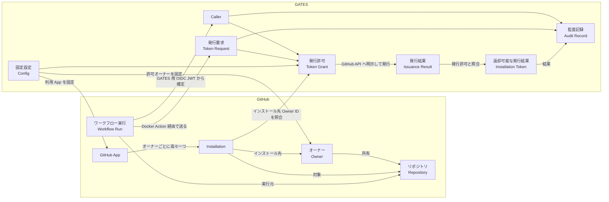
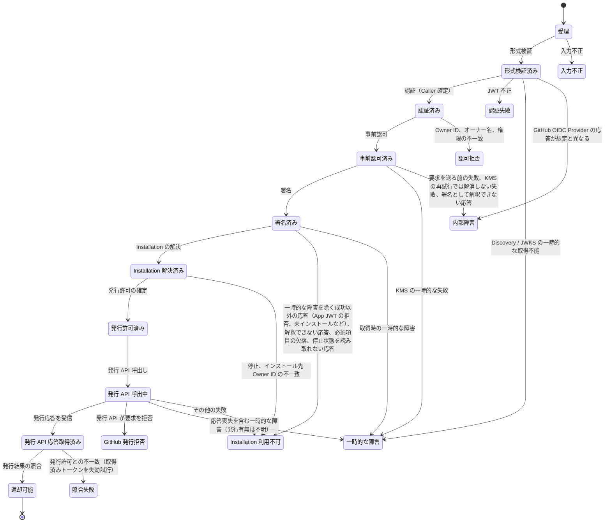
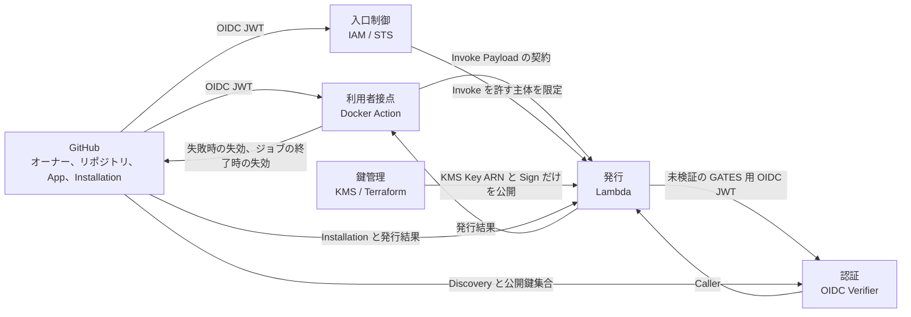

# Domain Model

GATES が扱う問題領域のドメインモデルです。
GATES は、許可された単一のオーナー配下の GitHub Actions ワークフローに、明示されたリポジトリへの `contents:read` に限定した短命な GitHub App Installation Access Token を発行します。

## 1. Purpose and Scope

本ドキュメントの目的は、Lambda 上の Go アプリケーション、Docker Action、Terraform の設計・実装・レビューが、概念の意味と判定のルールを一つのモデルから参照できるようにすることです。
中心に置くのは、Lambda が担う発行の判定です。
Docker Action、AWS IAM、KMS の鍵管理は、発行の判定と語の意味が異なる範囲として境界を示すにとどめます。

モデルが答える問いは次のとおりです。

- 発行要求を誰が出し、何を要求し、何が返るか
- オーナー、リポジトリ、Installation を何で同定するか
- 発行を許可する条件は何か。拒否はどの段階で、どの種別として起きるか
- どの単位の中で、何が常に成り立たなければならないか
- 境界をまたぐと、同じ語の意味がどう変わるか

概念には英語名を併記します。
英語名は概念の名前であり、複数の単語は空白で区切ります（Token Request など）。
実装では空白を除いた形（TokenRequest など）を型名・関数名にし、実装と本ドキュメントの整合はこの対応で確かめます。
package 名が概念名の前半を表すときは、型名からその部分を除きます（Revocation Outcome を revocation package の Outcome にするなど）。

本ドキュメントは、GATES に必要な値を概念として定義し、GitHub や AWS がその値をどのフィールドや Claim で提供するかは書きません。
提供のされ方は手段であり、概念の意味を変えないためです。
GitHub が定めた値そのものを書くのは、ルールがその値に依存する許可権限と付随権限に限ります。
GitHub が定める仕様の内容、出典、未確認事項は [GitHub Constraints](../spec/github-constraints.md) を正本とし、本ドキュメントはそれが GATES のルールに及ぼす影響だけを書きます。
JWT / JWS / JWK / OpenID Connect の標準仕様の規定の整理は [JWT Constraints](../spec/jwt-constraints.md) に置きます。

本ドキュメントの記述は、根拠の種類を次の表記で区別します。

- **事実**：情報源に根拠がある。出典を添える
- **推論**：根拠から導いた判断
- **候補**：本ドキュメントが補った語や区分で、情報源にはない
- **未確認**：情報源で決まっていない、または情報源どうしで食い違う

## 2. Problem Overview

GitHub Actions の `GITHUB_TOKEN` は、ワークフローが動くリポジトリの外を読めません。
別のリポジトリを読むには、GitHub App の Installation Access Token が要ります。
しかし、GitHub App の Private Key をワークフローに渡すと、鍵を持つ者が App の権限全体を使えてしまいます。

GATES は、この二つの要求を同時に満たす仲介者です。
鍵は AWS KMS に置いて署名だけを行わせ、ワークフローには、本人確認を経た上で、明示された対象と権限だけに絞ったトークンを渡します。
問題領域の関係者は 3 者です（事実：Requirements §3）。

- **ワークフロー利用者**：対象リポジトリと権限を指定してトークンを受け取る
- **GitHub App / オーナーの管理者**：Installation の対象リポジトリを管理し、GATES で読める範囲の上限を決める
- **GATES 運用者**：許可オーナー、GitHub App、署名鍵を固定し、認証・認可・発行・監査を担う

GATES が所有する概念は、固定設定、発行要求、Caller、発行許可、発行結果、監査記録です。
オーナー、リポジトリ、GitHub App、Installation は GitHub が所有する概念で、GATES はそれらを参照し、照合します。

## 3. Concepts

### 3.1 GitHub Entities Referenced by GATES

| 概念 | 英語名 | 同一性 | 主な性質 | 根拠 |
|---|---|---|---|---|
| **オーナー** | Owner | 不変 Owner ID | 名前（変更され得る）、種別（Organization またはユーザーアカウント）。リポジトリを所有する | 事実：Requirements §1、GitHub Constraints §2.1 |
| **リポジトリ** | Repository | 不変 Repository ID | 完全名 `owner/repo`（名前変更・移管で変わり得る）、所有オーナー | 事実：GitHub Constraints §2.1、§3.2、Lambda Design §2.2 |
| **GitHub App** | GitHub App | Client ID | 権限の上限（GitHub 側で設定）、Private Key（複数持てる。上限は GitHub Constraints §4.1） | 事実：Requirements §2.1、Lambda Design §4、GitHub Constraints §4.1 |
| **Installation** | Installation | Installation ID | インストール先 Owner ID、対象の選び方、付与された権限、停止状態 | 事実：GitHub Constraints §5 |
| **ワークフロー実行** | Workflow Run | ワークフロー実行 ID と試行番号 | 実行元のリポジトリとオーナー、起動のイベントと ref など。GATES 用 OIDC JWT の主体は実行元とワークフロー起動属性の一部を表し、実行そのものは識別しない | 事実：GitHub Constraints §3.1 |
| **Issuer の公開鍵集合** | JWK Set（JWKS） | 固定 Issuer に対応する公開鍵集合（取得先は Discovery の `jwks_uri`） | 署名検証用の個々の JWK の集合。ローテーションによって内容が変わり得る。GATES は Discovery で取得先を確認し、使用可能な鍵だけを実行環境内で保持する。個々の鍵の選択には JWK の `kid` を使う。秘密鍵か対称鍵の値を含む集合は、全体を受け入れない | 事実：Lambda Design §6.1、RFC 7517 §4.5・§5。日本語の概念名は本ドキュメントの表現 |
| **Discovery** | Discovery | Issuer | Issuer が公開する設定。GATES はそこから Issuer の値と公開鍵の取得先だけを読む。成功した内容は実行環境の中で再利用し、失敗した内容は保持しない | 事実：Lambda Design §6.1、OpenID Connect Discovery |

オーナーとリポジトリは、どちらも不変 ID と名前の二つの表現を持ちます。
名前は変わり得るため、認可の同一性は不変 ID で判断し、名前は要求の照合と GitHub API の呼び出しに使う表現と位置づけます（事実：Requirements FR-006、FR-002）。
名前が変わると、ID で同じものを指していても名前の照合は失敗します。
この失敗は、GATES では Fail Closed として受け入れます（事実：AWS Infrastructure Design §3.1）。

Installation には、GATES が参照する次の属性があります。

- **インストール先 Owner ID**（Installation Owner ID）：Installation がインストールされているオーナーの不変 Owner ID
- **停止状態**（Suspended）：オーナーの管理者が Installation を停止しているかどうか

Installation の対象の選び方と付与された権限は、GATES の判定に使いません。
対象の選び方は、発行結果の属性としてだけ照合します（[3.4](#34-issuance-result)）。

Installation は、GitHub App とオーナーの組に対して高々一つ存在します（推論：GitHub Constraints §5 の、オーナーを指定して単一の Installation を返すエンドポイントが Organization とユーザーアカウントのそれぞれにあることから。GitHub が一意性を明示的に保証したものとは扱わない）。
この性質があるため、GATES は Installation ID を設定に持たず、固定した GitHub App と許可オーナーから実行時に導出します（事実：Requirements FR-024）。

Issuer の公開鍵集合の JWK は、GATES の受理条件で次の二つに分かれます。

- **使用可能な鍵**（Usable Key）：JWK の受理条件を満たし、RSA 公開鍵として署名の検証に使える JWK。署名の一致は意味しない（事実：GATES OIDC JWT Signature の GOJ-JWK）
- **除外した JWK**（Excluded JWK）：受理条件を満たさず保持しない JWK。`kid` も保持しないため、JWT の判定では存在しない鍵と同じに扱う。運用者が Issuer の鍵情報の不整合に気付けるよう記録するが、監査記録の項目ではない（事実：GATES OIDC JWT Signature の GOJ-JWKS。英語名は候補。監査記録は発行処理 1 回の単位で、除外は取得 1 回の単位のため）

ワークフロー実行は、**ワークフロー実行 ID**（Run ID）と **試行番号**（Run Attempt）の組で特定します。
再実行は同じワークフロー実行 ID のもとで試行番号を増やすため、両方を持って初めて一回の実行を指せます（事実：GitHub Constraints §3.1）。

### 3.2 Fixed Configuration

**固定設定**（Config）は、実行時の入力からは変更できない値の集まりです（事実：Requirements FR-024、FR-009）。
Issuer と API Host は GATES 自身が固定し、残りの値は GATES 運用者がデプロイ時に決めます（事実：AWS Infrastructure Design §5）。
そのうち許可オーナーに関する 3 つの値を **許可オーナー**（Allowed Owner）と呼びます。

| 値 | 英語名 | 使われ方 | 根拠 |
|---|---|---|---|
| 許可オーナーの不変 Owner ID | Allowed Owner ID | Caller の認可、インストール先 Owner ID の照合、実効対象の所有オーナーの Owner ID の照合 | 事実：Requirements FR-006、Security Design §3.1 |
| 許可オーナー名 | Allowed Owner Name | 要求された完全名のオーナー部分の照合、Installation の取得先の指定 | 事実：Lambda Design §5 手順 3、§6.3 |
| 許可オーナーの種別 | Allowed Owner Type | Installation の取得方法の選択（Organization かユーザーアカウントか） | 事実：Lambda Design §6.3 |
| GitHub App の Client ID | Client ID | GitHub App JWT の発行者 | 事実：Lambda Design §4 |
| 署名鍵の KMS Key ARN | KMS Key ARN | GitHub App JWT の署名 | 事実：Lambda Design §4 |
| GATES 用 Audience | Audience | GATES 用 OIDC JWT の Audience の照合 | 事実：GATES OIDC JWT Claims の GOJ-AUD |
| Issuer | Issuer | GATES 用 OIDC JWT の Issuer の照合と Discovery / JWKS の取得先。GitHub Actions の OIDC Provider に固定。JWKS は Issuer の Discovery から得るため、独立した値を持たない | 事実：GATES OIDC JWT Claims の GOJ-ISS、GATES OIDC JWT Signature の GOJ-DISCOVERY、Lambda Design §6.1 |
| GitHub API Host | API Host | Installation の取得、トークンの発行と失効の呼び出し先。GitHub.com の API に固定 | 事実：Requirements FR-009、§2.2、Lambda Design §6.3 |

Authorization が読むのは、固定設定のうち許可オーナー（ID と名前）だけです。
Client ID、KMS Key ARN、Audience、Issuer、API Host は、認証、署名、Installation の解決、発行を担うコンポーネントが読みます。

### 3.3 Request and Decision

| 概念 | 英語名 | 種別 | 内容 | 根拠 |
|---|---|---|---|---|
| **発行要求** | Token Request | 値 | 対象（重複のない完全名の列）と Permissions。利用者が明示する。対象は明示した完全名だけで、全リポジトリを対象にする手段を持たない | 事実：Requirements FR-012、Lambda Design §2.1 |
| **完全名** | Full Name | 値 | `owner/repo` 形式のリポジトリ名。オーナー名とリポジトリ名に分割でき、比較は ASCII の範囲で大文字小文字を区別しない | 事実：Lambda Design §2.2 |
| **オーナー名** | Owner Name | 値 | 完全名のオーナー部分と許可オーナー名の二か所に現れるオーナーの名前。どちらも同じ文字種の規則に従う。比較は ASCII の範囲で大文字小文字を区別しない | 事実：Lambda Design §2.2 |
| **Permission Entry** | Permission Entry | 値 | 権限名と水準の組（`contents:read` など） | 事実：Requirements FR-008 |
| **Permissions** | Permissions | 値 | Permission Entry の集合。権限名ごとに水準を一つ持つ（GitHub の権限の表現が権限名をキーに持つため）。要求では `{contents:read}` だけが許可される。GitHub REST API のスキーマ「App Permissions」に対応する | 事実：Requirements FR-008、Security Design §3.1、GitHub Constraints §6.1、REST API endpoints for GitHub Apps のスキーマ「App Permissions」 |
| **許可権限** | Allowed Permissions | 値 | GATES が発行を許可する Permissions。`{contents:read}` に固定 | 事実：Requirements §2.1 |
| **付随権限** | Implied Permissions | 値 | 要求にかかわらず GitHub が付与する Permission Entry。`metadata:read` だけを許容する | 事実：Requirements FR-018 が除外の枠を定める。`metadata:read` だけを許容するのは GATES の判断。未確認：`metadata:read` が実際に付与されるか（GitHub Constraints §6.2）。語は候補 |
| **Caller** | Caller | 値 | 検証済み GATES 用 OIDC JWT から確定した呼び出し元。不変 Owner ID と Repository ID で識別し、ワークフロー実行 ID と試行番号、およびワークフロー起動属性を監査のためだけに添える | 事実：Requirements FR-002 |
| **ワークフロー起動属性** | Workflow Trigger Attributes | 値 | ワークフロー実行の起動と、GATES 用 OIDC JWT を取得したジョブを示す属性の組。誰が起動したか（行為者の名前と ID）、どのイベントか、どの ref とコミットか、どのワークフロー定義か、どの environment か。どれも欠落し得る | 事実：GitHub Constraints §3.1、GATES OIDC JWT Claims の Claim Summary |
| **発行許可** | Token Grant | 値 | Installation ID、対象の完全名の列、許可権限。認可が成立した結果であり、発行 API の呼び出しの内容を定める | 事実：Security Design §3.1 |

発行要求と Caller は、同じ Invoke Payload から取り出す別の概念です。
Payload に含まれる GATES 用 OIDC JWT は Caller を確定するための資格情報であり、発行要求の一部ではありません（事実：Lambda Design §2.1）。

Caller は、利用者の自己申告からは作れません（事実：Requirements FR-004）。
Caller の Owner ID は認可に使い、Repository ID、ワークフロー実行 ID、試行番号、ワークフロー起動属性は監査の識別だけに使います（事実：Requirements FR-002、Security Design §3.1）。
ワークフロー実行 ID と試行番号を添えるのは、監査記録から GitHub 上のワークフロー実行にたどり着けるようにするためで、Caller の同一性には含めません（事実：Security Design §5）。
ワークフロー起動属性を添えるのは、`pull_request_target` の悪用のように、どのイベントと ref でトークンを得たかが調査に要る場面で、GitHub 側の記録を参照せずに済ませるためです（事実：Security Design §5）。
ワークフロー起動属性はベストエフォートの属性であり、欠落していても Caller は確定します。
ワークフロー起動属性の値は監査記録に書き写すだけで、GATES は解釈も検証もせず、欠落した属性は欠落のまま持ちます（推論：認可に使わないため）。
値が空文字列の属性は、欠落と同じに扱います（推論：空の値は調査の手がかりにならず、区別する要求がないため）。
値が文字列でない属性も、欠落と同じに扱います（推論：拒否すると、認可に使わない属性の形が変わっただけで発行が止まるため。代わりに、GitHub が属性の型を変えると監査記録から値が消え、変更に気付きにくくなることを受け入れる）。

発行許可は、Caller、発行要求、許可オーナー、取得した Installation の 4 つがそろい、[5.2 Rules](#52-rules) の認可条件と Installation の有効性をすべて満たしたときにだけ作られます。
発行許可があって初めて GitHub API へ発行を要求できる、という順序がこの概念の役割です。

### 3.4 Issuance Result

| 概念 | 英語名 | 種別 | 内容 | 根拠 |
|---|---|---|---|---|
| **発行結果** | Issuance Result | 値 | GitHub API が返した Installation Access Token、有効期限、実効対象の集合、実効権限、対象の選び方 | 事実：GitHub Constraints §6.2 |
| **実効権限** | Effective Permissions | 値 | 発行結果に含まれる Permissions。許可権限と付随権限の範囲内であることを照合する | 事実：Requirements FR-016、FR-018 |
| **実効対象** | Effective Repository | 値 | 発行結果に含まれる各リポジトリ。Repository ID、所有オーナーの Owner ID、完全名を持つ | 事実：Lambda Design §6.3 |
| **返却可能な発行結果** | Installation Token | 値 | 発行許可との照合を通った発行結果。利用者に返せるのはこれだけ。名前は GitHub REST API の発行応答のスキーマ名で、トークン、有効期限、実効権限、実効対象の集合を持つ | 事実：Security Design §3.4、REST API endpoints for GitHub Apps のスキーマ「Installation Token」 |

**対象の選び方**（Repository Selection）は、発行結果の対象が選択したリポジトリに限られるか、全リポジトリかの二値です。

Installation Access Token はトークン文字列そのもので、GitHub の名前です。
本ドキュメントは Installation Token の名前を照合を通った発行結果にだけ使い、照合前の応答は発行結果と呼びます。
照合の条件は [5.3 Invariants](#53-invariants) に置きます。

発行結果は照合の前の値であり、不変条件を持ちません。
各項目は発行応答から独立に読み取り、読み取れなかった項目は、読み取れなかったことが分かる形で発行結果に残します（事実：Lambda Design §2.2、§6.3）。
照合は、読み取れなかった項目に関わる条件を満たさないものとして扱います。
こうすると、トークン文字列以外の項目を読み取れたかどうかは照合の結果だけを変え、トークン文字列の取り出しと、失効を試みられるかどうかを変えません。
実効対象の集合は、すべての要素について Repository ID、所有オーナーの Owner ID、完全名を読み取れた場合にだけ、読み取れたものとします（推論：一部の要素だけを持っても、全件の一致を求める照合の結果は変わらないため）。

### 3.5 Credentials

GATES の処理には 5 種類の **資格情報**（Credential）が現れ、どれも「トークン」と呼ばれ得ます（事実：System Architecture §4）。
語の衝突を避けるため、本ドキュメントでは次の名前で区別します。

| 資格情報 | 英語名 | 発行元 | 用途 | 発行の判定に現れるか |
|---|---|---|---|---|
| **AWS 用 OIDC JWT** | Web Identity Token | GitHub OIDC Provider（Audience は AWS STS） | IAM Role の引き受け | 現れない。入口制御だけが扱う |
| **AWS 一時認証情報** | AWS Credentials | AWS STS | Lambda Invoke の署名 | 現れない |
| **GATES 用 OIDC JWT** | ID Token | GitHub OIDC Provider（Audience は GATES 用 Audience） | Caller の確定 | 現れる。認証の入力。名前は OIDC の応答名 |
| **GitHub App JWT** | App JWT | Lambda が組み立て、KMS が署名 | GitHub API の呼び出し | 現れる。内部でだけ使い、外に出さない |
| **Installation Access Token** | Installation Access Token | GitHub API | 対象リポジトリの読み取り | 現れる。発行結果の中心。返却可能な発行結果（Installation Token）はこれに有効期限・対象・実効権限を添えたもの |

GATES 用 OIDC JWT は、Payload から取り出した時点では未検証であり、認証を通って初めて Caller の根拠になります。
認証を通る前の値を **未検証の GATES 用 OIDC JWT**（Unverified ID Token）と呼びます。
GitHub App JWT を外に出さないのは、GitHub App の権限全体を行使できる、Constitution のいう強い資格情報だからです（事実：Constitution の Design Principles 2）。

どの資格情報も、ログとエラー本文に記録しません（事実：Requirements QR-004）。
発行の判定に現れる資格情報は、種類によらず、どの出力でも値を伏せた同じ表記にします（推論：伏せ方が資格情報ごとに異なると、直すときに一部の資格情報だけが直り、ほかの資格情報が出力に残り得るため）。
一方、値を取り出せるコンポーネントは資格情報ごとに異なります（事実：Lambda Design §4）。
資格情報のうち利用者に返すのは Installation Access Token だけです（事実：Requirements FR-016）。

利用者接点には、これらに加えて **要求用トークン**（OIDC Request Token）が現れます。
Runner がジョブに渡す、GitHub OIDC Provider に OIDC JWT を要求するための資格情報です（事実：GitHub Actions Design §3）。
発行の判定には現れないため上の 5 種類に含めませんが、ログに出さず、値を取り出せるコンポーネントを限る点は同じです（事実：GitHub Actions Design §3.1、§3.4）。
利用者接点は、AWS 用 OIDC JWT と GATES 用 OIDC JWT を同じ手順で取得し、どちらになるかは要求した Audience で決まります。
そのため取得の手順では、両者をまとめて **OIDC JWT** と呼びます（事実：GitHub Actions Design §3.1）。

### 3.6 Audit Record

**監査記録**（Audit Record）は、一回の発行処理の結果を、資格情報を含めずに残したものです（事実：Requirements FR-021）。

| 項目 | 記録する条件 | 根拠 |
|---|---|---|
| 相関 ID（Request ID） | 常に | 事実：Requirements FR-021 |
| 時刻、結果（成功、または失敗の種別を表すエラーコード） | 常に | 事実：Security Design §5 |
| 拒否の理由 | 失敗の種別で終わった場合。満たさなかった条件か失敗した呼び出しを示し、資格情報と Caller、要求、許可オーナー、Installation の値を含めない。想定外の失敗では原因の値を含めない | 事実：Security Design §5、Lambda Design §3.2 |
| Caller の Owner ID と Repository ID、ワークフロー実行 ID と試行番号 | 認証に成功した後だけ。認証前の失敗では未検証の値を Caller として記録しない | 事実：Security Design §5 |
| ワークフロー起動属性 | 認証に成功した後で、含まれていた属性だけ | 事実：Security Design §5 |
| 要求対象、要求権限 | 形式検証を通った後 | 事実：Lambda Design §1。時点は推論 |
| 取得した Installation の Installation ID とインストール先 Owner ID | Installation の解決に成功した後 | 推論：インストール先 Owner ID の不一致は運用者かオーナーの管理者が直す失敗であり、どのアカウントの Installation が返ったかを、呼び出しを再現せずに確かめるため。監査記録は応答に出ないため、エラー文言で値を伏せる理由は及ばない |
| 失効の結果 | 照合失敗で終わった場合 | 事実：Lambda Design §3.1 |

照合に失敗した発行処理では、失効を試みたかどうかと、試みた場合の成否を残します。
この値を **失効の結果**（Revocation Outcome）と呼び、試みなかった、試みて成功した、試みて失敗した、の 3 つのどれかをとります（語は候補）。
試みなかった場合を成否の一方に含めないのは、トークン文字列を取得できずに失効を試みなかった処理を、監査記録で失効を試みた処理と見分けるためです（推論：[5.3 Invariants](#53-invariants) の発行処理の不変条件は、トークン文字列を取得できた場合にだけ失効の試行を求めるため）。

常に記録する項目を除き、表の記録する条件は次の二つのどちらかです。
その値を確定する段階を発行処理が通ったか（ワークフロー起動属性は、そのうち含まれていた属性だけ）、その値を伴う結果で終わったか（拒否の理由は失敗、失効の結果は照合失敗）です。
監査記録は確定した値だけを持ち、確定していない項目を既定の値で表しません（推論：既定の値で表すと、認証前の失敗の記録に Caller があるように読めるため）。

監査記録の単位は発行処理 1 回です。
中断した発行処理では残らない場合があります（[4.3](#43-lifecycle-of-an-issuance)）。
相関 ID は成功応答と失敗応答の両方に含め、ワークフローのログから監査記録へ、監査記録からワークフロー実行 ID でワークフロー実行へ、双方向にたどれるようにします（事実：Requirements FR-016、FR-021）。

### 3.7 Relationships

## 4. Behavior

### 4.1 Operations

| 操作 | 英語名 | 担当 | 入力 | 結果 | 根拠 |
|---|---|---|---|---|---|
| トークンを要求する | （Docker Action の責務） | ワークフロー利用者 | 対象、権限、接続情報 | Docker Action が発行処理を起動する | 事実：Requirements §3、FR-019 |
| ジョブの終了時の失効 | Revoke | Docker Action | ジョブの終了時の処理へ引き継いだ Installation Access Token。後続ステップへ渡したトークンはすべて含む | 成功または失敗。成否にかかわらずジョブの結果を変えない。トークンを引き継がなかった場合は何もしない | 事実：Requirements FR-026、GitHub Actions Design §3.5 |
| 失敗時の失効 | Revoke | Docker Action | 受け取った後、後続ステップへ渡す前に失敗するかキャンセルされた Installation Access Token | 成功または失敗。成否にかかわらず Docker Action は失敗で終わる | 事実：Requirements FR-026、GitHub Actions Design §3.5、§3.6 |
| 形式検証 | Validate | Lambda Handler | Invoke Payload | 発行要求と未検証の GATES 用 OIDC JWT を取り出す、または入力不正 | 事実：Lambda Design §2.2 |
| 認証 | Authenticate | OIDC Verifier | 未検証の GATES 用 OIDC JWT、固定設定、Issuer の公開鍵、現在時刻 | Caller を確定する、または拒否 | 事実：Requirements FR-002 |
| 事前認可 | Authorize | Authorization | Caller、発行要求、許可オーナー | 外部呼び出しに進める、または認可拒否 | 事実：Lambda Design §5 手順 3 |
| 署名 | Sign | KMS Signer | 固定設定の Client ID と KMS Key ARN、現在時刻 | GitHub App JWT | 事実：Requirements FR-013、Lambda Design §4 |
| Installation の解決 | Resolve Installation | Token Issuer | GitHub App JWT、許可オーナーの名前と種別 | 取得した Installation、または拒否（一時的な障害を除く成功以外の応答、解釈できない応答、必須項目の欠落、停止状態を読み取れない応答、一時的な障害） | 事実：Lambda Design §3.2、§6.3 |
| 発行許可の確定 | Grant | Authorization | Caller、発行要求、許可オーナー、取得した Installation | 発行許可、または拒否（インストール先 Owner ID の不一致、停止、認可条件の不成立） | 事実：Lambda Design §5、Security Design §3.1 |
| 発行 | Issue | Token Issuer | 発行許可、GitHub App JWT | 発行結果、または失敗 | 事実：Requirements FR-014、FR-015 |
| 発行結果の照合 | Verify | Token Issuer | 発行結果、発行許可、許可オーナー、現在時刻 | 返却可能な発行結果、または拒否 | 事実：Requirements FR-018 |
| 失効 | Revoke | Token Issuer | 照合を通らなかった発行結果のトークン | 成功または失敗。成否にかかわらず拒否のまま終わる | 事実：Requirements FR-007、FR-018、Lambda Design §3.1 |
| Installation Token の発行 | Issue Installation Token | Token Issuer | 発行許可の確定（Caller と発行要求は Token Issuer に渡さない）、許可オーナー、現在時刻 | 署名、Installation の解決、発行許可の確定、発行、発行結果の照合を順に行い、返却可能な発行結果、またはいずれかの段階の拒否。照合失敗には失効の結果を添える | 事実：Lambda Design §6.2。語は候補 |
| 監査記録の出力 | Audit | Lambda Handler | 発行処理の結果 | 監査記録 | 事実：Requirements FR-021 |
| 署名鍵を更新する | （運用手順） | GATES 運用者 | 新しい Private Key | 新しい KMS Key と、Lambda が参照する Key ARN の切り替え | 事実：Requirements FR-017、AWS Infrastructure Design §4.2 |
| Installation の対象を変える | （GitHub 側の操作） | GitHub App / オーナーの管理者 | 対象リポジトリの選択 | 読み取り可能範囲の上限が変わる | 事実：Requirements §2.3、Security Design §3.2 |

操作の失敗は、[4.2 Failure Kinds](#42-failure-kinds) の種別に次のように対応します（事実：Lambda Design §3.2、§5）。

| 操作 | 失敗の種別 |
|---|---|
| Validate | 入力不正 |
| Authenticate | 認証失敗。Discovery / JWKS を一時的に取得できなければ一時的な障害、GitHub OIDC Provider の応答が想定と異なれば内部障害 |
| Authorize | 認可拒否 |
| Sign | 一時的な障害。署名の要求を送る前に失敗するか、KMS が再試行では解消しない失敗を返すか、KMS の応答を署名として解釈できなければ内部障害 |
| Resolve Installation | Installation 利用不可（App JWT の拒否や未インストールを含む、一時的な障害を除く成功以外の応答。応答を解釈できない、必須項目が欠落している、停止状態を読み取れない）。取得時の一時的な障害は一時的な障害 |
| Grant | Installation 利用不可（インストール先 Owner ID の不一致、停止）。認可条件を満たさなければ認可拒否（Authorize を通った要求では起きないため、[4.3](#43-lifecycle-of-an-issuance) の図には描かない） |
| Issue | GitHub 発行拒否（発行 API の `422`）。通信の失敗などは一時的な障害、その他の失敗は Installation 利用不可 |
| Verify | 照合失敗 |
| Revoke | なし。失効に失敗しても照合失敗のまま終わる |
| Issue Installation Token | 失敗した段階（Sign、Resolve Installation、Grant、Issue、Verify）の種別をそのまま返す |

どの段階にも属さない想定外の障害も、Handler が応答を書ける限り内部障害で終わります。

最後の 2 つの操作は GATES の外で行われますが、発行できる範囲を変えるため、モデルに含めます。
認可の境界は GATES の設定だけでは決まらず、Installation の対象に依存します。

### 4.2 Failure Kinds

発行処理がトークンを返さずに終わる失敗を、**失敗の種別**（Failure Kind）で区別します。
種別を分けるのは、区別がルール、監査記録の意味、失効の義務のいずれかを変える場合に限ります（推論：本ドキュメントが答える問いが判定のルールであるため）。
どの外部依存が失敗したかのように、直す担当も次に起きることも変えない区別は、応答のエラーコードに任せます。

| 種別 | 英語名 | 起きる条件 | 直す担当と次に起きること | 根拠 |
|---|---|---|---|---|
| **入力不正** | Invalid Request | Payload を GATES が読み取れない | 利用者が要求の形を直す。要求を読み取れていないため、監査記録に要求対象と要求権限を残さない | 事実：Lambda Design §2.2 |
| **認証失敗** | Authentication Failure | GATES 用 OIDC JWT から Caller を確定できない | 利用者がワークフローの設定を直す。OIDC JWT の主体のカスタマイズが原因なら、リポジトリかオーナーの管理者が直す（[4.4](#44-events-outside-gates-that-change-the-outcome)）。Issuer の公開鍵のローテーションの直後なら、時間をおいた再実行で解消し得る（同節）。監査記録に未検証の値を Caller として残さない | 事実：Requirements FR-002、Security Design §5 |
| **認可拒否** | Authorization Denied | Caller と要求は読み取れたが、GATES の認可条件を満たさない | 利用者が要求の対象か権限を直す。監査記録には、GATES の認可で拒否したことが残る | 事実：Security Design §3.1、Lambda Design §3.2 |
| **Installation 利用不可** | Installation Unavailable | 固定した GitHub App と許可オーナーから、発行に使える Installation を得られない。一時的な障害を除く成功以外の応答、応答を解釈できない、必須項目の欠落、停止状態を読み取れない、停止、インストール先 Owner ID の不一致、発行の間に Installation か App の状態が変わった場合 | GATES 運用者かオーナーの管理者が、GitHub 側か固定設定を直す。再試行では解消しない | 事実：Lambda Design §3.2 |
| **GitHub 発行拒否** | GitHub Issuance Rejected | GATES の認可が成立したが、GitHub 発行 API が `422` で要求を拒否した。原因は応答コードから確定できない | 利用者の許可外要求とは断定せず、運用者が GitHub の発行条件・状態・応答を調べる。トークン文字列は未取得 | 事実：Lambda Design §3.2 |
| **照合失敗** | Verification Failure | GitHub 発行 API の応答を取得したが、発行結果が発行許可と一致しない。発行結果に読み取れなかった項目がある場合を含む | 運用者が設定か GitHub 側の仕様変更を調べる。トークン文字列を取得できた場合は失効を試みる | 事実：Requirements FR-018、Lambda Design §3.1 |
| **一時的な障害** | Transient Failure | Discovery / JWKS の取得、KMS の署名、GitHub API の呼び出しのいずれかが一時的に失敗した。通信の失敗、タイムアウト、サーバー側のエラー、レート制限を指す | 利用者の再実行で解消し得る。GATES も Docker Action も要求を自動で送り直さない（[6.1](#61-contexts)） | 事実：Lambda Design §3.2、§6.4、GitHub Actions Design §3.3 |
| **内部障害** | Internal Failure | 想定外の失敗。どの段階にも属さない失敗と、GitHub OIDC Provider の応答が想定と異なる失敗（Discovery が示す Issuer が固定した Issuer と異なる、公開鍵の取得先が Issuer と異なるホストかポートを指す、応答を解釈できない、公開鍵集合に秘密鍵か対称鍵の値が含まれる、使用可能な鍵が一つもない、応答が上限より大きい、再試行では解消しない失敗の応答が返る）と、署名の要求を送る前に失敗した場合、KMS が再試行では解消しない失敗を返した場合（鍵の無効化、署名できない鍵の状態、権限の不足など）、KMS の応答を署名として解釈できない場合を含む | 運用者が調べる。再試行では解消しない | 事実：Lambda Design §3.2 |

Installation 利用不可を認可拒否と分けるのは、利用者の要求に起因しない失敗だからです。
認可拒否に含めると、監査記録では利用者の要求が許可外だったように見えます。
一時的な障害と分けるのは、再試行では解消せず、運用者の対応を要するためです。

Installation 利用不可と照合失敗は、どちらも設定ミスや GitHub 側の仕様変更を示し得る監視対象です。
両者の境界は、問題を検出した処理段階です。Installation の取得・確認時点の不整合は Installation 利用不可、発行応答を取得して照合した不整合は照合失敗です。
照合失敗を一時的な障害と分けるのも、発行結果の不整合が再試行で解消する障害ではなく、監視対象だからです。

一時的な障害は、失敗した依存先が Discovery / JWKS、KMS、GitHub API のどれであっても一つの種別にまとめます。
どれが失敗しても、直す担当は変わらず、次に起きることも再試行で変わらないためです。
依存先の区別は調査のための情報であり、応答のエラーコードで表します。

GitHub OIDC Provider の応答が想定と異なる失敗を一時的な障害と分けるのは、再試行では解消せず、一時的な障害にすると利用者に無駄な再実行を促すためです。
新しい種別を設けず内部障害に含めるのは、内部障害と比べて、直す担当（運用者）も、監査記録に残るもの（失敗した段階までに確定した値）も、失効の義務（発行前のため、なし）も変わらないためです。
原因は監査記録の拒否の理由で区別します。
署名の要求を送る前に失敗した場合、KMS が再試行では解消しない失敗を返した場合、KMS の応答を署名として解釈できない場合を内部障害に含める理由も同じです。
鍵の状態、Key Policy、固定設定、実行環境を運用者が直すまで解消せず、発行の前のため失効の義務もありません。

操作が返して発行処理を終わらせる失敗は、ちょうど一つの種別に属し、その種別は操作が定めます（推論：複数の種別に属すると、直す担当と次に起きることが一つに決まらないため）。

失敗の種別は、応答のエラーコードで表します。
種別とエラーコードは一時的な障害を除いて一対一に対応し、一時的な障害だけは失敗した依存先ごとにエラーコードを分けます。

### 4.3 Lifecycle of an Issuance

一回の発行処理は、次の状態を順にたどります。
各段階で失敗すると、その段階に対応する失敗の種別で終わり、以降の段階には進みません（事実：Requirements QR-003、Lambda Design §5）。

内部障害への遷移は認証と署名の段階のものだけを描き、どの段階でも起き得る想定外の失敗は描きません。

照合失敗は GitHub の発行応答を取得した後の拒否です。空でないトークン文字列を取得した場合は失効を試みます。発行 API への要求後に通信が断たれた場合は、GitHub 側で発行が成功していてもトークン文字列を取得できないことがあります。返却しないことは保証しますが、GitHub 側でトークンが残らないことは保証しません（事実：Requirements FR-018、QR-003）。

発行処理は、失敗の種別で終わらずに打ち切られることもあります。
タイムアウト、メモリ不足、初期化の失敗のように Handler が応答を書けない場合で、これを **中断**（Interruption）と呼びます（事実：Lambda Design §3.2。語は候補）。
中断を失敗の種別に含めないのは、種別は発行処理が判定して応答で表すものであり、中断ではどちらもできないためです（推論）。
初期化の失敗は、固定設定が [5.3 Invariants](#53-invariants) の不変条件を満たさないか、実行環境から AWS SDK の設定を読めず、部品を作れない場合です。
その実行環境では発行処理を始められず、受理した要求は中断で終わります（事実：Lambda Design §4.1。推論：不変条件を満たさない値を作らない方針から）。
どの段階でも起き得るため、状態図には描きません。
中断した発行処理は利用者にトークンを返しませんが、監査記録が残らない場合があります。
トークン文字列を取得した後に中断すると、失効を試みられず、GitHub 側でトークンが有効なまま残り得ます（推論：Handler が処理を続けられないため）。

認可が事前認可と発行許可の確定の二段に分かれるのは、Installation を取得しないとインストール先 Owner ID を照合できず、Installation の取得には署名済みの GitHub App JWT が要るためです（推論：Lambda Design §5 手順 3 から 5 の順序から）。
事前認可は、KMS と GitHub API を呼ぶ前に、認可の見込みがない要求を落とすための段階です（事実：Lambda Design §5）。

### 4.4 Events Outside GATES That Change the Outcome

発行処理の外で起きる次の出来事は、GATES の設定を変えなくても発行の結果を変えます。

| 出来事 | 影響 | 根拠 |
|---|---|---|
| オーナーの名前変更 | IAM Role の引き受けとオーナー名の照合が失敗し、設定を更新するまで発行が止まる | 事実：AWS Infrastructure Design §3.1 |
| リポジトリの名前変更 | 旧名で要求すると、GitHub が拒否するか実効対象の完全名が一致せず返却できない場合がある。同一の許可オーナー・Installation の対象に残り、ほかの条件も成立するなら、新しい完全名で要求できる | 推論：Security Design §3.4 の照合条件から。旧名への GitHub の応答は未確認 |
| リポジトリの移管 | 所有オーナーと Installation の対象範囲が変わり得る。異なるオーナーへの移管後は、名前を変えて要求するだけでは単一オーナー認可を満たさない | 推論：Requirements FR-006・FR-007、Security Design §3.1 の Owner ID と Installation の確認から |
| Installation の対象の追加・削除 | 読み取り可能範囲の上限が変わる。Organization では、制限していなければリポジトリ管理者も追加できる | 事実：Security Design §3.2 |
| GitHub App の再インストール | Installation ID が変わるが、設定変更なしに新しい Installation を導出する | 事実：Security Design §3.2 |
| Installation の停止 | 取得した Installation が停止状態のため、発行許可を作らず Installation 利用不可で閉じる。GitHub の発行 API を呼ばない | 事実：Security Design §3.1、Lambda Design §5 手順 5 |
| GitHub 側での旧 Private Key の失効 | 新しい KMS Key に切り替え済みなら影響しない | 事実：Requirements AC-14 |
| OIDC JWT の主体のカスタマイズ | GATES が受け付ける主体の形式から外れると、入口制御の拒否か認証失敗で発行が止まる | 推論：GATES OIDC JWT Claims の GOJ-SUB、AWS Infrastructure Design §3.1 の主体の条件から。実環境では未確認 |
| Issuer の公開鍵のローテーション | 手元の鍵で検証できない JWT で JWKS の再取得が許され、取得に成功すれば新しい鍵に追従できる。再取得の上限の間や取得失敗時は、正当な JWT でも一時的に拒否され得る | 推論：Lambda Design §6.1 の再取得の上限と検証条件から |
| 公開鍵の取得先の変更 | 保持した Discovery は取り直さないため、古い取得先が使えなくなると、実行環境が入れ替わるまで一時的な障害か内部障害で止まる | 推論：Lambda Design §6.1 の Discovery の再利用から |

## 5. Rules and Invariants

### 5.1 Identity Rules

| ルール | 内容 | 根拠 |
|---|---|---|
| ID による同定 | オーナーの同一性は不変 Owner ID で判断し、名前の一致では代用しない | 事実：Requirements FR-006 |
| ID の形式 | Owner ID、Repository ID、Installation ID、ワークフロー実行 ID、試行番号は、int64 に収まる正の整数である。Owner ID、Repository ID、Installation ID は互いに別の概念で、比べるのは同じ概念の ID どうしに限る | 推論：GitHub の ID は 1 から始まる。試行番号が初回に `1` になることは未確認で、`0` を拒否するのは GATES の判断 |
| 名前の照合は補助 | 完全名のオーナー部分と許可オーナー名の照合は、要求の整合性の確認であり、認可の根拠ではない。認可の根拠は Caller の Owner ID にあり、発行に使う Installation はインストール先 Owner ID で確かめる | 推論：Security Design §3.1 の条件 1 と Installation の確認が ID、条件 2 だけが名前であることから |
| ID の整合 | Caller の Owner ID と Repository ID は、GATES 用 OIDC JWT の中で主体を表す属性と個別の属性の両方に現れる。両方がそろい、互いに一致するときに限り Caller を確定する | 事実：GitHub Constraints §3.2、GATES OIDC JWT Claims の Cross-Claim Invariants |
| 名前の比較規則 | 完全名の比較と重複判定は、ASCII の範囲で大文字小文字を区別しない。要求の重複判定、オーナー名の照合、実効対象の完全名の照合で共通 | 事実：Lambda Design §2.2 |

### 5.2 Rules

| ルール | 適用対象 | 成立条件 | 例外 | 根拠 |
|---|---|---|---|---|
| 認証条件 | 認証 | GATES 用 OIDC JWT が、JWS Compact Serialization で表され、JOSE Header が未対応の拡張や Nested JWT を示さず、`kid` で一意に選べる Issuer の使用可能な鍵で GATES が許可した署名方式により署名され、Issuer が固定設定の Issuer と一致し、Audience が GATES 用 Audience の一つだけであり、現在時刻が失効時刻より前であり、有効期間の開始と発行時刻が現在時刻に許容時計差を足した時刻より後でなく、属性を一意に読み取れ、発行時刻、失効時刻、Caller の確定に要る属性がそろい、[5.1 Identity Rules](#51-identity-rules) の ID の整合を満たす。一つでも満たさなければ認証失敗 | 有効期間の開始は欠落を許す | 事実：Requirements FR-002、FR-003、GATES OIDC JWT Claims、GATES OIDC JWT Signature、Security Design §2.2 |
| 取得前の拒否 | 認証 | 直列化、JSON と Claim 名、NumericDate の型と範囲、JOSE Header の条件（`kid` の存在を含む）は Issuer の公開鍵に依存しないため、公開鍵集合を取得する前に判定する。満たさなければ取得せずに認証失敗とし、再取得の上限を消費しない | なし | 事実：Lambda Design §6.1 |
| 鍵の選択と再取得 | 認証 | 保持した集合から `kid` で一意に選べる使用可能な鍵で署名を検証する。選べない（未知の `kid`、除外した JWK だけに一致、使用可能な鍵の複数一致）か署名が一致しなければ、再取得の上限の範囲で集合を取り直して判定し直し、それでも満たさなければ認証失敗。複数の鍵を総当たりで試さない | 上限の間は取り直さず、前回の取得が失敗していれば前回の失敗の種別を返す | 事実：Lambda Design §6.1、GATES OIDC JWT Signature の GOJ-JWKS |
| JWK の除外 | 公開鍵集合の取得 | 受理条件を満たさない JWK は、その JWK だけを除外して記録し、残りの使用可能な鍵で集合を作る。秘密鍵か対称鍵の値を含む JWK が一つでもあれば、`kty` や JWK として読めるかを問わず、集合全体を受け入れず内部障害 | なし | 事実：GATES OIDC JWT Signature の GOJ-JWKS |
| 認可条件 | 事前認可、発行許可の確定 | Caller の Owner ID が許可オーナーの Owner ID と一致し、要求の各完全名のオーナー名が許可オーナー名と一致し、Permissions が許可権限と等しい。満たさなければ認可拒否 | なし | 事実：Security Design §3.1 |
| Installation の有効性 | 発行許可の確定 | 取得した Installation のインストール先 Owner ID が許可オーナーの Owner ID と一致し、停止していない。満たさなければ Installation 利用不可 | なし | 事実：Security Design §3.1 |
| 全件成立 | 複数対象の発行要求 | すべての対象が条件を満たすときだけ発行する。一部だけの発行や対象の縮小をしない | なし | 事実：Requirements FR-011 |
| 明示の要求 | 発行 API の呼び出し | 対象と権限を必ず明示し、省略による全対象・全権限の継承を起こさない | なし | 事実：Requirements FR-015、GitHub Constraints §6.1 の省略時の継承 |
| 付随権限の許容 | 発行結果の照合 | 実効権限は許可権限に等しいこと | 付随権限 `metadata:read` が含まれる場合だけ許容する | 事実：Requirements FR-018、Security Design §3.4 |
| 有効期限 | 発行結果 | GitHub が定めた有効期限をそのまま返し、延長しない | なし | 事実：Requirements FR-014 |
| 対象の上限 | 発行要求 | 対象は 500 件以下 | なし | 事実：Lambda Design §2.1、GitHub Constraints §6.1 |
| 入力不正と認可拒否の区別 | 形式検証と認可 | 値を読み取れない形は入力不正、読み取れて許可条件に合わない値は認可拒否 | なし | 事実：Lambda Design §2.2 |
| 設定の固定 | 固定設定 | 実行時の入力から許可オーナー、GitHub App、Installation、KMS Key、Issuer、JWKS、Audience、API Host を指定できない | なし | 事実：Requirements FR-009、FR-024 |
| Fail Closed | 発行処理 | いずれかの段階が成立しなければトークンを返さない | なし | 事実：Requirements QR-003 |
| 資格情報の非記録 | 監査記録、エラー本文 | 5 種類の資格情報と Private Key を含めない | なし | 事実：Requirements QR-004 |

Installation に対象リポジトリが含まれることを、GATES は発行前に確認しません（事実：Security Design §2 の Authorization の行）。
含まれない対象は、発行 API が呼び出しを受け付けないか、発行結果の対象一覧が要求と一致しないかのどちらかで検出します（推論）。
失敗の種別は GitHub の応答で決まり、発行 API の `422` なら GitHub 発行拒否、その他の失敗なら Installation 利用不可、発行応答が発行許可と一致しなければ照合失敗です。
種別からは、対象が Installation に含まれなかったことを断定できません。
どの場合も利用者にトークンを返しません。

### 5.3 Invariants

不変条件は、その値を作る時点で条件を検査し、条件を満たさない値を作らないことで守ります。

| 単位 | 時点 | 常に成り立つこと | 根拠 |
|---|---|---|---|
| 発行要求 | 形式検証を通った時点 | 対象が 1 件以上 500 件以下で、各要素が完全名の形式を満たし、大文字小文字を区別しない重複がない。Permissions が下の行の条件を満たす | 事実：Lambda Design §2.2 |
| Permissions | 作られた時点 | Permission Entry を 1 つ以上持ち、権限名と水準がどれも権限名と水準の文字種を満たす。許可権限と等しいかは含まず、事前認可が判定する | 事実：Lambda Design §2.2、Security Design §3.1 |
| 相関 ID | Lambda Handler に渡す値を作った時点 | UTF-8 として正しい文字列である | 事実：Lambda Design §3.2 |
| 許可オーナー | 固定設定を読んだ時点 | Owner ID が [5.1](#51-identity-rules) の ID の形式を満たし、オーナー名がオーナー名の文字種を満たし、種別が二つの値のどちらかである | 事実：Requirements FR-024、Lambda Design §2.2 の名前の文字種。推論：条件を満たさない値を作らない方針（本節冒頭） |
| 認証の固定設定 | 検証器を作った時点 | Issuer が `https` のホストと、あれば空でないポートだけからなり、解析しても文字列が変わらない URL で、Audience が空でなく、AWS 用 OIDC JWT の Audience `sts.amazonaws.com` と異なり、ASCII の範囲で大文字小文字を区別せずに比べて、`https://github.com` と異なり、`https://github.com/` で始まらない | 推論：空の Audience はすべての JWT を拒否し、空の Issuer は Issuer の値のない署名済み JWT を通す。`sts.amazonaws.com` を拒否するのは、同じジョブで取得する AWS 用 OIDC JWT で認証を通せるようにしないため。github.com の URL を拒否するのは、GitHub が GitHub 全体を指す `https://github.com` と、呼び出し元のオーナーとリポジトリの URL でも発行し（事実：GitHub Constraints §3.1）、オーナーの URL は Audience を指定しない OIDC JWT にも入るため（事実：GATES OIDC JWT Claims の GOJ-AUD）、同じ値を Audience に使うほかのサービス向けの OIDC JWT や、Audience を指定せずに取得した OIDC JWT で認証を通せるようにしないため。前方一致で拒否するのは、発行される URL が呼び出し元ごとに異なり、値を列挙できないため。大文字小文字を区別しないのは、ホスト名、オーナー名、リポジトリ名が大文字小文字を区別しないため。RFC 3986 §6.2.3 が同じ URL とする、空のポートや既定のポートを付けた形は、Audience に選ばれる表記と考えにくいため扱わない。`https` に限るのは、平文の通信を設定から有効にできる形にしないため。ポートを許すのは、`httptest` の Issuer で取得と失敗の分類を確かめるため |
| 署名の固定設定 | KMS Signer を作った時点 | Client ID が空でなく、UTF-8 として正しい。KMS Key ARN が空でない | 推論：UTF-8 として正しくない Client ID は GitHub App JWT の JSON にできず、空の Client ID の GitHub App JWT は GitHub に拒否され、空の KMS Key ARN では KMS が署名しない。どれも発行のたびに失敗する設定であり、作る時点で止める |
| 保持した Discovery | 保持した時点 | Issuer が固定設定の Issuer と一致し、公開鍵の取得先が Issuer と同じ `https` のホストとポートを指す | 事実：OpenID Connect Discovery、GATES OIDC JWT Signature の GOJ-DISCOVERY。ホストとポートの限定は推論：固定した Issuer の外から鍵を読まないため |
| 保持した公開鍵 | 保持した時点 | 完全に受信して解釈でき、秘密鍵か対称鍵の値を含まない固定 Issuer の応答の、使用可能な鍵だけからなり、1 つ以上ある。除外した JWK は `kid` を含めて保持しない。同じ `kid` の使用可能な鍵が複数あっても保持し、一意に選べるかは JWT ごとに判定する。取得に失敗しても前回の鍵が残り、未知の鍵で検証に成功したとは扱わない | 事実：GATES OIDC JWT Signature の GOJ-JWK の鍵受理条件。保持・更新の方式は Lambda Design §6.1 |
| Caller | 認証を通った時点 | [5.2 Rules](#52-rules) の認証条件を満たした GATES 用 OIDC JWT だけから作られ、Owner ID と Repository ID が [5.1 Identity Rules](#51-identity-rules) の ID の整合を満たす。Owner ID、Repository ID、ワークフロー実行 ID、試行番号はどれも [5.1](#51-identity-rules) の ID の形式を満たす。いずれかが欠落していれば Caller は確定しない。ワークフロー実行 ID と試行番号は監査用の属性であり、認可には使用しない | 事実：Requirements FR-002、FR-004、GATES OIDC JWT Claims |
| Installation | 取得した応答から作った時点 | Installation ID とインストール先 Owner ID が [5.1](#51-identity-rules) の ID の形式を満たす。停止状態が、停止しているか停止していないかのどちらかに確定しており、停止状態を読み取れない応答からは作らない。インストール先 Owner ID が許可オーナーの Owner ID と一致することと停止していないことは含まず、発行許可の確定が [5.2 Rules](#52-rules) の Installation の有効性として判定する | 推論：読み取れない停止状態を停止していないと読むと、停止中の Installation で発行し得る（Fail Closed）。一致しない、または停止している Installation も GitHub 上に実在する値であり、作れない値ではなく発行に使えない値であるため |
| 発行許可 | 確定した時点 | [5.2 Rules](#52-rules) の認可条件をすべて満たす。対象は発行要求の対象と同じ列で、各完全名の表記と並びも発行要求のままである（GitHub API に渡すリポジトリ名と監査記録の要求対象を、利用者の要求と一致させるため）。Permissions は許可権限に等しい。Installation ID は、インストール先 Owner ID が許可オーナーの Owner ID と一致し、停止していない Installation のものである | 事実：Security Design §3.1 |
| 返却可能な発行結果 | 照合を通った時点 | トークンが空でなく、有効期限が将来である。実効対象の完全名の集合が発行許可の対象と一致し、件数が同じで、余分・欠落・重複がない。各実効対象の Repository ID が [5.1](#51-identity-rules) の ID の形式を満たして互いに異なり、所有オーナーの Owner ID が許可オーナーの Owner ID と一致する。実効権限が許可権限に付随権限を加えた範囲内で、許可権限をすべて含む。対象の選び方が、選択したリポジトリに限られている | 事実：Security Design §3.4、Requirements FR-018 |
| Output | 利用者接点が成功応答から作った時点 | `token` が空でなく ASCII の制御文字を含まない。`expires-at` が空でなく改行を含まない。`repositories` と `permissions` が 1 件以上で、各要素が空でなく改行と `,` を含まず、権限名と水準は `:` も含まない。成功応答の `request_id` も空でなく改行を含まない。`token` 以外の値と `request_id` は、旧形式のワークフローコマンドの接頭辞 `##[` を含まない | 事実：GitHub Actions Design §2.1、§3。要素の文字の条件は推論：カンマ区切りの Output を読む後続ステップが、`,` や `:` を含む要素を別の要素として読むため |
| 発行処理 | 全体 | 返却可能な発行結果がなければトークンを返さない。照合を通らず、空でないトークン文字列を取得できた場合は、実行可能な範囲で失効 API の呼び出しを試みる。失効成功、応答を取得できなかったトークンの不存在、中断した場合の失効の試行は保証しない。固定設定は処理中に変わらない。資格情報をログとエラー本文に出さない | 事実：Requirements QR-003、FR-007、FR-018、FR-024、QR-004 |

「返却可能な発行結果」の条件のうち対象の全件一致は、GitHub が要求外の対象を黙って除いた場合も、余分な対象を加えた場合も検出します。
この条件があるため、FR-007 と FR-010 のうち「トークンを返さない」ことは GitHub の拒否の振る舞いに依存しません（推論）。
GitHub が発行した後に不整合を検出して失効に失敗した場合、GitHub 側でトークンが有効なまま残り得ます。

## 6. Bounded Contexts and Ubiquitous Language

### 6.1 Contexts

同じ語が境界をまたぐと意味を変えるため、次の 5 つの範囲を別の Bounded Context として扱います。

| Bounded Context | 英語名 | 担うこと | 実装 | 中心の語 |
|---|---|---|---|---|
| **認証** | Authentication | 未検証の GATES 用 OIDC JWT を、Issuer の公開鍵と固定設定の Issuer と Audience で検証し、Caller を確定する | Lambda の Go アプリケーションのうち OIDC Verifier | JWT、JOSE Header、Claim、主体（`sub`）、Issuer、Audience、Discovery、JWK / JWKS、`kid`、使用可能な鍵 |
| **発行** | Issuance | 発行要求と Caller から発行許可を確定し、発行結果を照合して返す | Lambda の Go アプリケーションのうち OIDC Verifier を除く部分 | 本ドキュメント §3 の概念のうち、Issuer、GATES 用 Audience、Issuer の公開鍵集合、Discovery を除くもの |
| **入口制御** | Entry Control | 許可オーナーのワークフローだけに Lambda の Invoke を許す | IAM OIDC Provider、IAM Role、Terraform | OIDC JWT の主体の文字列パターン、Audience、AWS 一時認証情報、`lambda:InvokeFunction` |
| **利用者接点** | Workflow Integration | 利用者の入力を発行要求に変換し、Lambda の応答を判定して発行結果を Output として後続ステップへ渡し、受け取ったトークンの失効（失敗時の失効、ジョブの終了時の失効）を試みる | Docker Action | `repositories` と `permissions` のカンマ区切り、接続情報、要求用トークン、OIDC JWT、AWS 一時認証情報、Invoke の結果、成功応答と失敗応答、Output、通信の失敗、ワークフローコマンド（マスク、注釈）、ファイルコマンド（`GITHUB_OUTPUT`、`GITHUB_STATE`） |
| **鍵管理** | Key Custody | KMS Key の作成、鍵素材のインポート、鍵の更新 | Terraform と独立した運用手順 | KMS Key、鍵素材、`PendingImport` と `Enabled`、`key_spec` |

GitHub は、オーナー、リポジトリ、GitHub App、Installation を所有する上流です。
発行 Context は GitHub の API の語に従いつつ、完全名の列と GitHub API に渡すリポジトリ名の配列の間を翻訳します（事実：Lambda Design §6.3）。

認証 Context は、GitHub OIDC Provider の語（Claim と主体の文字列）を発行 Context の語（Owner ID、Repository ID、ワークフロー実行 ID、試行番号、ワークフロー起動属性）に翻訳します。
認証から発行へ渡る値は Caller だけで、発行 Context は GATES 用 OIDC JWT とその Claim を読みません。
固定設定のうち Issuer と Audience は認証 Context が、それ以外は発行 Context が読みます。
失敗の種別は両 Context で共通です。

利用者接点は、利用者の入力を Invoke Payload に変換するために、リストの構造（空の要素、区切りの数、重複）と、要素が UTF-8 として正しいことだけを確かめます（事実：GitHub Actions Design §2.2）。
対象の重複は [5.1](#51-identity-rules) の名前の比較規則で、権限名の重複は文字列の完全一致で判定します。
変換では要素の前後の空白を除くだけで、大文字小文字をそろえず、入力の順のまま Invoke Payload に入れます（事実：GitHub Actions Design §2.2）。
値を書き換えないのは、利用者が書いた要求と監査記録に残る要求を一致させるためです（推論）。
完全名と権限の文字種、対象の上限、認可条件は発行 Context の規則であり、利用者接点は持ちません。
利用者接点が同じ規則を持つと定義が 2 か所になり、発行 Context の規則だけを変えたときに、発行 Context が受け付ける要求を利用者接点が拒否し得るためです（推論）。

利用者接点は、Lambda の Invoke API が返した **Invoke の結果**（Invoke Result。`StatusCode`、`FunctionError`、Payload）を、AWS SDK のエラーとあわせて判定（Judge）します（事実：GitHub Actions Design §3）。
Payload を JSON として読み、`ok` が `true` なら **成功応答**（Success Response）、`false` なら **失敗応答**（Failure Response）です（事実：Lambda Design §3）。
成功応答からは `token` を Installation Access Token として取り出し、残りの項目をすべて読み取れたときだけ **Output**（Output。`token`、`expires-at`、`repositories`、`permissions`）を作ります（事実：GitHub Actions Design §2.1、§3）。
失敗応答のエラーコードは発行 Context の失敗の種別を示すもので、利用者接点はそれを読み替えずに示します（事実：GitHub Actions Design §3.2）。
OIDC JWT の取得、AWS STS、Invoke、失効のどの呼び出しでも、応答を得られなかった失敗を **通信の失敗**（Communication Failure）と呼び、タイムアウトとそれ以外に分けて示します（事実：GitHub Actions Design §3.2）。
発行 Context では通信の失敗は一時的な障害に含まれますが、利用者接点は失敗の種別を持たず、通信の失敗をそのまま示します（推論：利用者接点は再試行せず、どの失敗もステップの失敗として利用者に伝え、再実行するかを利用者に委ねるため）。

利用者接点は、発行要求を自動で送り直しません（事実：GitHub Actions Design §3.3）。
応答を受け取れなかった発行処理でも、GitHub 側でトークンが発行されて残り得るため（[4.3](#43-lifecycle-of-an-issuance)）、送り直すと誰も持たないトークンが増え得るからです（推論）。

利用者接点は、ジョブの終了時の処理へ引き継いだ Installation Access Token の失効を、ジョブの終了時にそのトークン自身で認証して試みます（事実：Requirements FR-026、GitHub Actions Design §3.5）。
利用者接点はトークンを後続ステップへ渡す前にジョブの終了時の処理へ引き継ぐため、後続ステップへ渡したトークンはすべてこの対象に含まれます（事実：GitHub Actions Design §2.1）。
この操作を **ジョブの終了時の失効** と呼び、発行 Context の失効（照合を通らなかった発行結果のトークンに対し、発行処理の不変条件が試行を求めるもの）と区別します。
GitHub API の操作は同じで、英語名はどちらも Revoke です。
ジョブの終了時の失効はベストエフォートで、成否はワークフローのログにだけ残り、監査記録の失効の結果には含まれません（推論：監査記録の単位は発行処理 1 回であり、発行処理は返却可能な発行結果を返した時点で終わっているため）。
失敗してもジョブの結果を変えず、トークンは GitHub 側で有効なまま、GitHub が定めた有効期限まで残り得ます。
ジョブの終了時の処理へトークンを引き継がなかったジョブでは何もしません。

利用者接点がトークンを受け取った後、後続ステップへ渡す前に失敗するかキャンセルされた場合は、そのトークンの失効をその場で試みます（事実：Requirements FR-026、GitHub Actions Design §3.5、§3.6）。
この操作を **失敗時の失効** と呼びます。
ジョブの終了時の処理へ引き継ぐ前に終わると、ジョブの終了時の失効の対象にもならず、誰も持たないトークンが有効期限まで残るためです（推論）。
引き継いだ後に後続ステップへ渡す段階で失敗した場合は、同じトークンが失敗時の失効とジョブの終了時の失効の両方の対象になります（事実：GitHub Actions Design §3.5）。
失敗時の失効もベストエフォートで、成否はワークフローのログにだけ残り、成否にかかわらず利用者接点は失敗で終わります。

どちらの失効についても、利用者が止める手段は設けません。利用者接点はジョブをまたぐトークンの受け渡しを提供せず、ジョブの終了後にトークンを使う正当な経路がないためです（事実：GitHub Actions Design §2.1）。

入口制御と認証は、同じ GitHub OIDC Provider を信頼しますが、互いの判定を前提にしません。
AWS 一時認証情報と GATES 用 OIDC JWT が同じジョブで取得されたことは検証されず、発行の可否は GATES 用 OIDC JWT と固定設定から判断します（事実：Security Design §2.2）。
この独立があるため、入口制御の資格情報が盗まれても、それだけでは Caller を確定できません。

入口制御が拒否した呼び出しは、発行処理を始めません。
Invoke を許可されない主体からの Invoke、AWS の認証情報のない呼び出し、OIDC JWT の主体が Trust Policy の条件に合わず IAM Role を引き受けられないワークフロー（主体が名前だけの旧形式である場合を含む）がこれに当たります。
Lambda の Invoke API が JSON として読めずに拒否した Payload も、関数に届かないため同じです（事実：Lambda Design §2.2）。
これらは失敗の種別に属さず、監査記録も残りません（推論：失敗の種別と監査記録は、発行処理 1 回の単位で定めるため）。

### 6.2 Terms Whose Meaning Changes Across Contexts

| 語 | 認証 | 発行 | 入口制御 | 利用者接点 | 鍵管理 |
|---|---|---|---|---|---|
| トークン | GATES 用 OIDC JWT | GitHub App JWT、Installation Access Token。GATES 用 OIDC JWT は認証へ渡すだけで読まない | AWS 用 OIDC JWT、AWS 一時認証情報 | 上記すべてと、要求用トークン、Output の `token`、`GITHUB_STATE` に書く値 | 現れない |
| オーナー | GATES 用 OIDC JWT の主体と Claim に現れる不変 Owner ID | 不変 Owner ID で同定する実体。名前と種別は設定値 | OIDC JWT の主体の先頭に現れる、オーナー名と Owner ID を並べた文字列パターン | 完全名の `owner` 部分 | 現れない |
| 主体 | GATES 用 OIDC JWT の `sub`。Owner ID と Repository ID を含む文字列 | 現れない。認証が確定した呼び出し元は Caller と呼ぶ | AWS 用 OIDC JWT の `sub` と、Invoke を許す IAM の主体 | 現れない | 現れない |
| Issuer | GitHub Actions の OIDC Provider。固定設定の値で、Discovery と公開鍵の取得先 | 現れない。コンポーネント名の Token Issuer は Installation Access Token の発行を担うもので、Issuer とは別の概念 | IAM OIDC Provider が信頼する発行元 | 現れない | 現れない |
| 検証と照合 | 署名と Claim の検証（Verify） | 発行結果と発行許可の照合（Verify）。英語名が同じため、日本語では「検証」と「照合」で区別する | 現れない | 現れない | 現れない |
| 権限 / permissions | 現れない | GitHub App の Permissions（`contents:read`） | IAM の許可（`lambda:InvokeFunction`、`kms:Sign`） | 入力の `permissions`（カンマ区切り）とワークフローの `permissions: id-token: write` | KMS Key Policy の署名権限と管理権限 |
| 応答 | 現れない | GitHub API の応答（発行応答など）と、Lambda Handler が書く成功応答と失敗応答 | 現れない | Lambda Handler が書いた成功応答と失敗応答を、Invoke の結果の Payload として読むもの | 現れない |
| repositories | 現れない | 発行要求の完全名の列。GitHub API へはリポジトリ名の配列に変換する | 現れない | 入力と Output のカンマ区切り文字列 | 現れない |
| 鍵 | Issuer の公開鍵（検証だけに使う） | 署名鍵の KMS Key ARN（署名だけを依頼する） | 現れない | 現れない | 鍵素材、KMS Key、Private Key のコピー |
| 失効 | GATES 用 OIDC JWT の失効時刻（`exp`）。時刻の経過で効力を失うこと | 照合を通らなかった発行結果のトークンを GitHub API で無効にする操作（Revoke）。発行処理の不変条件が試行を求め、失効の結果を監査記録に残す | 現れない | 受け取った Installation Access Token を GitHub API で無効にする操作（Revoke）。「ジョブの終了時の失効」と「失敗時の失効」がある。どちらもベストエフォートで、結果はワークフローのログにだけ残る | GitHub 側での旧 Private Key の失効。GATES は代行しない |

## 7. Unverified GitHub Behavior

公式文書で確認できない GitHub の振る舞いのうち、GATES のルールに影響するのは次の 2 つです。
どちらもトークンを返すかどうかは変えないため、裏取りを前提にしません。
確定できていない事項の一覧は [GitHub Constraints](../spec/github-constraints.md#9-outstanding-verification) にあります。

- 範囲外の対象を含む発行 API の呼び出しへの応答。失敗の種別の分類だけが変わる（[5.2 Rules](#52-rules)）
- 要求にかかわらず `metadata:read` が付与されるかどうか。付与されなくても照合は通る（[3.3 Request and Decision](#33-request-and-decision)）

## 8. Sources

- [Constitution](../CONSTITUTION.md)
- [Requirements](../spec/requirements.md)
- [Security Design](security.md)
- [Lambda Design](lambda.md)
- [System Architecture](architecture.md)
- [GitHub Actions Design](github-actions.md)
- [AWS Infrastructure Design](aws-infrastructure.md)
- [GitHub Constraints](../spec/github-constraints.md)
- [JWT Constraints](../spec/jwt-constraints.md)
- [GATES OIDC JWT Claims](gates-oidc-jwt-claims.md)
- [GATES OIDC JWT Signature](gates-oidc-jwt-signature.md)
- [GitHub — REST API endpoints for GitHub Apps](https://docs.github.com/en/rest/apps/apps)
- [OpenID Connect Discovery 1.0](https://openid.net/specs/openid-connect-discovery-1_0.html)
- [RFC 7517 — JSON Web Key (JWK)](https://www.rfc-editor.org/rfc/rfc7517)

## Appendix: Impact of Future Scope

[Future Scope](../spec/future-scope.md) が想定する機能を取り込む場合、本ドキュメントには次の影響が及びます。

- **細粒度の認可**：認可条件（§5.2）と発行許可の不変条件（§5.3）が変わる。Caller の Repository ID を認可に使うなら、監査のためだけに添えるという Caller の定義（§3.3）も変わる
- **発行可能な権限の拡大**：許可権限と付随権限（§3.3）、付随権限の許容（§5.2）、返却可能な発行結果（§5.3）が変わる。Account / Organization に関係する権限を扱うなら、リポジトリを対象とする発行要求の概念も見直す
