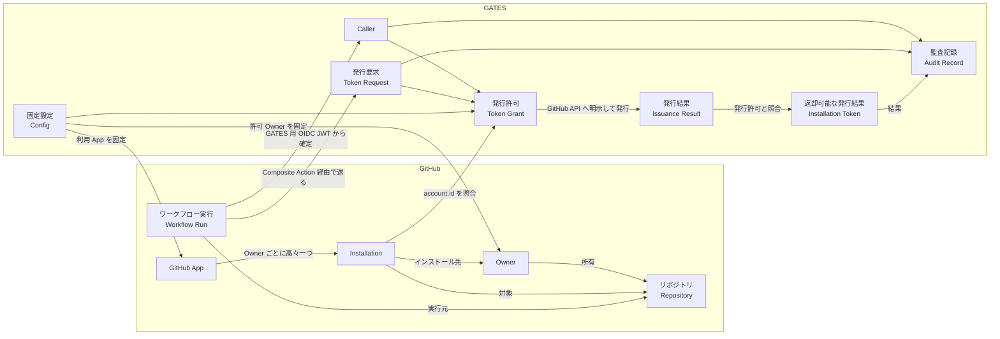
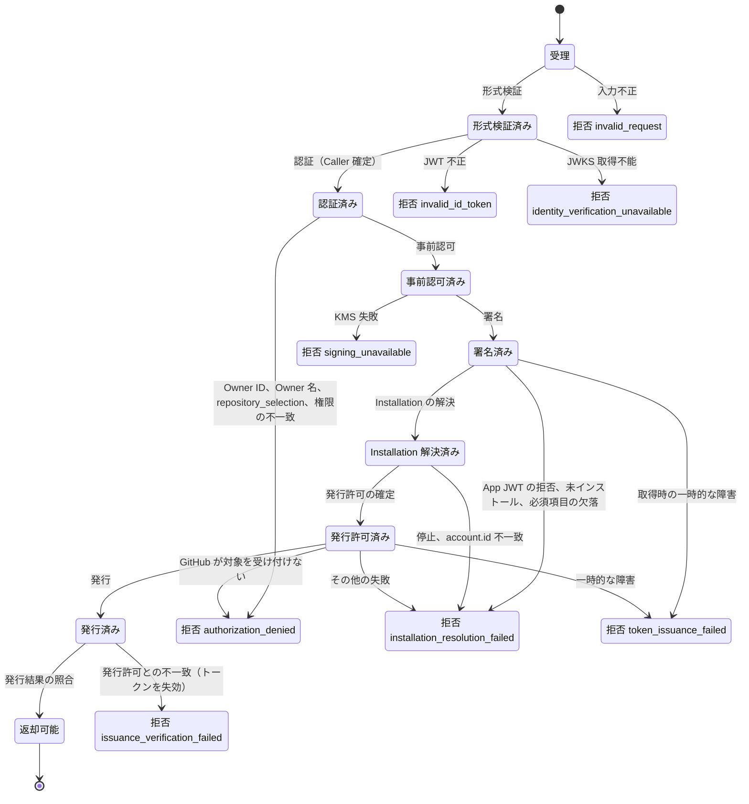
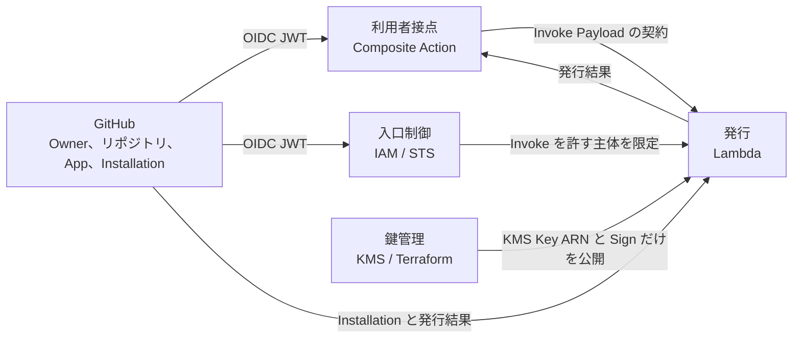

# Domain Model

GATES が扱う問題領域のドメインモデルです。
GATES は、許可された単一の Owner 配下の GitHub Actions ワークフローに、明示されたリポジトリへの `contents:read` に限定した短命な GitHub App Installation Access Token を発行します。

## 1. Purpose and Scope

本ドキュメントの目的は、Lambda 上の Go アプリケーション、Composite Action、Terraform の設計・実装・レビューが、概念の意味と判定のルールを一つのモデルから参照できるようにすることです。
中心に置くのは、Lambda が担う発行の判定です。
Composite Action、AWS IAM、KMS の鍵管理は、発行の判定と語の意味が異なる範囲として境界を示すにとどめます。

モデルが答える問いは次のとおりです。

- 発行要求を誰が出し、何を要求し、何が返るか
- Owner、リポジトリ、Installation を何で同定するか
- 発行を許可する条件は何か。拒否はどの段階で、どの種別として起きるか
- どの単位の中で、何が常に成り立たなければならないか
- 境界をまたぐと、同じ語の意味がどう変わるか

概念には英語名を併記します。
英語名は概念の名前であり、複数の単語は空白で区切ります（Token Request など）。
実装では空白を除いた形（TokenRequest など）を型名・関数名にし、実装と本ドキュメントの整合はこの対応で確かめます。
概念と実装の名前の対応表は [Lambda Design](lambda.md#5-domain-model) に置きます。

本ドキュメントの記述は、根拠の種類を次の表記で区別します。

- **事実**：情報源に根拠がある。出典を添える
- **推論**：根拠から導いた判断
- **候補**：本ドキュメントが補った語や区分で、情報源にはない
- **未確認**：情報源で決まっていない、または情報源どうしで食い違う

## 2. Problem Overview

GitHub Actions の `GITHUB_TOKEN` は、ワークフローが動くリポジトリの外を読めません。
別のリポジトリを読むには、GitHub App の Installation Access Token が要ります。
しかし、GitHub App の Private Key をワークフローに渡すと、鍵を持つ者が App の権限全体を使えてしまいます。

GATES は、この二つの要求を同時に満たす仲介者です。
鍵は AWS KMS に置いて署名だけを行わせ、ワークフローには、本人確認を経た上で、明示された対象と権限だけに絞ったトークンを渡します。
問題領域の関係者は 3 者です（事実：Requirements §3）。

- **ワークフロー利用者**：対象リポジトリと権限を指定してトークンを受け取る
- **GitHub App / Owner の管理者**：Installation の対象リポジトリを管理し、GATES で読める範囲の上限を決める
- **GATES 運用者**：許可 Owner、GitHub App、署名鍵を固定し、認証・認可・発行・監査を担う

GATES が所有する概念は、発行要求、Caller、発行許可、発行結果、監査記録です。
Owner、リポジトリ、GitHub App、Installation は GitHub が所有する概念で、GATES はそれらを参照し、照合します。

## 3. Concepts

### 3.1 GitHub Entities Referenced by GATES

| 概念 | 英語名 | 同一性 | 主な性質 | 根拠 |
|---|---|---|---|---|
| **Owner** | Owner | 不変 Owner ID | 名前（変更され得る）、種別（Organization またはユーザーアカウント）。リポジトリを所有する | 事実：Requirements §1、OIDC reference の `repository_owner_id` |
| **リポジトリ** | Repository | 不変 Repository ID | 完全名 `owner/repo`（名前変更・移管で変わり得る）、所有 Owner | 事実：OIDC reference の `repository_id`、Lambda Design §2.2 |
| **GitHub App** | GitHub App | Client ID | 権限の上限（GitHub 側で設定）、Private Key（25 個まで持てる） | 事実：Requirements §2.1、Lambda Design §7.2、Managing private keys for GitHub Apps |
| **Installation** | Installation | Installation ID | インストール先の Owner（`account.id`）、対象リポジトリの選び方（全リポジトリか選択したリポジトリか）、付与された権限、停止状態 | 事実：REST API endpoints for GitHub Apps の Installation の応答（`account`、`repository_selection`、`permissions`、`suspended_at`） |
| **ワークフロー実行** | Workflow Run | `run_id` と `run_attempt` | 実行元のリポジトリと Owner、実行文脈（ref、イベント、environment など）。OIDC JWT の `sub` は実行元と文脈を表し、実行そのものは識別しない | 事実：OIDC reference の `run_id`、`run_attempt`、`sub` |

Owner とリポジトリは、どちらも不変 ID と名前の二つの表現を持ちます。
名前は変わり得るため、認可の同一性は不変 ID で判断し、名前は要求の照合と GitHub API の呼び出しに使う表現と位置づけます（事実：Requirements FR-006、FR-002）。
名前が変わると、ID で同じものを指していても名前の照合は失敗します。
この失敗は、GATES では Fail Closed として受け入れます（事実：AWS Infrastructure Design §3.1）。

Installation は、GitHub App と Owner の組に対して高々一つ存在します（推論：REST API endpoints for GitHub Apps が Owner を指定して単一の Installation を返すエンドポイント `GET /orgs/{org}/installation` と `GET /users/{username}/installation` を提供することから）。
この性質があるため、GATES は Installation ID を設定に持たず、固定した GitHub App と許可 Owner から実行時に導出します（事実：Requirements FR-024）。

### 3.2 Fixed Configuration

**固定設定**（Config）は、GATES 運用者がデプロイ時に決め、実行時の入力からは変更できない値の集まりです（事実：Requirements FR-024、FR-009）。
そのうち許可 Owner に関する 3 つの値を **許可 Owner**（Allowed Owner）と呼びます。

| 値 | 英語名 | 使われ方 | 根拠 |
|---|---|---|---|
| 許可 Owner の不変 Owner ID | Allowed Owner ID | Caller の認可、Installation の `account.id` の照合、発行結果の `owner.id` の照合 | 事実：Requirements FR-006、Security Design §3.1 |
| 許可 Owner の名前 | Allowed Owner Name | 要求された完全名の Owner 部分の照合、Installation 取得 API のパス | 事実：Lambda Design §6 手順 3、§7.3 |
| 許可 Owner の種別 | Allowed Owner Type | Installation 取得 API の選択（Organization かユーザーか） | 事実：Lambda Design §7.3 |
| GitHub App の Client ID | Client ID | GitHub App JWT の `iss` | 事実：Lambda Design §7.2 |
| 署名鍵の KMS Key ARN | KMS Key ARN | GitHub App JWT の署名 | 事実：Lambda Design §7.2 |
| GATES 用 Audience | Audience | OIDC JWT の `aud` の照合 | 事実：Lambda Design §7.1 |
| Issuer | Issuer | OIDC JWT の `iss` の照合と Discovery / JWKS の取得先。`https://token.actions.githubusercontent.com` に固定。JWKS は Issuer の Discovery から得るため、独立した値を持たない | 事実：Lambda Design §7.1 |
| GitHub API Host | API Host | Installation の取得、トークンの発行と失効の呼び出し先。GitHub.com の API に固定 | 事実：Requirements FR-009、§2.2、Lambda Design §7.3 |

Authorization が読むのは、固定設定のうち許可 Owner（ID と名前）だけです。
Client ID、KMS Key ARN、Audience、Issuer、API Host は、認証、署名、Installation の解決、発行を担うコンポーネントが読みます。

### 3.3 Request and Decision

| 概念 | 英語名 | 種別 | 内容 | 根拠 |
|---|---|---|---|---|
| **発行要求** | Token Request | 値 | 対象（完全名の集合）、対象の選び方（`repository_selection` が `selected`）、App Permissions。利用者が明示する | 事実：Requirements FR-012、Lambda Design §2.1 |
| **完全名** | Full Name | 値 | `owner/repo` 形式のリポジトリ名。Owner 名とリポジトリ名に分割でき、比較は ASCII の範囲で大文字小文字を区別しない | 事実：Lambda Design §2.2 |
| **Permission** | Permission | 値 | 権限名と水準の組（`contents:read` など） | 事実：Requirements FR-008 |
| **App Permissions** | App Permissions | 値 | Permission の集合。要求では `{contents:read}` だけが許可される。名前は GitHub REST API の `permissions` オブジェクトのスキーマ名 | 事実：Requirements FR-008、Security Design §3.1、REST API endpoints for GitHub Apps のスキーマ「App Permissions」 |
| **許可権限** | Allowed Permissions | 値 | GATES が発行を許可する App Permissions。`{contents:read}` に固定 | 事実：Requirements §2.1 |
| **付随権限** | Implied Permissions | 値 | 要求にかかわらず GitHub が付与する Permission。`metadata:read` だけを許容する | 事実：Requirements FR-018 が除外の枠を定める。`metadata:read` が実際に付与されるかは公式文書で未確認で、実 API で確かめる。語は候補 |
| **Caller** | Caller | 値 | 検証済み OIDC JWT から確定した呼び出し元。不変 Owner ID と Repository ID で識別し、ワークフロー実行を特定する `run_id` と `run_attempt`、および実行文脈を監査のためだけに添える | 事実：Requirements FR-002 |
| **実行文脈** | Execution Context | 値 | ワークフロー実行がどう起動されたかを示す OIDC JWT の Claim の組。`actor`、`actor_id`、`event_name`、`ref`、`sha`、`workflow_ref`、`job_workflow_ref`、`environment`。どれも欠落し得る | 事実：OIDC reference、Lambda Design §7.1 |
| **発行許可** | Token Grant | 値 | Installation ID、対象の完全名の集合、許可権限。認可が成立した結果であり、GitHub API への発行要求の内容を定める | 事実：Lambda Design §5 の TokenGrant、Security Design §3.1 |

発行要求と Caller は、同じ Invoke Payload から取り出す別の概念です。
Payload の `id_token` は Caller を確定するための資格情報であり、発行要求の一部ではありません（事実：Lambda Design §5）。

Caller は、利用者の自己申告からは作れません（事実：Requirements FR-004）。
Caller の Owner ID は認可に使い、Repository ID、`run_id`、`run_attempt`、実行文脈は監査の識別だけに使います（事実：Requirements FR-002、Security Design §3.1）。
`run_id` と `run_attempt` を添えるのは、監査記録から GitHub 上のワークフロー実行にたどり着けるようにするためで、Caller の同一性には含めません（事実：Security Design §5）。
実行文脈を添えるのは、`pull_request_target` の悪用のように、どのイベントと ref でトークンを得たかが調査に要る場面で、GitHub 側の記録を参照せずに済ませるためです（事実：Security Design §5）。
実行文脈はベストエフォートの属性であり、欠落していても Caller は確定します。

発行許可は、Caller、発行要求、許可 Owner、取得した Installation の 4 つがそろい、[5.2 Rules](#52-rules) の認可条件と Installation の有効性をすべて満たしたときにだけ作られます。
発行許可があって初めて GitHub API へ発行を要求できる、という順序がこの概念の役割です。

### 3.4 Issuance Result

| 概念 | 英語名 | 種別 | 内容 | 根拠 |
|---|---|---|---|---|
| **発行結果** | Issuance Result | 値 | GitHub API が返した Installation Access Token、有効期限、対象リポジトリの一覧（各要素は Repository ID、完全名、`owner.id`）、実効権限、対象の選び方 | 事実：REST API endpoints for GitHub Apps の access_tokens の応答 |
| **実効権限** | Effective Permissions | 値 | 発行結果に含まれる App Permissions。許可権限と付随権限の範囲内であることを照合する | 事実：Requirements FR-016、FR-018 |
| **実効対象** | Repository Identity | 値 | 発行結果に含まれる各リポジトリ。Repository ID、`owner.id`、完全名を持つ。発行結果はこの集合を持つ | 事実：Lambda Design §5 |
| **返却可能な発行結果** | Installation Token | 値 | 発行許可との照合を通った発行結果。利用者に返せるのはこれだけ。名前は GitHub REST API の発行応答のスキーマ名で、`token`、`expires_at`、`permissions`、`repository_selection`、`repositories` を持つ | 事実：Lambda Design §5、REST API endpoints for GitHub Apps のスキーマ「Installation Token」 |

Installation Access Token はトークン文字列そのもの、Installation Token はそれに有効期限・対象・実効権限を添えた応答で、どちらも GitHub の名前です。
照合の条件は [5.3 Invariants](#53-invariants) に置きます。

### 3.5 Credentials

GATES の処理には 5 種類の資格情報が現れ、どれも「トークン」と呼ばれ得ます（事実：System Architecture §4）。
語の衝突を避けるため、本ドキュメントでは次の名前で区別します。

| 資格情報 | 英語名 | 発行元 | 用途 | 発行の判定に現れるか |
|---|---|---|---|---|
| **AWS 用 OIDC JWT** | Web Identity Token | GitHub OIDC Provider（`aud` は `sts.amazonaws.com`） | IAM Role の引き受け | 現れない。入口制御だけが扱う |
| **AWS 一時認証情報** | AWS Credentials | AWS STS | Lambda Invoke の署名 | 現れない |
| **GATES 用 OIDC JWT** | ID Token | GitHub OIDC Provider（`aud` は GATES 用 Audience） | Caller の確定 | 現れる。認証の入力。Payload の `id_token` と同じ名前（OIDC の応答名） |
| **GitHub App JWT** | App JWT | Lambda が組み立て、KMS が署名 | GitHub API の呼び出し | 現れる。内部でだけ使い、外に出さない |
| **Installation Access Token** | Installation Access Token | GitHub API | 対象リポジトリの読み取り | 現れる。発行結果の中心。返却可能な発行結果（Installation Token）はこれに有効期限・対象・実効権限を添えたもの |

どの資格情報も、ログとエラー本文に記録しません（事実：Requirements QR-004）。
資格情報のうち利用者に返すのは Installation Access Token だけです（事実：Requirements FR-016）。

### 3.6 Audit Record

**監査記録**（Audit Record）は、一回の発行処理の結果を、資格情報を含めずに残したものです（事実：Requirements FR-021）。

| 項目 | 記録する条件 | 根拠 |
|---|---|---|
| 相関 ID（Request ID、応答の `request_id`） | 常に | 事実：Requirements FR-021 |
| 時刻、結果（成功またはエラーコード） | 常に | 事実：Security Design §5 |
| Caller の Owner ID と Repository ID、`run_id` と `run_attempt` | 認証に成功した後だけ。認証前の失敗では未検証の値を Caller として記録しない | 事実：Security Design §5 |
| 実行文脈 | 認証に成功した後で、Claim が含まれていたものだけ | 事実：Security Design §5 |
| 要求対象、要求の `repository_selection`、要求権限 | 形式検証を通った後 | 事実：Lambda Design §1。時点は推論 |
| 失効の成否 | 照合に失敗し、発行済みのトークンを失効させようとした場合 | 事実：Lambda Design §3.1 |

監査記録の単位は発行処理 1 回です。
相関 ID は成功応答と失敗応答の両方に含め、ワークフローのログから監査記録へ、監査記録から `run_id` でワークフロー実行へ、双方向にたどれるようにします（事実：Requirements FR-016、FR-021）。

### 3.7 Relationships

## 4. Behavior

### 4.1 Operations

| 操作 | 英語名 | 主体 | 入力 | 結果 | 根拠 |
|---|---|---|---|---|---|
| トークンを要求する | （Composite Action の責務） | ワークフロー利用者 | 対象、権限、接続情報 | Composite Action が発行処理を起動する | 事実：Requirements §3、FR-019 |
| 形式検証 | Validate | Lambda Handler | Invoke Payload | 発行要求と GATES 用 OIDC JWT を取り出す、または入力不正 | 事実：Lambda Design §2.2 |
| 認証 | Authenticate | OIDC Verifier | GATES 用 OIDC JWT、固定設定 | Caller を確定する、または拒否 | 事実：Requirements FR-002 |
| 事前認可 | Authorize | Authorization | Caller、発行要求、許可 Owner | 外部呼び出しに進める、または認可拒否 | 事実：Lambda Design §6 手順 3 |
| 署名 | Sign | KMS Signer | GitHub App JWT の署名入力、KMS Key ARN | GitHub App JWT | 事実：Requirements FR-013 |
| Installation の解決 | Resolve Installation | Token Issuer | GitHub App JWT、許可 Owner の名前と種別 | 取得した Installation、または拒否（App JWT の拒否、未インストール、必須項目の欠落、一時的な障害） | 事実：Lambda Design §3.2、§7.3 |
| 発行許可の確定 | Grant | Authorization | 事前認可の結果、取得した Installation、許可 Owner | 発行許可、または拒否（`account.id` の不一致、停止） | 事実：Lambda Design §6 手順 5 |
| 発行 | Issue | Token Issuer | 発行許可、GitHub App JWT | 発行結果、または失敗 | 事実：Requirements FR-014、FR-015 |
| 発行結果の照合 | Verify | Token Issuer | 発行結果、発行許可、許可 Owner | 返却可能な発行結果、または拒否 | 事実：Requirements FR-018 |
| 失効 | Revoke | Token Issuer | 照合を通らなかった発行結果のトークン | 失効の成否。成否にかかわらず拒否のまま終わる | 事実：Requirements FR-007、FR-018、Lambda Design §3.1 |
| 監査記録の出力 | Audit | Lambda Handler | 発行処理の結果 | 監査記録 | 事実：Requirements FR-021 |
| 署名鍵を更新する | （運用手順） | GATES 運用者 | 新しい Private Key | 新しい KMS Key と、Lambda が参照する Key ARN の切り替え | 事実：Requirements FR-017、AWS Infrastructure Design §4.2 |
| Installation の対象を変える | （GitHub 側の操作） | GitHub App / Owner の管理者 | 対象リポジトリの選択 | 読み取り可能範囲の上限が変わる | 事実：Requirements §2.3、Security Design §3.2 |

操作の失敗は、次のエラーコードに対応します（事実：Lambda Design §3.2、§6）。

| 操作 | 失敗のエラーコード |
|---|---|
| Validate | `invalid_request` |
| Authenticate | `invalid_id_token`。JWKS を取得できなければ `identity_verification_unavailable` |
| Authorize | `authorization_denied` |
| Sign | `signing_unavailable` |
| Resolve Installation | `installation_resolution_failed`（App JWT の拒否、未インストール、必須項目の欠落）。一時的な障害は `token_issuance_failed` |
| Grant | `installation_resolution_failed`（`account.id` の不一致、停止） |
| Issue | `authorization_denied`（GitHub が対象を受け付けない）。一時的な障害は `token_issuance_failed`、その他の失敗は `installation_resolution_failed` |
| Verify | `issuance_verification_failed` |
| Revoke | なし。失効に失敗しても `issuance_verification_failed` のまま終わる |

一時的な障害は、通信の失敗、タイムアウト、5xx、レート制限による 403 / 429 を指します（事実：Lambda Design §3.2）。

どの段階にも属さない想定外の障害は `internal_error` で終わります。

最後の 2 つは GATES の外で行われる操作ですが、発行できる範囲を変えるため、モデルに含めます。
認可の境界は GATES の設定だけでは決まらず、Installation の対象に依存します。

### 4.2 Lifecycle of an Issuance

一回の発行処理は、次の状態を順にたどります。
各段階で失敗すると、その段階に対応するエラーコードで終わり、以降の段階には進みません（事実：Requirements QR-003、Lambda Design §6）。

`installation_resolution_failed` は、固定した GitHub App と許可 Owner から発行に使える Installation を得られない失敗をまとめたエラーコードです（事実：Lambda Design §3.2）。
利用者の要求に起因せず、運用者か Owner の管理者が直す必要がある失敗なので、`authorization_denied` と分けます。
再試行では解消しないため、一時的な障害を表す `token_issuance_failed` とも分けます。

`issuance_verification_failed` だけは、GitHub がトークンを発行した後の拒否です。
そのため、この状態に至るときはトークンの失効を試みます（事実：Lambda Design §3.1）。

認可が事前認可と発行許可の確定の二段に分かれるのは、Installation を取得しないと `account.id` を照合できず、Installation の取得には署名済みの GitHub App JWT が要るためです（推論：Lambda Design §6 手順 3 から 5 の順序から）。
事前認可は、KMS と GitHub API を呼ぶ前に、認可の見込みがない要求を落とすための段階です（事実：Lambda Design §6）。

### 4.3 Events Outside GATES That Change the Outcome

発行処理の外で起きる次の出来事は、GATES の設定を変えなくても発行の結果を変えます。

| 出来事 | 影響 | 根拠 |
|---|---|---|
| Owner の名前変更 | IAM Role の引き受けと Owner 名の照合が失敗し、設定を更新するまで発行が止まる | 事実：AWS Infrastructure Design §3.1 |
| リポジトリの名前変更・移管 | 旧名で要求すると、GitHub が受け付けないか `full_name` が一致しないかのいずれかで返却しない。新しい名前で要求すれば影響しない | 推論：Lambda Design §3.1 の照合条件から。旧名への GitHub の応答は未確認 |
| Installation の対象の追加・削除 | 読み取り可能範囲の上限が変わる | 事実：Security Design §3.2 |
| GitHub App の再インストール | Installation ID が変わるが、設定変更なしに新しい Installation を導出する | 事実：Security Design §3.2 |
| Installation の停止 | 取得した Installation の `suspended_at` が空でないため、発行許可を作らず `installation_resolution_failed` で閉じる。GitHub の発行 API を呼ばない | 事実：Security Design §3.1、Lambda Design §6 手順 5 |
| GitHub 側での旧 Private Key の失効 | 新しい KMS Key に切り替え済みなら影響しない | 事実：Requirements AC-14 |

## 5. Rules and Invariants

### 5.1 Identity Rules

| ルール | 内容 | 根拠 |
|---|---|---|
| ID による同定 | Owner の同一性は不変 Owner ID で判断し、名前の一致では代用しない | 事実：Requirements FR-006 |
| 名前の照合は補助 | 完全名の Owner 部分と許可 Owner 名の照合は、要求の整合性の確認であり、認可の根拠ではない。認可の根拠は Caller の Owner ID にあり、発行に使う Installation は `account.id` で確かめる | 推論：Security Design §3.1 の条件 1 と Installation の確認が ID、条件 2 だけが名前であることから |
| `sub` の形式 | Caller を確定できる OIDC JWT は、`sub` が `repo:OWNER@OWNER-ID/REPO@REPO-ID:...` の不変 ID 入り形式で、含まれる ID が `repository_owner_id`、`repository_id` の Claim と一致するものに限る | 事実：OIDC reference、Lambda Design §7.1 |
| 名前の比較規則 | 完全名の比較と重複判定は、ASCII の範囲で大文字小文字を区別しない。要求の重複判定、Owner 名の照合、`full_name` の照合で共通 | 事実：Lambda Design §2.2 |

### 5.2 Rules

| ルール | 適用対象 | 成立条件 | 例外 | 根拠 |
|---|---|---|---|---|
| 認可条件 | 事前認可 | Caller の Owner ID が許可 Owner ID と一致し、要求の各完全名の Owner 名が許可 Owner 名と一致し、`repository_selection` が `selected` で App Permissions が許可権限と等しい。満たさなければ `authorization_denied` | なし | 事実：Security Design §3.1 |
| Installation の有効性 | 発行許可の確定 | 取得した Installation の `account.id` が許可 Owner ID と一致し、`suspended_at` が空である。満たさなければ `installation_resolution_failed` | なし | 事実：Security Design §3.1 |
| 全件成立 | 複数対象の発行要求 | すべての対象が条件を満たすときだけ発行する。一部だけの発行や対象の縮小をしない | なし | 事実：Requirements FR-011 |
| 明示の要求 | GitHub API への発行要求 | 対象と権限を必ず明示し、省略による全対象・全権限の継承を起こさない | なし | 事実：Requirements FR-015、REST API endpoints for GitHub Apps の省略時の既定 |
| 付随権限の許容 | 発行結果の照合 | 実効権限は許可権限に等しいこと | 付随権限 `metadata:read` が含まれる場合だけ許容する | 事実：Requirements FR-018、Lambda Design §3.1 |
| 有効期限 | 発行結果 | GitHub が定めた有効期限をそのまま返し、延長しない | なし | 事実：Requirements FR-014 |
| 対象の上限 | 発行要求 | 対象は 500 件以下 | なし | 事実：Lambda Design §2.1、REST API endpoints for GitHub Apps |
| 入力不正と認可拒否の区別 | 形式検証と認可 | 値を読み取れない形は入力不正、読み取れて許可条件に合わない値は認可拒否 | なし | 事実：Lambda Design §2.2 |
| 設定の固定 | 固定設定 | 実行時の入力から許可 Owner、GitHub App、Installation、KMS Key、Issuer、JWKS、Audience、API Host を指定できない | なし | 事実：Requirements FR-009、FR-024 |
| Fail Closed | 発行処理 | いずれかの段階が成立しなければトークンを返さない | なし | 事実：Requirements QR-003 |
| 資格情報の非記録 | 監査記録、エラー本文 | 5 種類の資格情報と Private Key を含めない | なし | 事実：Requirements QR-004 |

Installation に対象リポジトリが含まれることを、GATES は発行前に確認しません（事実：Security Design §2 の Authorization の行）。
含まれない対象は、GitHub API が発行要求を受け付けないか、発行結果の対象一覧が要求と一致しないかのどちらかで検出します（推論）。
GitHub がどちらの振る舞いをするかで、エラーコードが `authorization_denied` と `issuance_verification_failed` のどちらになるかは変わりますが、トークンを返さない点は変わりません。
後者では GitHub がトークンを発行済みのため、返さないことに加えて失効を試みます。

### 5.3 Invariants

不変条件は、その値を作る時点で条件を検査し、条件を満たさない値を作らないことで守ります。

| 単位 | 時点 | 常に成り立つこと | 根拠 |
|---|---|---|---|
| 発行要求 | 形式検証を通った時点 | 対象が 1 件以上 500 件以下で、各要素が完全名の形式を満たし、大文字小文字を区別しない重複がない。`repository_selection` と App Permissions が読み取れる形である | 事実：Lambda Design §2.2 |
| Caller | 認証を通った時点 | 検証済みの GATES 用 OIDC JWT だけから作られ、Owner ID と Repository ID が `sub` の不変 ID と一致する | 事実：Requirements FR-002、FR-004、Lambda Design §7.1 |
| 発行許可 | 確定した時点 | [5.2 Rules](#52-rules) の認可条件をすべて満たす。対象は発行要求の対象と同じ集合で、App Permissions は許可権限に等しい。Installation ID は、`account.id` が許可 Owner ID と一致し、停止していない（`suspended_at` が空）Installation のものである | 事実：Security Design §3.1 |
| 返却可能な発行結果 | 照合を通った時点 | トークンが空でなく、有効期限が将来である。実効対象の完全名の集合が発行許可の対象と一致し、件数が同じで、余分・欠落・重複がない。各実効対象の Repository ID が有効で一意であり、`owner.id` が許可 Owner ID と一致する。実効権限が許可権限に付随権限を加えた範囲内で、`contents:read` を含む。`repository_selection` が `selected` である | 事実：Lambda Design §3.1、Requirements FR-018 |
| 発行処理 | 全体 | 返却可能な発行結果がなければトークンを返さない。照合を通らなかった発行結果のトークンは失効を試みる。固定設定は処理中に変わらない。資格情報をログとエラー本文に出さない | 事実：Requirements QR-003、FR-007、FR-018、FR-024、QR-004 |

「返却可能な発行結果」の条件のうち対象の全件一致は、GitHub が要求外の対象を黙って除いた場合も、余分な対象を加えた場合も検出します。
この条件があるため、FR-007 と FR-010 のうち「トークンを返さない」ことは GitHub の拒否の振る舞いに依存しません（推論）。
GitHub が発行した後に検出した場合、発行されたトークンが GitHub 上で無効になるかは失効の成否に依存します。
失効に失敗しても、そのトークンは Lambda の外に出ず、GitHub が定めた有効期限で失効します。

## 6. Bounded Contexts and Ubiquitous Language

### 6.1 Contexts

同じ語が境界をまたぐと意味を変えるため、次の 4 つの範囲を別の Bounded Context として扱います。

| Bounded Context | 英語名 | 担うこと | 実装 | 中心の語 |
|---|---|---|---|---|
| **発行** | Issuance | 発行要求と Caller から発行許可を確定し、発行結果を照合して返す | Lambda の Go アプリケーション | 本ドキュメント §3 の概念 |
| **入口制御** | Entry Control | 許可 Owner のワークフローだけに Lambda の Invoke を許す | IAM OIDC Provider、IAM Role、Terraform | `sub` のパターン、`aud`、AWS 一時認証情報、`lambda:InvokeFunction` |
| **利用者接点** | Workflow Integration | 利用者の入力を発行要求に変換し、発行結果を後続ステップへ渡す | Composite Action | `repositories` と `permissions` のカンマ区切り、接続情報、`GITHUB_OUTPUT` |
| **鍵管理** | Key Custody | KMS Key の作成、鍵素材のインポート、鍵の更新 | Terraform と独立した運用手順 | KMS Key、鍵素材、`PendingImport` と `Enabled`、`key_spec` |

GitHub は、Owner、リポジトリ、GitHub App、Installation を所有する上流です。
発行 Context は GitHub の API の語に従いつつ、完全名と `full_name`、リポジトリ名の配列と完全名の集合の間を翻訳します（事実：Lambda Design §7.3）。

入口制御と発行は、同じ GitHub OIDC Provider を信頼しますが、互いの判定を前提にしません。
AWS 一時認証情報と GATES 用 OIDC JWT が同じジョブで取得されたことは検証されず、発行の可否は GATES 用 OIDC JWT だけから判断します（事実：Security Design §2.2）。
この独立があるため、入口制御の資格情報が盗まれても、発行の可否は GATES 用 OIDC JWT から確定した Caller の Owner ID だけで決まります。

### 6.2 Terms Whose Meaning Changes Across Contexts

| 語 | 発行 | 入口制御 | 利用者接点 | 鍵管理 |
|---|---|---|---|---|
| トークン | GATES 用 OIDC JWT、GitHub App JWT、Installation Access Token | AWS 用 OIDC JWT、AWS 一時認証情報 | 上記すべてと Output の `token` | 現れない |
| Owner | 不変 Owner ID で同定する実体。名前と種別は設定値 | `sub` の先頭 `repo:<OWNER-NAME>@<OWNER-ID>/` という文字列パターン | 完全名の `owner` 部分 | 現れない |
| 権限 / permissions | GitHub App の App Permissions（`contents:read`） | IAM の許可（`lambda:InvokeFunction`、`kms:Sign`） | 入力の `permissions`（カンマ区切り）とワークフローの `permissions: id-token: write` | KMS Key Policy の署名権限と管理権限 |
| repositories | 発行要求の完全名の集合。GitHub API へはリポジトリ名の配列に変換する | 現れない | 入力と Output のカンマ区切り文字列 | 現れない |
| 鍵 | 署名鍵の KMS Key ARN。署名だけを依頼する | 現れない | 現れない | 鍵素材、KMS Key、Private Key のコピー |

## 7. Unverified GitHub Behavior

公式文書で確認できず、実 API で確かめる GitHub の振る舞いは次の 2 つです。
どちらもトークンを返すかどうかは変えません。

- 範囲外の対象を含む発行要求への応答。エラーコードの分類だけが変わる（[5.2 Rules](#52-rules)）
- 要求にかかわらず `metadata:read` が付与されるかどうか。付与されなくても照合は通る（[3.3 Request and Decision](#33-request-and-decision)）

## 8. Sources

- [Requirements](../spec/requirements.md)
- [Security Design](security.md)
- [Lambda Design](lambda.md)
- [System Architecture](architecture.md)
- [GitHub Actions Design](github-actions.md)
- [AWS Infrastructure Design](aws-infrastructure.md)
- [Testing Environment Setup](../contributing/setup-environment.md)
- [GitHub — OpenID Connect reference](https://docs.github.com/en/actions/reference/security/oidc)
- [GitHub — REST API endpoints for GitHub Apps](https://docs.github.com/en/rest/apps/apps)
- [GitHub — REST API endpoints for GitHub App installations](https://docs.github.com/en/rest/apps/installations)
- [GitHub — Managing private keys for GitHub Apps](https://docs.github.com/en/apps/creating-github-apps/authenticating-with-a-github-app/managing-private-keys-for-github-apps)
