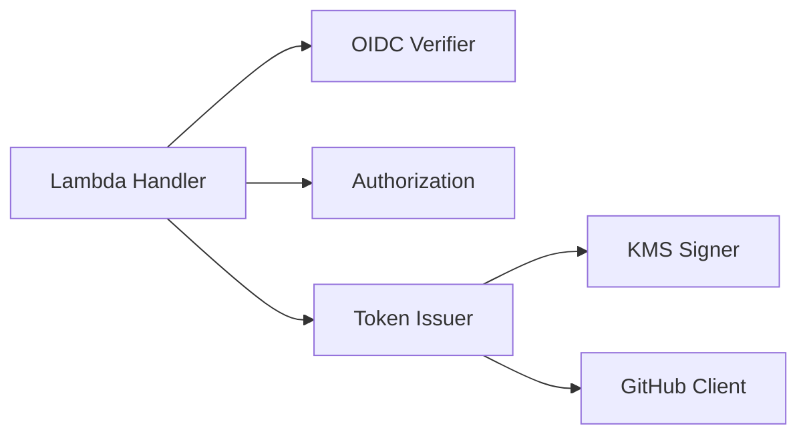

# Lambda Design

## 1. Responsibility and Invocation

Lambda は GitHub OIDC JWT の検証、GitHub App Installation への対象解決、`contents:read` の発行認可、KMS 署名、GitHub App Installation Access Token の発行を実行します。Go のパッケージやインターフェースは責務とテスト容易性に応じて設け、必要性のない抽象化を避けます。

Lambda は AWS IAM により認証・認可された同期 Invoke を受け付けます。Invoke の Payload に含まれる GATES 用 OIDC JWT の署名と Claim を検証し、要求を処理します。

| 項目 | 契約 |
|---|---|
| Transport | AWS Lambda `Invoke`、`InvocationType=RequestResponse` |
| AWS Authentication | 呼び出し元が AWS 一時認証情報で SigV4 署名する |
| Caller Identity | GATES 用 Audience の GitHub OIDC JWT を JSON Payload に含める |
| Payload | JSON。GATES が設ける上限を 16 KiB とする。無効な型・未知フィールドは拒否 |
| Response | JSON。呼び出し元は Invoke の `FunctionError` と Lambda 応答の `ok` をそれぞれ確認 |
| Endpoint | AWS Lambda Invoke API |

Lambda Invoke には HTTP の `Authorization` ヘッダーに相当するアプリケーション層のヘッダーがないため、GATES 用 OIDC JWT は `id_token` フィールドとして Payload に含めます。Payload は資格情報を含むため丸ごとログに記録せず、監査に必要な非秘密のフィールド（要求対象、`repository_selection`、要求権限）だけを記録します。

本ドキュメントでは、処理の段階を次の語で区別します。
Payload を GATES が読み取れるかの判定を **形式検証**、GATES 用 OIDC JWT から Caller を確定することを **認証**、GitHub API の発行応答を TokenGrant と突き合わせることを **照合** と呼びます。
概念の定義は [Domain Model](domain.md) を正本とします。

## 2. Request

### 2.1 Repository Request

```json
{
  "version": 1,
  "id_token": "<GATES_AUDIENCE_GITHUB_OIDC_JWT>",
  "repository_selection": "selected",
  "repositories": ["example-org/repo-a", "example-org/repo-b"],
  "permissions": {"contents": "read"}
}
```

| フィールド | ルール |
|---|---|
| `version` | 必須、整数 `1` |
| `id_token` | 必須、GATES 用 Audience の JWT。Bearer 資格情報として慎重に扱う |
| `repository_selection` | 必須、値は `selected`。GitHub の Installation と発行応答の `repository_selection` と同じ語彙で、要求が選択したリポジトリに限ることを明示する。`all` を含む他の値は認可拒否 |
| `repositories` | 必須、重複のない 1 件以上 500 件以下の `owner/repo` の配列。上限は GitHub のトークン発行 API が一度に受け付ける件数（[Generating an installation access token](https://docs.github.com/en/apps/creating-github-apps/authenticating-with-a-github-app/generating-an-installation-access-token-for-a-github-app) の「You can list up to 500 repositories」）。16 KiB の Payload には最短の要素で 2,000 件以上が入るため、Payload サイズより先にこの上限に達する |
| `permissions` | 必須、値は **`{"contents":"read"}`**。形式が不正なら入力不正、形式が正しく値が許可条件と異なれば認可拒否 |

- 対象は同一 Owner に属し、GATES で利用する同一の GitHub App Installation に含まれる必要がある。
- Caller / Owner / Installation ID と GitHub API Host を利用者から指定させない。
- 複数対象のうち一つでも許可条件を満たさなければ全件を拒否し、部分成功も自動分割もしない。
- GitHub API に渡す際は `owner/repo` を一度だけ `/` で分割し、Owner 名が許可 Owner 名に一致することを確認して、リポジトリ名の部分だけを `repositories` に指定する。要求時の `owner/repo` は応答の `full_name` と照合するため保持する。
- 各リポジトリに同じ App Permissions を適用する。別の権限を必要とする場合は個別に要求する。
- Lambda が返すトークンの対象は要求したリポジトリのみであり、App にインストール済みのすべてのリポジトリを意味しない。

### 2.2 Validation

Handler は入力型、未知フィールド、リストの重複、空値、`repository_selection` と App Permissions の形式、件数、サイズを検証します。
形式検証は、値を GATES が解釈できるかだけを判定します。
値が許可条件に合うかは、認証後に Authorization が判定します。
この順序の理由は [Security Design](security.md#31-authorization-rule) に記述します。

#### 入力不正と認可拒否の境界

各フィールドの値の形を、入力不正（`invalid_request`）と認可拒否（`authorization_denied`）に次のように分けます。
入力不正の形に当たらない要求だけが、Authorization の判定に進みます。

| フィールド | 入力不正にする形 | 認可拒否にする形 |
|---|---|---|
| `version` | 欠落、`null`、整数 `1` 以外（`1.0`、`"1"`、`2` を含む） | なし |
| `id_token` | 欠落、`null`、文字列以外、空文字列 | なし（JWT の検証失敗は `invalid_id_token`） |
| `repository_selection` | 欠落、`null`、文字列以外、空文字列 | `selected` 以外の文字列（`all` を含む） |
| `repositories` | 欠落、`null`、配列以外、空配列、文字列以外の要素、[完全名の形式](#名前の文字種と比較規則)に合わない要素、大文字小文字を区別しない重複、500 件超 | Owner 名が許可 Owner 名と異なる要素を含む |
| `permissions` | 欠落、`null`、オブジェクト以外、空オブジェクト、文字列以外の値、空文字列のキーまたは値 | `{"contents":"read"}` 以外の組（`contents` 以外のキー、`read` 以外の値、`metadata` などのキーの追加） |
| Payload 全体 | 16 KiB 超、JSON として不正、オブジェクト以外、未知のフィールド、重複したキー、不正な UTF-8、オブジェクトの後に続くデータ | なし |

空の App Permissions を入力不正にするのは、`permissions` が必須であり、[Requirements](../spec/requirements.md) FR-012 が欠落・未知値を広い既定権限に読み替えないと定めているためです。
空の Map は、要求の欠落と同じく、要求した権限を読み取れない形として扱います。
一方で、未知のキー（`issues` など）は認可拒否にします。
`contents:write` と同じく、形式は読み取れて値が許可外の要求であり、監査記録に残す対象だからです。

重複したキーを入力不正にするのは、`{"contents":"write","contents":"read"}` のような Payload の解釈が JSON の実装ごとに分かれるためです。
後の値を採る実装はこの Payload を `contents:read` として認可しますが、監査記録や別の処理が先の値を読むと、認可した内容と記録した内容が食い違います。

Owner 名の不一致を認可拒否にするのは、[Processing Flow](#6-processing-flow) の手順 3 が Owner 名の照合を Authorization の判定に置いているためです。
形式検証は、`owner/repo` を Owner 名とリポジトリ名に分割できるかまでを見ます。

500 件を超える要求を入力不正にするのは、GitHub API に渡すと、その応答が対象を受け付けなかった応答として `authorization_denied` に分類され（[Failure](#32-failure)）、件数の超過が認可拒否として記録されるためです。
形式検証で止めれば、KMS と GitHub API を呼ばずに済みます。

#### 名前の文字種と比較規則

`repositories` の各要素は、`/` をちょうど一つ含み、その前の Owner 名と後のリポジトリ名がどちらも空でない文字列です。
Owner 名とリポジトリ名は、次の文字種に限ります。

| 名前 | 受け付ける文字種と長さ | 根拠 |
|---|---|---|
| Owner 名 | 1 文字以上の ASCII 英数字とハイフン | ユーザー名の文字種は公式文書で確認した。ハイフンの位置と長さは緩い側に寄せた（下記） |
| リポジトリ名 | 1 文字以上 100 文字以下の ASCII 英数字、ハイフン、アンダースコア、ピリオド | 公式文書で確認した。`.` と `..` は緩い側に寄せた（下記） |

公式文書で確認できたのは次の規則です。

- **リポジトリ名**：100 文字以下で、ASCII の英字、数字、`.`、`-`、`_` だけを含む（[Creating a new repository](https://docs.github.com/en/repositories/creating-and-managing-repositories/creating-a-new-repository)）
- **ユーザー名**：英数字とハイフンだけを含む（[Username considerations for external authentication](https://docs.github.com/en/enterprise-cloud@latest/admin/managing-iam/iam-configuration-reference/username-considerations-for-external-authentication)）

公式文書で確認できなかった規則は、GitHub が受け付ける名前を拒否しない側に寄せ、形式検証で課しません。
GATES が GitHub より厳しい規則を持つと、正当な要求が入力不正になり、利用者には原因が分からないためです。
該当するのは次の規則です。

- **Owner 名のハイフンの位置**：先頭・末尾のハイフンと連続したハイフンの禁止は、上の文書で Enterprise Managed Users が正規化したユーザー名にだけ書かれている
- **Owner 名の長さ**：39 文字の上限は、上の文書で Enterprise Managed Users のユーザー名にだけ書かれている
- **リポジトリ名 `.` と `..`**：公式文書に記述がなく、文字種の規則だけでは拒否できない

一方で、Owner 名の文字種にも確認できなかった部分があります。
ユーザー名の規則の「英数字」が ASCII に限るかを公式文書は明言しておらず、Organization 名に固有の規則を書いた公式文書は見つかりませんでした。
それでも Owner 名に上の文字種を課せるのは、そうしても正当な要求を拒否しないためです。
許可 Owner 名は同じ文字種を満たす値としてデプロイ時に固定するため、この文字種に合わない Owner 名の要求は、形式検証を通しても Owner 名の照合で必ず拒否されます。
Owner 名の規則を課すかどうかは、結果を入力不正と認可拒否のどちらにするかだけを変えます。
リポジトリ名の文字種が `/` を含まないため、`a/b/c` は入力不正になり、リポジトリ名 `b/c` が GitHub API の `repositories` に渡ることはありません。

名前の比較と重複判定は、ASCII の範囲で大文字小文字を区別せずに行います。
Unicode の大文字小文字の対応（Go の `strings.EqualFold` など）を使わないのは、Kelvin 記号（U+212A）と `k` のように、GitHub 上では別の文字が同じ文字として扱われ得るためです。
比較の規則は、要求の重複判定、Owner 名の照合、発行応答の `full_name` の照合（[Success](#31-success)）で共通です。

入力文字列のリポジトリ名だけから所有権を判断せず、要求元の Owner は検証済み JWT に基づいて決定します。

## 3. Responses

### 3.1 Success

```json
{
  "ok": true,
  "token": "<INSTALLATION_ACCESS_TOKEN>",
  "expires_at": "<RFC3339_EXPIRATION_TIME>",
  "repository_selection": "selected",
  "repositories": ["example-org/repo-a", "example-org/repo-b"],
  "permissions": {"contents": "read", "metadata": "read"},
  "request_id": "<OPAQUE_ID>"
}
```

`repositories` は照合済みの発行対象を GitHub 応答の `full_name` で示します。`permissions` は GitHub 応答の実効権限、`repository_selection` は GitHub 応答の対象の選び方、`expires_at` は GitHub が定めた有効期限（RFC 3339 形式）です。GATES は有効期限を延長しません。
`request_id` は失敗応答と同じ相関 ID で、資格情報ではありません。
値には Lambda の request ID（Invoke 応答のヘッダー `x-amzn-RequestId` と同じ値）をそのまま使います。
CloudWatch Logs に自動で記録されるため、独自に採番しなくても監査記録と突き合わせられます。
成功時にも返すのは、呼び出し元がワークフローのログに残し、監査記録と突き合わせられるようにするためです（[Requirements](../spec/requirements.md) FR-021）。

Lambda は GitHub API の発行応答を次の条件で照合し、必要な情報が得られなければトークンを返しません。

- `token` が空でなく、`expires_at` が有効な将来日時であること。
- `repositories` が存在し、要求と同じ件数の対象を返すこと。`full_name` と要求名を大文字小文字を区別せず集合で照合し、余分な対象・欠落・重複を拒否すること。
- 各対象の Repository ID が有効かつ一意で、`owner.id` が許可 Owner ID と一致すること。ID は応答の整合性確認に用い、事前に確定した ID との照合とはみなさないこと。
- `permissions.contents` が `read` であり、追加 Permission は `metadata:read` が応答に含まれる場合に限り許容すること。その他の Permission は拒否すること。
- `repository_selection` が `selected` であること。`all` は要求外の対象を含むため拒否すること。

GitHub API の応答が照合条件に適合しない場合は `issuance_verification_failed` として拒否します。GitHub API の通信障害と区別するのは、発行応答の不整合が設定ミスや GitHub 側の仕様変更を示す監視対象だからです。

照合に失敗した時点で、GitHub はすでにトークンを発行しています。
応答に空でない `token` があれば、Lambda はそのトークンで `DELETE /installation/token` を呼び、失効させてから拒否します。
返さないだけで失効させないと、要求外の対象や権限を持つトークンが有効期限まで GitHub 上で有効なまま残るためです。
失効はベストエフォートとし、失効に失敗してもエラーコードは `issuance_verification_failed` のまま変えず、失効の成否を監査記録に残します。
失効できなかったトークンも利用者には返さないため、Lambda の外に出ることはなく、GitHub が定めた有効期限で失効します。

### 3.2 Failure

```json
{
  "ok": false,
  "error": {
    "code": "authorization_denied",
    "message": "The requested token is not permitted."
  },
  "request_id": "<OPAQUE_ID>"
}
```

`request_id` は成功応答と同じくトップレベルに置きます。
相関 ID は応答全体の属性であり、呼び出し元が `ok` の値によらず同じ場所から読めるようにするためです。

Handler は処理中の panic を回復し、`internal_error` の失敗応答として `request_id` とともに返します。
`FunctionError` になるのは、タイムアウト、メモリ不足、初期化の失敗のように Handler が応答を書けない場合だけです。
この場合は応答に `request_id` がないため、呼び出し元は Invoke の時刻と `run_id` で CloudWatch Logs の記録と突き合わせます。

| Error code | 内容 |
|---|---|
| `invalid_request` | Payload が [Validation](#22-validation) の入力不正の形に当たる |
| `invalid_id_token` | GitHub OIDC JWT が不正、期限切れ、必須 Claim の欠落・不整合 |
| `authorization_denied` | Caller の Owner ID が許可 Owner と不一致、要求した `repository_selection` / 権限が許可条件外、または要求リポジトリが許可 Owner / Installation の範囲外 |
| `identity_verification_unavailable` | OIDC Discovery / JWKS 等の検証に失敗 |
| `signing_unavailable` | KMS 署名に失敗 |
| `installation_resolution_failed` | 固定した GitHub App と許可 Owner から、発行に使える Installation を得られない。一時的な障害を除く GitHub API の失敗（App JWT が受け付けられない 401、GitHub App が許可 Owner にインストールされていない 404 など）、Installation の応答に必要な項目がない、Installation が停止している（`suspended_at` が空でない）、`account.id` が許可 Owner ID と一致しない |
| `token_issuance_failed` | GitHub API の一時的な障害。通信の失敗、タイムアウト、5xx、レート制限による 403 / 429 で、Installation の取得と発行要求の両方を含む。再試行で解消し得る |
| `issuance_verification_failed` | GitHub API の発行応答が [Success](#31-success) の照合条件に適合しない。発行済みのトークンは失効させる |
| `internal_error` | 想定外の内部障害 |

GitHub API の失敗は、原因を直す主体で分けます。
一時的な障害は `token_issuance_failed` に分類し、呼び出し元の再試行に委ねます。
要求した対象を GitHub が受け付けなかった応答（Installation の範囲外や存在しないリポジトリによる 422 など）は利用者の要求に起因するため、`authorization_denied` に分類します。
それ以外の失敗は `installation_resolution_failed` に分類します。
Client ID の誤り、KMS Key と GitHub に登録した Private Key の不一致、Installation の削除や停止のように、運用者か Owner の管理者が GitHub 側か固定設定を直す必要がある失敗だからです。
発行要求で起きた 401 / 403 / 404 も、直前に同じ App JWT で Installation を取得できているため、要求の間に Installation か App の状態が変わったものとしてこのコードに含めます。
この分類に用いる応答の形式は実 API で確認します。

`installation_resolution_failed` を `authorization_denied` と分けるのは、利用者の要求に起因しない失敗だからです。
`authorization_denied` に含めると、監査記録では利用者の要求が許可外だったように見えます。
`token_issuance_failed` と分けるのは、再試行では解消せず、運用者の対応を要するためです。

`installation_resolution_failed` と `issuance_verification_failed` は、どちらも設定ミスや GitHub 側の仕様変更を示し得る監視対象です。
両者の境界は、GitHub がトークンを発行したかどうかにあります。
Installation の応答の形式が想定と異なる場合は、トークンが存在しないため `installation_resolution_failed` に、発行応答の形式が想定と異なる場合は、失効させるべきトークンが存在するため `issuance_verification_failed` に分類します。

外部エラーをそのまま応答へ転記しません。認証情報を含む詳細を公開せず、相関 ID によってログと突き合わせます。Lambda の処理結果は `ok` で示し、Invoke 自体の結果と区別します。呼び出し側での AWS CLI 終了コード、`FunctionError`、`ok` の判定は [GitHub Actions Design](github-actions.md) に記述します。

## 4. Logical Components



| Component | 責務 |
|---|---|
| Lambda Handler | Payload の形式検証、各コンポーネントの呼び出し順序の制御、監査情報の記録、応答形式 |
| OIDC Verifier | GitHub OIDC JWT の署名・Issuer・Audience・時間・Claim 検証と Caller の確定 |
| Authorization | Caller、要求（対象、`repository_selection`、権限）、取得済み Installation、固定設定から発行可否を判定し、TokenGrant を確定。ネットワーク通信を行わない |
| Token Issuer | KMS Signer による App JWT の作成、GitHub Client を使った Installation の取得とトークン発行、GitHub 応答の TokenGrant への照合、照合に失敗したトークンの失効 |
| KMS Signer | 固定された非対称 KMS Key とアルゴリズムで署名 |
| GitHub Client | GitHub API（Installation の取得、トークン発行、トークンの失効）に対する HTTP 通信と応答の復号 |

このコンポーネント区分は責務のモデルであり、Go パッケージへの一対一の対応を要求しません。

## 5. Domain Model

概念の定義、ルール、不変条件は [Domain Model](domain.md) を正本とします。
本ドキュメントでは、その概念を実装でどう呼び、どのコンポーネントが持つかだけを示します。

| Domain Model の概念 | 実装での名前 | 持つコンポーネント | 補足 |
|---|---|---|---|
| 完全名 | FullName | Lambda Handler、Authorization、Token Issuer が共用 | [名前の文字種](#名前の文字種と比較規則)を満たし、比較は ASCII の範囲で大文字小文字を区別しない |
| 発行要求 | TokenRequest | Lambda Handler が作り、Authorization が読む | Payload から GATES 用 OIDC JWT を除いた部分 |
| Caller | Caller | OIDC Verifier が作り、Authorization と監査記録が読む | Owner ID と Repository ID で識別し、`run_id`、`run_attempt`、実行文脈（ExecutionContext）を監査のために添える |
| GATES 用 OIDC JWT（ID Token） | IDToken | OIDC Verifier | go-oidc の `IDToken` 型。Payload の `id_token` から認証して得る |
| App Permissions | AppPermissions | Lambda Handler、Authorization、Token Issuer が共用 | 要求の `permissions` と応答の `permissions` の両方をこの型で扱う |
| 固定設定 | Config | Lambda Handler が起動時に読み、各コンポーネントへ渡す | 許可 Owner（AllowedOwner）、Client ID、KMS Key ARN、Audience、Issuer、GitHub API Host。JWKS は Issuer の Discovery から得るため、独立した値を持たない |
| Installation | Installation | Token Issuer が取得し、Authorization が照合する | Installation ID、`account.id`、`suspended_at` |
| 発行許可 | TokenGrant | Authorization が作り、Token Issuer が読む | Installation ID、対象の完全名、App Permissions |
| 発行結果 | IssuanceResult | Token Issuer | GitHub API の発行応答。照合前の値 |
| 実効対象 | RepositoryIdentity | Token Issuer | 発行応答の各リポジトリの ID、`owner.id`、`full_name` |
| 返却可能な発行結果 | InstallationToken | Token Issuer が作り、Lambda Handler が返す | 照合を通った発行結果だけをこの型にする |
| 監査記録 | AuditRecord | Lambda Handler | 相関 ID（RequestID）、結果、Caller、要求対象、要求の `repository_selection`、要求権限、失効の成否 |

`TokenGrant` は認可済みの発行範囲を Token Issuer に渡すための値です。複数リポジトリには共通の App Permissions を適用し、対象ごとの違いが必要なら別のトークンを要求します。

表にない概念は、独立した型にしません。
Permission は AppPermissions の要素、Allowed Permissions と Implied Permissions は AppPermissions 型の定数、Allowed Owner Type は AllowedOwner の `Type` フィールドの値型 OwnerType です。
[Domain Model](domain.md#41-operations) の操作名（Validate、Authenticate、Authorize、Sign、Resolve Installation、Grant、Issue、Verify、Revoke、Audit）は、空白を除いた形を各コンポーネントの関数名にします。

[Request](#2-request) の「Repository Request」は Payload の形式の名前であり、TokenRequest は Payload から GATES 用 OIDC JWT を除いた発行要求の概念です。
形式検証を通った Repository Request から、GATES 用 OIDC JWT と TokenRequest を分けて取り出します。

## 6. Processing Flow

1. Handler が Payload サイズ、JSON 型、未知フィールド、必須値、対象の件数、`repository_selection` と App Permissions の形式を形式検証し、資格情報をログに残さない。
2. OIDC Verifier が固定 Issuer / JWKS と GATES 用 Audience で JWT を認証し、`repository_owner_id` と `repository_id` の Claim、および不変 ID 入り `sub` との一致から Caller を確定する。`run_id`、`run_attempt`、実行文脈は監査のために Caller に添える。
3. Authorization が Caller の Owner ID を固定した許可 Owner ID と照合し、`repository_selection` が `selected`、App Permissions が `contents:read` のみであることを確認し、要求された各 `owner/repo` の Owner 名を固定した許可 Owner 名と照合する。不一致なら外部呼び出しに進まず拒否する。
4. Token Issuer が KMS Signer で GitHub App JWT を生成し、GitHub Client で許可 Owner の Installation を取得する。取得の失敗は [Failure](#32-failure) の分類に従い、一時的な障害なら `token_issuance_failed`、それ以外なら `installation_resolution_failed` として拒否する。
5. Authorization が Installation の `account.id` を固定 Owner ID と照合し、`suspended_at` が空であることを確認して、Installation ID、要求対象名、固定 Permission から TokenGrant を確定する。停止している、または `account.id` が一致しなければ `installation_resolution_failed` として拒否し、発行 API を呼ばない。
6. Token Issuer が Grant の各 `owner/repo` から Owner を除いたリポジトリ名の配列と `permissions` を GitHub API に明示してトークンを取得する。GitHub 応答の `full_name` は Grant の元の `owner/repo` と全件照合し、Owner ID、Repository ID の有効性・一意性、実効権限が許可範囲内であることを照合する。必要な一覧・権限の欠落や不一致があれば、応答のトークンを失効させ、`issuance_verification_failed` として返却しない。
7. Handler が必要最小限の成功応答を返す。いずれかに失敗した場合は安全なエラーコードと相関 ID を返し、トークンは返さない。

Owner ID、`repository_selection` / 権限、Owner 名の照合（手順 3）を Installation の取得（手順 4）より先に置くのは、KMS と GitHub API の呼び出しを認可の見込みがある要求だけに限るためです。

## 7. External Integrations

### 7.1 OIDC Validation

- Issuer を `https://token.actions.githubusercontent.com` に固定し、固定 Issuer に対応する Discovery / JWKS を利用する。
- 署名アルゴリズムを許可済み方式に限定する。署名・Issuer・Audience・期限の検証を保守される OIDC ライブラリに委譲する。
- Audience は GATES 用値との完全一致を確認する。`iat` / `nbf` / `exp` と許容時計差を検証し、無効な時間条件を拒否する。
- `repository_owner_id`、`repository_id` の Claim と、`sub` に含まれる不変 ID の一致を確認し、ID の欠落・不一致を拒否する。
- `run_id` と `run_attempt` を必須 Claim として読み取り、監査のために Caller に添える。認可には使わない。欠落は Fail Closed の原則に従って拒否する。
- 実行文脈として、`actor`、`actor_id`、`event_name`、`ref`、`sha`、`workflow_ref`、`job_workflow_ref`、`environment` の Claim を読み取り、監査のために Caller に添える。認可には使わない。これらは監査記録を詳しくするためのベストエフォートの属性であり、欠落していても拒否せず、欠落したまま記録する。`environment` のように、ジョブの設定によって含まれない Claim があるためである。
- 任意の Issuer / JWKS / `jku` を入力から指定させない。通信時間とレスポンスサイズを制限し、鍵取得不能なら拒否する。

### 7.2 KMS Signing

- GitHub App JWT の Header を RS256 とし、Claim は `iss`、`iat`、`exp` を設定する。`iss` には GitHub App の Client ID を用いる。`iat` は時計差を考慮して現在時刻の 60 秒前とし、`exp` は GitHub の上限である 10 分を超えない。
- Header と Payload を Base64URL（padding なし）で結合し、署名入力を SHA-256 でハッシュする。
- AWS KMS `Sign` に `SigningAlgorithm=RSASSA_PKCS1_V1_5_SHA_256`、`MessageType=DIGEST`、計算済みダイジェストを渡す。二重ハッシュをしない。
- 署名結果を Base64URL で連結し、内部 GitHub App JWT を作成する。
- Lambda が保持するのは GitHub App の Client ID、KMS Key ARN、必要な設定だけであり、秘密鍵の平文は受け取らない。KMS Key の設定は Terraform、鍵素材インポートは独立した運用手順で行い、実行時の責務外とする。

### 7.3 GitHub Client

- App JWT で許可 Owner の Installation を取得し、Installation ID、`account.id`、`suspended_at` を得る。取得に使うエンドポイントは、デプロイ時に固定した Owner の種別で選ぶ。Organization なら `GET /orgs/{org}/installation`、ユーザーアカウントなら `GET /users/{username}/installation` を呼び出す。失敗の分類は [Failure](#32-failure) に従う。`suspended_at` は Installation に含めて返し、停止の判定は Authorization が行う（[Processing Flow](#6-processing-flow) の手順 5）。トークン発行には `POST /app/installations/{installation_id}/access_tokens` を使用する。
- 照合に失敗したトークンの失効には `DELETE /installation/token` を使用する。このエンドポイントは App JWT ではなく、失効させる Installation Access Token 自体で認証する。失効の要求にもタイムアウトを設け、失敗しても再試行せずに監査記録へ残す。
- `GET /repos/{owner}/{repo}/installation` はどちらの種別にも使えるが、採用しない。要求されたリポジトリから Installation を引くことになり、固定した設定から Installation を導出する [Requirements](../spec/requirements.md) FR-024 から外れるためである。
- GATES の要求は `owner/repo` 形式とする。GitHub のトークン発行 API の `repositories` はリポジトリ名だけを受け取るため、Owner 名が許可 Owner 名に一致することを確認してリポジトリ名の配列へ変換する。変換前の完全名と API 応答の `full_name` を照合する。
- GitHub API に変換後の `repositories` と `permissions` を必ず指定する。応答照合の期待値と欠落時の扱いは本ドキュメントの [Responses](#3-responses) を正本とし、実 API で確認する。
- API Host、API バージョン、HTTP Header は信頼済み設定で固定する。タイムアウト・レスポンスサイズ上限を設け、API エラー本文に含まれる資格情報をログへ転記しない。

## 8. Technology Decisions

| 用途 | 採用技術・方針 | 理由 |
|---|---|---|
| Lambda | `github.com/aws/aws-lambda-go/lambda` | AWS 公式の Go ランタイム連携 |
| AWS SDK / KMS | AWS SDK for Go v2 (`config`、`service/kms`) | AWS 公式の認証情報解決・KMS API |
| GitHub OIDC 検証 | `github.com/coreos/go-oidc/v3/oidc` | Discovery / JWKS / JWT 検証を信頼できるライブラリに委譲 |
| GitHub REST API | `net/http`、`encoding/json` | 限られたエンドポイントを Go 標準ライブラリで処理 |
| App JWT 組み立て | 標準ライブラリと KMS Sign | JWT の署名検証器は自作しない |
| テスト | Go `testing`、`httptest` を基礎として、必要なら補助ライブラリを追加 | 環境依存しないテストを優先。追加依存を一律禁止しない |

依存関係は保守体制・必要性・脆弱性・ライセンス・間接依存を評価して決めます。Go のパッケージ化、内部インターフェースやテストヘルパーの採用は実装担当者の裁量とし、正当な理由のある構造化を妨げません。

### 8.1 Go Packages

入力と認可の処理は、次の package に分けます。
どれも通信と外部ライブラリを持ちません。
OIDC Verifier、Token Issuer、KMS Signer、GitHub Client の package は、それぞれを実装するときに加えます。

| Package | 対応する論理コンポーネント | 責務 | 依存先 |
|---|---|---|---|
| `internal/repository` | Lambda Handler、Authorization、Token Issuer が共通で使う | FullName の分割と検証、Owner 名と FullName の比較 | なし |
| `internal/request` | Lambda Handler の形式検証 | Payload の復号と形式検証。GATES 用 OIDC JWT と TokenRequest を分けて返す | `repository` |
| `internal/authz` | Authorization | AllowedOwner、Caller、TokenRequest、Installation から発行の可否を判定し、TokenGrant を確定する | `repository`、`request` |

`internal/repository` を独立させるのは、要求の重複判定、Owner 名の照合、発行応答の `full_name` の照合が、同じ比較規則を使うためです。
各 package に比較を書くと、一か所だけが大文字小文字の扱いや分割の規則を違えたときに、照合の結果が食い違います。

Caller と TokenGrant は `internal/authz` に置きます。
どちらも Authorization の入力か出力であり、Caller は OIDC Verifier が作り、TokenGrant は Token Issuer が読みます。
OIDC Verifier と Token Issuer の package が `internal/authz` を import しても、`internal/authz` は通信を持たないため、副作用が `internal/authz` に入りません。

この構成と [Domain Model](domain.md) の概念は、実装の前に置いた雛形です。
実装で概念の過不足や名前のずれが分かったときは、コードと本ドキュメントを同じ変更で直します。

## 9. Testability

認可判断はネットワーク通信と分離してテストできるようにします。GitHub API の HTTP は `httptest`、KMS の API 境界はテストダブル、OIDC は固定鍵とテスト JWT / JWKS を用いて確認します。リポジトリ名の変換では `owner/repo` からリポジトリ名だけが GitHub API に渡ること、異なる Owner・不正な区切り・大文字小文字の違い・重複を適切に処理すること、応答の `full_name` が元の要求と一致しない場合に拒否することを検証します。
受け入れ条件にない次の事例も検証します。

- 501 件の対象を要求すると `invalid_request` になる
- 発行応答の `repository_selection` が `all` のとき `issuance_verification_failed` になり、トークンを返さず、失効 API を呼ぶ
- 失効 API が失敗しても `issuance_verification_failed` のままで、失効の失敗が監査記録に残る
- 取得した Installation の `suspended_at` が空でないとき `installation_resolution_failed` になり、発行 API を呼ばない
- Installation の取得が 401 のとき `installation_resolution_failed`、5xx やタイムアウトのとき `token_issuance_failed` になる
- Handler 内の panic が `internal_error` の失敗応答になり、`request_id` を含む
- 実行文脈の Claim が欠落していても拒否せず、欠落したまま監査記録に残る

受け入れ条件は [Requirements](../spec/requirements.md) を正本とします。

## 10. Sources

- [AWS — Lambda Invoke](https://docs.aws.amazon.com/lambda/latest/dg/invocation-sync.html)
- [AWS — AWS CLI Lambda Invoke](https://docs.aws.amazon.com/cli/latest/reference/lambda/invoke.html)
- [AWS — aws-lambda-go](https://github.com/aws/aws-lambda-go)
- [AWS — AWS SDK for Go v2](https://docs.aws.amazon.com/sdk-for-go/v2/developer-guide/)
- [AWS — KMS Sign](https://docs.aws.amazon.com/kms/latest/APIReference/API_Sign.html)
- [GitHub — OIDC reference](https://docs.github.com/en/actions/reference/security/oidc)
- [GitHub — GitHub App JWT](https://docs.github.com/en/apps/creating-github-apps/authenticating-with-a-github-app/generating-a-json-web-token-jwt-for-a-github-app)
- [GitHub — Generating an installation access token](https://docs.github.com/en/apps/creating-github-apps/authenticating-with-a-github-app/generating-an-installation-access-token-for-a-github-app)
- [GitHub — REST API endpoints for GitHub Apps](https://docs.github.com/en/rest/apps/apps)
- [GitHub — REST API endpoints for GitHub App installations](https://docs.github.com/en/rest/apps/installations)
- [GitHub — Rate limits for the REST API](https://docs.github.com/en/rest/using-the-rest-api/rate-limits-for-the-rest-api)
- [GitHub — Creating a new repository](https://docs.github.com/en/repositories/creating-and-managing-repositories/creating-a-new-repository)
- [GitHub — Username considerations for external authentication](https://docs.github.com/en/enterprise-cloud@latest/admin/managing-iam/iam-configuration-reference/username-considerations-for-external-authentication)
- [Go — coreos/go-oidc/v3/oidc](https://pkg.go.dev/github.com/coreos/go-oidc/v3/oidc)
