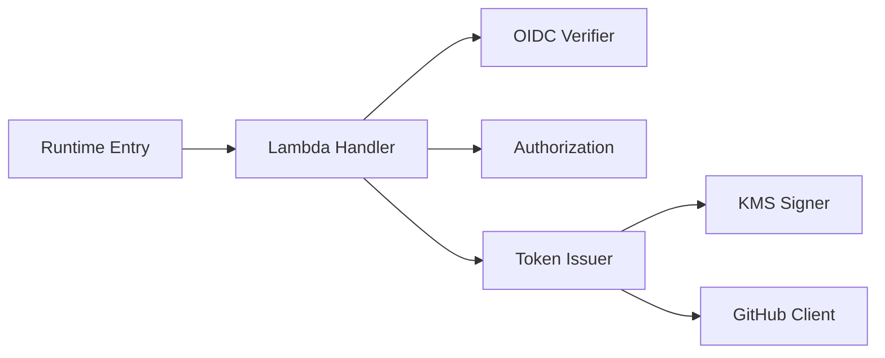

# Lambda Design

## 1. Responsibility and Invocation

Lambda は GitHub OIDC JWT の検証、Installation の解決、要求された対象と権限の発行認可、KMS 署名、GitHub App Installation Access Token の発行を実行します。
リポジトリポリシーを適用するデプロイでは、発行認可のために、各対象のリポジトリポリシーを GitHub API から取得します。

Lambda は AWS IAM により認証・認可された同期 Invoke を受け付けます。Invoke の Payload に含まれる GATES 用 OIDC JWT の署名と Claim を検証し、要求を処理します。

| 項目 | 契約 |
|---|---|
| Transport | AWS Lambda Invoke API、`InvocationType=RequestResponse` |
| AWS Authentication | 呼び出し元が AWS 一時認証情報で SigV4 署名する |
| Caller Identity | GATES 用 Audience の GitHub OIDC JWT を JSON Payload に含める |
| Payload | JSON。GATES が設ける上限を 16 KiB とする。無効な型・未知フィールドは拒否 |
| Response | JSON。呼び出し元は Invoke の `FunctionError` と Lambda 応答の `ok` をそれぞれ確認 |

Lambda Invoke には HTTP の `Authorization` ヘッダーに相当するアプリケーション層のヘッダーがないため、GATES 用 OIDC JWT は `id_token` フィールドとして Payload に含めます。そのため Payload を丸ごとログに記録しません。

概念の定義は [Domain Model](domain.md) を正本とします。

## 2. Request

### 2.1 Invoke Payload

```json
{
  "version": 1,
  "id_token": "<GATES_AUDIENCE_GITHUB_OIDC_JWT>",
  "repositories": ["example-org/repo-a", "example-org/repo-b"],
  "permissions": {"contents": "read", "pull_requests": "write"}
}
```

| フィールド | ルール |
|---|---|
| `version` | 必須、整数 `1` |
| `id_token` | 必須、GATES 用 Audience の JWT。Bearer 資格情報として慎重に扱う |
| `repositories` | 必須、重複のない 1 件以上 500 件以下の `owner/repo` の配列。上限は GitHub のトークン発行 API が一度に受け付ける件数に合わせる（[GitHub App Constraints](../external/github/app.md)）。GATES が設ける 16 KiB の Payload には最短の要素で 2,000 件以上が入るため、Payload サイズより先にこの上限に達する。リポジトリポリシーを適用するデプロイでは、認可が受け付ける件数を[対象の件数の上限](#対象の件数の上限)でさらに限る |
| `permissions` | 必須、権限名をキー、水準を値とする 1 組以上のオブジェクト。許可される組の条件は [Security Design](security.md#31-authorization-rule) に、入力不正と認可拒否の分け方は [Validation](#22-validation) に定める |

形式検証を通った Invoke Payload から、未検証の GATES 用 OIDC JWT と発行要求を分けて取り出します。

- 対象は同一オーナーに属し、GATES で利用する同一の GitHub App Installation に含まれる必要がある。
- Caller / オーナー / Installation ID と GitHub API Host を利用者から指定させない。
- 全リポジトリを対象にする項目（GitHub の `repository_selection`）を設けない。対象は `repositories` で明示したリポジトリだけである。`repository_selection` を含む Payload は、未知のフィールドとして入力不正になる。
- 複数対象のうち一つでも許可条件を満たさなければ全件を拒否し、部分成功も自動分割もしない。
- 各リポジトリに同じ Permissions を適用する。別の権限を必要とする場合は個別に要求する。
- GitHub App に付与された権限のすべてを対象にする項目を設けない。権限は `permissions` で明示した組だけである。

### 2.2 Validation

形式検証は、値を GATES が解釈できるかだけを判定します。
値が許可条件に合うかは、認証後に Authorization が判定します。
この順序の理由は [Security Design](security.md#31-authorization-rule) に記述します。

#### 入力不正と認可拒否の境界

各フィールドの値の形を、入力不正（`invalid_request`）と認可拒否（`authorization_denied`）に次のように分けます。
入力不正の形に当たらない要求だけが、Authorization の判定に進みます。

| フィールド | 入力不正にする形 | 認可拒否にする形 |
|---|---|---|
| `version` | 欠落、`null`、整数 `1` 以外（`1.0`、`"1"`、`2` を含む） | なし |
| `id_token` | 欠落、`null`、文字列以外、空文字列 | なし（JWT の検証失敗は `invalid_id_token`） |
| `repositories` | 欠落、`null`、配列以外、空配列、文字列以外の要素、[完全名の形式](#名前の文字種と比較規則)に合わない要素、大文字小文字を区別しない重複、500 件超 | オーナー名が許可オーナー名と異なる要素を含む。保護対象に当たる要素を含み、Caller がその保護対象の許可 Caller に当たらない。リポジトリポリシーを適用するデプロイで、[対象の件数の上限](#対象の件数の上限)を超える。リポジトリポリシーを適用するデプロイで、有効なリポジトリポリシーがない要素か、Caller がそのリポジトリポリシーの許可 Caller に当たらない要素を含む |
| `permissions` | 欠落、`null`、オブジェクト以外、空オブジェクト、文字列以外の値、[権限名と水準の文字種](#権限名と水準の文字種)に合わないキーまたは値（空文字列を含む） | 許可権限に含まれない組を一つでも含む（`members` のような Repository permissions でない権限名、列挙にない権限名、`metadata` の `write` や `contents` の `admin` のように、許可権限がその権限名に含めない水準）。許可権限に含まれても、発行上限に水準の包含で含まれない組を一つでも含む。保護対象に当たる要素を `repositories` に含む要求で、Caller が当たる許可 Caller の権限の上限に水準の包含で含まれない組を一つでも含む。リポジトリポリシーを適用するデプロイで、いずれかの要素のリポジトリポリシーで Caller が当たる許可 Caller の権限の上限に、水準の包含で含まれない組を一つでも含む |
| Payload 全体 | 16 KiB 超、JSON として不正、オブジェクト以外、未知のフィールド、重複したキー、不正な UTF-8、オブジェクトの後に続くデータ | なし |

JSON として不正な Payload は、Lambda の Invoke API が関数に渡す前に拒否するため、GATES の応答も監査記録も残りません。
GATES はそれでもこの形を入力不正として判定し、Invoke API の検査に依存しません。

空の Permissions を入力不正にするのは、`permissions` が必須であり、[Requirements](../spec/requirements.md) FR-AUTHZ-003 が欠落・未知値を広い既定値に読み替えないと定めているためです。
空の Map は、要求の欠落と同じく、要求した権限を読み取れない形として扱います。
一方で、許可権限の列挙にないキー（`members` など）は認可拒否にします。
列挙にない水準と同じく、形式は読み取れて値が許可外の要求であり、監査記録に残す対象だからです。

重複したキーを入力不正にするのは、`{"contents":"write","contents":"read"}` のような Payload の解釈が JSON の実装ごとに分かれるためです。
後の値を採る実装はこの Payload を `contents:read` として発行しますが、監査記録や別の処理が先の値を読むと、発行した内容と記録した内容が食い違います。

オーナー名の不一致を認可拒否にするのも、許可権限の列挙にないキーと同じく、形式は読み取れて値が許可外の要求だからです。
形式検証は、`owner/repo` をオーナー名とリポジトリ名に分割できるかまでを見ます。

500 件を超える要求を入力不正にするのは、GitHub API に渡すと、その応答が `422` なら `github_issuance_rejected` に分類され、利用者が直せる件数の超過が、原因を特定できない発行拒否として記録され得るためです。
形式検証で止めれば、KMS と GitHub API を呼ばずに済みます。

#### 対象の件数の上限

リポジトリポリシーを適用するデプロイでは、1 回の要求の対象を 10 件までとし、11 件以上の要求を認可拒否にします。
リポジトリポリシーの取得は、対象ごとに GitHub API を 1 回呼び、接続を使い回さずに直列に行うため（[§6.3](#63-github-client)、[§6.4](#64-call-time-budget)）、時間も Installation のレート制限の消費も件数に比例します。
上限を置かないと、大きな要求は取得の合計の予算を毎回使い切り、再実行しても発行されません。
取得できない対象を省いて判定することも、以前に読んだ内容で補うこともしないため（[Security Design](security.md#37-repository-policies)）、件数で先に拒否するほうが、利用者が原因に気付けます。

10 件は、取得 1 回の所要時間の観測から決めた値です。
Runner から接続を張り直して取得した 20 回は、中央値 0.24 秒、最大 0.29 秒でした（[GitHub Single File Permission](../research/github/single-file.md#所要時間とレート制限)）。
この値なら 10 件の取得は通常 3 秒前後で、取得の合計の予算（[§6.4](#64-call-time-budget) の 15 秒）に収まります。
観測は Runner から GitHub API までの時間で、Lambda から取得した時間は測っていません。

上限を超えた要求を入力不正にしないのは、件数は読み取れており、デプロイの設定（リポジトリポリシーの適用）によって許すかどうかが変わる値だからです（[Domain Model](domain.md) の RULE-013）。
この条件は事前認可で判定するため、上限を超えた要求には KMS と GitHub API を呼びません。
ポリシー読み取り許可の確定でも判定し直し、ポリシー読み取り許可がそれだけで取得の件数を上限以下に保つようにします（[§5](#5-processing-flow)）。
リポジトリポリシーを適用しないデプロイでは、この上限を課さず、形式検証の 500 件まで受け付けます。

形式検証のエラー文言には、不正なフィールドの名前（配列の要素なら位置を添える）とその形だけを書き、Payload の断片を含めません。
未知のフィールドの名前、`permissions` のキー、数値のリテラルも断片に当たります。
断片には GATES 用 OIDC JWT が入り得るためです。

#### 権限名と水準の文字種

`permissions` のキー（権限名）と値（水準）は、1 文字以上 64 文字以下の ASCII 小文字とアンダースコア（`_`）の文字列に限ります。
この文字種は、GitHub の Permissions の表現（[GitHub App Constraints](../external/github/app.md)）に合わせて GATES が決めた形式の制限で、GitHub が公式に定めた規則ではありません。
この文字種に合わない文字列は、GitHub の権限名や水準として読み取れない形（[Domain Model](domain.md) の RULE-013）として、入力不正にします。

この規則により、監査記録に入る要求の権限は、改行や制御文字を含まない 64 文字以下の語に限られます。
ログのエンコーダが値をどうエスケープするかによらず、記録の 1 行を偽装する値や長大な値が入りません。
値の数には上限を設けず、記録全体の大きさは Payload の 16 KiB の上限で抑えます。

64 文字の上限は GitHub 公式の文字数制限ではなく、発行 API のスキーマの最長の権限名（46 文字）と許可権限の最長の権限名（39 文字）に余裕を持たせて GATES が決めた値です。
許可権限の権限名と水準はどれもこの規則に合うため、正当な要求は拒否されません。
将来 GitHub がこの規則に合わない権限名を加えても、その権限名は GATES が列挙に加えるまで許可権限に含まれず、要求の結果が認可拒否から入力不正に変わるだけです。
その権限名を列挙に加えるときは、この規則も合わせて見直します。

発行結果の実効権限も Permissions として同じ規則で読みます。
照合は発行許可の Permissions と付随権限の範囲外の Permission Entry をもともと拒否するため、規則に合わない権限名が応答に現れても、トークンを返さないことは変わりません。
この場合も照合の失敗（`issuance_verification_failed`）として扱い、応答の `token` の取り出しと失効は、`permissions` を読み取れたかどうかに依存させません。

#### 名前の文字種と比較規則

`repositories` の各要素は、`/` をちょうど一つ含み、その前のオーナー名と後のリポジトリ名がどちらも空でない文字列です。
オーナー名とリポジトリ名は、次の文字種に限ります。

| 名前 | 受け付ける文字種と長さ | 根拠 |
|---|---|---|
| オーナー名 | 1 文字以上の ASCII 英数字とハイフン | GATES が決めた形式の制限。GitHub の規則としては確定していない（下記） |
| リポジトリ名 | 1 文字以上 100 文字以下の ASCII 英数字、ハイフン、アンダースコア、ピリオド | GitHub の新規リポジトリ名の制約に合わせる。`.` と `..` は緩い側に寄せた（下記） |

GitHub 側の名前の文字種と長さ、その根拠と未確認事項は [GitHub Owner and Repository Constraints](../external/github/account.md) を参照します。

GitHub の規則として確認できなかった条件は、GitHub が受け付ける名前を拒否しない側に寄せ、形式検証で課しません。
GATES が GitHub より厳しい規則を持つと、正当な要求が入力不正になり、利用者には原因が分からないためです。
該当するのは次の規則です。

- **オーナー名のハイフンの位置**：先頭・末尾のハイフンと連続したハイフンの禁止は、Enterprise Managed Users の命名規則であり、ほかのオーナーに転用しない
- **オーナー名の長さ**：39 文字の上限も、Enterprise Managed Users の命名規則であり、ほかのオーナーに転用しない
- **リポジトリ名 `.` と `..`**：GitHub が受け付けるかを確認できておらず、文字種の規則だけでは拒否できない

一方で、オーナー名の文字種も、User と Organization に一様に適用できる GitHub の規則としては確定していません。
それでもオーナー名に上の文字種を課せるのは、そうしても正当な要求を拒否しないためです。
許可オーナー名は同じ文字種を満たす値としてデプロイ時に固定するため、この文字種に合わないオーナー名の要求は、形式検証を通してもオーナー名の照合で必ず拒否されます。
オーナー名の規則を課すかどうかは、結果を入力不正と認可拒否のどちらにするかだけを変えます。
例外として、Enterprise Managed Users のユーザーアカウントは、ユーザー名にアンダースコアを含むため、この文字種を満たさず、許可オーナーに設定できません。
リポジトリ名の文字種が `/` を含まないため、`a/b/c` は入力不正になり、リポジトリ名 `b/c` が GitHub API の `repositories` に渡ることはありません。

名前の比較と重複判定は、ASCII の範囲で大文字小文字を区別せずに行います。
Unicode の大文字小文字の対応を使わないのは、Kelvin 記号（U+212A）と `k` のように、GitHub 上では別の文字が同じ文字として扱われ得るためです。
比較の規則は、要求の重複判定、オーナー名の照合、発行応答の `full_name` の照合、保護対象のリポジトリ名と要求のリポジトリ名の照合、許可 Caller のリポジトリ名と Caller のリポジトリ名の照合（保護対象の一覧とリポジトリポリシーの両方）、保護対象の一覧とリポジトリポリシーの重複判定、ポリシー読み取りトークンの実効対象と利用者に返すトークンの実効対象の完全名の対応づけで共通です（[Domain Model](domain.md) の RULE-005）。

入力文字列のリポジトリ名だけから所有権を判断せず、要求元のオーナーは検証済み JWT に基づいて決定します。

## 3. Responses

### 3.1 Success

```json
{
  "ok": true,
  "token": "<INSTALLATION_ACCESS_TOKEN>",
  "expires_at": "<RFC3339_EXPIRATION_TIME>",
  "repositories": ["example-org/repo-a", "example-org/repo-b"],
  "permissions": {"contents": "read", "metadata": "read", "pull_requests": "write"},
  "request_id": "<OPAQUE_ID>"
}
```

`repositories` は照合済みの発行対象を GitHub 応答の `full_name` で示します。`permissions` は GitHub 応答の実効権限、`expires_at` は GitHub が定めた有効期限（RFC 3339 形式）です。GATES は有効期限を延長しません。
GitHub 応答の `repository_selection` は返しません。
照合により `selected` 以外の応答はトークンを返さないため、成功応答では値が常に同じで、呼び出し元に伝える情報がないからです。
`request_id` は失敗応答と同じ相関 ID で、資格情報ではありません。
値には Lambda の request ID（Invoke 応答のヘッダー `x-amzn-RequestId` と同じ値）をそのまま使います。
CloudWatch Logs に自動で記録されるため、独自に採番しなくても監査記録と突き合わせられます。
成功時にも返すのは、呼び出し元がワークフローのログに残し、監査記録と突き合わせられるようにするためです（[Requirements](../spec/requirements.md) FR-OPS-003）。

Lambda は、GitHub API の発行応答を発行許可と照合し、照合を通ったときだけトークンを返します。
照合の条件は [Security Design](security.md#34-issuance-result-verification) に、照合を通った発行結果が満たす不変条件は [Domain Model](domain.md) の INV-012 に定めます。
照合の条件に適合しない応答は `issuance_verification_failed` として拒否します。

発行応答から空でない `token` を取得できたうえで照合に失敗した場合、Lambda はそのトークンで `DELETE /installation/token` を呼んで失効を試みます。
失効に失敗してもエラーコードは `issuance_verification_failed` のまま変えず、[Domain Model](domain.md#audit-record) の失効の結果を監査記録に残します。
`token` を取得できない場合は、失効 API の認証に使うトークンがないため、失効を試みません。

### 3.2 Failure

```json
{
  "ok": false,
  "error": {
    "code": "authorization_denied",
    "message": "The requested token is not permitted."
  },
  "request_id": "<OPAQUE_ID>"
}
```

`request_id` は成功応答と同じくトップレベルに置きます。
相関 ID は応答全体の属性であり、呼び出し元が `ok` の値によらず同じ場所から読めるようにするためです。

コンポーネントが panic するのは、構築関数を経ていないゼロ値が、その値を前提にする処理に渡った場合だけです。
Go の型はゼロ値の生成を禁じられないため、この場合だけは呼び出し側の誤りとして処理を止めます。
外部入力と外部呼び出しの失敗は、panic にせずエラーで返します。

Handler は処理中の panic を回復し、`internal_error` の失敗応答として `request_id` とともに返します。
panic の値は、応答にも監査記録にも運用者向けのログにも書きません。
回復した panic は、運用者向けのログに相関 ID とスタックトレースを ERROR で記録します。
このログの行は、`msg` を `panic recovered` とし、相関 ID を `request_id`、スタックトレースを `stack` のキーに書きます。
監査記録の `msg` と同じく、運用者が監視でこの行を見分ける印になるためです。
`FunctionError` になるのは、タイムアウト、メモリ不足、初期化の失敗、相関 ID が UTF-8 として正しくない場合のように Handler が応答を書けない場合だけです。
この場合は応答に `request_id` がないため、呼び出し元は Invoke の時刻と `run_id` で CloudWatch Logs の記録と突き合わせます。
相関 ID は応答に入るため、UTF-8 として正しくなければ、失敗応答も JSON に符号化できません。
Lambda Handler は Payload を読む前に相関 ID を確かめます。
正しくなければ発行処理を始めず、Runtime Entry がそのエラーを Lambda Runtime に返します。
符号化の時点で初めて気づくと、発行したトークンを返せず失効もしないまま残すためです。
発行処理を始めないため、監査記録も書きません。

エラーコードは、[Domain Model](domain.md#failure-kinds) の失敗の種別を応答で表す値です。
種別を分ける理由は Domain Model に置き、本ドキュメントはコードと失敗の条件の対応だけを定めます。

| Error code | 失敗の種別 | 内容 |
|---|---|---|
| `invalid_request` | 入力不正 | Payload が [Validation](#22-validation) の入力不正の形に当たる |
| `invalid_id_token` | 認証失敗 | GATES 用 OIDC JWT が [OIDC JWT Claims](oidc-jwt-claims.md) または [OIDC JWT Signature](oidc-jwt-signature.md) の受理条件を満たさない。JWT の形式・署名、Issuer、Audience、時間条件、必須 Claim、再取得後も一意に選べる使用可能な鍵がない `kid` などを含む |
| `authorization_denied` | 認可拒否 | Caller の Owner ID が許可オーナーと不一致、要求した権限が許可条件外、要求したリポジトリのオーナー名が許可オーナー名と不一致、または保護対象に当たる対象を含む要求で、Caller が許可 Caller に当たらないか、要求した権限が許可 Caller の権限の上限に水準の包含で含まれない。リポジトリポリシーを適用するデプロイでは、対象の件数が上限を超える、有効なリポジトリポリシー（[§4.2](#42-repository-policy)）がない対象を含む、またはリポジトリポリシーが Caller か要求した権限を許していない対象を含む場合も含む。Installation の対象外であることが GitHub API の呼び出し後に判明した場合は、その処理段階の失敗として扱う |
| `identity_verification_unavailable` | 一時的な障害 | OIDC Discovery / JWKS の取得が一時的に失敗した。通信の失敗、タイムアウト、5xx、403 / 429 で、再試行で解消し得る |
| `signing_unavailable` | 一時的な障害 | KMS 署名が一時的に失敗した。通信の失敗、タイムアウト、呼び出し元の ctx の期限切れと中断、5xx、スロットリングで、再試行で解消し得る |
| `installation_unavailable` | Installation 利用不可 | 固定した GitHub App と許可オーナーから、発行に使える Installation を得られない。一時的な障害を除く GitHub API の失敗（App JWT が受け付けられない 401、GitHub App が許可オーナーにインストールされていないときの 404 など）、Installation の応答に必要な項目がない、停止状態を読み取れない、Installation が停止している（`suspended_at` が時刻である）、`account.id` が許可オーナーの Owner ID と一致しない。ポリシー読み取りトークンの発行 API の呼び出しの失敗も、利用者に返すトークンの発行と同じく分類する |
| `github_api_unavailable` | 一時的な障害 | GitHub API の一時的な障害。通信の失敗、タイムアウト、5xx、レート制限による 403 / 429 で、Installation の取得、発行 API の呼び出し（ポリシー読み取りトークンの発行を含む）、リポジトリポリシーの取得を含む。リポジトリポリシーの取得の合計の予算（[§6.4](#64-call-time-budget)）を使い切った場合も含む。再試行で解消し得る |
| `github_issuance_rejected` | GitHub 発行拒否 | GATES の認可が成立した後、GitHub の発行 API が `422` で要求を拒否した。検証失敗やスパム判定など、原因は応答コードから特定できない（[GitHub App Constraints](../external/github/app.md)）。ポリシー読み取りトークンの発行の `422`（対象が Installation に含まれない、GitHub App の Single file の権限が Installation で承認されていないなど）を含む |
| `issuance_verification_failed` | 照合失敗 | GitHub API の発行応答が照合を通らない。実効対象のリポジトリ名と Repository ID の対応が保護対象の一覧と食い違う場合を含む。ポリシー読み取りトークンの発行応答が照合を通らない場合（読めるファイルのパスがリポジトリポリシーのパスだけでない場合を含む）と、利用者に返すトークンの実効対象の Repository ID が、同じ完全名でリポジトリポリシーを読んだ対象と一致しない場合も含む。空でないトークン文字列を取得できた場合は失効を試みる |
| `internal_error` | 内部障害 | Handler の panic、部品が返したエラーがどの失敗の種別にも当たらないか複数の種別に当たる場合、Discovery / JWKS の非一時的な取得・構造異常、JWKS に使用可能な鍵がない場合、KMS が再試行では解消しない失敗を返した場合（鍵の無効化、鍵の状態、権限の不足など）、KMS の応答を署名として解釈できない場合、KMS に要求を送る前の AWS SDK の失敗、照合を通ったポリシー読み取りトークンでのリポジトリポリシーの取得が、ファイルの有無を示さない応答を返した場合（[§6.3](#63-github-client)）を含む |

一時的な障害のエラーコードは失敗した依存先ごとに分かれるため、外部の依存を呼ぶコンポーネントは、失敗の種別を依存先が分かる形で返します。
Token Issuer も、KMS Signer と GitHub Client の失敗を、依存先が分かる種別のまま返します。
Lambda Handler は、その種別をエラーコードに写します。
部品が返したエラーがどの失敗の種別にも当たらなければ、Lambda Handler は `internal_error` に写します。
写像の漏れを、再実行を促すなどの利用者への誤った案内にしないためです。
部品が返したエラーが複数の失敗の種別に当たる場合も、Lambda Handler は種別の間に優先順位を置かず、`internal_error` に写します。
[Domain Model](domain.md#failure-kinds) では操作が返して発行処理を終わらせる失敗は一つの種別に属するため、複数に当たるのは操作が種別を定め損ねた場合です。
優先順位を置くと、操作が定めていない種別が、写像の順序によって応答と監査記録に残ります。

失敗応答の `message` は、エラーコードごとに固定した次の文言です。
部品のエラー文言を含めず、拒否の理由を応答に出しません（[応答とエラー文言に出す情報](#応答とエラー文言に出す情報)）。
一時的な障害のコードだけに再実行を促す文を添えます。
再実行では解消しない失敗に再実行を促さないためです。

| Error code | `message` |
|---|---|
| `invalid_request` | `The request payload is invalid.` |
| `invalid_id_token` | `The ID token is not accepted.` |
| `authorization_denied` | `The requested token is not permitted.` |
| `identity_verification_unavailable` | `Identity verification is temporarily unavailable. Retry later.` |
| `signing_unavailable` | `Signing is temporarily unavailable. Retry later.` |
| `installation_unavailable` | `The GitHub App installation is not available for issuance.` |
| `github_api_unavailable` | `The GitHub API is temporarily unavailable. Retry later.` |
| `github_issuance_rejected` | `GitHub rejected the token issuance.` |
| `issuance_verification_failed` | `The issued token did not pass verification and was not returned.` |
| `internal_error` | `An internal error occurred.` |

#### GitHub API の失敗の分類

GitHub API の失敗は、HTTP 応答から次のように分類します。
通信の失敗、タイムアウト、5xx、レート制限による 403 / 429 は `github_api_unavailable` にします。
発行 API の 422 は `github_issuance_rejected` にします。
それ以外の失敗は `installation_unavailable` にします。
Client ID の誤り、KMS Key と GitHub に登録した Private Key の不一致、Installation の削除や停止が、ここに入ります。
発行 API の呼び出しで起きた 401 / 403 / 404 も、直前に同じ App JWT で Installation を取得できているため、その間に Installation か App の状態が変わったものとしてこのコードに含めます。
Installation の応答の形式が想定と異なる場合は `installation_unavailable` に、発行応答の形式が想定と異なる場合は `issuance_verification_failed` にします。
ポリシー読み取りトークンの発行は、発行 API の呼び出しとして、この分類に従います。
リポジトリポリシーの取得はこの分類に従わず、[§6.3](#63-github-client) の応答の分類に従います。
取得では `404` がリポジトリポリシーのないことを示し、`200` も応答の形でファイルでないことや大きすぎることを示すためです。

この分類は GATES のエラー分類であり、GitHub の HTTP ステータスの定義ではありません。
Installation の取得に使う API が公開している応答コードは `200` だけで（[GitHub App Constraints](../external/github/app.md)）、分類は `200` 以外の応答をレート制限と一時的な障害を除いて `installation_unavailable` にすることで成り立ち、特定のステータスには依存しません。
発行 API の `422` を `authorization_denied` と分けるのは、`422` は検証失敗かスパム判定を指し（同）、権限不足や悪意の有無を確定できないためです。

403 と 429 のうちレート制限によるものは、応答のヘッダーで判定します。
429 は常にレート制限とします。
403 は、`x-ratelimit-remaining` が `0` か、`retry-after` のヘッダーがあるときだけレート制限とし、ほかの 403 はレート制限としません。
本文のメッセージは判定に使いません。
GitHub はセカンダリのレート制限を本文のメッセージだけで示す場合があり（[GitHub App Constraints](../external/github/app.md)）、文言に頼ると、GitHub が文言を変えたときに分類が変わるためです。
この判定は、ヘッダーのないレート制限の 403 を `installation_unavailable` として、レート制限でないのにこれらのヘッダーが付いた 403 を `github_api_unavailable` として伝え得ます。
どちらの誤りでもトークンは返さず、誤りが変えるのは、利用者に再実行を促すかどうかです。

#### Discovery / JWKS と KMS の失敗の分類

Discovery と JWKS の取得では、403 も `identity_verification_unavailable` にします。
Discovery と JWKS は認証を要しない公開の文書で、GATES に起因する 403 が想定できず、レート制限と見なすためです。
[取得前の拒否](#61-oidc-validation)に当たらず手元の鍵で検証できない JWT について取得に失敗した場合は、署名の正否を判定できないため、JWT が不正であっても取得の失敗として返します。
再取得の上限の間に返す種別は、JWKS の再取得の上限に従います。

KMS に接続できない失敗には、経路の一時的な障害と、ネットワークの設定の誤りのように再試行では解消しない失敗の両方があり、区別できません。
これを `signing_unavailable` に含めるのは、Discovery / JWKS の取得の通信の失敗と同じ扱いにするためです。
設定の誤りは、デプロイ後の試験で発行が一度も成功しないことから気付けます。
本文の受信途中の切断のうち、通信の失敗として報告されないものは、完全に受信して解釈できない本文と区別できず、`internal_error` になります。
`ThrottlingException` を名前で挙げて `signing_unavailable` にするのは、KMS がスロットリングを 5xx ではなく 400 で返すためです（[AWS — KMS Common Error Types](https://docs.aws.amazon.com/kms/latest/APIReference/CommonErrors.html)）。

#### 応答とエラー文言に出す情報

外部エラーをそのまま応答へ転記しません。認証情報を含む詳細を公開せず、相関 ID によってログと突き合わせます。Lambda の処理結果は `ok` で示し、Invoke 自体の結果と区別します。

認可拒否と、Installation が発行に使えないことによる拒否のエラー文言には、満たさなかった条件を書き、Caller、要求、許可オーナー、保護対象の一覧、Installation の値を含めません。
文言は監査記録のためのもので、エラー応答には出しません。
拒否の理由を応答に出すと、許可オーナーの Owner ID やオーナー名を、許可されない呼び出し元が探れるためです。
値を含めないのは、Caller と要求は監査記録が別の項目として持つため文言に重ねる必要がなく、文言が誤って応答に混ざっても許可オーナーと保護対象の一覧を明かさないためです。

保護対象に関わる拒否も、応答はほかの認可拒否と照合失敗と同じく、エラーコードごとの固定の `message` にし、要求した対象が保護対象であること、許可 Caller、権限の上限を応答に出しません。
出すと、許可されない呼び出し元が、どのリポジトリが保護対象か、どのリポジトリが許可 Caller かを探り、許可 Caller を経由した到達（[Security Design](security.md#36-protected-repositories)）の標的を選べるためです。
エラー文言は、どの要求の対象か、一覧のどの保護対象かを、要求の対象の位置と一覧の要素の位置で示します。
Installation は許可オーナー名から取得するため、その Installation ID と `account.id` は、許可オーナー名をいま持つアカウントを示します。
`account.id` が許可オーナーの Owner ID と一致しない場合も同じであり、許可オーナーの値と同じに伏せます。

リポジトリポリシーに関わる拒否も、応答はエラーコードごとの固定の `message` にし、どの対象のリポジトリポリシーで拒否したかと、その理由を応答に出しません。
出すと、許可されない呼び出し元が、どの対象にリポジトリポリシーがあり、どの対象が自分を許していないかを探れるためです（[Security Design](security.md#37-repository-policies)）。
どの対象で拒否されたかを知りたい利用者は、対象を 1 件ずつ要求して見分けます。
エラー文言は、どの対象かを要求の対象の位置で示し、リポジトリポリシーの値（許可 Caller の ID と名前、権限の上限）、文書の内容、YAML のライブラリのエラー文言、文書の中の誤りの位置、どの許可 Caller が当たったかを示す位置を含めません。
文書の中の位置を示さないのは、文書を直すのは監査記録を読めないリポジトリの側で、その側はファイルを読んで誤りや当たった許可 Caller を探せるためです。
位置を書く経路がなければ、解析の誤りの文言から文書の断片が監査記録に混ざる経路もありません。

GitHub API の呼び出しの失敗のエラー文言には、応答のステータスを書き、応答本文、GitHub App JWT、Installation Access Token、ポリシー読み取りトークンを含めません。

照合失敗のエラー文言にも満たさなかった条件を書き、トークン、実効対象の完全名、Repository ID と Owner ID の値を含めません。
実効対象は要求の対象か Installation の対象のリポジトリを指すため、要求と Installation の値と同じに伏せます。
失効を試みて失敗した場合は、照合失敗のエラー文言に失効の失敗の理由（失効の応答のステータスと GitHub の request ID、または通信の失敗）を添えます。

GitHub API の呼び出しの失敗と照合失敗のエラー文言には、GitHub の request ID を含めます。
失敗の原因を GitHub 側の記録と突き合わせて調べる手がかりになるためです。
GitHub の request ID は、成功応答と失敗応答の相関 ID とは別の値で、資格情報でも、Caller、要求、許可オーナー、Installation の値でもありません。

Token Issuer は、GitHub API の呼び出しの失敗の文言に、失敗した段階の名前（Installation の解決、ポリシー読み取りトークンの発行、リポジトリポリシーの取得、発行）を前置します。
Installation の取得と発行 API の呼び出しの失敗は、同じ種別になり得て文言の形も同じため、段階の名前がないと監査記録から失敗した呼び出しを見分けられないからです。
ポリシー読み取りトークンの照合失敗の文言にも、ポリシー読み取りトークンの発行の段階の名前を前置します。
利用者に返すトークンの照合失敗と同じ `issuance_verification_failed` になり、どちらのトークンの照合かを見分けるためです。
リポジトリポリシーの取得の失敗の文言には、対象の位置を添えます。
KMS の署名、ポリシー読み取り許可の確定、Grant の失敗には前置しません。
署名の失敗は KMS Signer の文言で、ポリシー読み取り許可の確定と Grant の失敗は満たさなかった条件で、それぞれ段階が分かるためです。

## 4. Logical Components



| Component | 責務 |
|---|---|
| Runtime Entry | 起動時の固定設定の読み込みと各コンポーネントの組み立て、初期化の失敗の記録と異常終了、Lambda Runtime からの Payload と相関 ID の受け取りと、Lambda Handler の応答か相関 ID を確かめた結果のエラーの返却。Lambda Runtime のライブラリと AWS SDK の設定の読み込みを使う唯一のコンポーネントで、失敗の分類や値の検証の判断を持たない |
| Lambda Handler | 相関 ID の検証、Payload の形式検証、各コンポーネントの呼び出し順序の制御、監査記録の出力、応答形式 |
| OIDC Verifier | GitHub OIDC JWT の署名・Issuer・Audience・時間・Claim 検証と Caller（Owner ID、Repository ID、リポジトリ名と、監査のためだけに添えるワークフロー実行 ID と試行番号、ワークフロー起動属性）の確定、Issuer の Discovery / JWKS の取得と保持 |
| Authorization | Caller の Owner ID、Repository ID、リポジトリ名と、要求（対象、権限）、取得済み Installation、固定設定（許可オーナー、発行上限、保護対象の一覧、リポジトリポリシーの適用）から発行可否を判定し、ポリシー読み取り許可と発行許可を確定。リポジトリポリシーを適用するデプロイでは、取得した文書の文字列からリポジトリポリシーを読み取り、その条件を判定する。ネットワーク通信を行わない |
| Token Issuer | KMS Signer による App JWT の作成、GitHub Client を使った Installation の取得とトークン発行、GitHub 応答の発行許可と保護対象の一覧への照合、照合に失敗したトークンの失効。リポジトリポリシーを適用するデプロイでは、ポリシー読み取りトークンの発行、ポリシー読み取り許可への照合、リポジトリポリシーの取得、ポリシー読み取りトークンの失効と、利用者に返すトークンの実効対象とリポジトリポリシーを読んだ対象の Repository ID の照合も行う |
| KMS Signer | 固定設定の Client ID と現在時刻から GitHub App JWT を組み立て、固定された非対称 KMS Key とアルゴリズムで署名 |
| GitHub Client | GitHub API（Installation の取得、トークン発行、リポジトリポリシーの取得、トークンの失効）に対する HTTP 通信と応答の復号 |

このコンポーネント区分は責務のモデルであり、Go パッケージへの一対一の対応を要求しません。

Token Issuer は、Installation の解決と発行結果の照合のために固定設定の許可オーナーと保護対象の一覧を、リポジトリポリシーを読むかを決めるためにリポジトリポリシーの適用を受け取ります。
Caller と発行要求は受け取りません。
発行結果の照合に要るのは、次のものだけです。

- 発行許可かポリシー読み取り許可
- 許可オーナー
- 実効対象の名前と Repository ID の対応を突き合わせる保護対象の一覧
- 利用者に返すトークンの照合では、照合済みのポリシー読み取りトークンの実効対象

Caller を見る条件は、Token Issuer が関数として受け取るポリシー読み取り許可の確定と Grant（[§6.2](#62-github-app-jwt)）が判定します。
読む対象を Authorization から受け取り、読んだ文書を Authorization に渡すのも、この二つの関数を通してだけです。

資格情報の値を取り出せるコンポーネントは、次のとおりに限ります。
ほかのコンポーネントでは、ログやエラーにどう出力しても値が伏せられる型で運びます。
取り出せる箇所を限ると、資格情報がログやエラー本文に出る経路を、その箇所の確認に絞れるためです。
伏せた値は、資格情報の種類によらず、どの出力でも同じ表記にします。
伏せ方が資格情報ごとに異なると、直すときに一部の資格情報だけが直り、ほかの資格情報が出力に残り得るためです。

| 資格情報 | 値を取り出せるコンポーネント |
|---|---|
| 未検証の GATES 用 OIDC JWT | OIDC Verifier |
| GitHub App JWT | GitHub Client。GitHub App JWT を Token Issuer の外に出さない |
| Installation Access Token | 成功応答を書く Lambda Handler と、失効を要求する GitHub Client |
| ポリシー読み取りトークン | GitHub Client だけ。リポジトリポリシーの取得と失効の要求に使い、ポリシー読み取りトークンを Token Issuer の外に出さない |

検証済みの GATES 用 OIDC JWT は、OIDC Verifier が Caller を確定する間だけ存在し、OIDC Verifier の外に出しません。
OIDC Verifier の外に出すのは、Caller と、署名を含まない [Domain Model](domain.md#audit-record) の署名検証済みの Claims Set だけです。
署名検証済みの Claims Set を作れるのは OIDC Verifier だけで、読むのは監査記録だけです。
Authorization が署名検証済みの Claims Set を受け取れないよう、その型を参照できる package を限ります。

### 4.1 Runtime Entry

Lambda Handler は、Invoke の Payload をバイト列のまま受け取り、応答を JSON に符号化したバイト列で返します。
Lambda の Invoke API は JSON として読めない Payload を関数に渡さずに `InvalidRequestContentException` で拒否しますが、重複したキー、オブジェクトの後に続くデータ、未知のフィールドを含む Payload は関数に渡します。
Payload を Lambda Runtime のライブラリに復号させると、こうした Payload が Lambda Handler に届く前に `FunctionError` になるか、[Validation](#22-validation) を経ずに読み替えられ、`invalid_request` の応答と監査記録を返せないためです。
Runtime Entry は、Lambda Runtime が Invoke ごとに ctx に入れる request ID を読んで、相関 ID として Lambda Handler に値で渡します。
ctx は期限を変えずにそのまま渡します。
Lambda Handler は Lambda Runtime のライブラリに依存せず、応答を書けた Invoke を `FunctionError` にしません。

固定設定のうち Issuer、API Host、リポジトリポリシーのパスは本ドキュメントが固定し（[§6.1](#61-oidc-validation)、[§6.3](#63-github-client)、[§4.2](#42-repository-policy)）、残りの値（許可オーナー、Client ID、GATES 用 Audience、KMS Key ARN、発行上限、保護対象の一覧、リポジトリポリシーの適用）は Runtime Entry が起動時に環境変数から読みます。
読んだ値を [Domain Model](domain.md) の許可オーナー、発行上限、保護対象の一覧、リポジトリポリシーの適用の不変条件（INV-004、INV-015、INV-016、INV-018）で検証するのは固定設定の読み込みであり、Runtime Entry はその結果を受け取るだけで、値の検証の判断を持ちません。
環境変数の欠落か不正な値、[Domain Model](domain.md) の許可オーナー、認証の固定設定、署名の固定設定、発行上限、保護対象の一覧、リポジトリポリシーの適用の不変条件（INV-004、INV-005、INV-006、INV-015、INV-016、INV-018）の違反、AWS SDK の設定の読み込みの失敗は、どれも初期化の失敗です。
初期化に失敗した Runtime Entry は、ログに記録して異常終了し、Lambda Handler を Lambda Runtime に渡しません。
Lambda はこの Invoke を `Runtime.ExitError` の `FunctionError` にします（[AWS Fault Injection](../research/aws/fault-injection.md)）。

要求ごとに `internal_error` を返す形にしないのは、どの失敗も固定設定かデプロイの誤りで再実行では解消せず、要求を受け付けても発行が一度も成立しないためです。
初期化を失敗させれば、設定の誤りが Invoke の時点で明らかになり、Lambda Handler に未初期化の部品を扱う分岐が要りません。
初期化の失敗のログには、満たさなかった条件と、どの値の条件かを書き、値を書きません。
固定設定の読み込みで見つけた誤りは環境変数の名前で、部品を作る時点で見つけた誤りは固定設定の概念名（GATES 用 Audience、Client ID など）で、どの値かを示します。
部品は環境変数を知らず、概念名と環境変数の名前は [AWS Infrastructure Design](aws-infrastructure.md#51-environment-variables) の表で一対一に対応するためです。
固定設定の読み込みで見つけた環境変数の欠落と不正な値は、複数あればそのすべてを一度の初期化の失敗として書きます。
デプロイの誤りを、一度の Invoke でまとめて直せるようにするためです。
認証の固定設定と署名の固定設定の不変条件は、読み込みの後に部品を作る時点で検査するため、読み込みの誤りを直した後の初期化で初めて見つかることがあります。
AWS SDK の失敗も、SDK の文言を含めず、設定を読めなかったことだけを書きます。

発行上限の環境変数は、`contents:read,pull_requests:write` のように、権限名と水準を `:` でつないだ組をカンマで区切って並べた文字列です。
組の並びは意味を持ちません。
要求は水準の包含で照合するため（[Domain Model](domain.md) の水準の包含）、同じ権限名の複数の水準を並べた値（`contents:read,contents:write`）は、最も高い水準だけを書いた値（`contents:write`）と同じ意味になります。
この値を不正な値にしないのは、低い水準の組があってもなくても許す要求が変わらず、運用者が書いた値と Lambda が使う値が食い違わないためです。
固定設定の読み込みは、次のどれかに当たる値を不正な値にします。

- 空文字列、空の要素（先頭、末尾、連続したカンマ）
- `:` をちょうど一つ含まない要素、権限名か水準が[権限名と水準の文字種](#権限名と水準の文字種)に合わない要素（前後の空白を含む）
- 同じ組の重複
- 許可権限に含まれない組

前後の空白を除かず、重複を一つにまとめないのは、どちらも書き損じであることが多く、読み替えると運用者が書いた値と Lambda が使う値が食い違うためです。
許可権限に含まれるかも固定設定の読み込みで確かめるため、この誤りも環境変数の名前で示します。
不正な要素が複数あれば、そのすべてを、要素の位置と満たさなかった条件とともに、環境変数の名前を付けた一つの誤りとして書きます。
許可権限に含まれるかは Terraform が確かめず（[AWS Infrastructure Design](aws-infrastructure.md#52-plan-time-validation)）、適用した後の初期化で初めて分かるため、環境変数の誤りと同じく、まとめて直せるようにします。

リポジトリポリシーの適用の環境変数は、`true`（適用する）か `false`（適用しない）の文字列です。
固定設定の読み込みは、`true` と `false` のほかの値（空文字列、`True`、`1`、`yes`、前後の空白を含む値）を不正な値にし、欠落とともに初期化の失敗にします。
読み替えずに拒否するのは、欠落と書き損じをどちらかの値に読むと、運用者が決めていない動作になるためです（[Domain Model](domain.md) の INV-018）。

#### 保護対象の一覧の書式

保護対象の一覧の環境変数は、[YAML 1.2.2](https://yaml.org/spec/1.2.2/) の文書 1 件です。
運用者が書いた文字列を、コメントを含めてそのまま環境変数に置き、Terraform で別の形式に変換しません。

```yaml
repositories:
  # 共通基盤
  - id: "200"
    name: platform-infra
    callers:
      - repository_id: "100"
        repository_name: deploy-tools
        permissions:
          contents: write
          pull_requests: read
  # どの Caller にも許可しない
  - id: "201"
    name: audit-records
    callers: []
```

受け付ける構造は次のとおりです。
どの対応（マッピング）も、表のキーをすべて持ち、ほかのキーを持ちません。

| 位置 | 値 | 規則 |
|---|---|---|
| 文書 | 対応 | キー `repositories` だけを持つ |
| `repositories` | 保護対象の列 | 空の列は、保護対象を置かないことを示す |
| `repositories[i]` | 対応 | キー `id`、`name`、`callers` を持つ |
| `id`、`repository_id` | Repository ID | 引用符（`"` か `'`）で囲んだスカラー。中身は符号と先頭の `0` を付けない 10 進表記とし、値は int64 に収まる正の整数（[Domain Model](domain.md) の RULE-002） |
| `name`、`repository_name` | リポジトリ名 | オーナー名を含まない。[リポジトリ名の文字種](#名前の文字種と比較規則)を満たす |
| `callers` | 許可 Caller の列 | 空の列は、どの Caller にも許可しないことを示す |
| `callers[j]` | 対応 | キー `repository_id`、`repository_name`、`permissions` を持つ |
| `permissions` | 権限の上限 | 権限名をキー、水準を値とする対応で、1 組以上。その許可 Caller に許す、権限名ごとの最も高い水準を書く。キーと値は[権限名と水準の文字種](#権限名と水準の文字種)を満たし、組は許可権限に含まれる |

トップレベルに書式のバージョンを表すキー（`version` など）を置きません。
この環境変数は、同じリリースの Terraform と Lambda の間の契約だからです。
書式を変えるリリースは、古い書式の値を未知のキーか型の違いとして初期化の失敗にし、古い書式の値を別の意味に読まない形にします。

固定設定の読み込みは、次のどれかに当たる値を不正な値にします。

- **文字の符号化**：UTF-8 として正しくないバイト列、BOM（U+FEFF。先頭に限らない）、NEL（U+0085）、LS（U+2028）、PS（U+2029）
- **構文**：YAML として読めない値
- **文書の数**：2 件目の文書を含む（中身のない 2 件目を含む）。文書が 1 件もない値（コメントだけの値を含む）は、トップレベルが対応でない値に当たる
- **認可に要らない YAML の機能**：ディレクティブ（`%YAML`、`%TAG`）、アンカー、エイリアス、マージキー（引用符のない `<<`）、明示的なタグ（`!!str` と、非特定タグ `!` を含む）
- **キー**：同じ対応の中の重複したキー（引用符の有無と種類だけが違う表記を含む）、文字列のスカラーでないキー（列や対応をキーにした複合キー、`1:` のように文字列以外に解決されるキー）、未知のキー（`version` を含む）、必須のキーの欠落
- **値の型**：表の値と種類の違う値（列の位置の対応やスカラー、対応の位置の列やスカラーなど）、`null` と空の値（`~`、`name:` のように値を書かないもの）。スカラーの値は文字列に限り、引用符のないスカラーが [YAML 1.2.2 の Core Schema](https://yaml.org/spec/1.2.2/#103-core-schema) で真偽値、整数、浮動小数点数、`null` に解決される値（`name: true`、`contents: 1`）も、型の違いとして拒否する
- **ID**：引用符で囲んでいない ID、表記の誤り（`0`、負数、先頭の `0`、前後の空白、小数、指数、16 進数、int64 を超える値）
- **名前**：リポジトリ名の文字種と長さに合わない名前（オーナー名を含めた `owner/repo` を含む）
- **重複**：保護対象の間の Repository ID の重複とリポジトリ名の重複、同じ保護対象の許可 Caller の間の Repository ID の重複とリポジトリ名の重複。リポジトリ名の重複は大文字小文字を区別せずに判定する
- **権限の上限**：空の `permissions`、権限名と水準の文字種に合わないキーか値（大文字を含む `READ` など）、許可権限に含まれない組（`members: read`、`contents: admin` など）

認可に要らない YAML の機能、重複したキー、文字列以外に解決される引用符のないキーと値を拒否するのは、運用者が書いた値と Lambda が使う値を食い違わせないためです。
YAML のライブラリやツールは、これらの解釈（重複したキーの後勝ちと先勝ち、引用符のない値の型、タグの扱い）で分かれ、Terraform の `yamldecode` と Lambda でも同じ解釈になる保証がありません。
NEL、LS、PS を拒否するのも同じ理由です。
YAML 1.2.2 は NEL、LS、PS を改行として扱いませんが、Lambda が使う YAML のライブラリは改行として扱うため、コメントの中の NEL の後ろを Lambda だけがキーとして読みます。
BOM は、先頭のものは文字の符号化の宣言としてライブラリが黙って取り除き、先頭以外のものは表示では見分けられない文字として名前やキーに入ります。
正しい書式の値は、BOM と NEL、LS、PS のどれも含まないため、位置によらず拒否します。

引用符で囲んでいない ID を拒否するのは、YAML の数値の解釈が、8 進数、指数、16 進数の表記と、int64 を超える値の扱いで、ライブラリごとに分かれるためです。
文字列として書かせれば、Lambda は書かれた 10 進の文字列だけを読みます。
引用符の中のエスケープは展開した値で確かめ、ブロックスカラー（`|`、`>`）の ID は引用符で囲んでいない ID として拒否します。
名前と権限は、引用符で囲んでも囲まなくても受け付けます。
引用符のない値が文字列に解決されるかは Core Schema の表で決め、ライブラリの型の解決を使いません。
Lambda が使う YAML のライブラリは、`2001-12-14` を日時に、`1_000` と `0b10` を整数に解決し、Core Schema と食い違うためです。
Core Schema で文字列に解決される `yes`、`on`、`2001-12-14` は、文字列として受け付けます。
正しい権限名と水準は引用符がなくても文字列に読めるため、引用符を求められるのは、`true` や `1` のように文字列以外に読める名前だけです。

異なる保護対象に同じ許可 Caller を書いた一覧は受け付けます。
許可 Caller の重複を禁じるのは、同じ保護対象の中で権限の上限が一つに決まらないためで、保護対象が異なれば上限は保護対象ごとに決まります。
保護対象が自分自身を許可 Caller に持つ一覧も受け付けます。

空の `permissions` の許可 Caller を拒否するのは、その許可 Caller にどの権限も許さないことになり、許可 Caller を書かないことと区別できず、書き忘れであることが多いためです。
どの Caller にも許可しない保護対象は、`callers: []` で表せます。

この書式は、YAML を値に復号した結果ではなく、構文の上で確かめます。
復号した値からは、重複したキー、引用符の有無、タグ、アンカーを見分けられないためです。
エイリアスは、展開する前に拒否します。
構文木に残らない機能（ディレクティブと非特定タグ `!`）は、解析の前の文字列で拒否します。
正しい書式の値はコメントの外に `%` と `!` を含まないため、この拒否は正しい値を拒否しません。
入力の大きさの上限は、固定設定の読み込みでは設けません。
Lambda は環境変数の合計が 4096 バイトを超える設定を適用させないため（[AWS Infrastructure Design](aws-infrastructure.md#52-plan-time-validation)）、入力はその大きさに収まります。
エイリアスを展開しないため、入力より大きな値を作る経路もありません。

不正な値は、発行上限と同じく、そのすべてを、位置と満たさなかった条件とともに、環境変数の名前を付けた一つの誤りとして書きます。
位置は、YAML として読めない値と YAML の機能の誤りでは行で、構造と値の誤りでは `repositories[1].callers[0].permissions` のような要素のパスで示します。
YAML として読めない値は、ライブラリが行を特定できなければ位置を示しません。
権限の上限の組の誤りは、`permissions` のパスと、書かれた順の組の位置で示します。
すべての誤りを書く規則には、次の例外があります。
YAML として読めない組（文字列でないキー、マージキー、エイリアス、文字列でない値）を含む `permissions` では、ほかの組の誤りを示しません。読めない組を除いて確かめると、示す位置が書かれた順とずれるためです。
種類の違う値と未知のキーの値の中にある誤りも示しません。その位置がすでに誤りで、中の値は書式のどの位置にも当たらないためです。
誤りには、ID、名前、権限の値と、YAML のライブラリのエラー文言を含めません。
ライブラリのエラー文言は入力の断片を含み得るためです。
未知のキーの名前も含めません。書き誤った構造では、キーの位置に名前や権限が来るためです。

### 4.2 Repository Policy

リポジトリポリシーは、対象のリポジトリの既定ブランチの `.github/gates-policy.yml` に置く、[YAML 1.2.2](https://yaml.org/spec/1.2.2/) の文書 1 件です。
Authorization が、GitHub Client の取得した文書の文字列を読み、[Domain Model](domain.md) の INV-017 を満たすリポジトリポリシーを作ります。

```yaml
callers:
  # 共通のビルド基盤
  - repository_id: "100"
    repository_name: deploy-tools
    permissions:
      contents: read
      pull_requests: write
```

文書は、キー `callers` だけを持つ対応です。
`callers` は許可 Caller の列で、空の列（`callers: []`）は、どの Caller にも許可しないことを示します。
`callers` の要素とその中の値の書式は、[保護対象の一覧の書式](#保護対象の一覧の書式)の `callers[j]` と同じです。
同じ許可 Caller を保護対象の一覧とリポジトリポリシーに同じ形で書け、Caller が許可 Caller に当たる条件（[Domain Model](domain.md) の RULE-015、RULE-016）を一つの規則で判定できるようにするためです。

受け付ける YAML の範囲も保護対象の一覧と同じで、[保護対象の一覧の書式](#保護対象の一覧の書式)の不正な値の規則（文字の符号化、構文、文書の数、認可に要らない YAML の機能、キー、値の型、ID、名前、重複、権限の上限）をそのまま課します。
同じ範囲にするのは、保護対象の一覧と同じく、書いた主体の意図と Lambda の読み方を食い違わせないためです。
リポジトリポリシーは運用者ではなく対象のリポジトリに書き込める主体が書くため、YAML のライブラリの解釈が書いた主体の意図と分かれる範囲を、保護対象の一覧より広げる理由がありません（[Security Design](security.md#36-protected-repositories) の YAML を読む外部のライブラリ）。
重複の規則は、許可 Caller の間の Repository ID の重複とリポジトリ名の重複に当たります。
空のファイルとコメントだけのファイルは、文書が 1 件もない値として不正です（どの Caller にも許可しないなら `callers: []` と書く）。

保護対象の一覧と扱いが異なるのは、次の点です。

- **大きさの上限**：64 KiB（65,536 バイト）を超える文書は、有効なリポジトリポリシーがないものとする。保護対象の一覧は Lambda の環境変数の上限で大きさが限られるが、リポジトリポリシーは書き込める主体がどの大きさにもできるため、YAML のライブラリに読ませる前に限る
- **誤りの示し方**：一部でも不正な文書は、文書全体を無効にし（[Domain Model](domain.md) の INV-017）、どこが誤っているかを示さない（[応答とエラー文言に出す情報](#応答とエラー文言に出す情報)）
- **書式を変えるとき**：トップレベルに書式のバージョンを表すキーを置かない点は同じだが、互換のない書式に変えるときは、古い書式のファイルを初期化の失敗にする代わりに、別のパスを使う。リポジトリポリシーは多くのリポジトリに置かれ、GATES のリリースと同時には書き換えられないためである。パスを分ければ、各リポジトリは新しい書式のファイルを前もって置け、一つのファイルを二つの書式で読み分ける規則も要らない。ポリシー読み取りトークンの照合は読めるファイルのパスを一つだけ受け付けるため（[§6.3](#63-github-client)）、GitHub App の Single file のパスを切り替える手順は、書式を変えるときに設計する

64 KiB は、正当な文書を拒否しない大きさで、Discovery と JWKS の上限（[§6.1](#61-oidc-validation)）と同じ値です。
許可 Caller 1 件は、コメントを添えても 200 バイト程度で、64 KiB には 300 件以上が入ります。
GitHub の Contents API は、GATES が使う既定のメディアタイプ（`application/vnd.github+json`）では 1 MB を超えるファイルの内容を返さないため（[GitHub App Constraints](../external/github/app.md) §4.5）、上限を 1 MB より十分小さくしておけば、内容を返さない応答の形に出会う前に、応答の `size` で大きすぎると判定できます。
大きさは、GitHub Client が応答の `size` で（[§6.3](#63-github-client)）、Authorization が受け取った文書の長さで、それぞれ確かめます。
文書を読む側の制限を、取得する側の確認に依存させないためです。

**リポジトリポリシーのパス** の `.github/gates-policy.yml` は、本ドキュメントが固定する定数で、環境変数にしません。
リポジトリポリシーを書くのは、デプロイごとの GATES 運用者ではなく、各対象のリポジトリに書き込める主体です。
パスがデプロイによらず同じなら、その主体に示す置き場所が一つで済みます。
また、Issuer と API Host と同じく（[AWS Infrastructure Design](aws-infrastructure.md#51-environment-variables)）、Lambda の設定を変更できる主体が、読むファイルを差し替えられる値を増やしません。
GitHub App の Single file のパスは、運用者がこのパスと同じに設定し、ポリシー読み取りトークンの照合が一致を確かめます（[§6.3](#63-github-client)）。

## 5. Processing Flow

「（適用時）」を付けた手順は、リポジトリポリシーを適用するデプロイでだけ行います。

1. Lambda Handler が Payload を形式検証し、GATES 用 OIDC JWT と発行要求を取り出す。
2. OIDC Verifier が GATES 用 OIDC JWT を認証し、Caller を確定する。
3. Authorization が、[Security Design](security.md#31-authorization-rule) の認可条件 1 から 4 を番号順に判定する（事前認可）。保護対象の条件は、要求した完全名のリポジトリ名が保護対象の名前と一致するすべての保護対象について判定する（[Domain Model](domain.md) の RULE-015）。リポジトリポリシーを適用するデプロイでは、続けて[対象の件数の上限](#対象の件数の上限)を判定する。
4. Token Issuer が KMS Signer で GitHub App JWT を作り、GitHub Client で許可オーナーの Installation を取得する。
5. （適用時）Authorization が取得した Installation の有効性を確かめ、手順 3 の条件を判定し直し、ポリシー読み取り許可を確定する（[Domain Model](domain.md) の INV-020）。
6. （適用時）Token Issuer が、ポリシー読み取り許可の対象と `single_file:read` を明示してポリシー読み取りトークンを発行させ、発行応答をポリシー読み取り許可と照合する（[Domain Model](domain.md) の INV-019）。照合には、手順 8 と同じく、各実効対象とすべての保護対象の組の照合を含む。照合を通れば、各対象のリポジトリポリシーを要求の対象の順に一つずつ取得する。取得の後か照合の失敗の後に、ポリシー読み取りトークンの失効を試みる。
7. Authorization が取得した Installation の有効性を確かめ、手順 3 の条件を判定し直し、リポジトリポリシーを適用するデプロイでは手順 6 で取得した各対象のリポジトリポリシーの条件（[Domain Model](domain.md) の RULE-016）も判定して、発行許可を確定する（Grant）。
8. Token Issuer が発行許可の対象と Permissions を明示して GitHub API にトークンを発行させ、発行応答を発行許可と照合する。照合には、各実効対象とすべての保護対象の組について、リポジトリ名の一致と Repository ID の一致が両方成り立つか両方成り立たないことを含む。リポジトリポリシーを適用するデプロイでは、各実効対象の Repository ID が、手順 6 の照合済みのポリシー読み取りトークンの、完全名が同じ実効対象の Repository ID と一致することも含む（[Domain Model](domain.md) の INV-012）。
9. Lambda Handler が監査記録を出力し、応答を返す。

どの手順で失敗しても、エラーコードで終わり、以降の手順に進みません。
ただし、手順 6 でポリシー読み取りトークンの文字列を取得していれば、照合と取得の成否によらず、失効を試みてから終わります（[§6.2](#62-github-app-jwt)）。
手順 1 の前に相関 ID が UTF-8 として正しくないと分かった場合は、どの手順にも進まず `FunctionError` になります。

リポジトリポリシーを適用しないデプロイでは、手順 7 はリポジトリポリシーの条件を判定しません。
手順 3 も対象の件数の上限を判定せず、手順 8 の照合にリポジトリポリシーを読んだ対象との Repository ID の一致は加わりません。
GitHub API の呼び出しは Installation の取得と発行だけで、時間の予算は [§6.4](#64-call-time-budget) の適用しないデプロイの値です。

手順 6 は、一つの対象の取得が失敗した時点で、残りの対象を取得せずに失効へ進みます。
取得の失敗は、一時的な障害か内部障害で発行処理を終わらせ、残りの対象の結果が判定を変えないためです（[Domain Model](domain.md) の RULE-016、Failure Kinds）。
リポジトリポリシーがない、ファイルでない、大きすぎるという取得の結果は失敗ではなく、残りの対象の取得を続けます。
これらの結果の対象の後ろに取得できない対象があれば、一時的な障害で終わる必要があり（[Domain Model](domain.md) の RULE-016）、それはすべての対象を読むまで分からないためです。
すべての対象を読んでから Grant が判定するため、[§7](#7-audit-record) の示す対象は、要求の対象の順で最初に条件を満たさない対象になります。
取得を並行させないのは、件数の上限の下では直列でも時間の予算に収まるためです。

Owner ID、権限、オーナー名、保護対象の照合（手順 3）を Installation の取得（手順 4）より先に置くのは、KMS と GitHub API の呼び出しを認可の見込みがある要求だけに限るためです。
保護対象の条件は、要求と Caller と保護対象の一覧だけで判定でき、Installation を要しません。
手順 3 で判定すれば、保護対象に当たる対象を含み、許可のない要求では、GitHub 側でトークンが発行されません。

手順 3 では、許可権限の確認を別の条件として判定したうえで、水準の包含の規則そのものにも許可権限に含まれることの条件を持たせます（[Domain Model](domain.md) の水準の包含）。
発行上限が許可権限の一部であること（INV-015）に頼ると、発行上限の `write` が許可権限にない `read` を許し得るためです。
二つの確認のどちらかを誤っても、もう片方が拒否します。
付随権限 `metadata:read` は要求の Permissions に含めず、要求の Permissions だけを権限の上限に照合します。

手順 6 と手順 8 の照合を、名前が一致した保護対象だけでなく、すべての保護対象との組で行うのは、改名した保護対象を新しい名前で要求した場合を検出するためです。
この要求は手順 3 で保護対象に当たらず、実効対象の Repository ID だけが保護対象の ID に一致します。
手順 6 でも保護対象との組を照合するのは、この食い違いを、利用者に返すトークンを発行する前に検出するためです。

手順 7 の Grant は、手順 3 を通った要求にも認可条件を判定し直し、満たさなければ認可拒否を返します。
[Domain Model](domain.md) の発行許可の不変条件（INV-011）を、Grant だけで守れるようにするためです。
手順 5 も同じ理由で手順 3 の条件を判定し直し、ポリシー読み取り許可の不変条件（INV-020）をそれだけで守れるようにします。
保護対象の条件も手順 5 と手順 7 の両方で判定します。
どちらか一方で判定しても保護対象の一覧は守れますが、両方で判定し、それぞれの許可がそれだけで不変条件を満たすようにします。
認可条件と Installation の有効性の両方を満たさない要求は、手順 3 が手順 4 より先にある順序に合わせて、認可拒否として返します。
手順 7 は、手順 3 の条件、Installation の有効性、リポジトリポリシーの条件の順に判定します。
手順 5 を通った要求では、リポジトリポリシーの条件だけが満たされないことがあります。

## 6. External Integrations

### 6.1 OIDC Validation

OIDC Verifier は、GATES 用 OIDC JWT を [OIDC JWT Claims](oidc-jwt-claims.md) と [OIDC JWT Signature](oidc-jwt-signature.md) の受理条件で検証し、成立したときだけ Caller を確定します。
受理条件はこれらの設計を正本とし、検証ライブラリの既定値で置き換えません。
Caller のリポジトリ名は、受理した `sub` のリポジトリ部の、Repository ID と組になった名前で、`repository` の Claim からは取りません（[OIDC JWT Claims](oidc-jwt-claims.md) の GOJ-SUB-FORMAT）。
名前の文字種は認証で確かめず、受理条件を変えません（[Domain Model](domain.md) の INV-009）。
文字種の外の名前は、許可 Caller のリポジトリ名に一致しないため、保護対象に当たる対象を含む要求と、リポジトリポリシーを適用するデプロイのすべての要求が認可拒否になります。
署名の検証そのものは暗号ライブラリに任せ、自作しません。
本節は、OIDC JWT Signature がコンポーネント設計に委ねる Discovery / JWKS の取得、保持、再取得、除外した JWK の記録を定めます。

- **取得先**：Issuer は `https://token.actions.githubusercontent.com` に固定する。リダイレクトに従わず、JWT の Header や利用者入力から取得先を変更しない。
- **取得の時点と保持**：Discovery / JWKS は Lambda の初期化ではなく最初の認証で取得する。初期化時に取得すると、取得の失敗を Handler が相関 ID 付きのエラーとして返せないためである。取得に成功した Discovery は実行環境内で保持して再取得せず、取得に失敗した内容は保持しない。そのため Issuer が公開鍵の取得先を変えて古い取得先が使えなくなると、実行環境が入れ替わるまで一時的な障害か内部障害で止まる。JWKS は使用可能な鍵だけを、有効期限を設けずに保持する。有効期限を設けないことで受容するリスクは [Security Design](security.md#5-failure-audit-and-security-risks) に定める。
- **取得前の拒否**：[OIDC JWT Signature](oidc-jwt-signature.md) の直列化の条件（GOJ-SERIALIZATION-COMPACT）と JOSE Header の条件（GOJ-HEADER-JSON、GOJ-HEADER-ALG、GOJ-HEADER-KID、GOJ-HEADER-CTY、GOJ-HEADER-CRIT、GOJ-HEADER-B64）、[OIDC JWT Claims](oidc-jwt-claims.md) の Claims Set の JSON と Claim 名の条件（GOJ-CLAIMS-JSON、GOJ-CLAIM-NAME-ALIAS）と GOJ-EXP の NumericDate の型と範囲は、Issuer の鍵情報に依存しない。これらを満たさない JWT は、Discovery / JWKS を取得せずに `invalid_id_token` で拒否する。不正な JWT が再取得の上限を消費せず、Issuer の障害時にもエラーの種別が変わらないためである。
- **JWKS の再取得の上限**：保持した鍵集合に、JWT の `kid` で一意に選べて署名が一致する使用可能な鍵がなければ、JWKS の再取得を試みる。取得の試行は、成否にかかわらず、同じ実行環境内で前回の試行の開始から 1 分に 1 回までとし、並行した試行は一つにまとめる。上限の間は取得せず、前回の試行が取得失敗なら同じ種別を返す。JWKS の構造の異常、秘密情報の混入、使用可能な鍵が 1 つもない場合も取得失敗とし、直前に取得に成功した鍵集合を置き換えない。1 分は取得頻度の抑制とローテーションへの追従を両立させるために置いた初期値で、実環境のローテーションでは検証していない。
- **除外した JWK の記録**：JWK の受理条件を満たさず除外した JWK は、`keys` 内の位置、`kid`、除外の理由を、運用者向けのログに WARN で記録する。鍵の値、応答本文、ライブラリのエラー文言は記録しない。運用者は位置と `kid` から Issuer の JWKS を直接確かめられるためである。
- **取得の制限**：Discovery と JWKS の応答サイズの上限は、それぞれ 64 KiB とする。調査時の応答（[Discovery](../research/github/oidc-discovery.md)、[JWKS](../research/github/oidc-jwks.md)）が約 10 倍に増えても収まり、想定外に大きい応答を読み込み続けない大きさである。各取得のタイムアウトは [Call Time Budget](#64-call-time-budget) に置く。

### 6.2 GitHub App JWT

GitHub App JWT の GitHub 側の仕様は [GitHub App Constraints](../external/github/app.md) を参照します。
本節は、GATES が作る GitHub App JWT の内容と使い方を定めます。

- **`iss`**：デプロイ時の固定設定にある GitHub App の Client ID にする。GitHub は App ID も受け付けるが、Client ID を推奨している。Installation ID、Owner ID、要求の値を使わない。
- **`iat`**：生成時刻の 60 秒前にする。GitHub が時計差への備えとして推奨する値である。
- **`exp`**：生成時刻の 5 分後にする。GitHub の上限の 10 分より短くし、Lambda と GitHub の時計がどちらの向きに数分ずれても、上限を超えず、使い終わる前に期限が来ないようにする。使い終わるまでの時間は [Call Time Budget](#64-call-time-budget) にある。
- **時刻の表現**：`iat` と `exp` は、UTC の秒単位の整数を JSON の数値として置く（RFC 7519 の NumericDate）。
- **JOSE Header**：`{"alg":"RS256","typ":"JWT"}` に固定し、JWS Compact Serialization で KMS に署名させる。`typ` は任意の Header Parameter だが置く。GitHub が Installation の取得を受け付けた[調査記録](../research/github/app-installation.md)の GitHub App JWT がこの Header であり、`typ` のない JWT を GitHub が受け付けるかは確かめていないためである。

- GitHub App JWT は要求ごとに 1 回だけ作り、Installation の取得（[Processing Flow](#5-processing-flow) の手順 4）、ポリシー読み取りトークンの発行（手順 6）、発行（手順 8）に使う。要求をまたいで保持しない。保持すると、有効期限の管理と、期限の近い GitHub App JWT を使って GitHub に拒否される失敗が加わる。
- Token Issuer は手順 4 から手順 8 までを、署名を含めて一つの操作として行い、その間の手順 5（ポリシー読み取り許可の確定）と手順 7（Grant）を Lambda Handler から関数として受け取る。GitHub App JWT とポリシー読み取りトークンを Lambda Handler に渡さないためである。渡すと、Lambda Handler のログやエラーに出し得る値が増え、手順の間で資格情報を持ち回る経路が Token Issuer の外にできる。この操作を Installation Access Token の発行（Issue Installation Access Token）と呼び、失敗した段階の種別をそのまま返し、照合失敗には失効の結果を添える。リポジトリポリシーを適用するデプロイでは、どの結果にもポリシー読み取りトークンの失効の結果を添える。
- Grant に渡すのは、対象ごとに、取得した文書の文字列か、リポジトリポリシーがない、ファイルでない、大きすぎるのどれかだけで、ポリシー読み取りトークンと HTTP の応答を渡さない。文書の読み取りと判定は、ネットワーク通信を行わない Authorization の側で行う。文書の書式が不正でも、それは判定の結果であり、取得の失敗ではない。取得できない対象があれば Grant を呼ばず、取得の失敗の種別で終わる。
- ポリシー読み取りトークンの失効は、手順 6 でトークン文字列を取得できたときに必ず試みる。照合に失敗したら取得せずに試み、照合を通ったら取得を終えた後に、取得の成否にかかわらず試みる。手順 7 の前に試みるのは、GitHub 側に残る時間を短くするためで、取得の後にポリシー読み取りトークンを使う手順はない。Token Issuer は、トークン文字列を取得した後に、失効を試みずに操作を抜ける経路を持たない。panic で抜ける場合も、抜ける前に試みる。

### 6.3 GitHub Client

Installation の取得、トークンの発行と失効、リポジトリポリシーの取得の GitHub API の仕様は、[GitHub App Constraints](../external/github/app.md) を参照します。
本節は、GATES がどのエンドポイントをどう使うかを定めます。
GitHub API は SDK を使わず、Go 標準ライブラリの HTTP クライアントで呼び出します。
使うエンドポイントが少数に限られるためです。

- **Installation の取得**：GitHub App JWT で、許可オーナーの種別が Organization なら `GET /orgs/{org}/installation`、ユーザーアカウントなら `GET /users/{username}/installation` を呼び出す。`GET /repos/{owner}/{repo}/installation` はどちらの種別にも使えるが、採用しない。要求されたリポジトリから Installation を引くことになり、固定した設定から Installation を導出する [Requirements](../spec/requirements.md) FR-OPS-001 から外れるためである。停止の判定は Authorization が行う。
- **トークンの発行**：`POST /app/installations/{installation_id}/access_tokens` に、発行許可の対象と Permissions を必ず指定する。発行 API の `repositories` はリポジトリ名だけを受け取るため、発行許可の各完全名を一度だけ `/` で分割し、リポジトリ名の部分を渡す。分割前の完全名は、発行応答の `full_name` との照合に使う。
- **ポリシー読み取りトークンの発行**：トークンの発行と同じエンドポイントに、ポリシー読み取り許可の対象のリポジトリ名と `{"single_file":"read"}` を指定する。発行応答は、トークンの発行と同じ規則で読み、読めるファイルのパスを加えて読む（下の表）。
- **リポジトリポリシーの取得**：ポリシー読み取りトークンで、`GET /repos/{owner}/{repo}/contents/.github/gates-policy.yml` を呼び出す。対象は、照合済みのポリシー読み取りトークンの実効対象に当たる、ポリシー読み取り許可の完全名だけとし、一度だけ `/` で分割したオーナー名とリポジトリ名を、それぞれパスの 1 区画としてエスケープして置く。パスはリポジトリポリシーのパスの定数で、`ref` は付けない。`ref` を省くと既定ブランチを読み（[GitHub App Constraints](../external/github/app.md) §4.5）、呼び出し元が ref を選ぶ余地がない。応答は下の[リポジトリポリシーの取得の応答の分類](#リポジトリポリシーの取得の応答の分類)で読む。
- **トークンの失効**：照合に失敗したトークンと、ポリシー読み取りトークンの失効には `DELETE /installation/token` を使う。このエンドポイントは App JWT ではなく、失効させる Installation Access Token 自体で認証する。`204` だけを失効の成功とし、失敗しても再試行せずに監査記録へ残す。
- **API Host**：`https://api.github.com` に固定し、利用者入力から変更しない。GATES が対象とするのは GitHub.com だけである。
- **リダイレクト**：従わず、`3xx` は成功以外の応答として扱う。リダイレクト先は GATES が選んだエンドポイントではなく、その応答を Installation や発行応答、リポジトリポリシーとして読む根拠がないためである。また、従うと、固定した API Host の外へ GitHub App JWT かポリシー読み取りトークンを送り得る。
- **API バージョン**：すべての要求の `X-GitHub-Api-Version` に、[GitHub App Constraints](../external/github/app.md) が REST API を確認したバージョンを付ける。省略すると既定のバージョンが使われ、そのサポートが終わると既定が変わるため、GATES のコードを変えずに応答の形が変わり得る。指定したバージョンのサポートが終わると、GitHub は `410 Gone` を返し、`installation_unavailable` になる。再試行では解消せず、バージョンを更新するまで発行が止まる。更新するときは、GitHub App Constraints と調査記録を新しいバージョンで確かめ直す。
- **`User-Agent`**：すべての要求に、GATES を示す固定の値を付ける。GitHub は `User-Agent` のない要求を拒否し、値にアプリケーションの名前を推奨する（同）。
- **応答サイズの上限**：Installation の取得の応答は 64 KiB、発行応答は 16 MiB、リポジトリポリシーの取得の応答は 2 MiB とする。失効の応答は、成否をステータスだけで判定するため本文を読まず、上限を設けない。Installation の取得の 64 KiB は、Discovery と JWKS の上限と同じく、[調査記録](../research/github/app-installation.md)の応答が増えても収まり、想定外に大きい応答を読み込み続けない大きさとする。発行応答は対象 1 件ごとにリポジトリの完全な表現を持ち、[調査記録](../research/github/installation-access-token.md)では 12 文字のリポジトリ名で 1 件あたり約 6 KB だった。この表現はリポジトリ名を約 40 回、オーナー名を約 50 回繰り返すため、100 文字のリポジトリ名と 39 文字のオーナー名では 1 件あたり約 12 KB になる。16 MiB は対象 500 件で 1 件あたり約 33 KB まで収まる大きさとする。説明文やトピックのような自由記述のフィールドの最大長は確かめていない。ポリシー読み取りトークンの発行応答も発行応答で、上限は同じである。リポジトリポリシーの取得の 2 MiB は、内容を返す 1 MB 以下のファイルの応答が、Base64 の符号化（4/3 倍）と、`content` に含まれ得る改行を含めても収まる大きさとする。リポジトリポリシーの大きさの上限（64 KiB）に合わせないのは、64 KiB を超えて 1 MB 以下のファイルの応答も最後まで読み、`size` で大きすぎるリポジトリポリシーと分類するためである。応答を 64 KiB 程度で読むのをやめると、そのファイルは形が想定と異なる応答になり、リポジトリの側が直す拒否として伝わらない。
- **上限を超えた応答**：Installation の応答は、形式が想定と異なる応答として `installation_unavailable` にする。リポジトリポリシーの取得の応答は、形式が想定と異なる応答として `internal_error` にする。発行応答は、形式が想定と異なる発行応答として `issuance_verification_failed` にし、失効を試みない。トークン文字列は、完全に受信して解釈できた発行応答からだけ取り出す。途中までの本文からトークン文字列を探すと、壊れた JSON の解釈という別の規則が要るためである。この場合、GitHub 側で発行されたトークンは有効期限まで残り得る。
- **発行応答の読み取り**：`201` の本文は、`token` とほかのフィールドを独立に読む。`token` を読み取れれば、ほかのフィールドが欠落しているか読み取れなくても発行結果にし、読み取れなかったことを発行結果に残す。本文を JSON のオブジェクトとして解釈できない場合（JSON でない、読まないフィールドの中を含めて本文のどこかに同じ名前の重複がある、UTF-8 として正しくない文字列がある）は、`token` を含めてどのフィールドも読み取らない。読み取れなかったフィールドは `issuance_verification_failed` になり、どの読み取りも失敗の種別を変えないため、GitHub Client は `201` をエラーにしない。
- **名前の重複**：同じ名前を重複して持つ Installation の応答は、形式が想定と異なる応答として `installation_unavailable` にする。重複した名前のどちらの値を読むかが決まらず、Installation ID やインストール先 Owner ID を一つに定められないためである。

[Domain Model](domain.md) の概念は、GitHub API の応答の次のフィールドから得ます。

| Domain Model の概念 | 応答 | フィールド | 補足 |
|---|---|---|---|
| Installation ID | Installation | `id` | |
| インストール先 Owner ID | Installation | `account.id` | 許可オーナーの Owner ID との照合は Authorization が行う |
| 停止状態 | Installation | `suspended_at` | `null` なら停止していない。時刻なら停止している。キーの欠落と、`null` でも時刻でもない値は、停止状態を読み取れない応答として `installation_unavailable` にする |
| 対象の選び方 | 発行応答 | `repository_selection` | `selected` が選択したリポジトリに限る、`all` が全リポジトリ。文字列でなければ読み取れない。ほかの文字列も読み取り、照合が `selected` 以外として拒否する |
| Installation Access Token | 発行応答 | `token` | 空でない文字列だけを読み取る。空文字列は失効 API の認証に使えないため、読み取れないものとする |
| 実効権限 | 発行応答 | `permissions` | [権限名と水準の文字種](#権限名と水準の文字種)に合わない、空、またはオブジェクトでない値は読み取れない |
| 実効対象の Repository ID | 発行応答 | `repositories[].id` | |
| 実効対象の所有オーナーの Owner ID | 発行応答 | `repositories[].owner.id` | |
| 実効対象の完全名 | 発行応答 | `repositories[].full_name` | 要求の完全名と照合する |
| 有効期限 | 発行応答 | `expires_at` | RFC 3339 形式。時刻として読めなければ読み取れない |
| 読めるファイルのパス | 発行応答 | `single_file_paths` | ポリシー読み取りトークンの発行応答だけで読む。文字列の配列でなければ読み取れない。照合は、要素がちょうど 1 つで、リポジトリポリシーのパスとバイト列として一致することを求める（[Domain Model](domain.md) の INV-019）。`single_file` と `has_multiple_single_files` は読まない |

実効対象の集合は、`repositories` が配列で、どの要素も `null` でなく、`id` と `owner.id` が整数で、`full_name` が完全名の形式であるときだけ読み取ります。

許可オーナーの種別は応答から読まず、固定設定の値を使います。
値は `Organization` か `User` で、Domain Model の「ユーザーアカウント」は `User` を指します。

読めるファイルのパスに `single_file_paths` を使うのは、パスの集合を表すキーだからです。
パスに `README.md` を指定した記録では、発行応答に `single_file`（文字列）、`has_multiple_single_files`、`single_file_paths`（配列）が現れました（[GitHub App Constraints](../external/github/app.md) §4.4、§4.5）。
`single_file` は一つのパスしか表せず、GitHub App に複数のパスを指定したときに、ほかのパスを読めることを見落とし得ます。
パスを `.github/gates-policy.yml` にしたときの値は記録していません（同 §4.5）。
値が予想と違っても、照合はトークンを返さずに照合失敗で終わります。
大文字と小文字を区別して比べるのは、大文字にしたパスの取得が `403` だったためです（同 §4.5）。

#### リポジトリポリシーの取得の応答の分類

リポジトリポリシーの取得は、`Accept` を `application/vnd.github+json` にして、応答を次のように分類します。
`raw` のメディアタイプを使わないのは、存在しない先を指すシンボリックリンクでリンク先の名前を本文として返し、ファイルの内容と見分けられないためです（[GitHub Single File Permission](../research/github/single-file.md#指定したパスに有効なファイルがない場合)）。

| 応答 | 分類 |
|---|---|
| `200`、オブジェクト、`type` が `file`、`size` が 65,536 以下、`encoding` が `base64`、`content` の改行を除いて復号した長さが `size` と一致 | 文書を取得できた。復号した文書を Authorization に渡す。`size` が `0` の文書も渡し、文書が 1 件もない値として不正になる |
| `200`、オブジェクト、`type` が `file`、`size` が 65,536 を超える | 大きすぎる。`content` を復号しない。1 MB を超えて `encoding` が `none` の応答も含む |
| `200`、配列 | ファイルでない（ディレクトリ） |
| `200`、オブジェクト、`type` が `file` 以外の文字列 | ファイルでない（存在しない先を指すシンボリックリンクの `symlink` などの、ファイル以外を表す値） |
| `404` | リポジトリポリシーがない |
| 通信の失敗、タイムアウト、5xx、レート制限による 403 / 429 | 一時的な障害（`github_api_unavailable`）。レート制限の判定は[GitHub API の失敗の分類](#github-api-の失敗の分類)と同じ |
| ほかのすべての応答 | 内部障害（`internal_error`）。`3xx`、`401`、レート制限でない `403`、ほかの 4xx、形が想定と異なる `200`（JSON のオブジェクトか配列として解釈できない、同じ名前の重複がある、`type` が文字列でない、`size` が 0 以上の整数でない、`size` が上限以下で `encoding` が `base64` でない、`content` を復号できないか長さが `size` と合わない）、応答サイズの上限を超えた応答を含む |

`404` をリポジトリポリシーがないと読むのは、照合済みのポリシー読み取りトークンで、その実効対象のリポジトリの、Single file のパスと照合したパスを読んだ場合だけです。
観測では、`404` が返ったのは、指定したパスにファイルがない場合と、トークンの対象でないリポジトリを読んだ場合で、トークンの対象のリポジトリで指定していないパスは、ファイルの有無にかかわらず `403` でした（[GitHub App Constraints](../external/github/app.md) §4.5）。
トークンの対象であることとパスの一致は照合が確かめているため、残る `404` はファイルがないことを示します。
照合を通らないトークンでは取得しないため、パスの食い違いや対象の取り違えを、リポジトリポリシーがないことと読み違えません。

ファイルの有無を示さない拒否（`401` とレート制限でない `403`）を内部障害にするのは、照合を通ったトークンで照合したパスを読めないことが、GitHub の振る舞いが観測と異なることを示すためです。
利用者の要求にもリポジトリの内容にも起因しないため、リポジトリの側が直す認可拒否にせず、再実行で解消する見込みもないため、一時的な障害にもしません（[Domain Model](domain.md) の Failure Kinds）。
応答の `X-Accepted-GitHub-Permissions` は、Single file で読めた応答でも `contents=read` を示したため（同 §4.5）、分類に使いません。

リンク先がファイルのシンボリックリンクは、GitHub が通常のファイルと同じ形で返すため、文書を取得できたものとして読みます（[Security Design](security.md#37-repository-policies)）。
コミットのない空のリポジトリの応答は観測していません。
どの形で返っても上の表で分類します。
空のリポジトリには固定のパスのファイルもないため、`404` ならリポジトリポリシーがない場合と同じ判定になります。

#### レート制限

リポジトリポリシーを適用するデプロイでは、対象 N 件の要求は、ポリシー読み取りトークンで N 回の取得と 1 回の失効を呼び、Installation のプライマリのレート制限（1 時間に最小 5,000 回）を N + 1 消費します。
観測では、どちらの応答も `x-ratelimit-resource` が `core` で、取得 1 回ごとに使用数が 1 増えました（[GitHub App Constraints](../external/github/app.md) §4.1）。
利用者に返すトークンも、Docker Action のジョブの終了時の失効で 1 消費し、ワークフローがそのトークンで呼ぶ API も同じ制限に数えられます。
GitHub App JWT による Installation の取得と 2 回の発行がどのレート制限に数えられるかは、資料に記述がありません（同 §4.1）。
対象の件数の上限の 10 件では、GATES と Docker Action だけで 1 回の要求が 12 を消費し、1 時間に約 400 回の要求で 5,000 回に達し得ます。
リポジトリポリシーを適用しないデプロイでは、GATES と Docker Action の消費は、成功したときのジョブの終了時の失効か、照合失敗のときの GATES の失効で、1 回の要求につき最大 1 です。

### 6.4 Call Time Budget

外部の呼び出しで待つ時間には、呼び出しごとに上限を設けます。
上限に達した呼び出しは、失効を除き、タイムアウトとして一時的な障害に分類します。

| 呼び出し | タイムアウト |
|---|---|
| Discovery と JWKS の取得 | 取得ごとに 5 秒、1 回の認証で最大 2 つ取得するため最大 10 秒 |
| KMS の署名 | 5 秒 |
| Installation の取得 | 5 秒 |
| ポリシー読み取りトークンの発行（適用時） | 10 秒 |
| リポジトリポリシーの取得（適用時） | 取得ごとに 5 秒、すべての対象の取得の合計で 15 秒 |
| ポリシー読み取りトークンの失効（適用時） | 5 秒 |
| トークンの発行 | 10 秒 |
| トークンの失効 | 5 秒 |
| 合計 | リポジトリポリシーを適用しないデプロイで 35 秒、適用するデプロイで 65 秒 |

5 秒は、遅延の実測から導いた値ではなく、無限には待てないために置いた初期値です。
短すぎると一時的な障害が増えて利用者に再実行を促しますが、トークンを誤って返すことはありません。
発行だけを 10 秒にするのは、短すぎることの代償がほかの呼び出しより大きいためです。
GitHub 側でトークンを発行した後にタイムアウトすると、トークン文字列を取得できず失効も試みられないまま、有効なトークンが GitHub 側に残ります。
対象 500 件の発行応答が数 MB になり得ることも、ほかの呼び出しより長く待つ理由です。
ポリシー読み取りトークンの発行も、同じ理由で 10 秒にします。

リポジトリポリシーの取得の合計は、最初の取得を始めた時点から数えます。
各取得のタイムアウトは、5 秒と合計の残りの短いほうです。
合計を使い切ったら、残りの対象を取得せず、タイムアウトとして一時的な障害にします。
取得ごとの 5 秒だけでは、10 件の取得が最大 50 秒になります。
それに合わせて関数のタイムアウトを延ばすと、遅い GitHub API にその分長く待たされます。
15 秒は、通常 3 秒前後の 10 件の取得（[対象の件数の上限](#対象の件数の上限)）が、何件か遅くなっても収まるように置いた初期値です。

GATES はどの呼び出しも再試行せず、一時的な障害を呼び出し元の再実行に任せます。
AWS SDK が既定で行う KMS の呼び出しの再試行も止めます。
再試行を残すと、1 回の呼び出しの待ち時間がタイムアウトの数倍に試行の間の待ちを足した値になり、合計を見積もれなくなるためです。

外部の呼び出しはどれも、HTTP の要求ごとに接続を張り、その要求が終われば閉じます。
Lambda は使われていない接続を時間とともに取り除き、取り除かれた接続を次の Invoke が使い回すと接続の失敗になります（[Code best practices for Go Lambda Event Functions](https://docs.aws.amazon.com/lambda/latest/dg/golang-handler.html#go-best-practices)）。
この失敗は HTTP の要求が応答を受け取る前に起き、GATES は再試行しないため、一時的な障害として呼び出し元に返ります。
Go の HTTP クライアントが、使い回した接続の失敗で HTTP の要求を送り直すかは、その内部の条件で決まり、GATES の設計では保証できないため、`GET` の呼び出しも含めて接続を使い回しません。
接続を張る時間は、各呼び出しのタイムアウトに含めます。

Lambda の関数のタイムアウトは、合計より、外部の呼び出し以外の処理と応答を書く時間の分だけ長くし、Terraform で設定します。
値は、適用するデプロイの合計 65 秒に 10 秒を足した 75 秒とし、リポジトリポリシーを適用するかしないかで変えません。
適用するかどうかで関数のタイムアウトまで変えると、リポジトリポリシーの適用が AWS のリソースの設定にも及び、Terraform の条件分岐とその試験が要るためです。
適用しないデプロイでは、外部の呼び出しの待ち時間の上限が 35 秒のまま変わらないため、長くした関数のタイムアウトまで待つことはありません。
関数がタイムアウトすると Handler は応答を書けず、トークン文字列を取得した後なら失効も試みられません（[Domain Model](domain.md#lifecycle-of-an-issuance) の中断）。
要求の ctx の期限は関数のタイムアウトと同じため、期限切れを一時的な障害に分類した監査記録を書いた直後に打ち切られることがあります。
このとき呼び出し元が受け取るのは `Sandbox.Timedout` の `FunctionError` で、監査記録の `result` の失敗の種別は呼び出し元に届いていません（[AWS Fault Injection](../research/aws/fault-injection.md)）。

GitHub App JWT を作ってから発行の応答を受け取るまでは、署名、Installation の取得、発行のタイムアウトの合計で最大 20 秒です。
リポジトリポリシーを適用するデプロイでは、ポリシー読み取りトークンの発行、取得、その失効の 30 秒が加わり、最大 50 秒です。
どちらも GitHub App JWT の `exp`（[§6.2](#62-github-app-jwt) の 5 分）より短いため、同じ GitHub App JWT を手順 4、手順 6、手順 8 に使えます。

失効は、要求の ctx の中断と期限を引き継がない ctx で行い、発行の呼び出しの ctx からも作りません。
要求が中断された後も、発行がタイムアウトの直前に応答を返した後も、照合に失敗したトークンの失効を試みるためです。
ポリシー読み取りトークンの失効も同じ ctx の規則とタイムアウトの規則に従い、取得の合計を使い切った後や、要求の ctx が中断された後にも試みます。
失効のタイムアウトは、5 秒と、関数の残り時間から応答を書くための 1 秒を除いた時間の短いほうとします。
関数の残り時間を超えて待つと、失効を待つ間に関数がタイムアウトし、照合失敗の応答を書けなくなるためです。
関数の残り時間は、Lambda Handler が受け取った要求の ctx の期限から読みます。
要求の ctx に期限がなければ、失効のタイムアウトは 5 秒だけとします。
そのため Lambda Handler は、要求の ctx を別の期限で包まずに Token Issuer へ渡します。
残り時間が 1 秒以下でも失効は試み、すぐにタイムアウトした失効は失敗として監査記録に残します。
試みなかったことにすると、照合に失敗してトークン文字列を取得できたのに失効を試みない経路が、中断のほかにできるためです（[Domain Model](domain.md) の INV-014 の発行処理の不変条件）。

## 7. Audit Record

監査記録の項目と記録する条件は [Domain Model](domain.md#audit-record) を、記録する値と記録しない値は [Security Design](security.md#5-failure-audit-and-security-risks) を正本とします。
本節は、監査記録の出力の形とキー名を定めます。

監査記録は、JSON のオブジェクトを標準出力に 1 行ずつ書き、CloudWatch Logs に送ります。
文字列の値の改行と `"` はエスケープするため、ワークフロー起動属性に改行が入っても 1 行に収まります。
1 回の発行処理につき 1 行を、応答を返す直前に出力します。
途中の手順で出力すると、1 回の発行処理に複数の記録が残るためです。

監査記録の行は、`msg` が `audit record` で、`level` が `INFO` です。
ほかのログ（除外した JWK、初期化の失敗、回復した panic）は別の `msg` を持ち、監査記録のキーを持ちません。
ログの種類を表すキーを別に設けないのは、`msg` と同じ事実を二か所に書くと、二つの印が食い違い得るためです。
結果によらず `INFO` にするのは、拒否は通常の運用で起きる記録であり、監視は `result` の値で行うためです。
時刻はログの共通のキー `time`（RFC 3339）をそのまま監査記録の時刻とし、独自のキーを持ちません。
記録は結果が確定した直後に 1 回書くため、書いた時刻が結果の時刻だからです。

| Domain Model の項目 | キー | 値 |
|---|---|---|
| 相関 ID | `request_id` | 文字列。成功応答と失敗応答の `request_id` と同じ値 |
| 結果 | `result` | 成功なら `success`、失敗ならエラーコード |
| 拒否の理由 | `reason` | 失敗した部品のエラー文言。panic を回復した場合は固定の文言で、panic の値を含めない |
| Caller の Owner ID と Repository ID、ワークフロー実行 ID と試行番号 | `caller.owner_id`、`caller.repository_id`、`caller.run_id`、`caller.run_attempt` | 整数 |
| ワークフロー起動属性 | `caller.actor`、`caller.actor_id`、`caller.event_name`、`caller.ref`、`caller.sha`、`caller.workflow_ref`、`caller.job_workflow_ref`、`caller.environment` | 文字列。GATES 用 OIDC JWT の同名の Claim の値をそのまま写す |
| 要求対象 | `request.repositories` | 完全名の文字列の配列。要求の表記と並びのまま |
| 要求権限 | `request.permissions` | 権限名をキー、水準を値とするオブジェクト |
| 取得した Installation の Installation ID とインストール先 Owner ID | `installation.id`、`installation.owner_id` | 整数 |
| 失効の結果 | `revocation` | `not_attempted`、`succeeded`、`failed` のどれか |
| ポリシー読み取りトークンの失効の結果 | `policy_read_revocation` | `not_attempted`、`succeeded`、`failed` のどれか |
| 署名検証済みの Claims Set | `claims_set` | JSON オブジェクト。署名を検証した Payload を JSON として再符号化した値 |

`caller`、`request`、`installation` は JSON のオブジェクトです。
`claims_set` は `caller` の中に置きません。
`caller` は認証に成功した後だけ記録し、`claims_set` は署名検証の後の認証失敗でも記録するためです。
`claims_set` の値の再符号化では RFC 7493 の条件（UTF-8 と名前の一意性）を確かめ直し、文字列のエスケープを書き直し、数値の表記は変えません。
制御文字と U+2028、U+2029 はエスケープされ、Payload の元の表記によらず、ワークフロー起動属性の文字列と同じく 1 行に収まります。
数値の表記を変えないのは、未知の Claim の大きな整数を浮動小数点数に丸めると、調査に使う値が変わるためです。
入れ子にするのは、Domain Model の概念の単位でキーがそろい、記録する条件もその単位で決まるためです。
`time`、`level`、`msg` はほかのログと共通のキーで、監査記録の項目には使いません。

記録する条件を満たさなかった項目は、キーごと出しません。
`null` や空文字列を値として書かないのは、条件を満たさなかったことと、値が空だったことを見分けるためです。
ワークフロー起動属性は、欠落した属性のキーを出しません。

`policy_read_revocation` は、ポリシー読み取りトークンの発行 API を呼んだ発行処理にだけ出します。
リポジトリポリシーを適用しないデプロイの監査記録には現れません。
キーの名前を `revocation` と分けて `policy_read_` を前置するのは、一つの記録が両方を持ち得て、`revocation` が利用者に返すトークンの失効を指すことを変えないためです。
Lambda Handler が panic を回復した記録には出しません。
Token Issuer から結果を受け取れず、値が確定していないためです。

リポジトリポリシーを読んだ対象の Repository ID は記録しません。
監査記録は利用者に返すトークンの実効対象の Repository ID も持たず、対象を要求対象の完全名で示します。
読んだ対象の ID だけを加えても、記録の中に比べる相手がありません。
読んだ対象と実効対象の ID の不一致は、照合失敗の `reason` が示します。

Caller のリポジトリ名は `caller` に加えません。
署名検証済みの Claims Set に `sub` と `repository` が残り、保護対象による拒否を調べるときも、そこから名前を読めるためです。

保護対象に関わる拒否は、監査記録のキーを増やさず、`reason` の文言で見分けます。
文言は[応答とエラー文言に出す情報](#応答とエラー文言に出す情報)に従います。
見分ける事項は次のとおりです。

- **保護対象による認可拒否と、ほかの認可拒否**：保護対象の条件は [Security Design](security.md#31-authorization-rule) の条件 4 で、条件 1 から 3 を満たした要求だけが判定に進む（[§5](#5-processing-flow) の手順 3）。`reason` は最初に満たさなかった条件を示す
- **保護対象による認可拒否の理由**：許可 Caller のない保護対象、Repository ID とリポジトリ名の両方が一致する許可 Caller がない、Caller が当たる許可 Caller の権限の上限に水準の包含で含まれない Permission Entry がある、の別。両方が一致する許可 Caller がない拒否のうち、Repository ID だけが一致する許可 Caller がある場合と、リポジトリ名だけが一致する許可 Caller がある場合は、どちらも一致しない場合と別の文言にする。前者は許可 Caller のリポジトリの改名を、後者は削除と同じ名前での作り直しを示し、運用者が一覧を直す手がかりになるためである。両方の許可 Caller があれば、Repository ID だけが一致する場合の文言にする。同一性は Repository ID で判断するため、ID が一致する許可 Caller のほうが Caller と同じリポジトリを指す
- **保護対象との食い違いによる照合失敗と、ほかの照合失敗**：食い違いの照合失敗は、実効対象のリポジトリ名だけが保護対象の名前に一致する場合（保護対象の削除と作り直し、一覧の ID の誤記）と、Repository ID だけが保護対象の ID に一致する場合（保護対象の改名、一覧の名前の誤記）を、別の文言にする。ポリシー読み取りトークンの照合失敗も同じに見分ける

リポジトリポリシーに関わる記録も、キーを増やさず、`reason` の文言で見分けます。
見分ける事項は次のとおりです。

- **対象の件数の上限による認可拒否**：事前認可で、条件 1 から 4 を満たした要求だけが判定に進む（[§5](#5-processing-flow) の手順 3）
- **リポジトリポリシーによる認可拒否と、ほかの認可拒否**：リポジトリポリシーの条件は [Security Design](security.md#31-authorization-rule) の条件 5 で、条件 1 から 4 と Installation の有効性を満たした要求だけが判定に進む（[§5](#5-processing-flow) の手順 7）。拒否した対象を、要求の対象の位置で示す。条件を満たさない対象が複数あれば、要求の対象の順で最初の対象を示す
- **リポジトリポリシーによる認可拒否の理由**：リポジトリポリシーがない（`404`）、ファイルでない、大きすぎる、書式か内容が不正、許可 Caller のないリポジトリポリシー、Repository ID とリポジトリ名の両方が一致する許可 Caller がない、Caller が当たる許可 Caller の権限の上限に水準の包含で含まれない Permission Entry がある、の別。両方が一致する許可 Caller がない拒否は、保護対象と同じく、Repository ID だけが一致する場合、リポジトリ名だけが一致する場合、どちらも一致しない場合を別の文言にする。リポジトリポリシーがない、ファイルでない、大きすぎる、書式か内容が不正は、どれも有効なリポジトリポリシーがない場合で、直すのはリポジトリの側だが、ファイルを置き忘れたのか、置き方か中身を誤ったのかで、直す箇所が異なる
- **リポジトリポリシーを読んだ対象との不一致による照合失敗と、ほかの照合失敗**：利用者に返すトークンの実効対象の Repository ID が、同じ完全名でリポジトリポリシーを読んだ対象の ID と一致しない場合を、別の文言にする。対象の作り直しか名前の競合を示し、繰り返し起きるかを監視する手がかりになる
- **失敗した段階**：ポリシー読み取りトークンの発行と照合、リポジトリポリシーの取得（対象の位置を添える）の失敗は、段階の名前で見分ける（[応答とエラー文言に出す情報](#応答とエラー文言に出す情報)）

## 8. References

- [AWS — Invoke a Lambda Event Function synchronously](https://docs.aws.amazon.com/lambda/latest/dg/invocation-sync.html)
- [AWS — Lambda API Reference: Invoke](https://docs.aws.amazon.com/lambda/latest/api/API_Invoke.html)
- [AWS — Lambda execution environment lifecycle](https://docs.aws.amazon.com/lambda/latest/dg/lambda-runtime-environment.html)
- [AWS — Lambda context object in Go](https://docs.aws.amazon.com/lambda/latest/dg/golang-context.html)
- [AWS — Code best practices for Go Lambda Event Functions](https://docs.aws.amazon.com/lambda/latest/dg/golang-handler.html#go-best-practices)
- [AWS — AWS CLI Lambda Invoke](https://docs.aws.amazon.com/cli/latest/reference/lambda/invoke.html)
- [AWS — AWS SDK for Go v2](https://docs.aws.amazon.com/sdk-for-go/v2/developer-guide/)
- [AWS — KMS Sign](https://docs.aws.amazon.com/kms/latest/APIReference/API_Sign.html)
- [AWS — KMS Common Error Types](https://docs.aws.amazon.com/kms/latest/APIReference/CommonErrors.html)
- [GitHub App Constraints](../external/github/app.md)
- [GitHub Owner and Repository Constraints](../external/github/account.md)
- [OIDC JWT Claims](oidc-jwt-claims.md)
- [OIDC JWT Signature](oidc-jwt-signature.md)
- [RFC 7515 JSON Web Signature](../external/standards/rfc7515.md)
- [RFC 7519 JSON Web Token](../external/standards/rfc7519.md)
- [OpenID Foundation — OpenID Connect Core 1.0](https://openid.net/specs/openid-connect-core-1_0.html)
- [IETF — RFC 7519 JSON Web Token](https://www.rfc-editor.org/rfc/rfc7519)

## Appendix: Impact of Future Scope

[Scope](../spec/scope.md) が将来取り込むことを想定する機能を導入する場合、本ドキュメントには次の影響が及びます。

- **細粒度の認可の残る部分**：Caller をリポジトリより細かく見分けるなら、OIDC Verifier が Caller に入れる値と、許可 Caller の書式（保護対象の一覧とリポジトリポリシーで共通の `callers[j]`）と、手順 3、手順 5、手順 7 の照合が変わる。チームに応じて制御するなら、Caller と許可 Caller の照合の入力に、GATES が持たない User と Team の情報が加わる
- **Organization permissions、Account permissions、Enterprise permissions の発行**：`permissions` の値、入力不正と認可拒否の分け方、手順 3 の権限の確認が変わる。対象を `repositories` で表せない権限を扱うなら、Payload の形も見直す
- **OIDC JWT の再利用の検出とレート制限**：処理フローに要求の履歴を照会して記録する手順が加わり、その拒否と履歴の照会の障害を表すエラーコードが加わる
