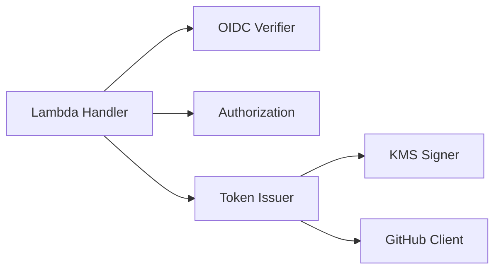

# Lambda Design

## 1. Responsibility and Invocation

Lambda は GitHub OIDC JWT の検証、GitHub App Installation への対象解決、`contents:read` の発行認可、KMS 署名、GitHub App Installation Access Token の発行を実行します。Go のパッケージやインターフェースは責務とテスト容易性に応じて設け、必要性のない抽象化を避けます。

Lambda は AWS IAM により認証・認可された同期 Invoke を受け付けます。Invoke の Payload に含まれる GATES 用 OIDC JWT の署名と Claim を検証し、要求を処理します。

| 項目 | 契約 |
|---|---|
| Transport | AWS Lambda `Invoke`、`InvocationType=RequestResponse` |
| AWS Authentication | 呼び出し元が AWS 一時認証情報で SigV4 署名する |
| Caller Identity | GATES 用 Audience の GitHub OIDC JWT を JSON Payload に含める |
| Payload | JSON。GATES が設ける上限を 16 KiB とする。無効な型・未知フィールドは拒否 |
| Response | JSON。呼び出し元は Invoke の `FunctionError` と Lambda 応答の `ok` をそれぞれ確認 |
| Endpoint | AWS Lambda Invoke API |

Lambda Invoke には HTTP の `Authorization` ヘッダーに相当するアプリケーション層のヘッダーがないため、GATES 用 OIDC JWT は `identity_token` フィールドとして Payload に含めます。Payload は資格情報を含むため丸ごとログに記録せず、監査に必要な非秘密のフィールド（要求対象と要求権限）だけを記録します。

## 2. Request

### 2.1 Repository Request

```json
{
  "version": 1,
  "identity_token": "<GATES_AUDIENCE_GITHUB_OIDC_JWT>",
  "scope": "repository",
  "repositories": ["example-org/repo-a", "example-org/repo-b"],
  "permissions": {"contents": "read"}
}
```

| フィールド | ルール |
|---|---|
| `version` | 必須、整数 `1` |
| `identity_token` | 必須、GATES 用 Audience の JWT。Bearer 資格情報として慎重に扱う |
| `scope` | 必須、値は `repository`。その他の値は認可拒否 |
| `repositories` | 必須、重複のない 1 件以上の `owner/repo` の配列。GitHub API の上限は 500 件だが、実効上限は Payload サイズで決まる |
| `permissions` | 必須、値は **`{"contents":"read"}`**。形式が不正なら入力不正、形式が正しく値が許可条件と異なれば認可拒否 |

- 対象は同一 Organization に属し、GATES で利用する同一の GitHub App Installation に含まれる必要がある。
- Caller / Owner / Installation ID と GitHub API Host を利用者から指定させない。
- 複数対象のうち一つでも許可条件を満たさなければ全件を拒否し、部分成功も自動分割もしない。
- GitHub API に渡す際は `owner/repo` を一度だけ `/` で分割し、Owner が許可 Organization に一致することを確認して、リポジトリ名の部分だけを `repositories` に指定する。要求時の `owner/repo` は応答の `full_name` と照合するため保持する。
- 各リポジトリに同じ Permission Map を適用する。別の権限を必要とする場合は個別に要求する。
- Lambda が返すトークンの対象は要求したリポジトリのみであり、App にインストール済みのすべてのリポジトリを意味しない。

### 2.2 Validation

Handler は入力型、未知フィールド、リストの重複、空値、`scope` と Permission Map の形式、サイズを検証します。形式検証は要求が整っているかだけを判定し、要求した Scope と権限が許可条件に一致するかは JWT 検証後に Authorization が判定します。この順序の理由は [Security Design](security.md#31-authorization-rule) に記述します。

各 `owner/repo` は Owner とリポジトリ名の 2 要素に分割し、許可 Organization の Owner 名と照合します。名前の比較と重複判定は大文字小文字を区別せずに行います。入力文字列のリポジトリ名だけから所有権を判断せず、要求元の Organization は検証済み JWT に基づいて決定します。

## 3. Responses

### 3.1 Success

```json
{
  "ok": true,
  "token": "<INSTALLATION_ACCESS_TOKEN>",
  "expires_at": "<RFC3339_EXPIRATION_TIME>",
  "scope": "repository",
  "repositories": ["example-org/repo-a", "example-org/repo-b"],
  "permissions": {"contents": "read", "metadata": "read"}
}
```

`repositories` は検証済みの発行対象を GitHub 応答の `full_name` で示します。`permissions` は GitHub 応答の実効権限、`expires_at` は GitHub が定めた有効期限（RFC 3339 形式）です。GATES は有効期限を延長しません。Lambda は GitHub API の発行応答を次の条件で検証し、必要な情報が得られなければトークンを返しません。

- `token` が空でなく、`expires_at` が有効な将来日時であること。
- `repositories` が存在し、要求と同じ件数の対象を返すこと。`full_name` と要求名を大文字小文字を区別せず集合で照合し、余分な対象・欠落・重複を拒否すること。
- 各対象の Repository ID が有効かつ一意で、`owner.id` が許可 Owner ID と一致すること。ID は応答の整合性確認に用い、事前に確定した ID との照合とはみなさないこと。
- `permissions.contents` が `read` であり、追加 Permission は `metadata:read` が応答に含まれる場合に限り許容すること。その他の Permission は拒否すること。

GitHub API の応答が検証条件に適合しない場合は `issuance_verification_failed` として拒否します。GitHub API の通信障害と区別するのは、発行応答の不整合が設定ミスや GitHub 側の仕様変更を示す監視対象だからです。

### 3.2 Failure

```json
{
  "ok": false,
  "error": {
    "code": "authorization_denied",
    "message": "The requested token is not permitted.",
    "request_id": "<OPAQUE_ID>"
  }
}
```

| Error code | 内容 |
|---|---|
| `invalid_request` | JSON、必須フィールド、未知フィールド、Scope / Permission Map の形式が不正 |
| `invalid_identity_token` | GitHub OIDC JWT が不正、期限切れ、必須 Claim の欠落・不整合 |
| `authorization_denied` | Caller の Owner ID が許可 Organization と不一致、要求した Scope / 権限が許可条件外、または要求リポジトリが許可 Organization / Installation の範囲外 |
| `identity_verification_unavailable` | OIDC Discovery / JWKS 等の検証に失敗 |
| `signing_unavailable` | KMS 署名に失敗 |
| `token_issuance_failed` | GitHub API との通信、または発行要求が失敗 |
| `issuance_verification_failed` | GitHub API の発行応答が [Success](#31-success) の検証条件に適合しない |
| `internal_error` | 想定外の内部障害 |

GitHub API が要求した対象を受け付けなかった応答（Installation の範囲外や存在しないリポジトリによる 422 など）は `authorization_denied` に分類し、通信障害やその他の失敗は `token_issuance_failed` に分類します。この分類に用いる応答の形式は実 API で確認します。

外部エラーをそのまま応答へ転記しません。認証情報を含む詳細を公開せず、相関 ID によってログと突き合わせます。Lambda の処理結果は `ok` で示し、Invoke 自体の結果と区別します。呼び出し側での AWS CLI 終了コード、`FunctionError`、`ok` の判定は [GitHub Actions Design](github-actions.md) に記述します。

## 4. Logical Components



| Component | 責務 |
|---|---|
| Lambda Handler | Payload の形式検証、各コンポーネントの呼び出し順序の制御、監査情報の記録、応答形式 |
| OIDC Verifier | GitHub OIDC JWT の署名・Issuer・Audience・時間・Claim 検証と Caller の確定 |
| Authorization | Caller、要求（対象、Scope、権限）、取得済み Installation、固定設定から発行可否を判定し、TokenGrant を確定。ネットワーク通信を行わない |
| Token Issuer | KMS Signer による App JWT の作成、GitHub Client を使った Installation の取得とトークン発行、GitHub 応答の TokenGrant への照合 |
| KMS Signer | 固定された非対称 KMS Key とアルゴリズムで署名 |
| GitHub Client | GitHub API（Installation の取得とトークン発行）に対する HTTP 通信と応答の復号 |

このコンポーネント区分は責務のモデルであり、Go パッケージへの一対一の対応を要求しません。

## 5. Domain Model

| Concept | 主な属性 | 不変条件 |
|---|---|---|
| Caller | `repository_owner_id`、`repository_id`、`ref`、`event_name`、必要な Workflow 情報 | 認証済み JWT からのみ構築。不変 ID が `sub` と整合 |
| TokenRequest | `repositories[]`、`permissions{}` | 対象と権限を明示。`repository` スコープ、`contents:read` を要求 |
| Installation | Installation ID、`account.id` | App JWT で取得した許可 Organization の Installation。`account.id` が固定 Owner ID と一致 |
| TokenGrant | Installation ID、`repositories[]`、`permissions{}` | JWT・Installation・固定許可範囲を確認した発行前の認可結果。対象名と権限を GitHub API に明示 |
| RepositoryIdentity | ID、Owner ID、完全名 | 発行応答で得た実効対象。Owner と名称を要求に照合し、ID の有効性・一意性を確認する |
| InstallationToken | トークン、有効期限、対象、実効権限 | GitHub 応答を Grant と照合し、過大・不明な場合は返却禁止 |

`TokenGrant` は認可済みの発行範囲を Token Issuer に渡すための値です。複数リポジトリには共通の Permission Map を適用し、対象ごとの違いが必要なら別のトークンを要求します。

## 6. Processing Flow

1. Handler が Payload サイズ、JSON 型、未知フィールド、必須値、Scope と Permission Map の形式を検証し、資格情報をログに残さない。
2. OIDC Verifier が固定 Issuer / JWKS と GATES 用 Audience で JWT を検証し、`repository_owner_id` と `repository_id` の Claim、および不変 ID 入り `sub` との一致から Caller を確定する。
3. Authorization が Caller の Owner ID を固定した許可 Owner ID と照合し、Scope が `repository`、Permission Map が `contents:read` のみであることを確認し、要求された各 `owner/repo` の Owner 名を固定 Organization 名と照合する。不一致なら外部呼び出しに進まず拒否する。
4. Token Issuer が KMS Signer で GitHub App JWT を生成し、GitHub Client で許可 Organization の Installation を取得する。
5. Authorization が Installation の `account.id` を固定 Owner ID と照合し、Installation ID、要求対象名、固定 Permission から TokenGrant を確定する。
6. Token Issuer が Grant の各 `owner/repo` から Owner を除いたリポジトリ名の配列と `permissions` を GitHub API に明示してトークンを取得する。GitHub 応答の `full_name` は Grant の元の `owner/repo` と全件照合し、Owner ID、Repository ID の有効性・一意性、実効権限が許可範囲内であることを確認する。必要な一覧・権限の欠落や不一致があれば `issuance_verification_failed` として返却しない。
7. Handler が必要最小限の成功応答を返す。いずれかに失敗した場合は安全なエラーコードと相関 ID を返し、トークンは返さない。

Owner ID、Scope / 権限、Owner 名の照合（手順 3）を Installation の取得（手順 4）より先に置くのは、KMS と GitHub API の呼び出しを認可の見込みがある要求だけに限るためです。

## 7. External Integrations

### 7.1 OIDC Validation

- Issuer を `https://token.actions.githubusercontent.com` に固定し、固定 Issuer に対応する Discovery / JWKS を利用する。
- 署名アルゴリズムを許可済み方式に限定する。署名・Issuer・Audience・期限の検証を保守される OIDC ライブラリに委譲する。
- Audience は GATES 用値との完全一致を確認する。`iat` / `nbf` / `exp` と許容時計差を検証し、無効な時間条件を拒否する。
- `repository_owner_id`、`repository_id` の Claim と、`sub` に含まれる不変 ID の一致を確認し、ID の欠落・不一致を拒否する。
- 任意の Issuer / JWKS / `jku` を入力から指定させない。通信時間とレスポンスサイズを制限し、鍵取得不能なら拒否する。

### 7.2 KMS Signing

- GitHub App JWT の Header を RS256 とし、Claim は `iss`、`iat`、`exp` を設定する。`iss` には GitHub App の Client ID を用いる。`iat` は時計差を考慮して現在時刻の 60 秒前とし、`exp` は GitHub の上限である 10 分を超えない。
- Header と Payload を Base64URL（padding なし）で結合し、署名入力を SHA-256 でハッシュする。
- AWS KMS `Sign` に `SigningAlgorithm=RSASSA_PKCS1_V1_5_SHA_256`、`MessageType=DIGEST`、計算済みダイジェストを渡す。二重ハッシュをしない。
- 署名結果を Base64URL で連結し、内部 GitHub App JWT を作成する。
- Lambda が保持するのは GitHub App の識別子、KMS Key ARN、必要な設定だけであり、秘密鍵の平文は受け取らない。KMS Key の設定は Terraform、鍵素材インポートは独立した運用手順で行い、実行時の責務外とする。

### 7.3 GitHub Client

- App JWT で `GET /orgs/{org}/installation` を呼び出し、Installation ID と `account.id` を取得する。トークン発行には `POST /app/installations/{installation_id}/access_tokens` を使用する。
- GATES の要求は `owner/repo` 形式とする。GitHub のトークン発行 API の `repositories` はリポジトリ名だけを受け取るため、許可 Organization に一致する Owner を確認してリポジトリ名の配列へ変換する。変換前の完全名と API 応答の `full_name` を照合する。
- GitHub API に変換後の `repositories` と `permissions` を必ず指定する。応答照合の期待値と欠落時の扱いは本書の [Responses](#3-responses) を正本とし、実 API で確認する。
- API Host、API バージョン、HTTP Header は信頼済み設定で固定する。タイムアウト・レスポンスサイズ上限を設け、API エラー本文に含まれる資格情報をログへ転記しない。

## 8. Technology Decisions

| 用途 | 採用技術・方針 | 理由 |
|---|---|---|
| Lambda | `github.com/aws/aws-lambda-go/lambda` | AWS 公式の Go ランタイム連携 |
| AWS SDK / KMS | AWS SDK for Go v2 (`config`、`service/kms`) | AWS 公式の認証情報解決・KMS API |
| GitHub OIDC 検証 | `github.com/coreos/go-oidc/v3/oidc` | Discovery / JWKS / JWT 検証を信頼できるライブラリに委譲 |
| GitHub REST API | `net/http`、`encoding/json` | 限られたエンドポイントを Go 標準ライブラリで処理 |
| App JWT 組み立て | 標準ライブラリと KMS Sign | JWT の署名検証器は自作しない |
| テスト | Go `testing`、`httptest` を基礎として、必要なら補助ライブラリを追加 | 環境依存しないテストを優先。追加依存を一律禁止しない |

依存関係は保守体制・必要性・脆弱性・ライセンス・間接依存を評価して決めます。Go のパッケージ化、内部インターフェースやテストヘルパーの採用は実装担当者の裁量とし、正当な理由のある構造化を妨げません。

## 9. Testability

認可判断はネットワーク通信と分離してテストできるようにします。GitHub API の HTTP は `httptest`、KMS の API 境界はテストダブル、OIDC は固定鍵とテスト JWT / JWKS を用いて確認します。リポジトリ名の変換では `owner/repo` からリポジトリ名だけが GitHub API に渡ること、異なる Owner・不正な区切り・大文字小文字の違い・重複を適切に処理すること、応答の `full_name` が元の要求と一致しない場合に拒否することを検証します。

受け入れ条件は [Requirements](../spec/requirements.md) を正本とします。

## 10. Sources

- [AWS — Lambda Invoke](https://docs.aws.amazon.com/lambda/latest/dg/invocation-sync.html)
- [AWS — AWS CLI Lambda Invoke](https://docs.aws.amazon.com/cli/latest/reference/lambda/invoke.html)
- [AWS — aws-lambda-go](https://github.com/aws/aws-lambda-go)
- [AWS — AWS SDK for Go v2](https://docs.aws.amazon.com/sdk-for-go/v2/developer-guide/)
- [AWS — KMS Sign](https://docs.aws.amazon.com/kms/latest/APIReference/API_Sign.html)
- [GitHub — OIDC reference](https://docs.github.com/en/actions/reference/security/oidc)
- [GitHub — GitHub App JWT](https://docs.github.com/en/apps/creating-github-apps/authenticating-with-a-github-app/generating-a-json-web-token-jwt-for-a-github-app)
- [GitHub — Generating an installation access token](https://docs.github.com/en/apps/creating-github-apps/authenticating-with-a-github-app/generating-an-installation-access-token-for-a-github-app)
- [GitHub — REST API endpoints for GitHub Apps](https://docs.github.com/en/rest/apps/apps)
- [Go — coreos/go-oidc/v3/oidc](https://pkg.go.dev/github.com/coreos/go-oidc/v3/oidc)
