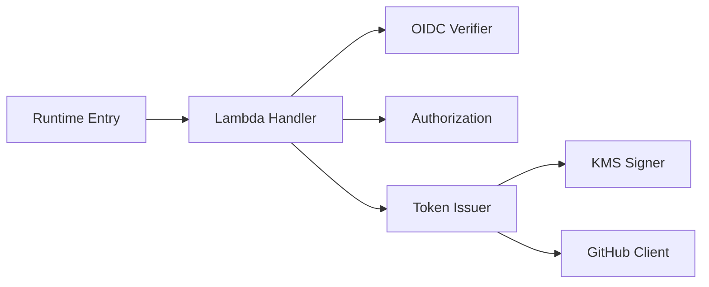

# Lambda Design

## 1. Responsibility and Invocation

Lambda は GitHub OIDC JWT の検証、Installation の解決、`contents:read` の発行認可、KMS 署名、GitHub App Installation Access Token の発行を実行します。

Lambda は AWS IAM により認証・認可された同期 Invoke を受け付けます。Invoke の Payload に含まれる GATES 用 OIDC JWT の署名と Claim を検証し、要求を処理します。

| 項目 | 契約 |
|---|---|
| Transport | AWS Lambda Invoke API、`InvocationType=RequestResponse` |
| AWS Authentication | 呼び出し元が AWS 一時認証情報で SigV4 署名する |
| Caller Identity | GATES 用 Audience の GitHub OIDC JWT を JSON Payload に含める |
| Payload | JSON。GATES が設ける上限を 16 KiB とする。無効な型・未知フィールドは拒否 |
| Response | JSON。呼び出し元は Invoke の `FunctionError` と Lambda 応答の `ok` をそれぞれ確認 |

Lambda Invoke には HTTP の `Authorization` ヘッダーに相当するアプリケーション層のヘッダーがないため、GATES 用 OIDC JWT は `id_token` フィールドとして Payload に含めます。Payload は資格情報を含むため丸ごとログに記録せず、監査に必要な非秘密のフィールド（要求対象、要求権限）だけを記録します。

概念の定義は [Domain Model](domain.md) を正本とします。

## 2. Request

### 2.1 Invoke Payload

```json
{
  "version": 1,
  "id_token": "<GATES_AUDIENCE_GITHUB_OIDC_JWT>",
  "repositories": ["example-org/repo-a", "example-org/repo-b"],
  "permissions": {"contents": "read"}
}
```

| フィールド | ルール |
|---|---|
| `version` | 必須、整数 `1` |
| `id_token` | 必須、GATES 用 Audience の JWT。Bearer 資格情報として慎重に扱う |
| `repositories` | 必須、重複のない 1 件以上 500 件以下の `owner/repo` の配列。上限は GitHub のトークン発行 API が一度に受け付ける件数に合わせる（[GitHub Constraints](../spec/github-constraints.md#61-発行-api-の呼び出しと有効期限)）。GATES が設ける 16 KiB の Payload には最短の要素で 2,000 件以上が入るため、Payload サイズより先にこの上限に達する |
| `permissions` | 必須、値は **`{"contents":"read"}`**。形式が不正なら入力不正、形式が正しく値が許可条件と異なれば認可拒否 |

形式検証を通った Invoke Payload から、未検証の GATES 用 OIDC JWT と発行要求を分けて取り出します。

- 対象は同一オーナーに属し、GATES で利用する同一の GitHub App Installation に含まれる必要がある。
- Caller / オーナー / Installation ID と GitHub API Host を利用者から指定させない。
- 全リポジトリを対象にする項目（GitHub の `repository_selection`）を設けない。対象は `repositories` で明示したリポジトリだけである。`repository_selection` を含む Payload は、未知のフィールドとして入力不正になる。
- 複数対象のうち一つでも許可条件を満たさなければ全件を拒否し、部分成功も自動分割もしない。
- 各リポジトリに同じ Permissions を適用する。別の権限を必要とする場合は個別に要求する。

### 2.2 Validation

形式検証は、値を GATES が解釈できるかだけを判定します。
値が許可条件に合うかは、認証後に Authorization が判定します。
この順序の理由は [Security Design](security.md#31-authorization-rule) に記述します。

#### 入力不正と認可拒否の境界

各フィールドの値の形を、入力不正（`invalid_request`）と認可拒否（`authorization_denied`）に次のように分けます。
入力不正の形に当たらない要求だけが、Authorization の判定に進みます。

| フィールド | 入力不正にする形 | 認可拒否にする形 |
|---|---|---|
| `version` | 欠落、`null`、整数 `1` 以外（`1.0`、`"1"`、`2` を含む） | なし |
| `id_token` | 欠落、`null`、文字列以外、空文字列 | なし（JWT の検証失敗は `invalid_id_token`） |
| `repositories` | 欠落、`null`、配列以外、空配列、文字列以外の要素、[完全名の形式](#名前の文字種と比較規則)に合わない要素、大文字小文字を区別しない重複、500 件超 | オーナー名が許可オーナー名と異なる要素を含む |
| `permissions` | 欠落、`null`、オブジェクト以外、空オブジェクト、文字列以外の値、[権限名と水準の文字種](#権限名と水準の文字種)に合わないキーまたは値（空文字列を含む） | `{"contents":"read"}` 以外の組（`contents` 以外のキー、`read` 以外の値、`metadata` などのキーの追加） |
| Payload 全体 | 16 KiB 超、JSON として不正、オブジェクト以外、未知のフィールド、重複したキー、不正な UTF-8、オブジェクトの後に続くデータ | なし |

JSON として不正な Payload は、Lambda の Invoke API が関数に渡す前に拒否するため、GATES の応答も監査記録も残りません（[Runtime Entry](#41-runtime-entry)）。
GATES はそれでもこの形を入力不正として判定し、Invoke API の検査に依存しません。

空の Permissions を入力不正にするのは、`permissions` が必須であり、[Requirements](../spec/requirements.md) FR-012 が欠落・未知値を広い既定権限に読み替えないと定めているためです。
空の Map は、要求の欠落と同じく、要求した権限を読み取れない形として扱います。
一方で、未知のキー（`issues` など）は認可拒否にします。
`contents:write` と同じく、形式は読み取れて値が許可外の要求であり、監査記録に残す対象だからです。

重複したキーを入力不正にするのは、`{"contents":"write","contents":"read"}` のような Payload の解釈が JSON の実装ごとに分かれるためです。
後の値を採る実装はこの Payload を `contents:read` として認可しますが、監査記録や別の処理が先の値を読むと、認可した内容と記録した内容が食い違います。

オーナー名の不一致を認可拒否にするのも、未知のキーと同じく、形式は読み取れて値が許可外の要求だからです。
形式検証は、`owner/repo` をオーナー名とリポジトリ名に分割できるかまでを見ます。

500 件を超える要求を入力不正にするのは、GitHub API に渡すと、その応答が `422` なら `github_issuance_rejected` に分類され（[Failure](#32-failure)）、利用者が直せる件数の超過が、原因を特定できない発行拒否として記録され得るためです。
形式検証で止めれば、KMS と GitHub API を呼ばずに済みます。

形式検証のエラー文言には、不正なフィールドの名前（配列の要素なら位置を添える）とその形だけを書き、Payload の断片を含めません。
未知のフィールドの名前、`permissions` のキー、数値のリテラルも断片に当たります。
断片には GATES 用 OIDC JWT が入り得るためです。

#### 権限名と水準の文字種

`permissions` のキー（権限名）と値（水準）は、1 文字以上 64 文字以下の ASCII 小文字とアンダースコア（`_`）の文字列に限ります。
GitHub の Permissions の表現は [GitHub Constraints](../spec/github-constraints.md#61-発行-api-の呼び出しと有効期限) を参照します。
この文字種は、その表現に合わせて GATES が決めた形式の制限です。
GitHub が公式に定めた規則ではありません。
この文字種に合わない文字列は、GitHub の権限名や水準として読み取れないため、入力不正にします。
[Security Design](security.md#31-authorization-rule) と [Domain Model](domain.md) の RULE-013 が入力不正にする「値を読み取れない形」に、この文字列も含まれます。

この規則により、監査記録に入る要求の権限は、改行や制御文字を含まない 64 文字以下の語に限られます。
ログのエンコーダが値をどうエスケープするかによらず、記録の 1 行を偽装する値や長大な値が入りません。
値の数には上限を設けず、記録全体の大きさは Payload の 16 KiB の上限で抑えます。

64 文字の上限は GitHub 公式の文字数制限ではなく、最長の権限名（46 文字）に余裕を持たせて GATES が決めた値です。
許可されるのは `{"contents":"read"}` だけなので、将来 GitHub がこの規則に合わない権限名を加えても、正当な要求は拒否されません。
その権限名を使う要求の結果が、認可拒否から入力不正に変わるだけです。

発行結果の実効権限も Permissions として同じ規則で読みます。
照合は許可権限と付随権限の範囲外の Permission Entry をもともと拒否するため（[Success](#31-success)）、規則に合わない権限名が応答に現れても、トークンを返さないことは変わりません。
この場合も照合の失敗（`issuance_verification_failed`）として扱い、応答の `token` の取り出しと失効は、`permissions` を読み取れたかどうかに依存させません。

#### 名前の文字種と比較規則

`repositories` の各要素は、`/` をちょうど一つ含み、その前のオーナー名と後のリポジトリ名がどちらも空でない文字列です。
オーナー名とリポジトリ名は、次の文字種に限ります。

| 名前 | 受け付ける文字種と長さ | 根拠 |
|---|---|---|
| オーナー名 | 1 文字以上の ASCII 英数字とハイフン | GATES が決めた形式の制限。GitHub の規則としては確定していない（下記） |
| リポジトリ名 | 1 文字以上 100 文字以下の ASCII 英数字、ハイフン、アンダースコア、ピリオド | GitHub の新規リポジトリ名の制約に合わせる。`.` と `..` は緩い側に寄せた（下記） |

GitHub 側の名前の文字種と長さ、その根拠と未確認事項は [GitHub Constraints](../spec/github-constraints.md#2-owner-and-repository) を参照します。

GitHub の規則として確認できなかった条件は、GitHub が受け付ける名前を拒否しない側に寄せ、形式検証で課しません。
GATES が GitHub より厳しい規則を持つと、正当な要求が入力不正になり、利用者には原因が分からないためです。
該当するのは次の規則です。

- **オーナー名のハイフンの位置**：先頭・末尾のハイフンと連続したハイフンの禁止は、Enterprise Managed Users の命名規則であり、ほかのオーナーに転用しない
- **オーナー名の長さ**：39 文字の上限も、Enterprise Managed Users の命名規則であり、ほかのオーナーに転用しない
- **リポジトリ名 `.` と `..`**：GitHub が受け付けるかを確認できておらず、文字種の規則だけでは拒否できない

一方で、オーナー名の文字種も、User と Organization に一様に適用できる GitHub の規則としては確定していません。
それでもオーナー名に上の文字種を課せるのは、そうしても正当な要求を拒否しないためです。
許可オーナー名は同じ文字種を満たす値としてデプロイ時に固定するため、この文字種に合わないオーナー名の要求は、形式検証を通してもオーナー名の照合で必ず拒否されます。
オーナー名の規則を課すかどうかは、結果を入力不正と認可拒否のどちらにするかだけを変えます。
例外として、Enterprise Managed Users のユーザーアカウントは、ユーザー名にアンダースコアを含むため、この文字種を満たさず、許可オーナーに設定できません。
リポジトリ名の文字種が `/` を含まないため、`a/b/c` は入力不正になり、リポジトリ名 `b/c` が GitHub API の `repositories` に渡ることはありません。

名前の比較と重複判定は、ASCII の範囲で大文字小文字を区別せずに行います。
Unicode の大文字小文字の対応（Go の `strings.EqualFold` など）を使わないのは、Kelvin 記号（U+212A）と `k` のように、GitHub 上では別の文字が同じ文字として扱われ得るためです。
比較の規則は、要求の重複判定、オーナー名の照合、発行応答の `full_name` の照合（[Success](#31-success)）で共通です。

入力文字列のリポジトリ名だけから所有権を判断せず、要求元のオーナーは検証済み JWT に基づいて決定します。

## 3. Responses

### 3.1 Success

```json
{
  "ok": true,
  "token": "<INSTALLATION_ACCESS_TOKEN>",
  "expires_at": "<RFC3339_EXPIRATION_TIME>",
  "repositories": ["example-org/repo-a", "example-org/repo-b"],
  "permissions": {"contents": "read", "metadata": "read"},
  "request_id": "<OPAQUE_ID>"
}
```

`repositories` は照合済みの発行対象を GitHub 応答の `full_name` で示します。`permissions` は GitHub 応答の実効権限、`expires_at` は GitHub が定めた有効期限（RFC 3339 形式）です。GATES は有効期限を延長しません。
GitHub 応答の `repository_selection` は返しません。
照合により `selected` 以外の応答はトークンを返さないため、成功応答では値が常に同じで、呼び出し元に伝える情報がないからです。
`request_id` は失敗応答と同じ相関 ID で、資格情報ではありません。
値には Lambda の request ID（Invoke 応答のヘッダー `x-amzn-RequestId` と同じ値）をそのまま使います。
CloudWatch Logs に自動で記録されるため、独自に採番しなくても監査記録と突き合わせられます。
成功時にも返すのは、呼び出し元がワークフローのログに残し、監査記録と突き合わせられるようにするためです（[Requirements](../spec/requirements.md) FR-021）。

Lambda は、GitHub API の発行応答を発行許可と照合し、照合を通ったときだけトークンを返します。
照合の条件は [Security Design](security.md#34-issuance-result-verification) に、照合を通った発行結果が満たす不変条件は [Domain Model](domain.md) の INV-012 に定めます。
照合の条件に適合しない応答は `issuance_verification_failed` として拒否します。

発行応答から空でない `token` を取得できたうえで照合に失敗した場合、Lambda はそのトークンで `DELETE /installation/token` を呼んで失効を試みます。
失効に失敗してもエラーコードは `issuance_verification_failed` のまま変えず、[Domain Model](domain.md#36-audit-record) の失効の結果を監査記録に残します。
`token` を取得できない場合は、失効 API の認証に使うトークンがないため、失効を試みません。

### 3.2 Failure

```json
{
  "ok": false,
  "error": {
    "code": "authorization_denied",
    "message": "The requested token is not permitted."
  },
  "request_id": "<OPAQUE_ID>"
}
```

`request_id` は成功応答と同じくトップレベルに置きます。
相関 ID は応答全体の属性であり、呼び出し元が `ok` の値によらず同じ場所から読めるようにするためです。

コンポーネントが panic するのは、構築関数を経ていないゼロ値が、その値を前提にする処理に渡った場合だけです。
Go の型はゼロ値の生成を禁じられないため、この場合だけは呼び出し側の誤りとして処理を止めます。
外部入力と外部呼び出しの失敗は、panic にせずエラーで返します。

Handler は処理中の panic を回復し、`internal_error` の失敗応答として `request_id` とともに返します。
panic の値は、応答にも監査記録にも運用者向けのログにも書きません（[Security Design](security.md#5-failure-audit-and-security-risks)）。
回復した panic は、運用者向けのログに相関 ID とスタックトレースを ERROR で記録します。
このログの行は、`msg` を `panic recovered` とし、相関 ID を `request_id`、スタックトレースを `stack` のキーに書きます。
監査記録の `msg` と同じく、運用者が監視でこの行を見分ける印になるためです。
`FunctionError` になるのは、タイムアウト、メモリ不足、初期化の失敗、相関 ID が UTF-8 として正しくない場合のように Handler が応答を書けない場合だけです。
この場合は応答に `request_id` がないため、呼び出し元は Invoke の時刻と `run_id` で CloudWatch Logs の記録と突き合わせます。
相関 ID は応答に入るため、UTF-8 として正しくなければ、失敗応答も JSON に符号化できません。
Lambda Handler は Payload を読む前に相関 ID を確かめます。
正しくなければ発行処理を始めず、Runtime Entry がそのエラーを Lambda Runtime に返します。
符号化の時点で初めて気づくと、発行したトークンを返せず失効もしないまま残すためです。
発行処理を始めないため、監査記録も書きません。

エラーコードは、[Domain Model](domain.md#42-failure-kinds) の失敗の種別を応答で表す値です。
種別を分ける理由は Domain Model に置き、本ドキュメントはコードと失敗の条件の対応だけを定めます。

| Error code | 失敗の種別 | 内容 |
|---|---|---|
| `invalid_request` | 入力不正 | Payload が [Validation](#22-validation) の入力不正の形に当たる |
| `invalid_id_token` | 認証失敗 | GATES 用 OIDC JWT が [GATES OIDC JWT Claims](gates-oidc-jwt-claims.md) または [GATES OIDC JWT Signature](gates-oidc-jwt-signature.md) の受理条件を満たさない。JWT の形式・署名、Issuer、Audience、時間条件、必須 Claim、再取得後も一意に選べる使用可能な鍵がない `kid` などを含む |
| `authorization_denied` | 認可拒否 | Caller の Owner ID が許可オーナーと不一致、要求した権限が許可条件外、または要求したリポジトリのオーナー名が許可オーナー名と不一致。Installation の対象外であることが GitHub API の呼び出し後に判明した場合は、その処理段階の失敗として扱う |
| `identity_verification_unavailable` | 一時的な障害 | OIDC Discovery / JWKS の取得が一時的に失敗した。通信の失敗、タイムアウト、5xx、403 / 429 で、再試行で解消し得る |
| `signing_unavailable` | 一時的な障害 | KMS 署名が一時的に失敗した。通信の失敗、タイムアウト、呼び出し元の ctx の期限切れと中断、5xx、スロットリングで、再試行で解消し得る |
| `installation_resolution_failed` | Installation 利用不可 | 固定した GitHub App と許可オーナーから、発行に使える Installation を得られない。一時的な障害を除く GitHub API の失敗（App JWT が受け付けられない 401、GitHub App が許可オーナーにインストールされていないときの 404 など）、Installation の応答に必要な項目がない、停止状態を読み取れない、Installation が停止している（`suspended_at` が時刻である）、`account.id` が許可オーナーの Owner ID と一致しない |
| `token_issuance_failed` | 一時的な障害 | GitHub API の一時的な障害。通信の失敗、タイムアウト、5xx、レート制限による 403 / 429 で、Installation の取得と発行 API の呼び出しの両方を含む。再試行で解消し得る |
| `github_issuance_rejected` | GitHub 発行拒否 | GATES の認可が成立した後、GitHub の発行 API が `422` で要求を拒否した。検証失敗やスパム判定など、原因は応答コードから特定できない |
| `issuance_verification_failed` | 照合失敗 | GitHub API の発行応答が [Success](#31-success) の照合を通らない。空でないトークン文字列を取得できた場合は失効を試みる |
| `internal_error` | 内部障害 | Handler の panic、部品が返したエラーがどの失敗の種別にも当たらないか複数の種別に当たる場合、Discovery / JWKS の非一時的な取得・構造異常、JWKS に使用可能な鍵がない場合、KMS が再試行では解消しない失敗を返した場合（鍵の無効化、鍵の状態、権限の不足など）、KMS の応答を署名として解釈できない場合、KMS に要求を送る前の AWS SDK の失敗を含む |

一時的な障害のエラーコードは失敗した依存先ごとに分かれるため、外部の依存を呼ぶコンポーネントは、失敗の種別を依存先が分かる形で返します。
Token Issuer も、KMS Signer と GitHub Client の失敗を、依存先が分かる種別のまま返します。
Lambda Handler は、その種別をエラーコードに写します。
部品が返したエラーがどの失敗の種別にも当たらなければ、Lambda Handler は `internal_error` に写します。
写像の漏れを、再実行を促すなどの利用者への誤った案内にしないためです。
部品が返したエラーが複数の失敗の種別に当たる場合も、Lambda Handler は種別の間に優先順位を置かず、`internal_error` に写します。
[Domain Model](domain.md#42-failure-kinds) では操作が返して発行処理を終わらせる失敗は一つの種別に属するため、複数に当たるのは操作が種別を定め損ねた場合です。
優先順位を置くと、操作が定めていない種別が、写像の順序によって応答と監査記録に残ります。

失敗応答の `message` は、エラーコードごとに固定した次の文言です。
部品のエラー文言を含めず、拒否の理由を応答に出しません（[応答とエラー文言に出す情報](#応答とエラー文言に出す情報)）。
一時的な障害の 3 つのコードだけに再実行を促す文を添えます。
再実行では解消しない失敗に再実行を促さないためです。

| Error code | `message` |
|---|---|
| `invalid_request` | `The request payload is invalid.` |
| `invalid_id_token` | `The ID token is not accepted.` |
| `authorization_denied` | `The requested token is not permitted.` |
| `identity_verification_unavailable` | `Identity verification is temporarily unavailable. Retry later.` |
| `signing_unavailable` | `Signing is temporarily unavailable. Retry later.` |
| `installation_resolution_failed` | `The GitHub App installation is not available for issuance.` |
| `token_issuance_failed` | `The GitHub API is temporarily unavailable. Retry later.` |
| `github_issuance_rejected` | `GitHub rejected the token issuance.` |
| `issuance_verification_failed` | `The issued token did not pass verification and was not returned.` |
| `internal_error` | `An internal error occurred.` |

#### GitHub API の失敗の分類

GitHub API の失敗は、HTTP 応答から次のように分類します。
通信の失敗、タイムアウト、5xx、レート制限による 403 / 429 は `token_issuance_failed` にします。
発行 API の 422 は `github_issuance_rejected` にします。
それ以外の失敗は `installation_resolution_failed` にします。
Client ID の誤り、KMS Key と GitHub に登録した Private Key の不一致、Installation の削除や停止が、ここに入ります。
発行 API の呼び出しで起きた 401 / 403 / 404 も、直前に同じ App JWT で Installation を取得できているため、その間に Installation か App の状態が変わったものとしてこのコードに含めます。
Installation の応答の形式が想定と異なる場合は `installation_resolution_failed` に、発行応答の形式が想定と異なる場合は `issuance_verification_failed` にします。

この分類は GATES のエラー分類であり、GitHub の HTTP ステータスの定義ではありません。
発行 API の `422` は、GitHub の公開仕様では検証失敗またはスパム判定を指し、Installation の範囲外の要求だけを意味しません（[GitHub Constraints](../spec/github-constraints.md#61-発行-api-の呼び出しと有効期限)）。
Installation の取得に使う Organization と User の API が公開している応答コードは `200` だけです（[GitHub Constraints](../spec/github-constraints.md#5-installation)）。
上の 404 は、User の API でアンインストールの後に観測した応答で、Organization の API では確かめていません。
分類は `200` 以外の応答をレート制限と一時的な障害を除いて `installation_resolution_failed` にすることで成り立ち、特定のステータスには依存しません。
発行 API の `422` を `authorization_denied` と分けるのは、`422` だけでは権限不足や悪意の有無を確定できないためです。

403 と 429 のうちレート制限によるものは、応答のヘッダーで判定します。
429 は常にレート制限とします。
403 は、`x-ratelimit-remaining` が `0` か、`retry-after` のヘッダーがあるときだけレート制限とし、ほかの 403 はレート制限としません。
本文のメッセージは判定に使いません。
GitHub はセカンダリのレート制限を本文のメッセージだけで示す場合があり（[GitHub Constraints](../spec/github-constraints.md#61-発行-api-の呼び出しと有効期限)）、文言に頼ると、GitHub が文言を変えたときに分類が変わるためです。
この判定は、ヘッダーのないレート制限の 403 を `installation_resolution_failed` として、レート制限でないのにこれらのヘッダーが付いた 403 を `token_issuance_failed` として伝え得ます。
GitHub App JWT で認証した要求の応答は、レート制限に達していない記録では `x-ratelimit-*` を含まず（同節）、制限に達したときに付くかは確かめていません。
どちらの誤りでもトークンは返さず、誤りが変えるのは、利用者に再実行を促すかどうかです。

#### Discovery / JWKS と KMS の失敗の分類

Discovery と JWKS の取得では、403 も `identity_verification_unavailable` にします。
Discovery と JWKS は認証を要しない公開の文書で、GATES に起因する 403 が想定できず、レート制限と見なすためです。
[取得前の拒否](#61-oidc-validation)に当たらず手元の鍵で検証できない JWT について取得に失敗した場合は、署名の正否を判定できないため、JWT が不正であっても取得の失敗として返します。
再取得の上限の間に返す種別は、[JWKS の再取得の上限](#61-oidc-validation)に従います。

KMS に接続できない失敗には、経路の一時的な障害と、ネットワークの設定の誤りのように再試行では解消しない失敗の両方があり、区別できません。
これを `signing_unavailable` に含めるのは、Discovery / JWKS の取得の通信の失敗と同じ扱いにするためです。
設定の誤りは、デプロイ後の試験で発行が一度も成功しないことから気付けます。
本文の受信途中の切断のうち、通信の失敗として報告されないものは、完全に受信して解釈できない本文と区別できず、`internal_error` になります。
`ThrottlingException` を名前で挙げて `signing_unavailable` にするのは、KMS がスロットリングを 5xx ではなく 400 で返すためです（[AWS — KMS Common Error Types](https://docs.aws.amazon.com/kms/latest/APIReference/CommonErrors.html)）。

#### 応答とエラー文言に出す情報

外部エラーをそのまま応答へ転記しません。認証情報を含む詳細を公開せず、相関 ID によってログと突き合わせます。Lambda の処理結果は `ok` で示し、Invoke 自体の結果と区別します。

認可拒否と、Installation が発行に使えないことによる拒否のエラー文言には、満たさなかった条件を書き、Caller、要求、許可オーナー、Installation の値を含めません。
文言は監査記録のためのもので、エラー応答には出しません。
拒否の理由を応答に出すと、許可オーナーの Owner ID やオーナー名を、許可されない呼び出し元が探れるためです。
値を含めないのは、Caller と要求は監査記録が別の項目として持つため文言に重ねる必要がなく、文言が誤って応答に混ざっても許可オーナーを明かさないためです。
Installation は許可オーナー名から取得するため、その Installation ID と `account.id` は、許可オーナー名をいま持つアカウントを示します。
`account.id` が許可オーナーの Owner ID と一致しない場合も同じであり、許可オーナーの値と同じに伏せます。

GitHub API の呼び出しの失敗のエラー文言には、応答のステータスを書き、応答本文、GitHub App JWT、Installation Access Token を含めません。

照合失敗のエラー文言にも満たさなかった条件を書き、トークン、実効対象の完全名、Repository ID と Owner ID の値を含めません。
実効対象は要求の対象か Installation の対象のリポジトリを指すため、要求と Installation の値と同じに伏せます。
失効を試みて失敗した場合は、照合失敗のエラー文言に失効の失敗の理由（失効の応答のステータスと GitHub の request ID、または通信の失敗）を添えます。

GitHub API の呼び出しの失敗と照合失敗のエラー文言には、GitHub の request ID を含めます。
失敗の原因を GitHub 側の記録と突き合わせて調べる手がかりになるためです。
GitHub の request ID は、成功応答と失敗応答の相関 ID とは別の値で、資格情報でも、Caller、要求、許可オーナー、Installation の値でもありません。

Token Issuer は、GitHub API の呼び出しの失敗の文言に、失敗した段階の名前（Installation の解決、発行）を前置します。
Installation の取得と発行 API の呼び出しの失敗は、同じ種別になり得て文言の形も同じため、段階の名前がないと監査記録から失敗した呼び出しを見分けられないからです。
KMS の署名と Grant の失敗には前置しません。
署名の失敗は KMS Signer の文言で、Grant の失敗は満たさなかった条件で、それぞれ段階が分かるためです。

## 4. Logical Components



| Component | 責務 |
|---|---|
| Runtime Entry | 起動時の固定設定の読み込みと各コンポーネントの組み立て、初期化の失敗の記録と異常終了、Lambda Runtime からの Payload と相関 ID の受け取りと、Lambda Handler の応答か相関 ID を確かめた結果のエラーの返却。Lambda Runtime のライブラリと AWS SDK の設定の読み込みを使う唯一のコンポーネントで、失敗の分類や値の検証の判断を持たない |
| Lambda Handler | 相関 ID の検証、Payload の形式検証、各コンポーネントの呼び出し順序の制御、監査記録の出力、応答形式 |
| OIDC Verifier | GitHub OIDC JWT の署名・Issuer・Audience・時間・Claim 検証と Caller の確定、Issuer の Discovery / JWKS の取得と保持 |
| Authorization | Caller、要求（対象、権限）、取得済み Installation、固定設定から発行可否を判定し、TokenGrant を確定。ネットワーク通信を行わない |
| Token Issuer | KMS Signer による App JWT の作成、GitHub Client を使った Installation の取得とトークン発行、GitHub 応答の TokenGrant への照合、照合に失敗したトークンの失効 |
| KMS Signer | 固定設定の Client ID と現在時刻から GitHub App JWT を組み立て、固定された非対称 KMS Key とアルゴリズムで署名 |
| GitHub Client | GitHub API（Installation の取得、トークン発行、トークンの失効）に対する HTTP 通信と応答の復号 |

このコンポーネント区分は責務のモデルであり、Go パッケージへの一対一の対応を要求しません。

資格情報の値を取り出せるコンポーネントは、次のとおりに限ります。
ほかのコンポーネントでは、ログやエラーにどう出力しても値が伏せられる型で運びます。
取り出せる箇所を限ると、資格情報がログやエラー本文に出る経路を、その箇所の確認に絞れるためです。

| 資格情報 | 値を取り出せるコンポーネント |
|---|---|
| 未検証の GATES 用 OIDC JWT | OIDC Verifier |
| GitHub App JWT | GitHub Client。GitHub App JWT を Token Issuer の外に出さない（[6.2 GitHub App JWT](#62-github-app-jwt)） |
| Installation Access Token | 成功応答を書く Lambda Handler と、失効を要求する GitHub Client |

検証済みの GATES 用 OIDC JWT は、OIDC Verifier が Caller を確定する間だけ存在し、OIDC Verifier の外に出しません。

### 4.1 Runtime Entry

Lambda Handler は、Invoke の Payload をバイト列のまま受け取り、応答を JSON に符号化したバイト列で返します。
Lambda の Invoke API は JSON として読めない Payload を関数に渡さずに `InvalidRequestContentException` で拒否しますが、重複したキー、オブジェクトの後に続くデータ、未知のフィールドを含む Payload は関数に渡します。
Payload を Lambda Runtime のライブラリに復号させると、こうした Payload が Lambda Handler に届く前に `FunctionError` になるか、[Validation](#22-validation) を経ずに読み替えられ、`invalid_request` の応答と監査記録を返せないためです。
Runtime Entry は、Lambda Runtime が Invoke ごとに ctx に入れる request ID を読んで、相関 ID として Lambda Handler に値で渡します。
ctx は期限を変えずにそのまま渡します（[Call Time Budget](#64-call-time-budget)）。
Lambda Handler は Lambda Runtime のライブラリに依存せず、応答を書けた Invoke を `FunctionError` にしません。
Lambda Runtime のライブラリを Runtime Entry だけに閉じるのは、Lambda Handler のテストで Lambda の ctx を組み立てずに済ませるためです。

固定設定のうち Issuer と API Host は本ドキュメントが固定し（[§6.1](#61-oidc-validation)、[§6.3](#63-github-client)）、残りの値（許可オーナー、Client ID、GATES 用 Audience、KMS Key ARN）は Runtime Entry が起動時に環境変数から読みます。
読んだ値を [Domain Model](domain.md) の許可オーナーの不変条件（INV-004）で検証するのは固定設定の読み込みであり、Runtime Entry はその結果を受け取るだけで、値の検証の判断を持ちません。
環境変数の欠落か不正な値、[Domain Model](domain.md) の許可オーナー、認証の固定設定、署名の固定設定の不変条件（INV-004、INV-005、INV-006）の違反、AWS SDK の設定の読み込みの失敗は、どれも初期化の失敗です。
初期化に失敗した Runtime Entry は、ログに記録して異常終了し、Lambda Handler を Lambda Runtime に渡しません。
Lambda はこの Invoke を `Runtime.ExitError` の `FunctionError` にします。

要求ごとに `internal_error` を返す形にしないのは、どの失敗も固定設定かデプロイの誤りで再実行では解消せず、要求を受け付けても発行が一度も成立しないためです。
初期化を失敗させれば、設定の誤りが Invoke の時点で明らかになり、Lambda Handler に未初期化の部品を扱う分岐が要りません。
初期化の失敗のログには、満たさなかった条件と、どの値の条件かを書き、値を書きません（[Security Design](security.md#5-failure-audit-and-security-risks)）。
固定設定の読み込みで見つけた誤りは環境変数の名前で、部品を作る時点で見つけた誤りは固定設定の概念名（GATES 用 Audience、Client ID など）で、どの値かを示します。
部品は環境変数を知らず、概念名と環境変数の名前は [AWS Infrastructure Design](aws-infrastructure.md#5-lambda-deployment-and-operation) の表で一対一に対応するためです。
固定設定の読み込みで見つけた環境変数の欠落と不正な値は、複数あればそのすべてを一度の初期化の失敗として書きます。
デプロイの誤りを、一度の Invoke でまとめて直せるようにするためです。
認証の固定設定と署名の固定設定の不変条件は、読み込みの後に部品を作る時点で検査するため、読み込みの誤りを直した後の初期化で初めて見つかることがあります。
AWS SDK の失敗も、SDK の文言を含めず、設定を読めなかったことだけを書きます。
Discovery / JWKS は初期化で取得しません（[§6.1](#61-oidc-validation)）。

## 5. Processing Flow

1. Lambda Handler が Payload を形式検証し（[Validation](#22-validation)）、GATES 用 OIDC JWT と発行要求を取り出す。
2. OIDC Verifier が GATES 用 OIDC JWT を認証し、Caller を確定する。
3. Authorization が、Caller の Owner ID、要求した各完全名のオーナー名、要求の Permissions を許可条件と照合する。
4. Token Issuer が KMS Signer で GitHub App JWT を作り、GitHub Client で許可オーナーの Installation を取得する。
5. Authorization が取得した Installation の有効性を確かめ、TokenGrant を確定する（Grant）。
6. Token Issuer が TokenGrant の対象と Permissions を明示して GitHub API にトークンを発行させ、発行応答を TokenGrant と照合する。
7. Lambda Handler が監査記録を出力し、応答を返す。

どの手順で失敗しても、[Failure](#32-failure) のエラーコードで終わり、以降の手順に進みません。
手順 1 の前に相関 ID が UTF-8 として正しくないと分かった場合は、どの手順にも進まず `FunctionError` になります（[Failure](#32-failure)）。

Owner ID、権限、オーナー名の照合（手順 3）を Installation の取得（手順 4）より先に置くのは、KMS と GitHub API の呼び出しを認可の見込みがある要求だけに限るためです。

手順 5 の Grant は、手順 3 を通った要求にも認可条件を判定し直し、満たさなければ認可拒否を返します。
[Domain Model](domain.md) の発行許可の不変条件（INV-011）を、Grant だけで守れるようにするためです。
認可条件と Installation の有効性の両方を満たさない要求は、手順 3 が手順 4 より先にある順序に合わせて、認可拒否として返します。

## 6. External Integrations

### 6.1 OIDC Validation

OIDC Verifier は、GATES 用 OIDC JWT を [GATES OIDC JWT Claims](gates-oidc-jwt-claims.md) と [GATES OIDC JWT Signature](gates-oidc-jwt-signature.md) の受理条件で検証し、成立したときだけ Caller を確定します。
受理条件はこの2つの設計を正本とし、検証ライブラリの既定値で置き換えません。
署名の検証そのものは暗号ライブラリに任せ、自作しません。
本節は、GATES OIDC JWT Signature がコンポーネント設計に委ねる Discovery / JWKS の取得、保持、再取得、除外した JWK の記録を定めます。

- **取得先**：Issuer は `https://token.actions.githubusercontent.com` に固定する。リダイレクトに従わず、JWT の Header や利用者入力から取得先を変更しない。
- **取得の時点と保持**：Discovery / JWKS は Lambda の初期化ではなく最初の認証で取得する。初期化時に取得すると、取得の失敗を Handler が相関 ID 付きのエラーとして返せないためである。取得に成功した Discovery は実行環境内で保持して再取得せず、取得に失敗した内容は保持しない。JWKS は使用可能な鍵だけを、有効期限を設けずに保持する。有効期限を設けないことで受容するリスクは [Security Design](security.md#5-failure-audit-and-security-risks) に定める。
- **取得前の拒否**：[GATES OIDC JWT Signature](gates-oidc-jwt-signature.md) の GOJ-SERIALIZATION の直列化・JSON の条件と GOJ-HEADER の JOSE Header の条件（`kid` の存在を含む）、[GATES OIDC JWT Claims](gates-oidc-jwt-claims.md) の GOJ-CLAIM-NAME の Claim 名の条件と GOJ-EXP の NumericDate の型と範囲は、Issuer の鍵情報に依存しない。これらを満たさない JWT は、Discovery / JWKS を取得せずに `invalid_id_token` で拒否する。不正な JWT が再取得の上限を消費せず、Issuer の障害時にもエラーの種別が変わらないためである。
- **JWKS の再取得の上限**：保持した鍵集合に、JWT の `kid` で一意に選べて署名が一致する使用可能な鍵がなければ、JWKS の再取得を試みる。取得の試行は、成否にかかわらず、同じ実行環境内で前回の試行の開始から 1 分に 1 回までとし、並行した試行は一つにまとめる。上限の間は取得せず、前回の試行が取得失敗なら同じ種別を返す。JWKS の構造の異常、秘密情報の混入、使用可能な鍵が 1 つもない場合も取得失敗とし、直前に取得に成功した鍵集合を置き換えない。1 分は取得頻度の抑制とローテーションへの追従を両立させるために置いた初期値で、実環境のローテーションでは検証していない。
- **除外した JWK の記録**：JWK の受理条件を満たさず除外した JWK は、`keys` 内の位置、`kid`、除外の理由を、運用者向けのログに WARN で記録する。鍵の値、応答本文、ライブラリのエラー文言は記録しない。運用者は位置と `kid` から Issuer の JWKS を直接確かめられるためである。
- **取得の制限**：Discovery と JWKS の各取得の応答サイズは各 64 KiB とする。調査時の応答（[Discovery](../research/github/oidc-discovery.md) が約 1.2 KB、[JWKS](../research/github/oidc-jwks.md) が 4 鍵で約 5.5 KB）に対して JWKS が約 10 倍に増えても収まり、想定外に大きい応答を読み込み続けない大きさである。各取得のタイムアウトは [Call Time Budget](#64-call-time-budget) に置く。

### 6.2 GitHub App JWT

GitHub App JWT の生成条件は [GitHub App JWT](github-app-jwt.md) を正本とします。

- GitHub App JWT は要求ごとに 1 回だけ作り、Installation の取得（[Processing Flow](#5-processing-flow) の手順 4）と発行（手順 6）の両方に使う。要求をまたいで保持しない。保持すると、有効期限の管理と、期限の近い GitHub App JWT を使って GitHub に拒否される失敗が加わる。
- Token Issuer は手順 4 から手順 6 までを一つの操作として行い、その間の手順 5（Grant）を Lambda Handler から関数として受け取る。GitHub App JWT を Lambda Handler に渡さないためである。渡すと、Lambda Handler のログやエラーに出し得る値が一つ増え、手順 4 と手順 6 の間で GitHub App JWT を持ち回る経路が Token Issuer の外にできる。

### 6.3 GitHub Client

GitHub API の仕様は、Installation の取得を [GitHub Constraints](../spec/github-constraints.md#5-installation)、トークンの発行と失効を [GitHub Constraints](../spec/github-constraints.md#6-installation-access-token) で参照します。
本節は、GATES がどのエンドポイントをどう使うかを定めます。
GitHub API は SDK を使わず、Go 標準ライブラリの HTTP クライアントで呼び出します。
使うエンドポイントが次の 3 つに限られるためです。

- **Installation の取得**：GitHub App JWT で、許可オーナーの種別が Organization なら `GET /orgs/{org}/installation`、ユーザーアカウントなら `GET /users/{username}/installation` を呼び出す。`GET /repos/{owner}/{repo}/installation` はどちらの種別にも使えるが、採用しない。要求されたリポジトリから Installation を引くことになり、固定した設定から Installation を導出する [Requirements](../spec/requirements.md) FR-024 から外れるためである。停止の判定は Authorization が行う（[Processing Flow](#5-processing-flow) の手順 5）。
- **トークンの発行**：`POST /app/installations/{installation_id}/access_tokens` に、TokenGrant の対象と Permissions を必ず指定する。発行 API の `repositories` はリポジトリ名だけを受け取るため、TokenGrant の各完全名を一度だけ `/` で分割し、リポジトリ名の部分を渡す。分割前の完全名は、発行応答の `full_name` との照合に使う。
- **トークンの失効**：照合に失敗したトークンの失効には `DELETE /installation/token` を使う。このエンドポイントは App JWT ではなく、失効させる Installation Access Token 自体で認証する。`204` だけを失効の成功とし、失敗しても再試行せずに監査記録へ残す。
- **リダイレクト**：従わず、`3xx` は [Failure](#32-failure) の分類で成功以外の応答として扱う。リダイレクト先は GATES が選んだエンドポイントではなく、その応答を Installation や発行応答として読む根拠がないためである。また、従うと、固定した API Host の外へ GitHub App JWT を送り得る。
- **API バージョン**：すべての要求に `X-GitHub-Api-Version: 2026-03-10` を付ける。GitHub Constraints が REST API を確認した版であり、[調査記録](../research/github/installation-access-token.md)もこの版で取得している。ヘッダーを省略すると既定の版が使われ、その版のサポートが終わると既定の版が変わる（[GitHub Constraints](../spec/github-constraints.md#1-scope-and-evidence)）。省略すると、GATES のコードを変えずに応答の形が変わり得るため、省略しない。この版のサポートが終わると、GitHub はこの版を指定した要求に `410 Gone` を返し、[Failure](#32-failure) の分類で `installation_resolution_failed` になる。再試行では解消せず、運用者が版を更新するまで発行が止まる。版を更新するときは、GitHub Constraints と調査記録を新しい版で確かめ直す。
- **`User-Agent`**：すべての要求に、GATES を示す固定の値 `gates` を付ける。GitHub は `User-Agent` のない要求を拒否し、値にアプリケーションの名前を推奨する（[GitHub Constraints](../spec/github-constraints.md#1-scope-and-evidence)）。
- **応答サイズの上限**：Installation の取得の応答は 64 KiB、発行応答は 16 MiB とする。失効の応答は、成否をステータスだけで判定するため本文を読まず、上限を設けない。Installation の応答は[調査記録](../research/github/app-installation.md)で約 1.6 KB であり、64 KiB は Discovery と JWKS の上限（[§6.1](#61-oidc-validation)）と同じく、増えても収まり、想定外に大きい応答を読み込み続けない大きさとする。発行応答は対象 1 件ごとにリポジトリの完全な表現を持ち、[調査記録](../research/github/installation-access-token.md)では 12 文字のリポジトリ名で 1 件あたり約 6 KB だった。この表現はリポジトリ名を約 40 回、オーナー名を約 50 回繰り返すため、100 文字のリポジトリ名と 39 文字のオーナー名では 1 件あたり約 12 KB になる。説明文やトピックのような自由記述のフィールドの最大長は確かめていない。16 MiB は、対象 500 件で 1 件あたり約 33 KB まで収まる大きさとする。
- **上限を超えた応答**：Installation の応答は、形式が想定と異なる応答として `installation_resolution_failed` にする。発行応答は、形式が想定と異なる発行応答として `issuance_verification_failed` にし、失効を試みない。トークン文字列は、完全に受信して解釈できた発行応答からだけ取り出す。途中までの本文からトークン文字列を探すと、壊れた JSON の解釈という別の規則が要るためである。この場合、GitHub 側で発行されたトークンは有効期限まで残り得る。
- **発行応答の読み取り**：`201` の本文は、`token` とほかのフィールドを独立に読む。`token` を読み取れれば、ほかのフィールドが欠落しているか読み取れなくても発行結果にし、読み取れなかったことを発行結果に残す。本文を JSON のオブジェクトとして解釈できない場合（JSON でない、読まないフィールドの中を含めて本文のどこかに同じ名前の重複がある、UTF-8 として正しくない文字列がある）は、`token` を含めてどのフィールドも読み取らない。読み取れなかったフィールドは `issuance_verification_failed` になり、どの読み取りも失敗の種別を変えないため、GitHub Client は `201` をエラーにしない。
- **名前の重複**：同じ名前を重複して持つ Installation の応答は、形式が想定と異なる応答として `installation_resolution_failed` にする。重複した名前のどちらの値を読むかが決まらず、Installation ID やインストール先 Owner ID を一つに定められないためである。

[Domain Model](domain.md) の概念は、GitHub API の応答の次のフィールドから得ます。

| Domain Model の概念 | 応答 | フィールド | 補足 |
|---|---|---|---|
| Installation ID | Installation | `id` | |
| インストール先 Owner ID | Installation | `account.id` | 許可オーナーの Owner ID との照合は Authorization が行う |
| 停止状態 | Installation | `suspended_at` | `null` なら停止していない。時刻なら停止している。キーの欠落と、`null` でも時刻でもない値は、停止状態を読み取れない応答として `installation_resolution_failed` にする。Go の時刻のゼロ値と同じ時刻（`0001-01-01T00:00:00Z`）も、停止していないことの表現と区別できないため、読み取れない値として扱う |
| 対象の選び方 | 発行応答 | `repository_selection` | `selected` が選択したリポジトリに限る、`all` が全リポジトリ。文字列でなければ読み取れない。ほかの文字列も読み取り、照合が `selected` 以外として拒否する |
| Installation Access Token | 発行応答 | `token` | 空でない文字列だけを読み取る。空文字列は失効 API の認証に使えないため、読み取れないものとする |
| 実効権限 | 発行応答 | `permissions` | [権限名と水準の文字種](#権限名と水準の文字種)に合わない、空、またはオブジェクトでない値は読み取れない |
| 実効対象の Repository ID | 発行応答 | `repositories[].id` | |
| 実効対象の所有オーナーの Owner ID | 発行応答 | `repositories[].owner.id` | |
| 実効対象の完全名 | 発行応答 | `repositories[].full_name` | 要求の完全名と照合する |
| 有効期限 | 発行応答 | `expires_at` | RFC 3339 形式。時刻として読めなければ読み取れない |

実効対象の集合は、`repositories` が配列で、どの要素も `null` でなく、`id` と `owner.id` が整数で、`full_name` が完全名の形式であるときだけ読み取ります。

許可オーナーの種別は応答から読まず、固定設定の値を使います。
値は `Organization` か `User` で、Domain Model の「ユーザーアカウント」は `User` を指します。

### 6.4 Call Time Budget

外部の呼び出しで待つ時間には、呼び出しごとに上限を設けます。
上限に達した呼び出しは、失効を除き、タイムアウトとして [Failure](#32-failure) の一時的な障害に分類します。

| 呼び出し | タイムアウト |
|---|---|
| Discovery と JWKS の取得 | 取得ごとに 5 秒、1 回の認証で最大 2 つ取得するため最大 10 秒 |
| KMS の署名 | 5 秒 |
| Installation の取得 | 5 秒 |
| トークンの発行 | 10 秒 |
| トークンの失効 | 5 秒 |
| 合計 | 35 秒 |

5 秒は、遅延の実測から導いた値ではなく、無限には待てないために置いた初期値です。
短すぎると一時的な障害が増えて利用者に再実行を促しますが、トークンを誤って返すことはありません。
発行だけを 10 秒にするのは、短すぎることの代償がほかの呼び出しより大きいためです。
GitHub 側でトークンを発行した後にタイムアウトすると、トークン文字列を取得できず失効も試みられないまま、有効なトークンが GitHub 側に残ります。
対象 500 件の発行応答が数 MB になり得ることも、他の呼び出しより長く待つ理由です（[GitHub Client](#63-github-client)）。

GATES はどの呼び出しも再試行せず、一時的な障害を呼び出し元の再実行に任せます。
AWS SDK for Go v2 が既定で行う KMS の呼び出しの再試行も止めます。
再試行を残すと、1 回の呼び出しの待ち時間がタイムアウトの数倍に試行の間の待ちを足した値になり、合計を見積もれなくなるためです。

外部の呼び出しはどれも、HTTP の要求ごとに接続を張り、その要求が終われば閉じます。
Lambda は使われていない接続を時間とともに取り除き、取り除かれた接続を次の Invoke が使い回すと接続の失敗になります（[Code best practices for Go Lambda Event Functions](https://docs.aws.amazon.com/lambda/latest/dg/golang-handler.html#go-best-practices)）。
この失敗は HTTP の要求が応答を受け取る前に起き、GATES は再試行しないため、一時的な障害として呼び出し元に返ります。
Go の HTTP クライアントが、使い回した接続の失敗で HTTP の要求を送り直すかは、その内部の条件で決まり、GATES の設計では保証できないため、`GET` の呼び出しも含めて接続を使い回しません。
接続を張る時間は、各呼び出しのタイムアウトに含めます。

Lambda の関数のタイムアウトは、合計より、外部の呼び出し以外の処理と応答を書く時間の分だけ長くし、Terraform で設定します。
関数がタイムアウトすると Handler は応答を書けず、トークン文字列を取得した後なら失効も試みられません（[Domain Model](domain.md#43-lifecycle-of-an-issuance) の中断）。

GitHub App JWT を作ってから発行の応答を受け取るまでは、署名、Installation の取得、発行のタイムアウトの合計で最大 20 秒です。
この時間は GitHub App JWT の `exp`（[GitHub App JWT](github-app-jwt.md) の GAJ-EXP の 5 分）より短いため、同じ GitHub App JWT を手順 4 と手順 6 に使えます（[6.2 GitHub App JWT](#62-github-app-jwt)）。

失効は、要求の ctx の中断と期限を引き継がない ctx で行い、発行の呼び出しの ctx からも作りません。
要求が中断された後も、発行がタイムアウトの直前に応答を返した後も、照合に失敗したトークンの失効を試みるためです。
失効のタイムアウトは、5 秒と、関数の残り時間から応答を書くための 1 秒を除いた時間の短いほうとします。
関数の残り時間は、Lambda Handler が受け取った要求の ctx の期限から読みます。
要求の ctx に期限がなければ、失効のタイムアウトは 5 秒だけとします。
そのため Lambda Handler は、要求の ctx を別の期限で包まずに Token Issuer へ渡します。
関数の残り時間を超えて待つと、失効を待つ間に関数がタイムアウトし、照合失敗の応答を書けなくなるためです。
残り時間が 1 秒以下でも失効は試み、すぐにタイムアウトした失効は失敗として監査記録に残します。
試みなかったことにすると、照合に失敗してトークン文字列を取得できたのに失効を試みない経路が、中断のほかにできるためです（[Domain Model](domain.md) の INV-014 の発行処理の不変条件）。

## 7. Audit Record

監査記録の項目と記録する条件は [Domain Model](domain.md#36-audit-record) を、記録する値と記録しない値は [Security Design](security.md#5-failure-audit-and-security-risks) を正本とします。
本節は、監査記録の出力の形とキー名を定めます。

監査記録は、`log/slog` の JSON Handler で標準出力に 1 行ずつ書きます。
Lambda の Go Runtime では標準出力が CloudWatch Logs に送られ、JSON Handler は文字列の値の改行と `"` をエスケープするため、ワークフロー起動属性に改行が入っても 1 行に収まります。
1 回の発行処理につき 1 行を、応答を返す直前に出力します。
途中の手順で出力すると、1 回の発行処理に複数の記録が残るためです。

監査記録の行は、`msg` が `audit record` で、`level` が `INFO` です。
ほかのログ（除外した JWK、初期化の失敗、回復した panic）は別の `msg` を持ち、監査記録のキーを持ちません。
ログの種類を表すキーを別に設けないのは、`msg` と同じ事実を二か所に書くと、二つの印が食い違い得るためです。
結果によらず `INFO` にするのは、拒否は通常の運用で起きる記録であり、監視は `result` の値で行うためです。
時刻は `slog` が付ける `time`（RFC 3339）をそのまま監査記録の時刻とし、独自のキーを持ちません。
記録は結果が確定した直後に 1 回書くため、書いた時刻が結果の時刻だからです。

| Domain Model の項目 | キー | 値 |
|---|---|---|
| 相関 ID | `request_id` | 文字列。成功応答と失敗応答の `request_id` と同じ値 |
| 結果 | `result` | 成功なら `success`、失敗なら [Failure](#32-failure) のエラーコード |
| 拒否の理由 | `reason` | 失敗した部品のエラー文言。panic を回復した場合は固定の文言で、panic の値を含めない |
| Caller の Owner ID と Repository ID、ワークフロー実行 ID と試行番号 | `caller.owner_id`、`caller.repository_id`、`caller.run_id`、`caller.run_attempt` | 整数 |
| ワークフロー起動属性 | `caller.actor`、`caller.actor_id`、`caller.event_name`、`caller.ref`、`caller.sha`、`caller.workflow_ref`、`caller.job_workflow_ref`、`caller.environment` | 文字列。GATES 用 OIDC JWT の同名の Claim の値をそのまま写す |
| 要求対象 | `request.repositories` | 完全名の文字列の配列。要求の表記と並びのまま |
| 要求権限 | `request.permissions` | 権限名をキー、水準を値とするオブジェクト |
| 取得した Installation の Installation ID とインストール先 Owner ID | `installation.id`、`installation.owner_id` | 整数 |
| 失効の結果 | `revocation` | `not_attempted`、`succeeded`、`failed` のどれか |

`caller`、`request`、`installation` は JSON のオブジェクトです。
入れ子にするのは、Domain Model の概念の単位でキーがそろい、記録する条件もその単位で決まるためです。
`time`、`level`、`msg` は `slog` のキーで、監査記録の項目には使いません。

記録する条件を満たさなかった項目は、キーごと出しません。
`null` や空文字列を値として書かないのは、条件を満たさなかったことと、値が空だったことを見分けるためです。
ワークフロー起動属性は、欠落した属性のキーを出しません。

## 8. Sources

- [AWS — Lambda Invoke](https://docs.aws.amazon.com/lambda/latest/dg/invocation-sync.html)
- [AWS — Lambda API Reference: Invoke](https://docs.aws.amazon.com/lambda/latest/api/API_Invoke.html)
- [AWS — Lambda execution environment lifecycle](https://docs.aws.amazon.com/lambda/latest/dg/lambda-runtime-environment.html)
- [AWS — Lambda context object in Go](https://docs.aws.amazon.com/lambda/latest/dg/golang-context.html)
- [AWS — Code best practices for Go Lambda Event Functions](https://docs.aws.amazon.com/lambda/latest/dg/golang-handler.html#go-best-practices)
- [AWS — AWS CLI Lambda Invoke](https://docs.aws.amazon.com/cli/latest/reference/lambda/invoke.html)
- [AWS — AWS SDK for Go v2](https://docs.aws.amazon.com/sdk-for-go/v2/developer-guide/)
- [AWS — KMS Sign](https://docs.aws.amazon.com/kms/latest/APIReference/API_Sign.html)
- [AWS — KMS Common Error Types](https://docs.aws.amazon.com/kms/latest/APIReference/CommonErrors.html)
- [GitHub Constraints](../spec/github-constraints.md)
- [GATES OIDC JWT Claims](gates-oidc-jwt-claims.md)
- [GATES OIDC JWT Signature](gates-oidc-jwt-signature.md)
- [GitHub App JWT](github-app-jwt.md)
- [JWT Constraints](../spec/jwt-constraints.md)
- [OpenID Foundation — OpenID Connect Core 1.0](https://openid.net/specs/openid-connect-core-1_0.html)
- [IETF — RFC 7519 JSON Web Token](https://www.rfc-editor.org/rfc/rfc7519)

## Appendix: Impact of Future Scope

[Future Scope](../spec/future-scope.md) が想定する機能を取り込む場合、本ドキュメントには次の影響が及びます。

- **細粒度の認可**：処理フロー（§5）の手順 3 の照合と Grant が判定する認可条件が変わる
- **発行可能な権限の拡大**：`permissions` の値（§2.1）、入力不正と認可拒否の分け方（§2.2）、手順 3 の権限の確認（§5）が変わる。許可する権限名が増えると、権限名と水準の文字種の規則（§2.2）が GitHub の権限名に合うかも確かめ直す
