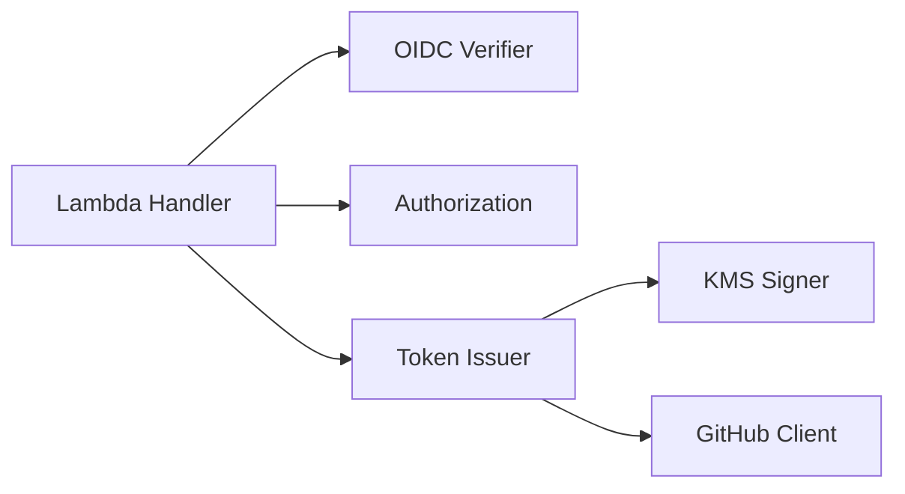

# Lambda Design

## 1. Responsibility and Invocation

Lambda は GitHub OIDC JWT の検証、Installation の解決、`contents:read` の発行認可、KMS 署名、GitHub App Installation Access Token の発行を実行します。Go のパッケージやインターフェースは責務とテスト容易性に応じて設け、必要性のない抽象化を避けます。

Lambda は AWS IAM により認証・認可された同期 Invoke を受け付けます。Invoke の Payload に含まれる GATES 用 OIDC JWT の署名と Claim を検証し、要求を処理します。

| 項目 | 契約 |
|---|---|
| Transport | AWS Lambda `Invoke`、`InvocationType=RequestResponse` |
| AWS Authentication | 呼び出し元が AWS 一時認証情報で SigV4 署名する |
| Caller Identity | GATES 用 Audience の GitHub OIDC JWT を JSON Payload に含める |
| Payload | JSON。GATES が設ける上限を 16 KiB とする。無効な型・未知フィールドは拒否 |
| Response | JSON。呼び出し元は Invoke の `FunctionError` と Lambda 応答の `ok` をそれぞれ確認 |
| Endpoint | AWS Lambda Invoke API |

Lambda Invoke には HTTP の `Authorization` ヘッダーに相当するアプリケーション層のヘッダーがないため、GATES 用 OIDC JWT は `id_token` フィールドとして Payload に含めます。Payload は資格情報を含むため丸ごとログに記録せず、監査に必要な非秘密のフィールド（要求対象、要求権限）だけを記録します。

本ドキュメントでは、処理の段階を次の語で区別します。
Payload を GATES が読み取れるかの判定を **形式検証**、GATES 用 OIDC JWT から Caller を確定することを **認証**、GitHub API の発行応答を TokenGrant と突き合わせることを **照合** と呼びます。
概念の定義は [Domain Model](domain.md) を正本とします。

## 2. Request

### 2.1 Repository Request

```json
{
  "version": 1,
  "id_token": "<GATES_AUDIENCE_GITHUB_OIDC_JWT>",
  "repositories": ["example-org/repo-a", "example-org/repo-b"],
  "permissions": {"contents": "read"}
}
```

| フィールド | ルール |
|---|---|
| `version` | 必須、整数 `1` |
| `id_token` | 必須、GATES 用 Audience の JWT。Bearer 資格情報として慎重に扱う |
| `repositories` | 必須、重複のない 1 件以上 500 件以下の `owner/repo` の配列。上限は GitHub のトークン発行 API が一度に受け付ける件数に合わせる（[GitHub Constraints](../spec/github-constraints.md#61-発行-api-の呼び出しと有効期限)）。GATES が設ける 16 KiB の Payload には最短の要素で 2,000 件以上が入るため、Payload サイズより先にこの上限に達する |
| `permissions` | 必須、値は **`{"contents":"read"}`**。形式が不正なら入力不正、形式が正しく値が許可条件と異なれば認可拒否 |

- 対象は同一オーナーに属し、GATES で利用する同一の GitHub App Installation に含まれる必要がある。
- Caller / オーナー / Installation ID と GitHub API Host を利用者から指定させない。
- 全リポジトリを対象にする項目（GitHub の `repository_selection`）を設けない。対象は `repositories` で明示したリポジトリだけである。`repository_selection` を含む Payload は、未知のフィールドとして入力不正になる。
- 複数対象のうち一つでも許可条件を満たさなければ全件を拒否し、部分成功も自動分割もしない。
- GitHub API に渡す際は `owner/repo` を一度だけ `/` で分割し、オーナー名が許可オーナー名に一致することを確認して、リポジトリ名の部分だけを `repositories` に指定する。要求時の `owner/repo` は応答の `full_name` と照合するため保持する。
- 各リポジトリに同じ Permissions を適用する。別の権限を必要とする場合は個別に要求する。
- Lambda が返すトークンの対象は要求したリポジトリのみであり、App にインストール済みのすべてのリポジトリを意味しない。

### 2.2 Validation

形式検証は、値を GATES が解釈できるかだけを判定します。
値が許可条件に合うかは、認証後に Authorization が判定します。
この順序の理由は [Security Design](security.md#31-authorization-rule) に記述します。

#### 入力不正と認可拒否の境界

各フィールドの値の形を、入力不正（`invalid_request`）と認可拒否（`authorization_denied`）に次のように分けます。
入力不正の形に当たらない要求だけが、Authorization の判定に進みます。

| フィールド | 入力不正にする形 | 認可拒否にする形 |
|---|---|---|
| `version` | 欠落、`null`、整数 `1` 以外（`1.0`、`"1"`、`2` を含む） | なし |
| `id_token` | 欠落、`null`、文字列以外、空文字列 | なし（JWT の検証失敗は `invalid_id_token`） |
| `repositories` | 欠落、`null`、配列以外、空配列、文字列以外の要素、[完全名の形式](#名前の文字種と比較規則)に合わない要素、大文字小文字を区別しない重複、500 件超 | オーナー名が許可オーナー名と異なる要素を含む |
| `permissions` | 欠落、`null`、オブジェクト以外、空オブジェクト、文字列以外の値、[権限名と水準の文字種](#権限名と水準の文字種)に合わないキーまたは値（空文字列を含む） | `{"contents":"read"}` 以外の組（`contents` 以外のキー、`read` 以外の値、`metadata` などのキーの追加） |
| Payload 全体 | 16 KiB 超、JSON として不正、オブジェクト以外、未知のフィールド、重複したキー、不正な UTF-8、オブジェクトの後に続くデータ | なし |

空の Permissions を入力不正にするのは、`permissions` が必須であり、[Requirements](../spec/requirements.md) FR-012 が欠落・未知値を広い既定権限に読み替えないと定めているためです。
空の Map は、要求の欠落と同じく、要求した権限を読み取れない形として扱います。
一方で、未知のキー（`issues` など）は認可拒否にします。
`contents:write` と同じく、形式は読み取れて値が許可外の要求であり、監査記録に残す対象だからです。

重複したキーを入力不正にするのは、`{"contents":"write","contents":"read"}` のような Payload の解釈が JSON の実装ごとに分かれるためです。
後の値を採る実装はこの Payload を `contents:read` として認可しますが、監査記録や別の処理が先の値を読むと、認可した内容と記録した内容が食い違います。

オーナー名の不一致を認可拒否にするのは、[Processing Flow](#6-processing-flow) の手順 3 がオーナー名の照合を Authorization の判定に置いているためです。
形式検証は、`owner/repo` をオーナー名とリポジトリ名に分割できるかまでを見ます。

500 件を超える要求を入力不正にするのは、GitHub API に渡すと、その応答が `422` なら `github_issuance_rejected` に分類され（[Failure](#32-failure)）、利用者が直せる件数の超過が、原因を特定できない発行拒否として記録され得るためです。
形式検証で止めれば、KMS と GitHub API を呼ばずに済みます。

形式検証のエラー文言には、不正なフィールドの名前（配列の要素なら位置を添える）とその形だけを書き、Payload の断片を含めません。
未知のフィールドの名前、`permissions` のキー、数値のリテラルも断片に当たります。
断片には GATES 用 OIDC JWT が入り得るためです。

#### 権限名と水準の文字種

`permissions` のキー（権限名）と値（水準）は、1 文字以上 64 文字以下の ASCII 小文字とアンダースコア（`_`）の文字列に限ります。
GitHub の Permissions の表現は [GitHub Constraints](../spec/github-constraints.md#61-発行-api-の呼び出しと有効期限) を参照します。
この文字種は、その表現に合わせて GATES が決めた形式の制限です。
GitHub が公式に定めた規則ではありません。
この文字種に合わない文字列は、GitHub の権限名や水準として読み取れないため、入力不正にします。
[Security Design](security.md#31-authorization-rule) と [Domain Model](domain.md#52-rules) が入力不正にする「値を読み取れない形」に、この文字列も含まれます。

この規則により、監査記録に入る要求の権限は、改行や制御文字を含まない 64 文字以下の語に限られます。
ログのエンコーダが値をどうエスケープするかによらず、記録の 1 行を偽装する値や長大な値が入りません。
値の数には上限を設けず、記録全体の大きさは Payload の 16 KiB の上限で抑えます。

64 文字の上限は GitHub 公式の文字数制限ではなく、最長の権限名（46 文字）に余裕を持たせて GATES が決めた値です。
許可されるのは `{"contents":"read"}` だけなので、将来 GitHub がこの規則に合わない権限名を加えても、正当な要求は拒否されません。
その権限名を使う要求の結果が、認可拒否から入力不正に変わるだけです。

発行結果の実効権限も Permissions として同じ規則で読みます。
照合は許可権限と付随権限の範囲外の Permission Entry をもともと拒否するため（[Success](#31-success)）、規則に合わない権限名が応答に現れても、トークンを返さないことは変わりません。
この場合も照合の失敗（`issuance_verification_failed`）として扱い、応答の `token` の取り出しと失効は、`permissions` を読み取れたかどうかに依存させません。

#### 名前の文字種と比較規則

`repositories` の各要素は、`/` をちょうど一つ含み、その前のオーナー名と後のリポジトリ名がどちらも空でない文字列です。
オーナー名とリポジトリ名は、次の文字種に限ります。

| 名前 | 受け付ける文字種と長さ | 根拠 |
|---|---|---|
| オーナー名 | 1 文字以上の ASCII 英数字とハイフン | GATES が決めた形式の制限。GitHub の規則としては確定していない（下記） |
| リポジトリ名 | 1 文字以上 100 文字以下の ASCII 英数字、ハイフン、アンダースコア、ピリオド | GitHub の新規リポジトリ名の制約に合わせる。`.` と `..` は緩い側に寄せた（下記） |

GitHub 側の名前の文字種と長さ、その根拠と未確認事項は [GitHub Constraints](../spec/github-constraints.md#2-owner-and-repository) を参照します。

GitHub の規則として確認できなかった条件は、GitHub が受け付ける名前を拒否しない側に寄せ、形式検証で課しません。
GATES が GitHub より厳しい規則を持つと、正当な要求が入力不正になり、利用者には原因が分からないためです。
該当するのは次の規則です。

- **オーナー名のハイフンの位置**：先頭・末尾のハイフンと連続したハイフンの禁止は、Enterprise Managed Users の命名規則であり、ほかのオーナーに転用しない
- **オーナー名の長さ**：39 文字の上限も、Enterprise Managed Users の命名規則であり、ほかのオーナーに転用しない
- **リポジトリ名 `.` と `..`**：GitHub が受け付けるかを確認できておらず、文字種の規則だけでは拒否できない

一方で、オーナー名の文字種も、User と Organization に一様に適用できる GitHub の規則としては確定していません。
それでもオーナー名に上の文字種を課せるのは、そうしても正当な要求を拒否しないためです。
許可オーナー名は同じ文字種を満たす値としてデプロイ時に固定するため、この文字種に合わないオーナー名の要求は、形式検証を通してもオーナー名の照合で必ず拒否されます。
オーナー名の規則を課すかどうかは、結果を入力不正と認可拒否のどちらにするかだけを変えます。
例外として、Enterprise Managed Users のユーザーアカウントは、ユーザー名にアンダースコアを含むため、この文字種を満たさず、許可オーナーに設定できません。
リポジトリ名の文字種が `/` を含まないため、`a/b/c` は入力不正になり、リポジトリ名 `b/c` が GitHub API の `repositories` に渡ることはありません。

名前の比較と重複判定は、ASCII の範囲で大文字小文字を区別せずに行います。
Unicode の大文字小文字の対応（Go の `strings.EqualFold` など）を使わないのは、Kelvin 記号（U+212A）と `k` のように、GitHub 上では別の文字が同じ文字として扱われ得るためです。
比較の規則は、要求の重複判定、オーナー名の照合、発行応答の `full_name` の照合（[Success](#31-success)）で共通です。

入力文字列のリポジトリ名だけから所有権を判断せず、要求元のオーナーは検証済み JWT に基づいて決定します。

## 3. Responses

### 3.1 Success

```json
{
  "ok": true,
  "token": "<INSTALLATION_ACCESS_TOKEN>",
  "expires_at": "<RFC3339_EXPIRATION_TIME>",
  "repositories": ["example-org/repo-a", "example-org/repo-b"],
  "permissions": {"contents": "read", "metadata": "read"},
  "request_id": "<OPAQUE_ID>"
}
```

`repositories` は照合済みの発行対象を GitHub 応答の `full_name` で示します。`permissions` は GitHub 応答の実効権限、`expires_at` は GitHub が定めた有効期限（RFC 3339 形式）です。GATES は有効期限を延長しません。
GitHub 応答の `repository_selection` は返しません。
下の照合条件により `selected` 以外の応答はトークンを返さないため、成功応答では値が常に同じで、呼び出し元に伝える情報がないからです。
`request_id` は失敗応答と同じ相関 ID で、資格情報ではありません。
値には Lambda の request ID（Invoke 応答のヘッダー `x-amzn-RequestId` と同じ値）をそのまま使います。
CloudWatch Logs に自動で記録されるため、独自に採番しなくても監査記録と突き合わせられます。
成功時にも返すのは、呼び出し元がワークフローのログに残し、監査記録と突き合わせられるようにするためです（[Requirements](../spec/requirements.md) FR-021）。

GitHub API の発行応答のスキーマと、各フィールドの存在条件が未確認であることは [GitHub Constraints](../spec/github-constraints.md#62-発行応答permission) を参照します。
Lambda は GitHub API の発行応答を次の条件で照合し、必要な情報が得られなければトークンを返しません。

- `token` が空でなく、`expires_at` が有効な将来日時であること。
- `repositories` が存在し、要求と同じ件数の対象を返すこと。`full_name` と要求名を大文字小文字を区別せず集合で照合し、余分な対象・欠落・重複を拒否すること。
- 各対象の Repository ID が有効かつ一意で、`owner.id` が許可オーナーの Owner ID と一致すること。ID は応答の整合性確認に用い、事前に確定した ID との照合とはみなさないこと。
- `permissions.contents` が `read` であり、追加の Permission Entry は `metadata:read` が応答に含まれる場合に限り許容すること。その他の Permission Entry は拒否すること。
- `repository_selection` が `selected` であること。`all` は要求外の対象を含むため拒否すること。

`metadata:read` を許容するのは GATES の判断であり、GitHub が常に付与することを前提にしません。
GitHub API の応答が照合条件に適合しない場合は `issuance_verification_failed` として拒否します。
これは [Domain Model](domain.md#42-failure-kinds) の照合失敗に当たり、一時的な障害と分ける理由もそこに置きます。

発行 API に要求を送信した後、GitHub 側でトークンが発行されたかどうかと、Lambda がトークン文字列を取得できたかどうかは別の事実です。
通信の切断やタイムアウトでは、GitHub 側の発行の有無が分からないことがあります。

発行応答から空でない `token` を取得できたうえで照合に失敗した場合、Lambda はそのトークンを返さず、そのトークンで `DELETE /installation/token` を呼んで失効を試みます。
返さないだけで失効させないと、要求外の対象や権限を持つトークンが有効期限まで GitHub 上で有効なまま残るためです。
失効はベストエフォートとし、失効に失敗してもエラーコードは `issuance_verification_failed` のまま変えず、失効の試行と成否を監査記録に残します。

`token` を取得できない場合は、失効 API の認証に使うトークンがないため、失効を試みません。
GATES は、GitHub 側で失効に成功することも、応答を受信できなかったトークンが存在しないことも保証しません。
どの場合も、照合を通っていないトークンを利用者には返しません。

### 3.2 Failure

```json
{
  "ok": false,
  "error": {
    "code": "authorization_denied",
    "message": "The requested token is not permitted."
  },
  "request_id": "<OPAQUE_ID>"
}
```

`request_id` は成功応答と同じくトップレベルに置きます。
相関 ID は応答全体の属性であり、呼び出し元が `ok` の値によらず同じ場所から読めるようにするためです。

Handler は処理中の panic を回復し、`internal_error` の失敗応答として `request_id` とともに返します。
`FunctionError` になるのは、タイムアウト、メモリ不足、初期化の失敗のように Handler が応答を書けない場合だけです。
この場合は応答に `request_id` がないため、呼び出し元は Invoke の時刻と `run_id` で CloudWatch Logs の記録と突き合わせます。

エラーコードは、[Domain Model](domain.md#42-failure-kinds) の失敗の種別を応答で表す値です。
種別とコードは一時的な障害を除いて一対一で、一時的な障害だけは失敗した依存先（Discovery / JWKS、KMS、GitHub API）ごとにコードを分けます。
種別を分ける理由は Domain Model に置き、本ドキュメントはコードと HTTP 応答の対応だけを定めます。

| Error code | 失敗の種別 | 内容 |
|---|---|---|
| `invalid_request` | 入力不正 | Payload が [Validation](#22-validation) の入力不正の形に当たる |
| `invalid_id_token` | 認証失敗 | GATES 用 OIDC JWT が [JWT Design](jwt.md) の受理条件を満たさない。JWT の形式・署名、Issuer、Audience、時間条件、必須 Claim、再取得後も一意に選べる使用可能な鍵がない `kid` などを含む |
| `authorization_denied` | 認可拒否 | Caller の Owner ID が許可オーナーと不一致、要求した権限が許可条件外、または要求したリポジトリのオーナー名が許可オーナー名と不一致。Installation の対象外であることが GitHub API の呼び出し後に判明した場合は、その処理段階の失敗として扱う |
| `identity_verification_unavailable` | 一時的な障害 | OIDC Discovery / JWKS の取得が一時的に失敗した。通信の失敗、タイムアウト、5xx、403 / 429 で、再試行で解消し得る |
| `signing_unavailable` | 一時的な障害 | KMS 署名が一時的に失敗した。通信の失敗、タイムアウト、呼び出し元の ctx の期限切れと中断、5xx、スロットリングで、再試行で解消し得る |
| `installation_resolution_failed` | Installation 利用不可 | 固定した GitHub App と許可オーナーから、発行に使える Installation を得られない。一時的な障害を除く GitHub API の失敗（App JWT が受け付けられない 401、GitHub App が許可オーナーにインストールされていないときに想定する 404 など）、Installation の応答に必要な項目がない、Installation が停止している（`suspended_at` が空でない）、`account.id` が許可オーナーの Owner ID と一致しない |
| `token_issuance_failed` | 一時的な障害 | GitHub API の一時的な障害。通信の失敗、タイムアウト、5xx、レート制限による 403 / 429 で、Installation の取得と発行 API の呼び出しの両方を含む。再試行で解消し得る |
| `github_issuance_rejected` | GitHub 発行拒否 | GATES の認可が成立した後、GitHub の発行 API が `422` で要求を拒否した。検証失敗やスパム判定など、原因は応答コードから特定できない |
| `issuance_verification_failed` | 照合失敗 | GitHub API の発行応答が [Success](#31-success) の照合条件に適合しない。空でないトークン文字列を取得できた場合は失効を試みる |
| `internal_error` | 内部障害 | Handler の panic、Discovery / JWKS の非一時的な取得・構造異常、JWKS に使用可能な鍵がない場合、KMS が再試行では解消しない失敗を返した場合（鍵の無効化、鍵の状態、権限の不足など）、KMS の応答を署名として解釈できない場合、KMS に要求を送る前の AWS SDK の失敗を含む |

GitHub API の失敗は、HTTP 応答から次のように分類します。
通信の失敗、タイムアウト、5xx、レート制限による 403 / 429 は `token_issuance_failed` にします。
発行 API の 422 は `github_issuance_rejected` にします。
それ以外の失敗は `installation_resolution_failed` にします。
Client ID の誤り、KMS Key と GitHub に登録した Private Key の不一致、Installation の削除や停止が、ここに入ります。
発行 API の呼び出しで起きた 401 / 403 / 404 も、直前に同じ App JWT で Installation を取得できているため、その間に Installation か App の状態が変わったものとしてこのコードに含めます。
Installation の応答の形式が想定と異なる場合は `installation_resolution_failed` に、発行応答の形式が想定と異なる場合は `issuance_verification_failed` にします。

この分類は GATES のエラー分類であり、GitHub の HTTP ステータスの定義ではありません。
発行 API の `422` は、GitHub の公開仕様では検証失敗またはスパム判定を指し、Installation の範囲外の要求だけを意味しません（[GitHub Constraints](../spec/github-constraints.md#61-発行-api-の呼び出しと有効期限)）。
Installation の取得に使う Organization と User の API も、公開している応答コードは `200` だけで、未インストールのときの応答は公開されていません（[GitHub Constraints](../spec/github-constraints.md#5-installation)）。
上の 404 は GATES の想定であり、分類は `200` 以外の応答をレート制限と一時的な障害を除いて `installation_resolution_failed` にすることで成り立ち、特定のステータスには依存しません。
ステータスと失敗原因の対応は公開されておらず、いつ変わってもおかしくないため、GATES は原因を断定しません。
発行 API の `422` を、GATES の認可条件で拒否したことを示す `authorization_denied` と分けるのは、`422` だけでは権限不足や悪意の有無を確定できないためです。
どの失敗でもトークンを返さないことは変わりません。

403 と 429 のうちレート制限によるものは、応答のヘッダーで判定します。
429 は常にレート制限とします。
403 は、`x-ratelimit-remaining` が `0` か、`retry-after` のヘッダーがあるときだけレート制限とし、ほかの 403 はレート制限としません。
本文のメッセージは判定に使いません。
GitHub はセカンダリのレート制限を本文のメッセージだけで示す場合があり（[GitHub Constraints](../spec/github-constraints.md#61-発行-api-の呼び出しと有効期限)）、文言に頼ると、GitHub が文言を変えたときに分類が変わるためです。
この判定は二通りに誤り得ます。
ヘッダーのないレート制限の 403 は、再試行で解消し得る失敗を、運用者の対応を要する `installation_resolution_failed` として伝えます。
レート制限でない 403 にこれらのヘッダーが付くと、運用者の対応を要する失敗を `token_issuance_failed` として伝えます。
GitHub App JWT で認証した要求の応答は、レート制限に達していない記録では `x-ratelimit-*` を含まず（同節）、制限に達したときに付くかは確かめていません。
どちらの誤りでもトークンは返さず、誤りが変えるのは、利用者に再実行を促すかどうかです。

Discovery と JWKS の取得の失敗は、次のように分類します。
通信の失敗、タイムアウト、本文の受信途中の切断、5xx、403 / 429 は `identity_verification_unavailable` にします。
403 を区別せずに含めるのは、Discovery と JWKS が認証を要しない公開の文書で、GATES に起因する 403 が想定できず、レート制限と見なすためです。
呼び出し元の ctx の期限切れと中断、TLS の失敗も、応答を受け取る前の失敗として通信の失敗に含めます。
それ以外の 200 以外の応答（リダイレクトを含む）、応答サイズの上限の超過、完全に受信した応答を解釈できない場合、JWKS に [JWT Design §5.4](jwt.md#54-jwk-と-jwk-set-の受理条件) の使用可能な鍵が一つもない場合、Discovery が示す Issuer が固定した Issuer と異なる場合、Discovery が示す JWKS の取得先が Issuer と同じ `https` のホストとポートでない場合は `internal_error` にします。
これらは再試行では解消せず、固定した Issuer の設定か GitHub 側の変更を運用者が調べる失敗であり、一時的な障害にすると利用者に無駄な再実行を促すためです。
JWT の受理条件に基づく認証失敗は `invalid_id_token` とします。ただし、JWKS 全体の異常は `internal_error` とし、取得の失敗も別に分類します。
JWKS を取得できたうえで、`kid` で一意に選べる使用可能な鍵がない JWT と署名が一致しない JWT は、再取得規則を経て `invalid_id_token` であり、JWT の `iss` が固定値と異なる場合も、Discovery の Issuer の不一致とは区別して `invalid_id_token` にします。
取得前の拒否に当たらず手元の鍵で検証できない JWT で取得に失敗した場合は、署名の正否を判定できないため、JWT が不正であっても取得の失敗として返します。
再取得の上限の間に返す種別は、[JWKS の再取得の上限](#jwks-の再取得の上限)に従います。
分類は公開鍵の取得が返した失敗の種別で行い、検証ライブラリのエラー文言には頼りません。
文言はライブラリの更新で変わり得るためです。

KMS の署名の失敗は、次のように分類します。
KMS との通信の失敗（接続できない場合、要求を送った後に応答を受け取れない場合、本文の受信途中の切断）、タイムアウト、呼び出し元の ctx の期限切れと中断、5xx、`ThrottlingException` は `signing_unavailable` にします。
接続できない失敗には、経路の一時的な障害と、ネットワークの設定の誤りのように再試行では解消しない失敗の両方があり、区別できません。
一時的な障害に含めるのは、Discovery / JWKS の取得の通信の失敗と同じ扱いにするためです。
設定の誤りは、デプロイ後の試験で発行が一度も成功しないことから気付けます。
本文の受信途中の切断は、通信の失敗として報告されたものだけを `signing_unavailable` にします。
通信の失敗として報告されない切断は、完全に受信して解釈できない本文と区別できず、`internal_error` になります。
この誤りは、再試行で解消し得る失敗を、運用者の対応を要する失敗として伝えます。
どちらでもトークンは返さず、変わるのは利用者に再実行を促すかどうかです。
`ThrottlingException` を名前で挙げるのは、KMS がスロットリングを 5xx ではなく 400 で返すためです（[AWS — KMS Common Error Types](https://docs.aws.amazon.com/kms/latest/APIReference/CommonErrors.html)）。
それ以外の KMS のエラー応答と、KMS の応答を署名として解釈できない場合は `internal_error` にします。
鍵の無効化（`DisabledException`）、`PendingImport` などの署名できない鍵の状態（`KMSInvalidStateException`）、権限の不足（`AccessDeniedException`）、鍵が見つからない（`NotFoundException`）が、ここに入ります。
KMS に要求を送る前に AWS SDK の中で起きた失敗（リージョンや認証情報を解決できない、パラメーターの検証に失敗したなど）も `internal_error` にします。
KMS が `200` を返しても署名が空なら、署名として解釈できない場合に含めて `internal_error` にします。
分類は KMS のエラーコードと HTTP ステータスで行い、エラーの文言には頼りません。

外部エラーをそのまま応答へ転記しません。認証情報を含む詳細を公開せず、相関 ID によってログと突き合わせます。Lambda の処理結果は `ok` で示し、Invoke 自体の結果と区別します。

## 4. Logical Components



| Component | 責務 |
|---|---|
| Lambda Handler | Payload の形式検証、各コンポーネントの呼び出し順序の制御、監査情報の記録、応答形式 |
| OIDC Verifier | GitHub OIDC JWT の署名・Issuer・Audience・時間・Claim 検証と Caller の確定、Issuer の Discovery / JWKS の取得と保持 |
| Authorization | Caller、要求（対象、権限）、取得済み Installation、固定設定から発行可否を判定し、TokenGrant を確定。ネットワーク通信を行わない |
| Token Issuer | KMS Signer による App JWT の作成、GitHub Client を使った Installation の取得とトークン発行、GitHub 応答の TokenGrant への照合、照合に失敗したトークンの失効 |
| KMS Signer | 固定設定の Client ID と現在時刻から GitHub App JWT を組み立て、固定された非対称 KMS Key とアルゴリズムで署名 |
| GitHub Client | GitHub API（Installation の取得、トークン発行、トークンの失効）に対する HTTP 通信と応答の復号 |

このコンポーネント区分は責務のモデルであり、Go パッケージへの一対一の対応を要求しません。

## 5. Domain Model

概念の定義、ルール、不変条件は [Domain Model](domain.md) を正本とします。
本ドキュメントでは、その概念を実装でどう呼び、どのコンポーネントが持つかだけを示します。

| Domain Model の概念 | 実装での名前 | 持つコンポーネント | 補足 |
|---|---|---|---|
| 完全名 | FullName | Lambda Handler、Authorization、Token Issuer が共用 | [名前の文字種](#名前の文字種と比較規則)を満たし、比較は ASCII の範囲で大文字小文字を区別しない |
| オーナー名 | OwnerName | Authorization、Token Issuer が共用 | 完全名のオーナー部分と許可オーナー名を同じ型で表す。[名前の文字種](#名前の文字種と比較規則)を満たし、比較は ASCII の範囲で大文字小文字を区別しない |
| 発行要求 | TokenRequest | Lambda Handler が作り、Authorization が読む | Payload から GATES 用 OIDC JWT を除いた部分 |
| Caller | Caller | OIDC Verifier が作り、Authorization と監査記録が読む | Owner ID と Repository ID で識別し、ワークフロー実行 ID（`run_id`）、試行番号（`run_attempt`）、ワークフロー起動属性（WorkflowTriggerAttributes）を監査のために添える |
| ワークフロー起動属性 | WorkflowTriggerAttributes | OIDC Verifier が作り、Caller が持ち、監査記録が読む | 認可には使わない |
| 許可オーナー | AllowedOwner | Lambda Handler が固定設定から作り、Authorization と Token Issuer が読む | 不変 Owner ID、オーナー名（OwnerName）、種別（OwnerType） |
| 許可オーナーの種別 | OwnerType | Token Issuer が Installation の取得 API の選択に読む | Organization かユーザーアカウントか |
| GATES 用 OIDC JWT（ID Token）、未検証 | RawIDToken | Lambda Handler が作り、OIDC Verifier が読む | Payload の `id_token` を認証前に運ぶ。資格情報のため、ログやエラーにどう出力しても値を伏せる。値を取り出すのは OIDC Verifier だけ |
| GitHub App JWT | AppJWT | KMS Signer が作り、GitHub Client が読む | Token Issuer の外に出さない（[KMS Signing](#72-kms-signing)）。RawIDToken と同じく値を伏せる。値を取り出すのは GitHub Client だけ |
| Installation Access Token | InstallationAccessToken | GitHub Client が発行応答から作り、InstallationToken が持ち、Lambda Handler が成功応答に入れる | RawIDToken と同じく値を伏せる。値を取り出すのは、成功応答を書く Lambda Handler と、失効を要求する GitHub Client だけ |
| Discovery | discoveryDocument | OIDC Verifier | Issuer の値と JWKS の取得先（`jwks_uri`）だけを読む |
| Issuer の公開鍵集合 | issuerKeySet | OIDC Verifier が取得して保持する | JWK Set（JWKS）として取得し、検証ライブラリの `oidc.KeySet` として使う。OIDC Verifier の外に出さない |
| Permissions | Permissions | Lambda Handler、Authorization、Token Issuer が共用 | 要求の `permissions` と応答の `permissions` の両方をこの型で扱う |
| 固定設定 | Config | Lambda Handler が起動時に読み、各コンポーネントへ渡す | 許可オーナー（AllowedOwner）、Client ID、KMS Key ARN、Audience、Issuer、GitHub API Host。JWKS は Issuer の Discovery から得るため、独立した値を持たない |
| Installation | Installation | Token Issuer が取得し、Authorization が照合する | Installation ID、インストール先 Owner ID（`account.id`）、停止状態（`suspended_at`） |
| 発行許可 | TokenGrant | Authorization が作り、Token Issuer が読む | Installation ID、対象の完全名、Permissions |
| 発行結果 | IssuanceResult | Token Issuer | GitHub API の発行応答。照合前の値 |
| 実効対象 | EffectiveRepository | Token Issuer | 発行応答の各リポジトリの Repository ID（`id`）、所有オーナーの Owner ID（`owner.id`）、完全名（`full_name`） |
| 返却可能な発行結果 | InstallationToken | Token Issuer が作り、Lambda Handler が返す | 照合を通った発行結果だけをこの型にする |
| 監査記録 | AuditRecord | Lambda Handler | 項目と記録する条件は [Domain Model](domain.md#36-audit-record) に従う |

`TokenGrant` は認可済みの発行範囲を Token Issuer に渡すための値です。複数リポジトリには共通の Permissions を適用し、対象ごとの違いが必要なら別のトークンを要求します。

表にない概念は、独立した型にしません。
Permission Entry は Permissions の要素、Allowed Permissions と Implied Permissions は Permissions の固定の値、Allowed Owner ID と Allowed Owner Name は AllowedOwner が持つ整数と OwnerName の値です。
Claim や Payload を復号する入れ物と、復号した値を解析するための非公開の型は、概念に対応しないため表に含めません。
検証済みの GATES 用 OIDC JWT は、OIDC Verifier が Caller を確定する間だけ存在し、OIDC Verifier の外に出しません。
[Domain Model](domain.md#41-operations) の操作名（Validate、Authenticate、Authorize、Sign、Resolve Installation、Grant、Issue、Verify、Revoke、Audit）は、空白を除いた形を各コンポーネントの関数名にします。

[Request](#2-request) の「Repository Request」は Payload の形式の名前であり、TokenRequest は Payload から GATES 用 OIDC JWT を除いた発行要求の概念です。
形式検証を通った Repository Request から、GATES 用 OIDC JWT と TokenRequest を分けて取り出します。

## 6. Processing Flow

1. Handler が Payload を形式検証し（[Validation](#22-validation)）、資格情報をログに残さない。
2. OIDC Verifier が固定 Issuer / JWKS と GATES 用 Audience で JWT を認証し、`repository_owner_id` と `repository_id` の Claim、および不変 ID 入り `sub` との一致から Caller を確定する。`run_id`、`run_attempt`、ワークフロー起動属性は監査のために Caller に添える。Discovery / JWKS の取得の失敗は [Failure](#32-failure) の分類に従い、一時的な障害なら `identity_verification_unavailable`、それ以外なら `internal_error` として拒否する。
3. Authorization が Caller の Owner ID を固定した許可オーナーの Owner ID と照合し、要求された各 `owner/repo` のオーナー名を固定した許可オーナー名と照合し、Permissions が `contents:read` のみであることを確認する。不一致なら外部呼び出しに進まず拒否する。
4. Token Issuer が KMS Signer で GitHub App JWT を生成し、GitHub Client で許可オーナーの Installation を取得する。署名の失敗は [Failure](#32-failure) の分類に従い、一時的な障害なら `signing_unavailable`、それ以外なら `internal_error` として拒否する。取得の失敗は [Failure](#32-failure) の分類に従い、一時的な障害なら `token_issuance_failed`、それ以外なら `installation_resolution_failed` として拒否する。
5. Authorization が Installation の `account.id` を許可オーナーの Owner ID と照合し、`suspended_at` が空であることを確認して、Installation ID、要求した完全名、許可権限から TokenGrant を確定する。停止している、または `account.id` が一致しなければ `installation_resolution_failed` として拒否し、発行 API を呼ばない。
6. Token Issuer が TokenGrant の各 `owner/repo` からオーナーを除いたリポジトリ名の配列と `permissions` を GitHub API に明示してトークンを取得する。GitHub 応答の `full_name` は TokenGrant の元の `owner/repo` と全件照合し、Owner ID、Repository ID の有効性・一意性、実効権限が許可範囲内であることを照合する。必要な一覧・権限の欠落や不一致があれば、`issuance_verification_failed` として返却せず、空でないトークン文字列を取得できた場合は失効を試みる。発行 API の `422` は `github_issuance_rejected` として拒否する。
7. Handler が必要最小限の成功応答を返す。いずれかに失敗した場合は安全なエラーコードと相関 ID を返し、トークンは返さない。

Owner ID、権限、オーナー名の照合（手順 3）を Installation の取得（手順 4）より先に置くのは、KMS と GitHub API の呼び出しを認可の見込みがある要求だけに限るためです。

手順 5 の Grant は、手順 3 を通った要求にも認可条件を判定し直し、満たさなければ認可拒否を返します。
[Domain Model](domain.md#53-invariants) の発行許可の不変条件を、Grant だけで守れるようにするためです。
認可条件と Installation の有効性の両方を満たさない要求は、手順 3 が手順 4 より先にある順序に合わせて、認可拒否として返します。
TokenGrant の Permissions を要求から写さないのは、Grant が判定し直す認可条件で両者が等しいことは確かめていても、写すと、認可の条件を将来変えたときに、要求の値がそのまま発行範囲に流れるためです。

認可拒否と、Installation が発行に使えないことによる拒否のエラー文言には、満たさなかった条件を書き、Caller、要求、許可オーナー、Installation の値を含めません。
Installation は許可オーナー名から取得するため、その Installation ID と `account.id` は、許可オーナー名をいま持つアカウントを示します。
`account.id` が許可オーナーの Owner ID と一致しない場合も同じであり、許可オーナーの値と同じに伏せます。
文言は監査記録のためのもので、エラー応答には出しません。
拒否の理由を応答に出すと、許可オーナーの Owner ID やオーナー名を、許可されない呼び出し元が探れるためです。
値を含めないのは、Caller と要求は監査記録が別の項目として持つため文言に重ねる必要がなく、文言が誤って応答に混ざっても許可オーナーを明かさないためです。

## 7. External Integrations

### 7.1 OIDC Validation

OIDC Verifier は、GATES 用 OIDC JWT を [JWT Design](jwt.md) の受理条件で検証し、成立したときだけ Caller を確定します。Claim の必須性・型・比較規則、`sub` と不変 ID の整合、JOSE Header、JWK / JWKS の受理条件は JWT Design を正本とします。検証ライブラリの既定値でこれらを置き換えません。信頼境界は [Security Design](security.md#2-trust-boundaries)、概念の定義は [Domain Model](domain.md) を参照します。

本節は、検証のための Discovery / JWKS の取得、保持と再取得、および各段階のエラーへの対応を定めます。JWT 自体が受理条件に合わない場合は `invalid_id_token` とし、Issuer の鍵情報やその取得に異常がある場合は [Failure](#32-failure) に従って区別します。

- **取得先**：Issuer は `https://token.actions.githubusercontent.com` に固定する。Discovery はその Issuer から HTTPS で取得し、取得した `issuer` の一致を確かめる。`jwks_uri` は同じ HTTPS のホストとポートに限る。リダイレクトに従わず、JWT の Header や利用者入力から取得先を変更しない。
- **取得時点と保持**：Discovery / JWKS は Lambda の初期化ではなく最初の認証で取得する。取得に成功した Discovery は実行環境内で保持して再取得せず、取得に失敗した内容は保持しない。JWKS は受理条件を満たした集合を実行環境内に保持し、有効期限を設けない。保持するのは使用可能な公開鍵だけとする。
- **取得前の拒否**：[JWT Design §5.1](jwt.md#51-jws-と-json-の基本条件) の直列化・JSON の条件と、[§5.2](jwt.md#52-jose-header) の JOSE Header の条件（`kid` の存在を含む）を満たさない JWT は、Discovery / JWKS を取得せずに `invalid_id_token` で拒否する。鍵情報に依存しない不正を取得の前に判定することで、不正な JWT が再取得の頻度の上限を消費せず、Issuer の障害時にもエラーの種別が変わらない。Claim 名の条件（[JWT Design §2.38.4](jwt.md#2384-json-と-claim-名の一貫した解釈)）と NumericDate の型と範囲（[§2.4](jwt.md#24-exp)）も鍵情報に依存しないため、同じく取得の前に判定する。
- **ローテーションへの追従**：保持した集合に、JWT の `kid` で一意に選べて署名が一致する使用可能な鍵がない場合（未知の `kid`、除外した JWK だけに一致する `kid`、使用可能な鍵の複数一致、署名不一致）は JWKS の再取得を試みる。同一実行環境内の並行した再取得は一つにまとめ、頻度を下記の上限で制御する。再取得が完了しても受理条件を満たさない JWT は認証しない。JWK の受理条件自体は [JWT Design §5.4](jwt.md#54-jwk-と-jwk-set-の受理条件) に従う。
- **取得方式と検証器の分担**：Discovery / JWKS の HTTP 通信、構造検証、鍵の採否・`kid` の一意選択、キャッシュの更新と再取得制限は GATES が担当する。署名検証には選定した暗号ライブラリを使い、Claim の検証には OIDC ライブラリの処理と GATES 固有の検証を組み合わせる。ライブラリのエラー文言やレスポンス本文を外部応答へ直接転記しない。
- **除外した JWK の記録**：JWK の受理条件を満たさず除外した JWK は、`keys` 内の位置、`kid`、除外の理由を、運用者向けのログに WARN で記録する。鍵の値、応答本文、ライブラリのエラー文言は記録しない。運用者は位置と `kid` から Issuer の JWKS を直接確かめられるためである。logger は Handler が OIDC Verifier に渡す。
- **取得の制限**：Discovery と JWKS の各取得の応答サイズは各64 KiB。64 KiB は、調査時の応答（[Discovery](../research/github/oidc-discovery.md) が約1.2 KB、[JWKS](../research/github/oidc-jwks.md) が4鍵で約5.5 KB）に対して JWKS が約10倍に増えても収まり、想定外に大きい応答を読み込み続けない大きさとする。各取得のタイムアウトは [Call Time Budget](#74-call-time-budget) に置く。

この方式は初期化時の取得失敗を Handler が相関 ID 付きのエラーとして返せるようにするためです。保持した鍵が Issuer の JWKS から削除されても直ちには失効扱いにしないこと、および実行環境ごとの再取得上限に起因するリスクは [Security Design §5](security.md#5-failure-audit-and-security-risks) に定めます。

#### JWKS の再取得の上限

JWKS の取得を含む鍵情報取得試行は、同じ実行環境内で前回の試行開始から1分に1回までとします。初回は必要な Discovery と JWKS を取得し、Discovery を保持済みなら JWKS だけを取得します。1分は、取得頻度の抑制と鍵のローテーションへの追従を両立するために定めた初期値で、実環境のローテーションでは検証していません。1分以内の追従を無条件に保証するものではなく、次回の取得が成功することを前提とします。

**取得成功** は HTTP 200 だけを意味しません。取得した JWKS の JSON 構文・集合構造・秘密情報の不存在を確認し、[JWT Design §5.4](jwt.md#54-jwk-と-jwk-set-の受理条件) に従って個別鍵を選別し、使用可能な鍵が1件以上存在する集合をキャッシュへ反映した状態を指します。除外した JWK が混在しても、集合全体の拒否条件に当たらず、使用可能な鍵が1件以上あれば成功です。ここでの成功は JWKS の受理と保持の成功であり、要求中の JWT の署名検証成功とは区別します。

**取得失敗** には通信・HTTP の失敗に加え、完全に受信した JWKS の構文・構造の異常、秘密情報の混入、使用可能な鍵が0件の場合を含めます。取得した応答が失敗に終わったときは新しい集合へ置き換えず、直前に取得成功した鍵集合を保持します。直前の成功がなければ使用できるキャッシュはありません。失敗の種別は [Failure](#32-failure) に従い、通信や一時的な HTTP 障害は `identity_verification_unavailable`、非一時的な構造異常などは `internal_error` とします。Discovery が必要な初回試行で失敗した場合も同じ分類とし、成功した Discovery のみ単独で保持して構いません。

取得前の拒否に当たらない JWT は、まず手元の鍵集合で署名を検証します。`kid` で一意に選んだ使用可能な鍵で署名が一致する場合は再取得せず、残りの JWT 受理条件を判定します。一致しない場合に限り、前回の試行開始時刻と現在時刻を比較し、次の表を上から順に適用します。表の前半で該当したら後続の行を評価しません。並行した取得試行は一つにまとめます。取得に成功すれば新しい集合に置き換えて今回の JWT の `kid` と署名を判定し、失敗すれば旧集合を保持したまま取得失敗の種別を返します。

| 優先順 | 状態 | 鍵情報取得試行・応答 |
|---|---|---|
| 1 | 前回の試行がない | 必要な文書を取得する |
| 2 | 現在時刻が前回の試行開始より前 | 再取得を許可する。時刻巻き戻し時は通常の「1分に1回」の例外とする |
| 3 | 前回の試行開始から60秒以上経過 | 必要な文書を再取得する |
| 4 | 前回の試行開始から60秒未満で、前回は取得成功 | 取得しない。保持した集合に対する `kid`・署名の判定結果を返す |
| 5 | 前回の試行開始から60秒未満で、前回は取得失敗 | 取得しない。前回の取得失敗と同じ種別を返す |

時刻が前回の試行開始と等しい場合は巻き戻しとは扱わず、60秒未満の条件を適用します。

取得失敗も頻度制限の1回として記録します。成功した鍵集合への更新と、前回試行の成功・失敗および失敗種別の記録は区別します。保持した旧集合で検証できる JWT は引き続き受理条件に従って処理します。

取得成功後の `kid` と署名に関する最終エラーは [JWT Design §5.4.2](jwt.md#542-秘密鍵対称鍵とエラー分類) を正本とします。

### 7.2 KMS Signing

GitHub App JWT の `iss`、`iat`、`exp`、JOSE Header、署名方式の生成条件は [JWT Design §4](jwt.md#4-github-app-jwt) を正本とします。本節は生成条件を実現するための KMS Sign の処理を定めます。

- Header と Payload を Base64URL（padding なし）で結合し、署名入力を SHA-256 でハッシュする。
- AWS KMS `Sign` に `SigningAlgorithm=RSASSA_PKCS1_V1_5_SHA_256`、`MessageType=DIGEST`、計算済みダイジェストを渡す。二重ハッシュをしない。
- 署名結果を Base64URL で連結し、内部 GitHub App JWT を作成する。
- GitHub App JWT は要求ごとに 1 回だけ作り、Installation の取得（[Processing Flow](#6-processing-flow) の手順 4）と発行（手順 6）の両方に使う。要求をまたいで保持しない。保持すると、有効期限の管理と、期限の近い GitHub App JWT を使って GitHub に拒否される失敗が加わる。保持しなければ、要求ごとに KMS の署名を 1 回呼ぶだけで済む。
- Token Issuer は手順 4 から手順 6 までを一つの操作として行い、その間の手順 5（Grant）を Lambda Handler から関数として受け取る。GitHub App JWT を Lambda Handler に渡さないためである。渡すと、Lambda Handler のログやエラーに出し得る値が一つ増え、手順 4 と手順 6 の間で GitHub App JWT を持ち回る経路が Token Issuer の外にできる。
- Lambda が保持するのは GitHub App の Client ID、KMS Key ARN、必要な設定だけであり、秘密鍵の平文は受け取らない。KMS Key の設定は Terraform、鍵素材インポートは独立した運用手順で行い、実行時の責務外とする。

### 7.3 GitHub Client

GitHub API の仕様は、Installation の取得を [GitHub Constraints](../spec/github-constraints.md#5-installation)、トークンの発行と失効を [GitHub Constraints](../spec/github-constraints.md#6-installation-access-token) で参照します。
本節は、GATES がどのエンドポイントをどう使うかを定めます。

- App JWT で許可オーナーの Installation を取得し、Installation ID、`account.id`、`suspended_at` を得る。取得に使うエンドポイントは、デプロイ時に固定したオーナーの種別で選ぶ。Organization なら `GET /orgs/{org}/installation`、ユーザーアカウントなら `GET /users/{username}/installation` を呼び出す。失敗の分類は [Failure](#32-failure) に従う。`suspended_at` は Installation に含めて返し、停止の判定は Authorization が行う（[Processing Flow](#6-processing-flow) の手順 5）。トークン発行には `POST /app/installations/{installation_id}/access_tokens` を使用する。
- 照合に失敗したトークンの失効には `DELETE /installation/token` を使用する。このエンドポイントは App JWT ではなく、失効させる Installation Access Token 自体で認証する。`204` だけを失効の成功とする。失効の要求にもタイムアウトを設け（[Call Time Budget](#74-call-time-budget)）、失敗しても再試行せずに監査記録へ残す。
- `GET /repos/{owner}/{repo}/installation` はどちらの種別にも使えるが、採用しない。要求されたリポジトリから Installation を引くことになり、固定した設定から Installation を導出する [Requirements](../spec/requirements.md) FR-024 から外れるためである。
- GATES の要求は `owner/repo` 形式とする。GitHub のトークン発行 API の `repositories` はリポジトリ名だけを受け取るため、オーナー名が許可オーナー名に一致することを確認してリポジトリ名の配列へ変換する。変換前の完全名と API 応答の `full_name` を照合する。
- GitHub API に変換後の `repositories` と `permissions` を必ず指定する。応答照合の期待値と欠落時の扱いは本ドキュメントの [Responses](#3-responses) を正本とする。
- API Host、API バージョン、HTTP Header は信頼済み設定で固定する。リダイレクトには従わず、`3xx` は [Failure](#32-failure) の分類で成功以外の応答として扱う。リダイレクト先は GATES が選んだエンドポイントではなく、その応答を Installation や発行応答として読む根拠がないためである。API エラー本文に含まれる資格情報をログへ転記しない。
- すべての要求に `X-GitHub-Api-Version: 2026-03-10` を付ける。GitHub Constraints が REST API を確認した版であり、[調査記録](../research/github/installation-access-token.md)もこの版で取得している。ヘッダーを省略すると `2022-11-28` が使われ、その版のサポートが終わると既定の版が変わる（[GitHub Constraints](../spec/github-constraints.md#1-scope-and-evidence)）。省略すると、GATES のコードを変えずに応答の形が変わり得るため、省略しない。この版のサポートが終わると、GitHub はこの版を指定した要求に `410 Gone` を返し、[Failure](#32-failure) の分類で `installation_resolution_failed` になる。再試行では解消せず、運用者が版を更新するまで発行が止まる。版を更新するときは、GitHub Constraints と調査記録を新しい版で確かめ直す。
- 応答の本文の大きさに上限を設ける。Installation の取得と失効の応答は 64 KiB、発行応答は 16 MiB とする。Installation の応答は[調査記録](../research/github/app-installation.md)で約 1.6 KB であり、64 KiB は Discovery と JWKS の上限（§7.1）と同じく、増えても収まり、想定外に大きい応答を読み込み続けない大きさとする。発行応答は対象 1 件ごとにリポジトリの完全な表現を持ち、[調査記録](../research/github/installation-access-token.md)では 12 文字のリポジトリ名で 1 件あたり約 6 KB だった。この表現はリポジトリ名を約 40 回、オーナー名を約 50 回繰り返すため、100 文字のリポジトリ名と 39 文字のオーナー名では 1 件あたり約 12 KB になる。説明文やトピックのような自由記述のフィールドの最大長は確かめていない。16 MiB は、対象 500 件で 1 件あたり約 33 KB まで収まる大きさとする。
- 上限を超えた Installation の応答は、形式が想定と異なる応答として `installation_resolution_failed` にする。上限を超えた発行応答は、形式が想定と異なる発行応答として `issuance_verification_failed` にし、失効を試みない。トークン文字列は、完全に受信して解釈できた発行応答からだけ取り出す。途中までの本文からトークン文字列を探すと、壊れた JSON の解釈という別の規則が要るためである。この場合、GitHub 側で発行されたトークンは有効期限まで残り得る（[Success](#31-success) の、トークンを取得できない場合と同じ）。

[Domain Model](domain.md) の概念は、GitHub API の応答の次のフィールドから得ます。

| Domain Model の概念 | 応答 | フィールド | 補足 |
|---|---|---|---|
| Installation ID | Installation | `id` | |
| インストール先 Owner ID | Installation | `account.id` | 許可オーナーの Owner ID との照合は Authorization が行う |
| 停止状態 | Installation | `suspended_at` | 空でなければ停止している |
| 対象の選び方 | Installation、発行応答 | `repository_selection` | `selected` が選択したリポジトリに限る、`all` が全リポジトリ |
| 実効権限 | 発行応答 | `permissions` | |
| 実効対象の Repository ID | 発行応答 | `repositories[].id` | |
| 実効対象の所有オーナーの Owner ID | 発行応答 | `repositories[].owner.id` | |
| 実効対象の完全名 | 発行応答 | `repositories[].full_name` | 要求の完全名と照合する |
| 有効期限 | 発行応答 | `expires_at` | RFC 3339 形式 |

許可オーナーの種別は応答から読まず、固定設定の値を使います。
値は `Organization` か `User` で、Domain Model の「ユーザーアカウント」は `User` を指します。

### 7.4 Call Time Budget

1 回の発行処理が外部の呼び出しで待つ時間には、呼び出しごとに上限を設けます。
上限に達した呼び出しは、失効を除き、タイムアウトとして [Failure](#32-failure) の一時的な障害に分類します。

| 呼び出し | タイムアウト |
|---|---|
| Discovery と JWKS の取得 | 取得ごとに 5 秒、1 回の認証で最大 2 つ取得するため最大 10 秒 |
| KMS の署名 | 5 秒 |
| Installation の取得 | 5 秒 |
| トークンの発行 | 10 秒 |
| トークンの失効 | 5 秒 |
| 合計 | 35 秒 |

5 秒の値は、遅延の実測から導いた値ではなく、無限には待てないために置いた初期値です。
短すぎると一時的な障害が増えて利用者に再実行を促しますが、トークンを誤って返すことはありません。
発行だけを 10 秒にするのは、短すぎることの代償がほかの呼び出しより大きいためです。
発行 API が GitHub 側でトークンを発行した後にタイムアウトすると、トークン文字列を取得できず失効も試みられないため、有効なトークンが GitHub 側に残ります（[Success](#31-success)）。
対象 500 件の発行応答は数 MB になり得ることも、他の呼び出しより長く待つ理由です（[GitHub Client](#73-github-client)）。

GATES はどの呼び出しも再試行しません。
AWS SDK for Go v2 は既定で KMS の呼び出しを最大 3 回試み、試行の間に待つため、KMS の署名でもこの再試行を止めます。
再試行を残すと、1 回の署名の上限がタイムアウトの数倍に待ち時間を足した値になり、合計を見積もれなくなるためです。
一時的な障害は利用者に返し、呼び出し元の再実行に任せます。

Lambda の関数のタイムアウトは、合計より、外部の呼び出し以外の処理と応答を書く時間の分だけ長くし、Terraform で設定します。
関数がタイムアウトすると Handler は応答を書けず、トークン文字列を取得した後なら失効も試みられません（[Domain Model](domain.md#43-lifecycle-of-an-issuance) の中断）。

GitHub App JWT を生成してから発行の応答を受け取るまでは、署名、Installation の取得、発行のタイムアウトの合計で最大 20 秒です。
この時間は、GitHub App JWT の `exp`（[JWT Design §4.4](jwt.md#44-exp) の 5 分）より短く、同じ GitHub App JWT を手順 4 と手順 6 に使えます（[KMS Signing](#72-kms-signing)）。

失効は、発行の呼び出しの ctx から作らず、要求の ctx の中断を引き継がない ctx で行います。
発行の呼び出しの ctx から作ると、発行がそのタイムアウトの直前に応答を返したとき、残りの時間では失効を送れないためです。
要求の ctx の中断を引き継がないのは、照合に失敗して取得したトークンの失効を、要求が中断されても試みるためです。
失効の期限は要求の ctx から引き継がず、次のタイムアウトで決めます。
失効のタイムアウトは、5 秒と、関数の残り時間から応答を書くための 1 秒を除いた時間の短いほうとします。
関数の残り時間を超えて待つと、失効を待つ間に関数がタイムアウトし、照合失敗の応答を書けなくなるためです。
残り時間が 1 秒以下でも失効は試み、すぐにタイムアウトした失効は失敗として監査記録に残します。
試みなかったことにすると、照合に失敗してトークン文字列を取得できたのに失効を試みない経路が、中断のほかにできるためです（[Domain Model](domain.md#53-invariants) の発行処理の不変条件）。

## 8. Technology Decisions

| 用途 | 採用技術・方針 | 理由 |
|---|---|---|
| Lambda | `github.com/aws/aws-lambda-go/lambda` | AWS 公式の Go ランタイム連携 |
| AWS SDK / KMS | AWS SDK for Go v2 (`config`、`service/kms`) | AWS 公式の認証情報解決・KMS API |
| GitHub OIDC 検証 | `github.com/coreos/go-oidc/v3/oidc`、`github.com/go-jose/go-jose/v4` | 署名検証と標準 Claim 処理にはライブラリを利用。鍵選別・取得・再取得制限と追加の Claim 条件は GATES が担当（[OIDC Validation](#71-oidc-validation)） |
| GitHub REST API | `net/http`、`encoding/json` | 限られたエンドポイントを Go 標準ライブラリで処理 |
| App JWT 組み立て | 標準ライブラリと KMS Sign | JWT の署名検証器は自作しない |
| テスト | Go `testing`、`httptest` を基礎として、必要なら補助ライブラリを追加 | 環境依存しないテストを優先。追加依存を一律禁止しない |

依存関係は保守体制・必要性・脆弱性・ライセンス・間接依存を評価して決めます。Go のパッケージ化、内部インターフェースやテストヘルパーの採用は実装担当者の裁量とし、正当な理由のある構造化を妨げません。

### 8.1 Go Packages

入力と認可の処理の package は、どれも通信と外部ライブラリを持ちません。
KMS Signer は `internal/signer`、GitHub Client は `internal/github`、Token Issuer は `internal/issuer` に置きます。

AWS SDK を import するのは `internal/signer` だけにします。
GitHub Client と Token Issuer のテストが AWS SDK に依存せず、KMS の API 境界のテストダブルが一つの package に閉じるためです。
package の名前を `kms` にしないのは、AWS SDK の package の名前と重なり、import のたびに別名が要るためです。

発行結果（IssuanceResult）は、発行応答を復号する `internal/github` に置きます。
`internal/issuer` に置くと、`internal/github` が `internal/issuer` を import し、手順 4 から手順 6 の組み立てで `internal/issuer` が `internal/github` を import したときに循環します。
照合（Verify）と失効の要否の判定は `internal/issuer` に置き、`internal/github` には HTTP の扱い（応答コードの分類、本文の復号、上限）だけを置きます。
照合は発行結果と発行許可だけから判定でき、HTTP の扱いと分けると、照合の規則を `httptest` なしで確かめられるためです。

外部の依存を呼ぶ package は、それぞれが自分の失敗の種別を sentinel error として持ち、Lambda Handler がエラーコードに写します。
一時的な障害のエラーコードは依存先ごとに分かれるため（[Failure](#32-failure)）、共通の sentinel error にまとめると、Handler が依存先を別の手段で見分けることになるためです。
Token Issuer は、KMS Signer と GitHub Client の失敗を、依存先が分かる種別のまま返します。

完全名とオーナー名の比較規則は、一つの package（`internal/repository`）に閉じます。
要求の重複判定、オーナー名の照合、発行応答の `full_name` の照合が、同じ比較規則を使うためです。
各 package に比較を書くと、一か所だけが大文字小文字の扱いや分割の規則を違えたときに、照合の結果が食い違います。
Permissions の検証と比較を一つの package（`internal/permission`）に閉じる理由も同じです。
形式検証、事前認可の許可権限との等しさ、発行結果の照合の付随権限を含む範囲の判定が、同じ Permissions の読み方と比べ方を使います。

Authorization は `internal/authz` に置き、Authorization の入力と出力の型も、形式検証が作る TokenRequest を除いて同じ package に置きます。
OIDC Verifier と Token Issuer の package が `internal/authz` を import しても、`internal/authz` は通信を持たないため、副作用が `internal/authz` に入りません。

Caller を作るのは `internal/authn` とテストだけとし、ほかの package が Caller を組み立てないことをレビューで確かめます。
`NewCaller` は公開関数で、呼び出せる package を型で限定できないため、「Caller は検証済みの GATES 用 OIDC JWT だけから作られる」不変条件はこの規則で守ります。

GitHub App JWT の型（AppJWT）は、使う側の `internal/github` に置き、値を取り出すメソッドを package の外に公開しません。
作る側の `internal/signer` は、`internal/github` が公開する関数で AppJWT を作ります。
「値を取り出すのは GitHub Client だけ」（[Domain Model](#5-domain-model)）を、レビューではなく型で守れるためです。
`internal/signer` に置くと、`internal/github` が `internal/signer` を import して AWS SDK を引き込み、GitHub Client のテストが AWS SDK に依存します。
`internal/github` は AWS SDK を持たないため、`internal/signer` が `internal/github` を import しても、循環も AWS SDK の流入も起きません。
一方、AppJWT を作るのは `internal/signer` とテストだけとし、ほかの package が作らないことはレビューで確かめます。
作る関数は公開関数で、呼び出せる package を型で限定できないためです。

実装で概念の過不足や名前のずれが分かったときは、コードと本ドキュメントを同じ変更で直します。

## 9. Testability

認可判断はネットワーク通信と分離してテストできるようにします。GitHub API の HTTP は `httptest`、KMS の API 境界はテストダブル、OIDC は固定鍵のテスト JWT で検証規則を、`httptest` の Issuer で Discovery / JWKS の取得と失敗の分類を確認します。リポジトリ名の変換では `owner/repo` からリポジトリ名だけが GitHub API に渡ること、異なるオーナー・不正な区切り・大文字小文字の違い・重複を適切に処理すること、応答の `full_name` が元の要求と一致しない場合に拒否することを検証します。
JWT の形式、Claim、JOSE Header、JWK / JWKS の受理条件と境界値は [JWT Design §6.2](jwt.md#62-実装レビュー時の代表テスト) に従ってテストします。受理条件の変更は検証器とテストの両方に反映します。
受け入れ条件にない次の事例も検証します。

- 501 件の対象を要求すると `invalid_request` になる
- 発行応答の `repository_selection` が `all` のとき `issuance_verification_failed` になり、トークンを返さず、失効 API を呼ぶ
- 失効 API が失敗しても `issuance_verification_failed` のままで、失効の失敗が監査記録に残る
- 取得した Installation の `suspended_at` が空でないとき `installation_resolution_failed` になり、発行 API を呼ばない
- Installation の取得が 401 のとき `installation_resolution_failed`、5xx やタイムアウトのとき `token_issuance_failed` になる
- Handler 内の panic が `internal_error` の失敗応答になり、`request_id` を含む
- ワークフロー起動属性の Claim が欠落していても拒否せず、欠落したまま監査記録に残る
- `aud` に GATES 用 Audience とほかの値が並ぶ JWT が `invalid_id_token` になる
- `nbf` と `iat` が現在時刻の 4 分後なら受理し、6 分後なら `invalid_id_token` になる
- GitHub の発行 API が `422` を返すと `github_issuance_rejected` になる
- 発行 API を呼び出した後にタイムアウトすると、トークンを返さず、失効も要求せず、失効を試みたと監査記録に残さない
- 未知の `kid` の連続・同時受信で再取得が上限を超えず、再取得が成功した場合はローテーション後の鍵による JWT を受理できる
- 同一 `kid` の使用可能な鍵が複数ある場合と、除外した JWK だけに一致する `kid` は、再取得規則を経て `invalid_id_token`。使用可能な鍵と除外した JWK の混在で一意な使用可能な鍵がある場合はその鍵で署名検証する
- 直列化・JOSE Header の条件を満たさない JWT（`kid` の欠落、`crit`・`b64`・`cty` の存在、改行入りなど）は、Discovery / JWKS を取得せずに `invalid_id_token`。Issuer の障害中も種別が変わらず、再取得の上限を消費しない
- JWKS の正常な鍵集合と不正な鍵が混在する場合、使用可能な鍵ゼロ、秘密情報の混入、HTTP 200 だが JSON が不正な場合で、取得成功・失敗とエラーを区別する
- 除外した JWK が、位置、`kid`、除外の理由とともに WARN のログに残り、鍵の値と応答本文を含まない
- JWKS の更新に失敗した後も旧キャッシュで検証可能な JWT は処理し、旧キャッシュで検証できない JWT は再取得制限中に前回の失敗種別を返す。並行した取得は一つにまとめる
- JWKS の前回取得が成功・失敗のそれぞれについて、時計が前回試行開始より前へ戻った場合は再取得を許可する。同時刻と59秒後は再取得せず、60秒後は再取得する。旧キャッシュで署名検証できる JWT は前回の取得結果にかかわらず再取得しない
- Discovery が示す Issuer が固定した Issuer と異なるとき `internal_error` になり、JWT の `iss` が固定値と異なるときは `invalid_id_token` になる
- Discovery / JWKS の取得が 5xx やタイムアウトのとき `identity_verification_unavailable`、404 や応答サイズの超過のとき `internal_error` になる
- KMS の署名が 5xx、`ThrottlingException`、通信の失敗、本文の受信途中の切断、タイムアウト、ctx の中断のとき `signing_unavailable`、`DisabledException`、`KMSInvalidStateException`、`AccessDeniedException`、`NotFoundException`、要求を送る前の AWS SDK の失敗（リージョンを解決できないなど）、`200` で署名が空のとき `internal_error` になり、どれも Installation の取得に進まない。Client ID が空か UTF-8 として正しくないか、KMS Key ARN が空なら KMS Signer を作らない
- GitHub API の 403 は、`x-ratelimit-remaining` が `0` か `retry-after` があれば `token_issuance_failed`、どちらもなければ本文がレート制限の文言でも `installation_resolution_failed` になる。429 はヘッダーがなくても `token_issuance_failed` になる
- GitHub API の `410` と `3xx` は `installation_resolution_failed` になり、リダイレクト先を要求しない
- 16 MiB を超える発行応答は `issuance_verification_failed` になり、失効を要求しない
- 発行応答が発行の呼び出しのタイムアウトの直前に届いて照合に失敗した場合も、失効を要求する
- 要求の ctx が中断された後に照合に失敗した場合も、失効を要求する
- Installation の取得と発行に、同じ GitHub App JWT と、[GitHub Client](#73-github-client) で固定した `X-GitHub-Api-Version` が使われる

受け入れ条件は [Requirements](../spec/requirements.md) を正本とします。

## 10. Sources

- [AWS — Lambda Invoke](https://docs.aws.amazon.com/lambda/latest/dg/invocation-sync.html)
- [AWS — AWS CLI Lambda Invoke](https://docs.aws.amazon.com/cli/latest/reference/lambda/invoke.html)
- [AWS — aws-lambda-go](https://github.com/aws/aws-lambda-go)
- [AWS — AWS SDK for Go v2](https://docs.aws.amazon.com/sdk-for-go/v2/developer-guide/)
- [AWS — KMS Sign](https://docs.aws.amazon.com/kms/latest/APIReference/API_Sign.html)
- [AWS — KMS Common Error Types](https://docs.aws.amazon.com/kms/latest/APIReference/CommonErrors.html)
- [GitHub Constraints](../spec/github-constraints.md)
- [JWT Design](jwt.md)
- [JWT Constraints](../spec/jwt-constraints.md)
- [Go — coreos/go-oidc/v3/oidc](https://pkg.go.dev/github.com/coreos/go-oidc/v3/oidc)
- [OpenID Foundation — OpenID Connect Core 1.0](https://openid.net/specs/openid-connect-core-1_0.html)
- [IETF — RFC 7519 JSON Web Token](https://www.rfc-editor.org/rfc/rfc7519)

## Appendix: Impact of Future Scope

[Future Scope](../spec/future-scope.md) が想定する機能を取り込む場合、本ドキュメントには次の影響が及びます。

- **細粒度の認可**：処理フロー（§6）の手順 3 の照合と Grant が判定する認可条件が変わる
- **発行可能な権限の拡大**：`permissions` の値（§2.1）、入力不正と認可拒否の分け方（§2.2）、発行結果の照合（§3.1）、手順 3 の権限の確認（§6）が変わる。許可する権限名が増えると、権限名と水準の文字種の規則（§2.2）が GitHub の権限名に合うかも確かめ直す
