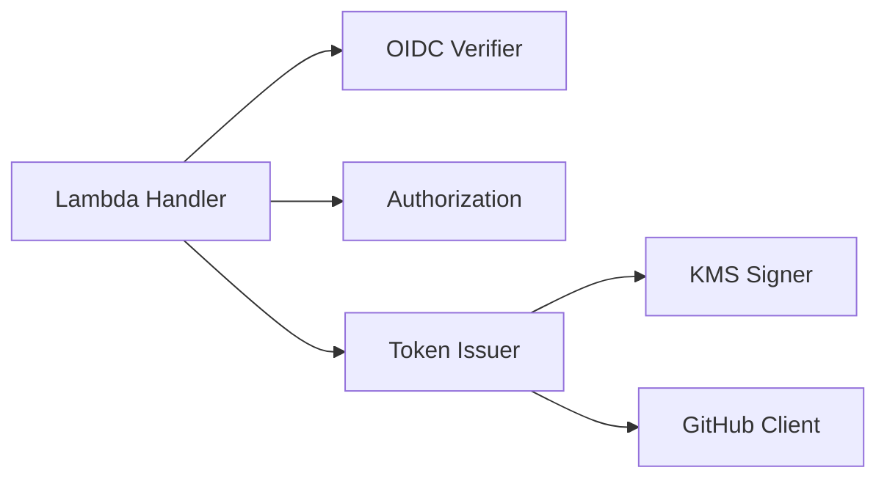

# Lambda Design

## 1. Responsibility and Invocation

Lambda は GitHub OIDC JWT の検証、GitHub App Installation への対象解決、現在のスコープでの `contents:read` の発行認可、KMS 署名、GitHub App Installation Access Token の発行を実行します。スコープの判断理由と将来の検討対象は [Project Scope](../spec/project-scope.md) に置きます。Go のパッケージやインターフェースは責務とテスト容易性に応じて設け、必要性のない抽象化を避けます。

Lambda は AWS IAM により認証・認可された同期 Invoke を受け付けます。Invoke の Payload に含まれる GATES 用 OIDC JWT の署名と Claim を検証し、要求を処理します。

| 項目 | 契約 |
|---|---|
| Transport | AWS Lambda `Invoke`、`InvocationType=RequestResponse` |
| AWS Authentication | 呼び出し元が AWS 一時認証情報で SigV4 署名する |
| Caller Identity | GATES 用 Audience の GitHub OIDC JWT を JSON Payload に含める |
| Payload | JSON。GATES が設ける上限を 16 KiB とする。無効な型・未知フィールドは拒否 |
| Response | JSON。呼び出し元は Invoke の `FunctionError` と Lambda 応答の `ok` をそれぞれ確認 |
| Endpoint | AWS Lambda Invoke API |

Lambda Invoke には HTTP の `Authorization` ヘッダーに相当するアプリケーション層のヘッダーがないため、GATES 用 OIDC JWT は `id_token` フィールドとして Payload に含めます。Payload は資格情報を含むため丸ごとログに記録せず、監査に必要な非秘密のフィールド（要求対象、要求権限）だけを記録します。

本ドキュメントでは、処理の段階を次の語で区別します。
Payload を GATES が読み取れるかの判定を **形式検証**、GATES 用 OIDC JWT から Caller を確定することを **認証**、GitHub API の発行応答を TokenGrant と突き合わせることを **照合** と呼びます。
概念の定義は [Domain Model](domain.md) を正本とします。

## 2. Request

### 2.1 Repository Request

```json
{
  "version": 1,
  "id_token": "<GATES_AUDIENCE_GITHUB_OIDC_JWT>",
  "repositories": ["example-org/repo-a", "example-org/repo-b"],
  "permissions": {"contents": "read"}
}
```

| フィールド | ルール |
|---|---|
| `version` | 必須、整数 `1` |
| `id_token` | 必須、GATES 用 Audience の JWT。Bearer 資格情報として慎重に扱う |
| `repositories` | 必須、重複のない 1 件以上 500 件以下の `owner/repo` の配列。上限は GitHub のトークン発行 API が一度に受け付ける件数に合わせる（[GitHub Constraints](../spec/github-constraints.md#61-発行要求と有効期限)）。GATES が設ける 16 KiB の Payload には最短の要素で 2,000 件以上が入るため、Payload サイズより先にこの上限に達する |
| `permissions` | 必須、値は **`{"contents":"read"}`**。形式が不正なら入力不正、形式が正しく値が許可条件と異なれば認可拒否 |

- 対象は同一オーナーに属し、GATES で利用する同一の GitHub App Installation に含まれる必要がある。
- Caller / オーナー / Installation ID と GitHub API Host を利用者から指定させない。
- 全リポジトリを対象にする項目（GitHub の `repository_selection`）を設けない。対象は `repositories` で明示したリポジトリだけである。`repository_selection` を含む Payload は、未知のフィールドとして入力不正になる。
- 複数対象のうち一つでも許可条件を満たさなければ全件を拒否し、部分成功も自動分割もしない。
- GitHub API に渡す際は `owner/repo` を一度だけ `/` で分割し、オーナー名が許可オーナー名に一致することを確認して、リポジトリ名の部分だけを `repositories` に指定する。要求時の `owner/repo` は応答の `full_name` と照合するため保持する。
- 各リポジトリに同じ Permissions を適用する。別の権限を必要とする場合は個別に要求する。
- Lambda が返すトークンの対象は要求したリポジトリのみであり、App にインストール済みのすべてのリポジトリを意味しない。

### 2.2 Validation

形式検証は、値を GATES が解釈できるかだけを判定します。
値が許可条件に合うかは、認証後に Authorization が判定します。
この順序の理由は [Security Design](security.md#31-authorization-rule) に記述します。

#### 入力不正と認可拒否の境界

各フィールドの値の形を、入力不正（`invalid_request`）と認可拒否（`authorization_denied`）に次のように分けます。
入力不正の形に当たらない要求だけが、Authorization の判定に進みます。

| フィールド | 入力不正にする形 | 認可拒否にする形 |
|---|---|---|
| `version` | 欠落、`null`、整数 `1` 以外（`1.0`、`"1"`、`2` を含む） | なし |
| `id_token` | 欠落、`null`、文字列以外、空文字列 | なし（JWT の検証失敗は `invalid_id_token`） |
| `repositories` | 欠落、`null`、配列以外、空配列、文字列以外の要素、[完全名の形式](#名前の文字種と比較規則)に合わない要素、大文字小文字を区別しない重複、500 件超 | オーナー名が許可オーナー名と異なる要素を含む |
| `permissions` | 欠落、`null`、オブジェクト以外、空オブジェクト、文字列以外の値、[権限名と水準の文字種](#権限名と水準の文字種)に合わないキーまたは値（空文字列を含む） | `{"contents":"read"}` 以外の組（`contents` 以外のキー、`read` 以外の値、`metadata` などのキーの追加） |
| Payload 全体 | 16 KiB 超、JSON として不正、オブジェクト以外、未知のフィールド、重複したキー、不正な UTF-8、オブジェクトの後に続くデータ | なし |

空の Permissions を入力不正にするのは、`permissions` が必須であり、[Requirements](../spec/requirements.md) FR-012 が欠落・未知値を広い既定権限に読み替えないと定めているためです。
空の Map は、要求の欠落と同じく、要求した権限を読み取れない形として扱います。
一方で、未知のキー（`issues` など）は認可拒否にします。
`contents:write` と同じく、形式は読み取れて値が許可外の要求であり、監査記録に残す対象だからです。

重複したキーを入力不正にするのは、`{"contents":"write","contents":"read"}` のような Payload の解釈が JSON の実装ごとに分かれるためです。
後の値を採る実装はこの Payload を `contents:read` として認可しますが、監査記録や別の処理が先の値を読むと、認可した内容と記録した内容が食い違います。

オーナー名の不一致を認可拒否にするのは、[Processing Flow](#6-processing-flow) の手順 3 がオーナー名の照合を Authorization の判定に置いているためです。
形式検証は、`owner/repo` をオーナー名とリポジトリ名に分割できるかまでを見ます。

500 件を超える要求を入力不正にするのは、GitHub API に渡すと、その応答が `422` なら `github_issuance_rejected` に分類され（[Failure](#32-failure)）、利用者が直せる件数の超過が、原因を特定できない発行拒否として記録され得るためです。
形式検証で止めれば、KMS と GitHub API を呼ばずに済みます。

形式検証のエラー文言には、不正なフィールドの名前（配列の要素なら位置を添える）とその形だけを書き、Payload の断片を含めません。
未知のフィールドの名前、`permissions` のキー、数値のリテラルも断片に当たります。
断片には GATES 用 OIDC JWT が入り得るためです。

#### 権限名と水準の文字種

`permissions` のキー（権限名）と値（水準）は、1 文字以上 64 文字以下の ASCII 小文字とアンダースコア（`_`）の文字列に限ります。
GitHub の Permissions の表現は [GitHub Constraints](../spec/github-constraints.md#61-発行要求と有効期限) を参照します。
この文字種は、その表現に合わせて GATES が決めた形式の制限です。
GitHub が公式に定めた規則ではありません。
この文字種に合わない文字列は、GitHub の権限名や水準として読み取れないため、入力不正にします。
[Security Design](security.md#31-authorization-rule) と [Domain Model](domain.md#52-rules) が入力不正にする「値を読み取れない形」に、この文字列も含まれます。

この規則により、監査記録に入る要求の権限は、改行や制御文字を含まない 64 文字以下の語に限られます。
ログのエンコーダが値をどうエスケープするかによらず、記録の 1 行を偽装する値や長大な値が入りません。
値の数には上限を設けず、記録全体の大きさは Payload の 16 KiB の上限で抑えます。

64 文字の上限は GitHub 公式の文字数制限ではなく、最長の権限名（46 文字）に余裕を持たせて GATES が決めた値です。
許可されるのは `{"contents":"read"}` だけなので、将来 GitHub がこの規則に合わない権限名を加えても、正当な要求は拒否されません。
その権限名を使う要求の結果が、認可拒否から入力不正に変わるだけです。

発行結果の実効権限も Permissions として同じ規則で読みます。
照合は許可権限と付随権限の範囲外の Permission Entry をもともと拒否するため（[Success](#31-success)）、規則に合わない権限名が応答に現れても、トークンを返さないことは変わりません。
この場合も照合の失敗（`issuance_verification_failed`）として扱い、応答の `token` の取り出しと失効は、`permissions` を読み取れたかどうかに依存させません。

#### 名前の文字種と比較規則

`repositories` の各要素は、`/` をちょうど一つ含み、その前のオーナー名と後のリポジトリ名がどちらも空でない文字列です。
オーナー名とリポジトリ名は、次の文字種に限ります。

| 名前 | 受け付ける文字種と長さ | 根拠 |
|---|---|---|
| オーナー名 | 1 文字以上の ASCII 英数字とハイフン | GATES が決めた形式の制限。GitHub の規則としては確定していない（下記） |
| リポジトリ名 | 1 文字以上 100 文字以下の ASCII 英数字、ハイフン、アンダースコア、ピリオド | GitHub の新規リポジトリ名の制約に合わせる。`.` と `..` は緩い側に寄せた（下記） |

GitHub 側の名前の文字種と長さ、その根拠と未確認事項は [GitHub Constraints](../spec/github-constraints.md#2-owner-and-repository) を参照します。

GitHub の規則として確認できなかった条件は、GitHub が受け付ける名前を拒否しない側に寄せ、形式検証で課しません。
GATES が GitHub より厳しい規則を持つと、正当な要求が入力不正になり、利用者には原因が分からないためです。
該当するのは次の規則です。

- **オーナー名のハイフンの位置**：先頭・末尾のハイフンと連続したハイフンの禁止は、Enterprise Managed Users の命名規則であり、ほかのオーナーに転用しない
- **オーナー名の長さ**：39 文字の上限も、Enterprise Managed Users の命名規則であり、ほかのオーナーに転用しない
- **リポジトリ名 `.` と `..`**：GitHub が受け付けるかを確認できておらず、文字種の規則だけでは拒否できない

一方で、オーナー名の文字種も、User と Organization に一様に適用できる GitHub の規則としては確定していません。
それでもオーナー名に上の文字種を課せるのは、そうしても正当な要求を拒否しないためです。
許可オーナー名は同じ文字種を満たす値としてデプロイ時に固定するため、この文字種に合わないオーナー名の要求は、形式検証を通してもオーナー名の照合で必ず拒否されます。
オーナー名の規則を課すかどうかは、結果を入力不正と認可拒否のどちらにするかだけを変えます。
例外として、Enterprise Managed Users のユーザーアカウントは、ユーザー名にアンダースコアを含むため（[GitHub Constraints](../spec/github-constraints.md#22-名前の制約)）、この文字種を満たさず、許可オーナーに設定できません。
リポジトリ名の文字種が `/` を含まないため、`a/b/c` は入力不正になり、リポジトリ名 `b/c` が GitHub API の `repositories` に渡ることはありません。

名前の比較と重複判定は、ASCII の範囲で大文字小文字を区別せずに行います。
Unicode の大文字小文字の対応（Go の `strings.EqualFold` など）を使わないのは、Kelvin 記号（U+212A）と `k` のように、GitHub 上では別の文字が同じ文字として扱われ得るためです。
比較の規則は、要求の重複判定、オーナー名の照合、発行応答の `full_name` の照合（[Success](#31-success)）で共通です。

入力文字列のリポジトリ名だけから所有権を判断せず、要求元のオーナーは検証済み JWT に基づいて決定します。

## 3. Responses

### 3.1 Success

```json
{
  "ok": true,
  "token": "<INSTALLATION_ACCESS_TOKEN>",
  "expires_at": "<RFC3339_EXPIRATION_TIME>",
  "repositories": ["example-org/repo-a", "example-org/repo-b"],
  "permissions": {"contents": "read", "metadata": "read"},
  "request_id": "<OPAQUE_ID>"
}
```

`repositories` は照合済みの発行対象を GitHub 応答の `full_name` で示します。`permissions` は GitHub 応答の実効権限、`expires_at` は GitHub が定めた有効期限（RFC 3339 形式）です。GATES は有効期限を延長しません。
GitHub 応答の `repository_selection` は返しません。
下の照合条件により `selected` 以外の応答はトークンを返さないため、成功応答では値が常に同じで、呼び出し元に伝える情報がないからです。
`request_id` は失敗応答と同じ相関 ID で、資格情報ではありません。
値には Lambda の request ID（Invoke 応答のヘッダー `x-amzn-RequestId` と同じ値）をそのまま使います。
CloudWatch Logs に自動で記録されるため、独自に採番しなくても監査記録と突き合わせられます。
成功時にも返すのは、呼び出し元がワークフローのログに残し、監査記録と突き合わせられるようにするためです（[Requirements](../spec/requirements.md) FR-021）。

GitHub API の発行応答のスキーマと、各フィールドの存在条件が未確認であることは [GitHub Constraints](../spec/github-constraints.md#62-発行応答permission) を参照します。
Lambda は GitHub API の発行応答を次の条件で照合し、必要な情報が得られなければトークンを返しません。

- `token` が空でなく、`expires_at` が有効な将来日時であること。
- `repositories` が存在し、要求と同じ件数の対象を返すこと。`full_name` と要求名を大文字小文字を区別せず集合で照合し、余分な対象・欠落・重複を拒否すること。
- 各対象の Repository ID が有効かつ一意で、`owner.id` が許可オーナーの Owner ID と一致すること。ID は応答の整合性確認に用い、事前に確定した ID との照合とはみなさないこと。
- `permissions.contents` が `read` であり、追加の Permission Entry は `metadata:read` が応答に含まれる場合に限り許容すること。その他の Permission Entry は拒否すること。
- `repository_selection` が `selected` であること。`all` は要求外の対象を含むため拒否すること。

`metadata:read` を許容するのは GATES の判断であり、GitHub が常に付与することを前提にしません。
GitHub API の応答が照合条件に適合しない場合は `issuance_verification_failed` として拒否します。
これは [Domain Model](domain.md#42-failure-kinds) の照合失敗に当たり、一時的な障害と分ける理由もそこに置きます。

発行 API に要求を送信した後、GitHub 側でトークンが発行されたかどうかと、Lambda がトークン文字列を取得できたかどうかは別の事実です。
通信の切断やタイムアウトでは、GitHub 側の発行の有無が分からないことがあります。

発行応答から空でない `token` を取得できたうえで照合に失敗した場合、Lambda はそのトークンを返さず、そのトークンで `DELETE /installation/token` を呼んで失効を試みます。
返さないだけで失効させないと、要求外の対象や権限を持つトークンが有効期限まで GitHub 上で有効なまま残るためです。
失効はベストエフォートとし、失効に失敗してもエラーコードは `issuance_verification_failed` のまま変えず、失効の試行と成否を監査記録に残します。

`token` を取得できない場合は、失効 API の認証に使うトークンがないため、失効を試みません。
GATES は、GitHub 側で失効に成功することも、応答を受信できなかったトークンが存在しないことも保証しません。
どの場合も、照合を通っていないトークンを利用者には返しません。

### 3.2 Failure

```json
{
  "ok": false,
  "error": {
    "code": "authorization_denied",
    "message": "The requested token is not permitted."
  },
  "request_id": "<OPAQUE_ID>"
}
```

`request_id` は成功応答と同じくトップレベルに置きます。
相関 ID は応答全体の属性であり、呼び出し元が `ok` の値によらず同じ場所から読めるようにするためです。

Handler は処理中の panic を回復し、`internal_error` の失敗応答として `request_id` とともに返します。
`FunctionError` になるのは、タイムアウト、メモリ不足、初期化の失敗のように Handler が応答を書けない場合だけです。
この場合は応答に `request_id` がないため、呼び出し元は Invoke の時刻と `run_id` で CloudWatch Logs の記録と突き合わせます。

エラーコードは、[Domain Model](domain.md#42-failure-kinds) の失敗の種別を応答で表す値です。
種別とコードは一時的な障害を除いて一対一で、一時的な障害だけは失敗した依存先（Discovery / JWKS、KMS、GitHub API）ごとにコードを分けます。
種別を分ける理由は Domain Model に置き、本ドキュメントはコードと HTTP 応答の対応だけを定めます。

| Error code | 失敗の種別 | 内容 |
|---|---|---|
| `invalid_request` | 入力不正 | Payload が [Validation](#22-validation) の入力不正の形に当たる |
| `invalid_id_token` | 認証失敗 | GitHub OIDC JWT が [OIDC Validation](#71-oidc-validation) の規則を満たさない。JWT の形式、署名、署名方式、Issuer、Audience、時間条件、必須 Claim の欠落・不整合を含む |
| `authorization_denied` | 認可拒否 | Caller の Owner ID が許可オーナーと不一致、要求した権限が許可条件外、または要求したリポジトリのオーナー名が許可オーナー名と不一致。Installation の対象外であることが GitHub API の呼び出し後に判明した場合は、その処理段階の失敗として扱う |
| `identity_verification_unavailable` | 一時的な障害 | OIDC Discovery / JWKS の取得が一時的に失敗した。通信の失敗、タイムアウト、5xx、403 / 429 で、再試行で解消し得る |
| `signing_unavailable` | 一時的な障害 | KMS 署名に失敗 |
| `installation_resolution_failed` | Installation 利用不可 | 固定した GitHub App と許可オーナーから、発行に使える Installation を得られない。一時的な障害を除く GitHub API の失敗（App JWT が受け付けられない 401、GitHub App が許可オーナーにインストールされていないときに想定する 404 など）、Installation の応答に必要な項目がない、Installation が停止している（`suspended_at` が空でない）、`account.id` が許可オーナーの Owner ID と一致しない |
| `token_issuance_failed` | 一時的な障害 | GitHub API の一時的な障害。通信の失敗、タイムアウト、5xx、レート制限による 403 / 429 で、Installation の取得と発行要求の両方を含む。再試行で解消し得る |
| `github_issuance_rejected` | GitHub 発行拒否 | GATES の認可が成立した後、GitHub の発行 API が `422` で要求を拒否した。検証失敗やスパム判定など、原因は応答コードから特定できない |
| `issuance_verification_failed` | 照合失敗 | GitHub API の発行応答が [Success](#31-success) の照合条件に適合しない。空でないトークン文字列を取得できた場合は失効を試みる |
| `internal_error` | 内部障害 | 想定外の内部障害。Handler の panic のようにどの段階にも属さない失敗と、Discovery / JWKS の取得のうち再試行で解消しない失敗を含む |

GitHub API の失敗は、HTTP 応答から次のように分類します。
通信の失敗、タイムアウト、5xx、レート制限による 403 / 429 は `token_issuance_failed` にします。
発行要求の 422 は `github_issuance_rejected` にします。
それ以外の失敗は `installation_resolution_failed` にします。
Client ID の誤り、KMS Key と GitHub に登録した Private Key の不一致、Installation の削除や停止が、ここに入ります。
発行要求で起きた 401 / 403 / 404 も、直前に同じ App JWT で Installation を取得できているため、要求の間に Installation か App の状態が変わったものとしてこのコードに含めます。
Installation の応答の形式が想定と異なる場合は `installation_resolution_failed` に、発行応答の形式が想定と異なる場合は `issuance_verification_failed` にします。

この分類は GATES のエラー分類であり、GitHub の HTTP ステータスの定義ではありません。
発行 API の `422` は、GitHub の公開仕様では検証失敗またはスパム判定を指し、Installation の範囲外の要求だけを意味しません（[GitHub Constraints](../spec/github-constraints.md#61-発行要求と有効期限)）。
Installation の取得に使う Organization と User の API も、公開している応答コードは `200` だけで、未インストールのときの応答は公開されていません（[GitHub Constraints](../spec/github-constraints.md#5-installation)）。
上の 404 は GATES の想定であり、分類は `200` 以外の応答をレート制限と一時的な障害を除いて `installation_resolution_failed` にすることで成り立ち、特定のステータスには依存しません。
ステータスと失敗原因の対応は公開されておらず、いつ変わってもおかしくないため、GATES は原因を断定しません。
発行 API の `422` を、GATES の認可条件で拒否したことを示す `authorization_denied` と分けるのは、`422` だけでは権限不足や悪意の有無を確定できないためです。
どの失敗でもトークンを返さないことは変わりません。

Discovery と JWKS の取得の失敗は、次のように分類します。
通信の失敗、タイムアウト、本文の受信途中の切断、5xx、403 / 429 は `identity_verification_unavailable` にします。
403 を区別せずに含めるのは、Discovery と JWKS が認証を要しない公開の文書で、GATES に起因する 403 が想定できず、レート制限と見なすためです。
呼び出し元の ctx の期限切れと中断、TLS の失敗も、応答を受け取る前の失敗として通信の失敗に含めます。
それ以外の 200 以外の応答（リダイレクトを含む）、応答サイズの上限の超過、完全に受信した応答を解釈できない場合、JWKS に `kid` を持つ RSA の公開鍵が一つもない場合、Discovery が示す Issuer が固定した Issuer と異なる場合、Discovery が示す JWKS の取得先が Issuer と同じ `https` のホストとポートでない場合は `internal_error` にします。
これらは再試行では解消せず、固定した Issuer の設定か GitHub 側の変更を運用者が調べる失敗であり、一時的な障害にすると利用者に無駄な再実行を促すためです。
取得の失敗でない認証の失敗はすべて `invalid_id_token` にします。
JWKS を取得できたうえで署名が一致しない JWT も `invalid_id_token` であり、JWT の `iss` が固定値と異なる場合も、Discovery の Issuer の不一致とは区別して `invalid_id_token` にします。
`kid` があり手元の鍵で検証できない JWT で取得に失敗した場合は、署名の正否を判定できないため、JWT が不正であっても取得の失敗として返します。
分類は公開鍵の取得が返した失敗の種別で行い、検証ライブラリのエラー文言には頼りません。
文言はライブラリの更新で変わり得るためです。

外部エラーをそのまま応答へ転記しません。認証情報を含む詳細を公開せず、相関 ID によってログと突き合わせます。Lambda の処理結果は `ok` で示し、Invoke 自体の結果と区別します。呼び出し側での AWS CLI 終了コード、`FunctionError`、`ok` の判定は [GitHub Actions Design](github-actions.md) に記述します。

## 4. Logical Components



| Component | 責務 |
|---|---|
| Lambda Handler | Payload の形式検証、各コンポーネントの呼び出し順序の制御、監査情報の記録、応答形式 |
| OIDC Verifier | GitHub OIDC JWT の署名・Issuer・Audience・時間・Claim 検証と Caller の確定、Issuer の Discovery / JWKS の取得と保持 |
| Authorization | Caller、要求（対象、権限）、取得済み Installation、固定設定から発行可否を判定し、TokenGrant を確定。ネットワーク通信を行わない |
| Token Issuer | KMS Signer による App JWT の作成、GitHub Client を使った Installation の取得とトークン発行、GitHub 応答の TokenGrant への照合、照合に失敗したトークンの失効 |
| KMS Signer | 固定された非対称 KMS Key とアルゴリズムで署名 |
| GitHub Client | GitHub API（Installation の取得、トークン発行、トークンの失効）に対する HTTP 通信と応答の復号 |

このコンポーネント区分は責務のモデルであり、Go パッケージへの一対一の対応を要求しません。

## 5. Domain Model

概念の定義、ルール、不変条件は [Domain Model](domain.md) を正本とします。
本ドキュメントでは、その概念を実装でどう呼び、どのコンポーネントが持つかだけを示します。

| Domain Model の概念 | 実装での名前 | 持つコンポーネント | 補足 |
|---|---|---|---|
| 完全名 | FullName | Lambda Handler、Authorization、Token Issuer が共用 | [名前の文字種](#名前の文字種と比較規則)を満たし、比較は ASCII の範囲で大文字小文字を区別しない |
| オーナー名 | OwnerName | Authorization、Token Issuer が共用 | 完全名のオーナー部分と許可オーナー名を同じ型で表す。[名前の文字種](#名前の文字種と比較規則)を満たし、比較は ASCII の範囲で大文字小文字を区別しない |
| 発行要求 | TokenRequest | Lambda Handler が作り、Authorization が読む | Payload から GATES 用 OIDC JWT を除いた部分 |
| Caller | Caller | OIDC Verifier が作り、Authorization と監査記録が読む | Owner ID と Repository ID で識別し、ワークフロー実行 ID（`run_id`）、試行番号（`run_attempt`）、ワークフロー起動属性（WorkflowTriggerAttributes）を監査のために添える |
| ワークフロー起動属性 | WorkflowTriggerAttributes | OIDC Verifier が作り、Caller が持ち、監査記録が読む | 認可には使わない |
| 許可オーナー | AllowedOwner | Lambda Handler が固定設定から作り、Authorization と Token Issuer が読む | 不変 Owner ID、オーナー名（OwnerName）、種別（OwnerType） |
| 許可オーナーの種別 | OwnerType | Token Issuer が Installation の取得 API の選択に読む | Organization かユーザーアカウントか |
| GATES 用 OIDC JWT（ID Token）、未検証 | RawIDToken | Lambda Handler が作り、OIDC Verifier が読む | Payload の `id_token` を認証前に運ぶ。資格情報のため、ログやエラーにどう出力しても値を伏せる。値を取り出すのは OIDC Verifier だけ |
| Discovery | discoveryDocument | OIDC Verifier | Issuer の値と JWKS の取得先（`jwks_uri`）だけを読む |
| Issuer の公開鍵集合 | issuerKeySet | OIDC Verifier が取得して保持する | JWK Set（JWKS）として取得し、検証ライブラリの `oidc.KeySet` として使う。OIDC Verifier の外に出さない |
| Permissions | Permissions | Lambda Handler、Authorization、Token Issuer が共用 | 要求の `permissions` と応答の `permissions` の両方をこの型で扱う |
| 固定設定 | Config | Lambda Handler が起動時に読み、各コンポーネントへ渡す | 許可オーナー（AllowedOwner）、Client ID、KMS Key ARN、Audience、Issuer、GitHub API Host。JWKS は Issuer の Discovery から得るため、独立した値を持たない |
| Installation | Installation | Token Issuer が取得し、Authorization が照合する | Installation ID、インストール先 Owner ID（`account.id`）、停止状態（`suspended_at`） |
| 発行許可 | TokenGrant | Authorization が作り、Token Issuer が読む | Installation ID、対象の完全名、Permissions |
| 発行結果 | IssuanceResult | Token Issuer | GitHub API の発行応答。照合前の値 |
| 実効対象 | EffectiveRepository | Token Issuer | 発行応答の各リポジトリの Repository ID（`id`）、所有オーナーの Owner ID（`owner.id`）、完全名（`full_name`） |
| 返却可能な発行結果 | InstallationToken | Token Issuer が作り、Lambda Handler が返す | 照合を通った発行結果だけをこの型にする |
| 監査記録 | AuditRecord | Lambda Handler | 項目と記録する条件は [Domain Model](domain.md#36-audit-record) に従う |

`TokenGrant` は認可済みの発行範囲を Token Issuer に渡すための値です。複数リポジトリには共通の Permissions を適用し、対象ごとの違いが必要なら別のトークンを要求します。

表にない概念は、独立した型にしません。
Permission Entry は Permissions の要素、Allowed Permissions と Implied Permissions は Permissions の固定の値、Allowed Owner ID と Allowed Owner Name は AllowedOwner が持つ整数と OwnerName の値です。
Claim や Payload を復号する入れ物と、復号した値を解析するための非公開の型は、概念に対応しないため表に含めません。
検証済みの GATES 用 OIDC JWT は、OIDC Verifier が Caller を確定する間だけ存在し、OIDC Verifier の外に出しません。
[Domain Model](domain.md#41-operations) の操作名（Validate、Authenticate、Authorize、Sign、Resolve Installation、Grant、Issue、Verify、Revoke、Audit）は、空白を除いた形を各コンポーネントの関数名にします。

[Request](#2-request) の「Repository Request」は Payload の形式の名前であり、TokenRequest は Payload から GATES 用 OIDC JWT を除いた発行要求の概念です。
形式検証を通った Repository Request から、GATES 用 OIDC JWT と TokenRequest を分けて取り出します。

## 6. Processing Flow

1. Handler が Payload を形式検証し（[Validation](#22-validation)）、資格情報をログに残さない。
2. OIDC Verifier が固定 Issuer / JWKS と GATES 用 Audience で JWT を認証し、`repository_owner_id` と `repository_id` の Claim、および不変 ID 入り `sub` との一致から Caller を確定する。`run_id`、`run_attempt`、ワークフロー起動属性は監査のために Caller に添える。Discovery / JWKS の取得の失敗は [Failure](#32-failure) の分類に従い、一時的な障害なら `identity_verification_unavailable`、それ以外なら `internal_error` として拒否する。
3. Authorization が Caller の Owner ID を固定した許可オーナーの Owner ID と照合し、要求された各 `owner/repo` のオーナー名を固定した許可オーナー名と照合し、Permissions が `contents:read` のみであることを確認する。不一致なら外部呼び出しに進まず拒否する。
4. Token Issuer が KMS Signer で GitHub App JWT を生成し、GitHub Client で許可オーナーの Installation を取得する。取得の失敗は [Failure](#32-failure) の分類に従い、一時的な障害なら `token_issuance_failed`、それ以外なら `installation_resolution_failed` として拒否する。
5. Authorization が Installation の `account.id` を許可オーナーの Owner ID と照合し、`suspended_at` が空であることを確認して、Installation ID、要求した完全名、許可権限から TokenGrant を確定する。停止している、または `account.id` が一致しなければ `installation_resolution_failed` として拒否し、発行 API を呼ばない。
6. Token Issuer が TokenGrant の各 `owner/repo` からオーナーを除いたリポジトリ名の配列と `permissions` を GitHub API に明示してトークンを取得する。GitHub 応答の `full_name` は TokenGrant の元の `owner/repo` と全件照合し、Owner ID、Repository ID の有効性・一意性、実効権限が許可範囲内であることを照合する。必要な一覧・権限の欠落や不一致があれば、`issuance_verification_failed` として返却せず、空でないトークン文字列を取得できた場合は失効を試みる。発行 API の `422` は `github_issuance_rejected` として拒否する。
7. Handler が必要最小限の成功応答を返す。いずれかに失敗した場合は安全なエラーコードと相関 ID を返し、トークンは返さない。

Owner ID、権限、オーナー名の照合（手順 3）を Installation の取得（手順 4）より先に置くのは、KMS と GitHub API の呼び出しを認可の見込みがある要求だけに限るためです。

手順 5 の Grant は、手順 3 を通った要求にも認可条件を判定し直し、満たさなければ認可拒否を返します。
[Domain Model](domain.md#53-invariants) の発行許可の不変条件を、Grant だけで守れるようにするためです。
認可条件と Installation の有効性の両方を満たさない要求は、手順 3 が手順 4 より先にある順序に合わせて、認可拒否として返します。
TokenGrant の Permissions を要求から写さないのは、Grant が判定し直す認可条件で両者が等しいことは確かめていても、写すと、認可の条件を将来変えたときに、要求の値がそのまま発行範囲に流れるためです。

認可拒否と、Installation が発行に使えないことによる拒否のエラー文言には、満たさなかった条件を書き、Caller、要求、許可オーナー、Installation の値を含めません。
Installation は許可オーナー名から取得するため、その Installation ID と `account.id` は、許可オーナー名をいま持つアカウントを示します。
`account.id` が許可オーナーの Owner ID と一致しない場合も同じであり、許可オーナーの値と同じに伏せます。
文言は監査記録のためのもので、エラー応答には出しません。
拒否の理由を応答に出すと、許可オーナーの Owner ID やオーナー名を、許可されない呼び出し元が探れるためです。
値を含めないのは、Caller と要求は監査記録が別の項目として持つため文言に重ねる必要がなく、文言が誤って応答に混ざっても許可オーナーを明かさないためです。

## 7. External Integrations

### 7.1 OIDC Validation

GATES 用 OIDC JWT は、次の規則をすべて満たすときだけ Caller の根拠にし、一つでも満たさなければ `invalid_id_token` として拒否します。
規則は [Domain Model](domain.md#52-rules) の認証条件を Claim の水準で定めたものです。
Discovery / JWKS の取得に関する項目は、検証に使う鍵の取得の定めで、その失敗は [Failure](#32-failure) の分類に従います。
Issuer、Claim、不変 ID 入り `sub`、そのカスタマイズの GitHub 側の仕様は [GitHub Constraints](../spec/github-constraints.md#3-github-actions-oidc) を参照します。
JWT / JWS / JWK / OpenID Connect の標準仕様の規定と適用範囲は [JWT Constraints](../spec/jwt-constraints.md) を参照します。
次の規則は GATES が決めた受理条件であり、GitHub が生成し得る形式をすべて受け付けることを意味しません。
本節の「実 JWT で確かめた」は設計時の観測の記録であり、GitHub が保証する仕様ではありません。
規則と標準仕様の対応、標準仕様との差分は[標準仕様との対応](#標準仕様との対応)に、JOSE Header と JWK の受理条件は[JOSE Header / JWK の受理条件](#jose-header--jwk-の受理条件)に記述します。

- **JWT の形式**：JWS Compact Serialization だけを受理し、JSON 形式と改行以外の空白を含む形は、署名が正当でも鍵を取得せずに拒否する。改行 (CR と LF) を含む形は受理する。検証に使うライブラリの解析が読み飛ばし、改行を除いた形と同じ値として検証するためである。この見逃しを許すのは、GitHub が発行する JWT に現れる見込みがなく、検出には解析の前に別の分岐が要るため
- **署名**：Issuer の Discovery から得た JWKS の鍵で署名を検証する。署名方式は `RS256` だけを許す。実 JWT のヘッダーが `RS256` であることを確かめた。許す方式を Discovery の内容に委ねると、Discovery が変わったときに許す方式が GATES の外で変わるため、GATES が固定する。鍵は JWT のヘッダーの `kid` で選び、`kid` のない JWT は、検証ライブラリが鍵の集合で検証しないため、鍵を取得せずに拒否する。実 JWT に `kid` があることを確かめた。JOSE Header と JWK の受理条件は[JOSE Header / JWK の受理条件](#jose-header--jwk-の受理条件)に従う
- **Issuer**：`iss` を `https://token.actions.githubusercontent.com` に固定する。Discovery はこの Issuer から取得し、Discovery が示す Issuer が固定値と異なれば鍵を使わず、[Failure](#32-failure) の分類に従って内部障害にする
- **Audience**：`aud` が固定設定の GATES 用 Audience の 1 要素だけであること。GATES 用 Audience を含んでいても、ほかの値が並べば拒否する。AWS 用と GATES 用の JWT を別々に取得する設計（[Security Design](security.md#22-gates-用-oidc-jwt)）に合わせ、複数の受け手に宛てた JWT を GATES の資格情報にしないため
- **時間条件**：`exp` と `iat` は必須とし、`nbf` は欠落を許す。どれも JSON の数値の NumericDate として読み、数字だけの JSON 文字列は拒否する（[JWT Constraints](../spec/jwt-constraints.md#4-jwt-claims)）。値は整数に限り、小数部か指数部を持つ値は拒否する。検証に使うライブラリは小数を秒に切り捨てるため、受理すると `iat` と `nbf` の判定が最大 1 秒緩くなる。受理する範囲は `0` 以上 `253402300799`（9999 年の末）以下とし、範囲の外は拒否する。検証に使うライブラリの時刻への変換が桁あふれし、不正な変換で時間条件を迂回させないため。`exp` には猶予を設けず、現在時刻が `exp` より前でなければ拒否する（等しい場合も拒否する）。`iat` と、あれば `nbf` は、現在時刻に許容時計差を足した時刻より後なら拒否する。許容時計差は 5 分とする
- **ID の Claim の表記**：`repository_owner_id`、`repository_id`、`run_id`、`run_attempt` と `sub` に含まれる ID は、JSON の文字列で、10 進数字だけからなり、先頭が `0` でなく（`0` そのものを含めて拒否する）、符号を持たず、64 ビット符号付き整数に収まる値だけを受け付ける。JSON の数値は受け付けない。実 JWT でこれらの Claim が数字だけの文字列であることを確かめた。表記を一つに限ると、`sub` の ID と Claim の ID を文字列のまま比べても整数として比べても結果が変わらない。数値も受け付けると、GitHub が表記を変えたときに黙って受け入れ、変更に気付けない
- **Claim の組の復号**：重複したキーと不正な UTF-8 を含む Claim の組は、Caller の確定に読まない Claim の中にあっても拒否する。解釈が JSON の実装ごとに分かれる入力であり、署名などの検証と Caller の確定で Claim の組を別々に読むと、検証した値と Caller にした値が食い違い得るため（[Validation](#22-validation) の重複したキーと同じ方針）。読まない Claim を区別しないのは、GitHub が署名する Payload にこれらの値が現れる見込みがなく、区別のための分岐が要らないため。Claim 名はエスケープを解いた後の完全一致で比較する（[JWT Constraints](../spec/jwt-constraints.md#4-jwt-claims)）。署名、時間条件、Issuer、Audience の検証と Caller の確定は、同じ名前の同じ値を読む。`iss`、`aud`、`exp`、`iat`、`nbf` と大文字小文字だけが異なる名前を **別名** と呼び、別名の Claim を含む組は、正しい名前の Claim と並んでいても拒否する。大文字小文字の対応は Unicode の範囲で判定し、`ſ`（U+017F）を `s` と同じ文字として扱う `iſſ` も別名に含める。検証に使うライブラリがこの範囲で大文字小文字を区別せずに復号するためである。この拒否によって読む値が正しい名前の値に限られるため、ライブラリの結果を受理の判定に使える。`sub` と ID の Claim は GATES が完全一致で読むため、この拒否の対象にしない
- **`sub` の解釈**：`repo:` で始まり、続く部分を最初の `/` でオーナー部とリポジトリ部に分け、リポジトリ部は次の `:` までとし、`:` がなければ拒否する。オーナー部とリポジトリ部は、それぞれ名前、`@`、ID の並びで、`@` をちょうど一つ含み、名前と ID のどちらも空でない。オーナー部の ID が `repository_owner_id` と、リポジトリ部の ID が `repository_id` と一致する。名前の部分は照合せず、リポジトリ部の後の `:` 以降は解釈しない。`@` をちょうど一つとするのは、GitHub の公式仕様で `@` がユーザー名にもリポジトリ名にも使えないため（[GitHub Constraints](../spec/github-constraints.md#32-immutable-subject-とカスタマイズ)）で、二つ以上含む `sub` は GitHub の形式に合わない値として拒否する。名前を照合しないのは、認可の根拠が ID にあり、名前は変わり得るため（[Domain Model](domain.md#51-identity-rules)）。`:` 以降を解釈しないのは、`sub` のカスタマイズで変わる部分であり、[Security Design](security.md#21-aws-iam--sts) が後半部分による制限を設けないため
- `run_id` と `run_attempt` を必須 Claim として読み取り、監査のために Caller に添える。認可には使わない。欠落は Fail Closed の原則に従って拒否する。
- ワークフロー起動属性として、`actor`、`actor_id`、`event_name`、`ref`、`sha`、`workflow_ref`、`job_workflow_ref`、`environment` の Claim を読み取り、監査のために Caller に添える。認可には使わない。これらは監査記録を詳しくするためのベストエフォートの属性であり、欠落していても拒否せず、欠落したまま記録する。`environment` のように、ジョブの設定によって含まれない Claim があるためである。文字列でない値も欠落として扱う（[Domain Model](domain.md#33-request-and-decision)）。値の形を検証しないため、改行や制御文字を含み得る。監査記録は値をエスケープする構造化形式の項目として出力し、文言に埋め込まない。
- **Discovery / JWKS の取得**：任意の Issuer / JWKS / `jku` を入力から指定させない。Discovery は Lambda の初期化ではなく最初の認証で取得し、成功した内容は実行環境の中で再利用し、失敗した場合は保持せず次の認証で取得し直す。初期化で取得すると、失敗が Lambda の初期化の失敗になり、Handler が `request_id` を含む失敗応答を返せないため（[Failure](#32-failure)）。取得した Discovery は実行環境の中で取り直さない。`kid` があり手元の鍵で検証できない JWT が来たときは、鍵のローテーションに追従するため JWKS を取得し直すが、要求ごとの無制限な再取得は認めない。同じ実行環境の中で同時の再取得を一つにまとめ、頻度に上限を設ける。上限の値は、検証ライブラリの挙動と鍵のローテーションの試験を踏まえて実装前に決める。上限に達している間も、手元の鍵で検証できない JWT を認証済みとして扱わず、手元の鍵で検証できる JWT の検証は妨げない。取得の失敗の分類は [Failure](#32-failure) に従う
- **Discovery / JWKS の取得の方式**：Discovery と JWKS は GATES が取得し、検証ライブラリには JWT の署名と Claim の検証だけを委ねる。検証ライブラリの取得処理は、応答のステータスと復号の失敗を文字列でしか返さず、応答本文をエラーに含めるため、[Failure](#32-failure) の分類に使えない。リダイレクトには従わず、JWKS の取得先は Issuer と同じ `https` のホストとポートに限る。固定した Issuer の外から鍵を読まないため
- **取得の上限**：タイムアウトは Discovery と JWKS の取得ごとに 5 秒、応答サイズは取得ごとに 64 KiB とする。実際の応答は Discovery が 1,217 バイト、JWKS が 4 鍵で 5,547 バイト、取得時間はどちらも 1 秒未満だった。64 KiB は JWKS が約 10 倍に増えても収まる大きさで、鍵の追加では超えず、想定外の応答を読み込み続けない。1 回の認証の取得回数と合計の待ち時間は、JWKS の再取得の上限とともに実装前に決める。Lambda の関数のタイムアウトは、その待ち時間に KMS と GitHub API の時間を足した値より十分長くする。短いと、取得が終わる前に Lambda がタイムアウトし、Handler が応答を書けない `FunctionError` になる（[Failure](#32-failure)）

時間条件の猶予を `iat` と `nbf` にだけ置くのは、猶予の有無が招く結果が `exp` と異なるためです。
Lambda の時計が GitHub より遅れていると、発行されたばかりの JWT の `iat` は Lambda から見て未来になり、猶予がなければ正常な JWT をすべて拒否します。
一方で `exp` に猶予を置くと、失効したはずの JWT を受け入れる時間が延びるだけです。
Lambda の時計が進んでいても、拒否されるのは失効の直前に届いた JWT だけであり、利用者がワークフローを再実行すれば回復します。
`iat` を `nbf` と別に検証するのは、GitHub が `nbf` を `iat` の 5 分前に置くため（実 JWT で確認）、`nbf` だけでは発行時刻が未来の JWT を 10 分先まで受け入れるからです。
許容時計差を 5 分にするのは、RFC 7519 が許容時計差を数分以内にとどめるよう書いており、GitHub が `nbf` を `iat` の 5 分前に置く幅とも同じだからです。
RFC 7519 では `exp`、`iat`、`nbf` のどれも任意です。
`exp` と `iat` の欠落を拒否し `nbf` の欠落を許すのは GATES の判断であり、OpenID Connect Core が ID Token で `exp` と `iat` を必須とし、`nbf` を定めていない区別に合わせています。
JWT の寿命は GitHub が定める `exp`（実 JWT では `iat` の 5 分後）に従い、GATES は独自の上限を設けません。
再利用できる期間を時間条件だけで制限する方針（[Requirements](../spec/requirements.md) §2.2）に従います。

`sub` の `:` の有無だけを形式として見るのは、実 JWT で確かめた形式がどれも `:` を持つためです。
安全のためではなく、ID の照合は `:` の有無によらず成り立ちます。
`repo` だけを含めるカスタマイズでは `repo:OWNER@OWNER-ID/REPO@REPO-ID` の形が現れ得ますが（[GitHub Constraints](../spec/github-constraints.md#32-immutable-subject-とカスタマイズ)）、実 JWT では確かめていません。
このカスタマイズをしたリポジトリは、入口制御を通った後に `invalid_id_token` で拒否されることを受け入れます。

`run_attempt` の `0` を拒否するのは、環境変数 `GITHUB_RUN_ATTEMPT` が初回の試行を `1` とするためです。
[GitHub OIDC JWT](../research/github/oidc-jwt.md) に記録した実 JWT でも、`run_attempt` はすべて `"1"` でした。
ただし OIDC reference はこの Claim を再試行された回数と説明しており、初回に `1` になることは明記されていません（[GitHub Constraints](../spec/github-constraints.md#31-issueraudienceclaim)）。
初回の Claim が `0` なら最初の試行はすべて `invalid_id_token` で拒否されますが、トークンを誤って返す方向の失敗ではありません。
正当な JWT で `0` が観測された場合は、この規則を見直します。

[Domain Model](domain.md) の概念は、GATES 用 OIDC JWT の次の Claim から得ます。

| Domain Model の概念 | Claim | 補足 |
|---|---|---|
| Caller の Owner ID | `repository_owner_id` | `sub` に含まれる Owner ID と一致することを確認する |
| Caller の Repository ID | `repository_id` | `sub` に含まれる Repository ID と一致することを確認する |
| ID の整合（[Identity Rules](domain.md#51-identity-rules)） | `sub` | `repo:OWNER@OWNER-ID/REPO@REPO-ID:...` の不変 ID 入り形式に限る |
| ワークフロー実行 ID | `run_id` | 必須 |
| 試行番号 | `run_attempt` | 必須 |
| ワークフロー起動属性 | `actor`、`actor_id`、`event_name`、`ref`、`sha`、`workflow_ref`、`job_workflow_ref`、`environment` | 欠落を許す |
| Audience の照合 | `aud` | 固定設定の GATES 用 Audience と完全一致 |
| Issuer の照合 | `iss` | `https://token.actions.githubusercontent.com` に固定 |

#### 標準仕様との対応

GATES は GATES 用 OIDC JWT を OpenID Connect の認証フローを経ずに受け取り、固定した Audience で照合します。
そのため、登録済みの `client_id` を前提とする ID Token の検証規則は適用せず、JWT 一般の規定と本節の規則で判定します。
本節の規則と標準仕様の対応は次のとおりです。

| 項目 | 標準仕様 | 本節の規則 |
|---|---|---|
| JWT の形式 | Compact Serialization で表す（[§2.1](../spec/jwt-constraints.md#21-構造署名アルゴリズム)） | Compact Serialization だけを受理する。改行を含む形は例外として受理する |
| `alg` | JOSE Header で必須。実装が許可する方式を明示する（[§2.1](../spec/jwt-constraints.md#21-構造署名アルゴリズム)） | `RS256` だけを許す |
| `kid`（JOSE Header） | JWS では任意。OpenID Connect Core に条件付きの規定がある（[§2.2](../spec/jwt-constraints.md#22-鍵の識別と-header-の拡張)） | 必須。欠落は拒否 |
| `kid`（JWK） | 任意（[§3.1](../spec/jwt-constraints.md#31-鍵の属性)） | `kid` のない鍵は検証に使わない |
| `iss`、`sub` | JWT 一般では任意（[§4](../spec/jwt-constraints.md#4-jwt-claims)） | 必須。`iss` は固定値、`sub` は不変 ID 入りの形式 |
| `aud` | JWT 一般では任意。文字列か文字列の配列を使え、受信者が含まれなければ拒否する（[§4](../spec/jwt-constraints.md#4-jwt-claims)） | 必須。GATES 用 Audience の 1 要素だけ |
| `exp`、`iat` | JWT 一般では任意（[§4](../spec/jwt-constraints.md#4-jwt-claims)） | 必須 |
| `nbf` | JWT 一般では任意（[§4](../spec/jwt-constraints.md#4-jwt-claims)） | 欠落を許す。あれば判定する |
| `exp`、`iat`、`nbf` の値 | JSON の数値。整数に限らない（[§4](../spec/jwt-constraints.md#4-jwt-claims)） | 整数だけを受理する。小数部か指数部を持つ値と、受理する範囲の外の値は拒否 |
| 時計差 | `exp` と `nbf` に数分程度の猶予を設けてよい。`iat` の判定は定めていない（[§4](../spec/jwt-constraints.md#4-jwt-claims)） | `iat` と `nbf` に 5 分。`exp` には設けない |
| Claim 名の重複 | 拒否するか、最後の同名フィールドだけを採用する（[§4](../spec/jwt-constraints.md#4-jwt-claims)） | 拒否 |
| Claim 名の大文字小文字 | `aud` と `AUD` は別の名前で、理解できない Claim は無視する（[§4](../spec/jwt-constraints.md#4-jwt-claims)） | 別名を含む組は拒否 |
| Discovery | Provider Metadata に `issuer`、`jwks_uri` のほかにも必須項目がある（[§5](../spec/jwt-constraints.md#5-openid-connect-and-discovery)） | Issuer の値と JWKS の取得先だけを読み、ほかの項目を受理条件にしない |

次の項目で、本節の規則は標準仕様より緩くなっています。
改行を受け入れる理由は、上の JWT の形式の規則に記述しています。

| 項目 | 標準仕様 | 本節の規則 | 影響 |
|---|---|---|---|
| JWT 中の改行 | Compact Serialization の各部分は Base64URL で、改行を含まない | 受理する | 改行を除いた JWT と同じ値で検証する。受理する Claim の値は変わらない |

#### JOSE Header / JWK の受理条件

GATES は JWT の検証で次の条件を課します。
標準仕様の規定は [JWT Constraints](../spec/jwt-constraints.md) を参照します。

- **Header の名前**：エスケープを解いた後に重複する名前と、不正な UTF-8 は拒否する
- **`crit`**：未対応の拡張を列挙した JWT を拒否する。空配列、重複、Header に存在しない名前、登録済みの名前を列挙した JWT も、GATES の判断で拒否する。`crit` に列挙されていない未知の Header は無視する
- **`b64`**：`b64:false` の JWT を拒否する。`b64:true` は標準仕様で禁止された形ではないが、検証ライブラリの署名入力の処理を確かめるまでは受理せず、確かめた結果で受理するかを決める
- **鍵の指定に使う Header**：`jku`、`jwk`、`x5u`、`x5c`、`x5t`、`x5t#S256` があっても、鍵の取得先と検証鍵には使わない。`typ` などほかの Header も鍵の選択の根拠にしない
- **JWK**：`kty` が `RSA` で、妥当な `n` と `e` を持ち、法が 2048 bit 以上の鍵だけを使う。`use` があれば `sig`、`key_ops` があれば `verify` を含み、`alg` があれば `RS256` であることを求める。`use` と `key_ops` を併せ持つ鍵は、両者の意味が整合していることも求める
- **同じ `kid` の鍵**：同じ `kid` に使える鍵が複数残り、一意に選べない JWT は、GATES の判断で拒否する。使えない鍵が同じ `kid` で並ぶだけでは拒否しない。JWKS の取得の失敗や構造の不正は [Failure](#32-failure) の分類に従い、一つの JWT に合う鍵がない場合と区別する

検証に使うライブラリの既定の振る舞いを、これらの条件の代わりにしません。
Header の名前の重複（エスケープを解いた後を含む）、`b64:true`、JWK の `use`、`key_ops`、`alg`、同じ `kid` の鍵の扱いは、採用するバージョンのライブラリで実装前に確かめます。

### 7.2 KMS Signing

JWS の構造、`RS256`、JWT の Claim の標準仕様の規定は [JWT Constraints](../spec/jwt-constraints.md) を参照します。
GitHub App JWT は OpenID Connect の ID Token ではないため、ID Token の必須 Claim（`sub`、`aud` など）を加えません。

- GitHub App JWT の Header を RS256 とし、Claim は `iss`、`iat`、`exp` を設定する。これらと `exp` の上限 10 分の公式根拠は [GitHub Constraints](../spec/github-constraints.md#42-github-app-jwt) を参照する。`iss` には GitHub App の Client ID を用いる。`iat` は時計差を考慮して現在時刻の 60 秒前とし、`exp` は上限を超えない。
- Header と Payload を Base64URL（padding なし）で結合し、署名入力を SHA-256 でハッシュする。
- AWS KMS `Sign` に `SigningAlgorithm=RSASSA_PKCS1_V1_5_SHA_256`、`MessageType=DIGEST`、計算済みダイジェストを渡す。二重ハッシュをしない。
- 署名結果を Base64URL で連結し、内部 GitHub App JWT を作成する。
- Lambda が保持するのは GitHub App の Client ID、KMS Key ARN、必要な設定だけであり、秘密鍵の平文は受け取らない。KMS Key の設定は Terraform、鍵素材インポートは独立した運用手順で行い、実行時の責務外とする。

### 7.3 GitHub Client

GitHub API の仕様は、Installation の取得を [GitHub Constraints](../spec/github-constraints.md#5-installation)、トークンの発行と失効を [GitHub Constraints](../spec/github-constraints.md#6-installation-access-token) で参照します。
本節は、GATES がどのエンドポイントをどう使うかを定めます。

- App JWT で許可オーナーの Installation を取得し、Installation ID、`account.id`、`suspended_at` を得る。取得に使うエンドポイントは、デプロイ時に固定したオーナーの種別で選ぶ。Organization なら `GET /orgs/{org}/installation`、ユーザーアカウントなら `GET /users/{username}/installation` を呼び出す。失敗の分類は [Failure](#32-failure) に従う。`suspended_at` は Installation に含めて返し、停止の判定は Authorization が行う（[Processing Flow](#6-processing-flow) の手順 5）。トークン発行には `POST /app/installations/{installation_id}/access_tokens` を使用する。
- 照合に失敗したトークンの失効には `DELETE /installation/token` を使用する。このエンドポイントは App JWT ではなく、失効させる Installation Access Token 自体で認証する。失効の要求にもタイムアウトを設け、失敗しても再試行せずに監査記録へ残す。
- `GET /repos/{owner}/{repo}/installation` はどちらの種別にも使えるが、採用しない。要求されたリポジトリから Installation を引くことになり、固定した設定から Installation を導出する [Requirements](../spec/requirements.md) FR-024 から外れるためである。
- GATES の要求は `owner/repo` 形式とする。GitHub のトークン発行 API の `repositories` はリポジトリ名だけを受け取るため、オーナー名が許可オーナー名に一致することを確認してリポジトリ名の配列へ変換する。変換前の完全名と API 応答の `full_name` を照合する。
- GitHub API に変換後の `repositories` と `permissions` を必ず指定する。応答照合の期待値と欠落時の扱いは本ドキュメントの [Responses](#3-responses) を正本とする。
- API Host、API バージョン、HTTP Header は信頼済み設定で固定する。採用する API バージョンの値は未確定で、実装時に決める（[GitHub Constraints](../spec/github-constraints.md#1-scope-and-evidence)）。タイムアウト・レスポンスサイズ上限を設け、API エラー本文に含まれる資格情報をログへ転記しない。

[Domain Model](domain.md) の概念は、GitHub API の応答の次のフィールドから得ます。

| Domain Model の概念 | 応答 | フィールド | 補足 |
|---|---|---|---|
| Installation ID | Installation | `id` | |
| インストール先 Owner ID | Installation | `account.id` | 許可オーナーの Owner ID との照合は Authorization が行う |
| 停止状態 | Installation | `suspended_at` | 空でなければ停止している |
| 許可オーナーの種別 | Installation | `account.type`、`target_type` | `Organization` か `User`。Domain Model の「ユーザーアカウント」は `User` を指す |
| 対象の選び方 | Installation、発行応答 | `repository_selection` | `selected` が選択したリポジトリに限る、`all` が全リポジトリ |
| 実効権限 | 発行応答 | `permissions` | |
| 実効対象の Repository ID | 発行応答 | `repositories[].id` | |
| 実効対象の所有オーナーの Owner ID | 発行応答 | `repositories[].owner.id` | |
| 実効対象の完全名 | 発行応答 | `repositories[].full_name` | 要求の完全名と照合する |
| 有効期限 | 発行応答 | `expires_at` | RFC 3339 形式 |

## 8. Technology Decisions

| 用途 | 採用技術・方針 | 理由 |
|---|---|---|
| Lambda | `github.com/aws/aws-lambda-go/lambda` | AWS 公式の Go ランタイム連携 |
| AWS SDK / KMS | AWS SDK for Go v2 (`config`、`service/kms`) | AWS 公式の認証情報解決・KMS API |
| GitHub OIDC 検証 | `github.com/coreos/go-oidc/v3/oidc`、`github.com/go-jose/go-jose/v4` | JWT の署名と Claim の検証を信頼できるライブラリに委譲。Discovery / JWKS の取得は GATES が行う（[OIDC Validation](#71-oidc-validation)） |
| GitHub REST API | `net/http`、`encoding/json` | 限られたエンドポイントを Go 標準ライブラリで処理 |
| App JWT 組み立て | 標準ライブラリと KMS Sign | JWT の署名検証器は自作しない |
| テスト | Go `testing`、`httptest` を基礎として、必要なら補助ライブラリを追加 | 環境依存しないテストを優先。追加依存を一律禁止しない |

依存関係は保守体制・必要性・脆弱性・ライセンス・間接依存を評価して決めます。Go のパッケージ化、内部インターフェースやテストヘルパーの採用は実装担当者の裁量とし、正当な理由のある構造化を妨げません。

### 8.1 Go Packages

入力と認可の処理の package は、どれも通信と外部ライブラリを持ちません。
Token Issuer、KMS Signer、GitHub Client の package は、それぞれを実装するときに加えます。

完全名とオーナー名の比較規則は、一つの package（`internal/repository`）に閉じます。
要求の重複判定、オーナー名の照合、発行応答の `full_name` の照合が、同じ比較規則を使うためです。
各 package に比較を書くと、一か所だけが大文字小文字の扱いや分割の規則を違えたときに、照合の結果が食い違います。
Permissions の検証と比較を一つの package（`internal/permission`）に閉じる理由も同じです。
形式検証、事前認可の許可権限との等しさ、発行結果の照合の付随権限を含む範囲の判定が、同じ Permissions の読み方と比べ方を使います。

Authorization は `internal/authz` に置き、Authorization の入力と出力の型も、形式検証が作る TokenRequest を除いて同じ package に置きます。
OIDC Verifier と Token Issuer の package が `internal/authz` を import しても、`internal/authz` は通信を持たないため、副作用が `internal/authz` に入りません。

Caller を作るのは `internal/authn` とテストだけとし、ほかの package が Caller を組み立てないことをレビューで確かめます。
`NewCaller` は公開関数で、呼び出せる package を型で限定できないため、「Caller は検証済みの GATES 用 OIDC JWT だけから作られる」不変条件はこの規則で守ります。

実装で概念の過不足や名前のずれが分かったときは、コードと本ドキュメントを同じ変更で直します。

## 9. Testability

認可判断はネットワーク通信と分離してテストできるようにします。GitHub API の HTTP は `httptest`、KMS の API 境界はテストダブル、OIDC は固定鍵のテスト JWT で検証規則を、`httptest` の Issuer で Discovery / JWKS の取得と失敗の分類を確認します。リポジトリ名の変換では `owner/repo` からリポジトリ名だけが GitHub API に渡ること、異なるオーナー・不正な区切り・大文字小文字の違い・重複を適切に処理すること、応答の `full_name` が元の要求と一致しない場合に拒否することを検証します。
受け入れ条件にない次の事例も検証します。

- 501 件の対象を要求すると `invalid_request` になる
- 発行応答の `repository_selection` が `all` のとき `issuance_verification_failed` になり、トークンを返さず、失効 API を呼ぶ
- 失効 API が失敗しても `issuance_verification_failed` のままで、失効の失敗が監査記録に残る
- 取得した Installation の `suspended_at` が空でないとき `installation_resolution_failed` になり、発行 API を呼ばない
- Installation の取得が 401 のとき `installation_resolution_failed`、5xx やタイムアウトのとき `token_issuance_failed` になる
- Handler 内の panic が `internal_error` の失敗応答になり、`request_id` を含む
- ワークフロー起動属性の Claim が欠落していても拒否せず、欠落したまま監査記録に残る
- `aud` に GATES 用 Audience とほかの値が並ぶ JWT が `invalid_id_token` になる
- `nbf` と `iat` が現在時刻の 4 分後なら受理し、6 分後なら `invalid_id_token` になる
- Header の名前の重複、未対応の `crit`、`b64:false`、用途やアルゴリズムが不整合な JWK、2048 bit 未満の RSA 鍵、鍵を一意に選べない `kid` の JWT が `invalid_id_token` になる
- `b64:true` の JWT は、受理するかを決めるまで受理しない
- GitHub の発行 API が `422` を返すと `github_issuance_rejected` になる
- 発行要求の送信後にタイムアウトすると、トークンを返さず、失効も要求せず、失効を試みたと監査記録に残さない
- 不正な `kid` の連続した要求や同時の要求でも JWKS の再取得が上限を超えず、鍵のローテーション後の JWT を受理できる
- Discovery が示す Issuer が固定した Issuer と異なるとき `internal_error` になり、JWT の `iss` が固定値と異なるときは `invalid_id_token` になる
- Discovery / JWKS の取得が 5xx やタイムアウトのとき `identity_verification_unavailable`、404 や応答サイズの超過のとき `internal_error` になる

受け入れ条件は [Requirements](../spec/requirements.md) を正本とします。

## 10. Sources

- [AWS — Lambda Invoke](https://docs.aws.amazon.com/lambda/latest/dg/invocation-sync.html)
- [AWS — AWS CLI Lambda Invoke](https://docs.aws.amazon.com/cli/latest/reference/lambda/invoke.html)
- [AWS — aws-lambda-go](https://github.com/aws/aws-lambda-go)
- [AWS — AWS SDK for Go v2](https://docs.aws.amazon.com/sdk-for-go/v2/developer-guide/)
- [AWS — KMS Sign](https://docs.aws.amazon.com/kms/latest/APIReference/API_Sign.html)
- [GitHub Constraints](../spec/github-constraints.md)
- [JWT Constraints](../spec/jwt-constraints.md)
- [Go — coreos/go-oidc/v3/oidc](https://pkg.go.dev/github.com/coreos/go-oidc/v3/oidc)
- [OpenID Foundation — OpenID Connect Core 1.0](https://openid.net/specs/openid-connect-core-1_0.html)
- [IETF — RFC 7519 JSON Web Token](https://www.rfc-editor.org/rfc/rfc7519)
