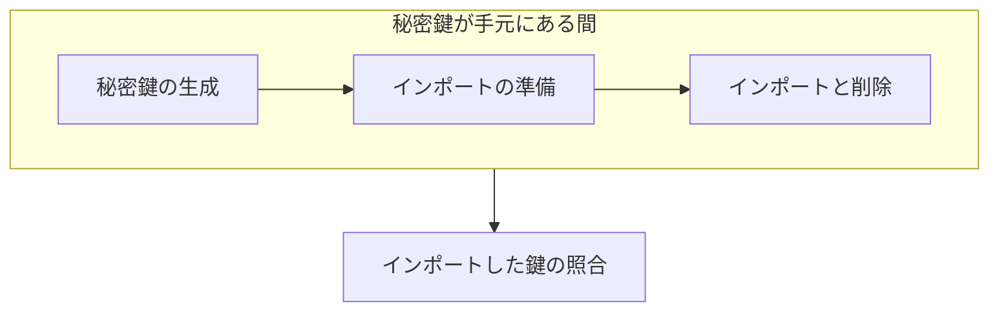

# Key Material Import

本ドキュメントでは、GitHub App Private Key（以下、秘密鍵）を生成して、Terraform が作った KMS Key に鍵素材として取り込むまでの手順を扱います。
取り込みは `make kms-import-key-material` が行い、運用者が行うのは、GitHub App での秘密鍵の生成と、インポートの後に出るフィンガープリントを GitHub の表示と照合することです。

## 1. Order of the Work

作業は次の順に進みます。



秘密鍵が手元にある時間を短くするため、秘密鍵を生成したら、すぐに `make kms-import-key-material` を実行します。

## 2. Running the Import

始める前に、次を満たしておきます。

- 対象の KMS Key が `terraform/local/terraform.tfvars` の `kms_keys` にあり、`make tf-apply` で作られている（Output の `kms_key_arns` に名前がある）
- AWS の一時認証情報（`AWS_ACCESS_KEY_ID`、`AWS_SECRET_ACCESS_KEY`、`AWS_SESSION_TOKEN`）がシェルにある
- AWS CLI、`jq`、`xxd`、OpenSSL 3 以降がある。macOS 標準の LibreSSL には、鍵素材のラップに使う `-id-aes256-wrap-pad` がない

GitHub App の設定ページで、`Credentials` → `Key pairs` → `New key` をクリックし、秘密鍵をダウンロードします。

リポジトリのルートで、鍵素材をインポートする KMS Key の `kms_keys` での名前を `KMS_KEY_NAME` に、ダウンロードした秘密鍵のパスを `GITHUB_PRIVATE_KEY_PATH` に指定して実行します。
`KMS_KEY_NAME` は、初回のインポートでは `key-1`、鍵の更新では新しく加えた鍵の名前にします。
秘密鍵は指定したファイルだけを扱い、ほかの場所を探しません。

```bash
make kms-import-key-material KMS_KEY_NAME=key-2 GITHUB_PRIVATE_KEY_PATH=<ダウンロードした秘密鍵のパス>
```

最後に、KMS Key の公開鍵のフィンガープリントが出ます。

```text
KMS key:     key-2 arn:aws:kms:...
Key state:   Enabled KEY_MATERIAL_DOES_NOT_EXPIRE
Fingerprint: SHA256:...
```

`Fingerprint` の値が、GitHub App の `Key pairs` に新しく加わった鍵のフィンガープリントと一致していれば成功しています。

## 3. What the Import Checks and Does

秘密鍵を読む前に、次を確かめ、どれかを満たさなければ何もせずに止まります。

- `KMS_KEY_NAME` が `kms_keys` の名前の形（`key-N`）で、Output の `kms_key_arns` にある
- `GITHUB_PRIVATE_KEY_PATH` が指定されていて、シンボリックリンクでない。リンクを削除しても、リンク先の秘密鍵は残るため
- KMS Key が `PendingImport` で、`Origin` が `EXTERNAL`、`KeyUsage` が `SIGN_VERIFY`、`KeySpec` が RSA である。インポートした鍵素材は別の鍵素材に交換できないため、鍵素材のある鍵は対象にしない

インポートの準備では、KMS からラッピング公開鍵と Import Token を取得します。
RSA の秘密鍵のラップに使えるのは `RSA_AES_KEY_WRAP_SHA_*` だけで、そのうち SHA-256 のものを選び、ラッピング公開鍵は AWS が推奨する最長の `RSA_4096` にします。
`RSA_AES_KEY_WRAP_SHA_256` では、使い捨ての AES 鍵で鍵素材を包み（RFC 5649 の鍵ラップ）、その AES 鍵をラッピング公開鍵で暗号化します。

秘密鍵のファイルからは公開鍵の部分だけを読んで RSA の秘密鍵であることと鍵長を確かめ、鍵長が KMS Key の `KeySpec` と違えばインポートせずに止まります。
GitHub は生成する鍵の鍵長を文書で約束していないためです。
鍵素材は無期限（`KEY_MATERIAL_DOES_NOT_EXPIRE`）でインポートします。

インポートの後、ダウンロードした秘密鍵と、`make kms-import-key-material` が作った作業ディレクトリを削除します。
そして、KMS Key が `Enabled` で `KEY_MATERIAL_DOES_NOT_EXPIRE` であることと、KMS Key の公開鍵のフィンガープリントがダウンロードした秘密鍵のものと一致することを確かめます。

## 4. When the Import Stops

秘密鍵を読む前の確認（§3）で止まったときは、秘密鍵のファイルは残ります。
原因を直し、もう一度実行します。

秘密鍵を読んだ後は、秘密鍵として読めたファイルと作業ディレクトリを、途中で止まったときと Ctrl-C で中断したときも削除します。
秘密鍵として読めないファイルは、パスの打ち間違いで関係のないファイルを消さないよう、削除しません。
秘密鍵を読んだ後、インポートの前に止まったときは、生成した鍵は使えません。
その鍵の秘密鍵はもう手元にないためです。
原因を直してから、新しい鍵を生成して実行し直し、使えなくなった鍵を GitHub App の `Key pairs` から削除します。
GitHub App の鍵がその 1 つだけのとき（初回のインポートなど）は、GitHub が最後の鍵を削除させないため、新しい鍵を生成するまで削除できません。

鍵長が `KeySpec` と違って止まったときは、その KMS Key は使えないため、同じ `KMS_KEY_NAME` では実行し直せません。
鍵長に合わせた `key_spec` の KMS Key を `kms_keys` に加えて適用し、その名前で実行し直します。

インポートの後に止まったとき（鍵の状態やフィンガープリントが違うとき）は、鍵素材は取り込まれています。
その KMS Key を使用中の鍵（`terraform/local/terraform.tfvars` の `active_kms_key` で指定する、Lambda が署名に使う鍵）にせず、原因を調べます。

## 5. References

- [GitHub — Managing private keys for GitHub Apps](https://docs.github.com/en/apps/creating-github-apps/authenticating-with-a-github-app/managing-private-keys-for-github-apps)
- [GitHub — REST API endpoints for GitHub Apps](https://docs.github.com/en/rest/apps/apps)
- [AWS — Importing key material for AWS KMS keys](https://docs.aws.amazon.com/kms/latest/developerguide/importing-keys.html)
- [AWS — Create a KMS key with imported key material](https://docs.aws.amazon.com/kms/latest/developerguide/importing-keys-conceptual.html)
- [AWS — Download the wrapping public key and import token](https://docs.aws.amazon.com/kms/latest/developerguide/importing-keys-get-public-key-and-token.html)
- [AWS — Encrypt the key material](https://docs.aws.amazon.com/kms/latest/developerguide/importing-keys-encrypt-key-material.html)
- [AWS — Import the key material](https://docs.aws.amazon.com/kms/latest/developerguide/importing-keys-import-key-material.html)
- [AWS — GetParametersForImport](https://docs.aws.amazon.com/kms/latest/APIReference/API_GetParametersForImport.html)
- [AWS — ImportKeyMaterial](https://docs.aws.amazon.com/kms/latest/APIReference/API_ImportKeyMaterial.html)
- [AWS — GetPublicKey](https://docs.aws.amazon.com/kms/latest/APIReference/API_GetPublicKey.html)
