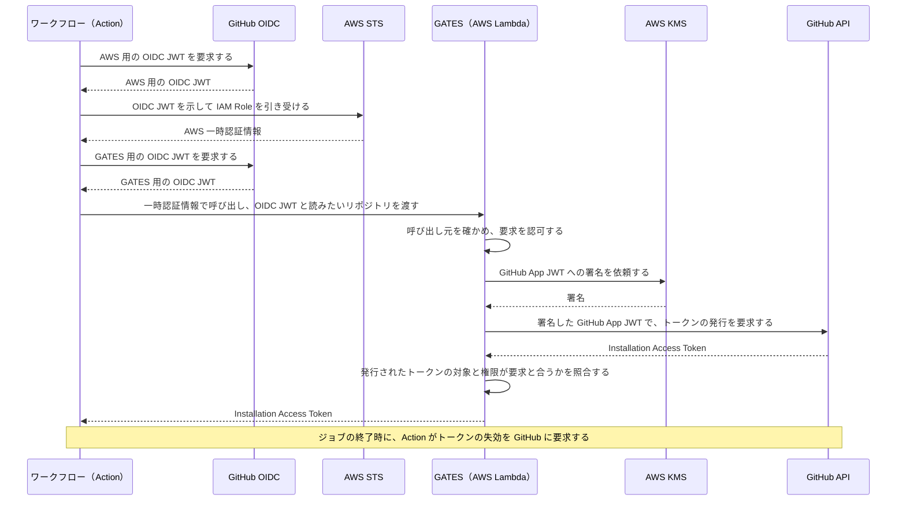

# GATES Overview

GATES（GitHub App Token Exchange System）は、GitHub Actions のワークフローに、GitHub App Private Key を渡さずに、指定したリポジトリだけを対象にした読み取り用のトークンを発行する仕組みです。
秘密鍵は **GATES 運用者**（GATES を AWS にデプロイして運用する人。以下、運用者）の AWS アカウントの中に置いたまま使い、ワークフローは短命なトークンだけを受け取ります。

## 1. 解決する問題

GitHub Actions がジョブごとに用意する `GITHUB_TOKEN` は、ワークフローを実行しているリポジトリにしか権限を持ちません。
共通の設定を置いたリポジトリや依存するライブラリのような、別の非公開リポジトリを読むには、別の資格情報が要ります。

その資格情報として、次の 2 つがよく使われます。

- **個人アクセストークンを Secrets に置く**：トークンは発行した個人のアカウントに紐づき、その人が Organization から外れるとワークフローが動かなくなる。必要より広い権限と長い有効期限で発行されることも多く、漏えいしたときの被害が大きい
- **GitHub App Private Key を Secrets に置く**：秘密鍵を手に入れた人は、その鍵が GitHub App から削除されるまで、GitHub App のすべての権限を使える。鍵を置いたワークフローの数だけ、漏えいの経路と、鍵を更新するときの作業が増える

GATES は、この 2 つを置き換えます。
ワークフローは、読みたいリポジトリを GATES に伝え、そのリポジトリだけを対象にした GitHub App のトークン（**Installation Access Token**）を受け取ります。
ワークフローの側には、個人アクセストークンも秘密鍵も置きません。

## 2. 仕組み

GATES の中心は、運用者の AWS アカウントで動く AWS Lambda の関数と、GitHub App Private Key を保管する AWS KMS の鍵（KMS Key）です。
ワークフローは、GATES の Docker Action（以下、Action）のステップを置き、トークンを受け取ります。

ワークフローは、自分の身元を **OIDC JWT**（ワークフローがどのオーナーのどのリポジトリで動いているかを GitHub が署名して示すトークン）で示します。
OIDC JWT は実行のたびに GitHub から受け取るため、ワークフローの側に長期の資格情報を置く必要はありません。
OIDC JWT は渡す相手ごとに別に受け取り、Action は AWS 用と GATES 用を使い分けます。
AWS STS は、AWS 用の OIDC JWT を確かめて、GATES の呼び出しだけを許された IAM Role の一時認証情報を返します。
この IAM Role を引き受けられるのは、**許可オーナー**（GATES がトークンを発行してよいと運用者が設定した GitHub の Organization かユーザーアカウント）のワークフローだけです。
GATES の Lambda は認証なしでインターネットに公開された呼び出し口を持たず、この一時認証情報による呼び出しだけを受け付けます。

Lambda は、GATES 用の OIDC JWT の署名と内容を確かめて呼び出し元を特定し、要求を認可します。
GitHub のオーナー名とリポジトリ名は変更でき、手放された名前は別の人が取得できます。
GATES は呼び出し元を名前ではなく変わらない ID（**不変 Owner ID**）で確かめるため、改名やアカウントの作り直しによって、許可オーナーになりすますことはできません。

GitHub にトークンを発行させるには、GitHub App Private Key で署名した GitHub App JWT が要ります。
秘密鍵は運用者の AWS アカウントの KMS にインポートしてあり、署名は KMS の中で行われます。
Lambda は KMS に署名を依頼できるだけで、秘密鍵そのものを読めません。
GitHub が発行したトークンの対象と権限が要求と合わなければ、Lambda はトークンをワークフローに返さず、失効を試みます。

Lambda は要求ごとに、呼び出し元（確かめられた場合）、要求したリポジトリ、結果を、トークンを含めずに監査記録として CloudWatch Logs に残します。
GATES が返す成功と失敗の応答には、監査記録と突き合わせるための `request_id` が付きます。

構成要素と処理の流れの詳細は [System Architecture](../design/architecture.md) にあります。

## 3. 発行されるトークン

Installation Access Token は、要求で列挙したリポジトリだけを対象にします。
GATES が要求する権限はリポジトリの内容を読む `contents:read` だけで、GitHub がリポジトリの基本情報を読む `metadata:read` を自動で加えることがあります。

有効期限は発行から 1 時間で、GitHub が決め、GATES は延長しません。
トークンは同じジョブの後続ステップで使います。
Action が出力したトークンは、ジョブの `outputs` を通してほかのジョブに渡すことはできません。
ジョブの終了時には、後続のステップが失敗した場合やジョブがキャンセルされた場合も含めて、Action が失効を試みます。
Action がトークンを受け取った後、後続のステップに渡す前に失敗した場合は、その時点で失効を試みます。
失効は確実ではなく、失効に失敗してもジョブは失敗しません。
失効できなかったトークンも、有効期限を過ぎれば使えなくなります。

要求したリポジトリのうち一つでも許可されないものがあれば、GATES はどのリポジトリのトークンも返しません。

要求と発行の規則は [Requirements](../spec/requirements.md) の FR-AUTHZ-003、FR-AUTHZ-006、FR-AUTHZ-007、FR-ISSUANCE-002、FR-ISSUANCE-003、FR-ISSUANCE-007 に、有効期限を含む GitHub の仕様は [GitHub Constraints](../spec/github-constraints.md) の §6 に、Action の入出力は [Issue Token](../../.github/actions/issue-token/README.md) にあります。

## 4. 現在の範囲と制約

導入を判断するうえで最も重い制約は、認可の単位です。
GATES は、呼び出し元を許可オーナー単位でしか区別しません。
許可オーナーのワークフローであれば、どのワークフローも、GitHub App の **インストール対象**（GitHub App をオーナーにインストールするときに選ぶ、GitHub App がアクセスできるリポジトリ）に含まれるどのリポジトリでも読めます。
このため、読める範囲を決めるのは GitHub App のインストール対象であり、機密性の高いリポジトリをインストール対象に含めると、許可オーナーのすべてのワークフローから読めるようになります。
呼び出し元ごとの細粒度の認可は将来取り込む候補ですが、時期は決まっていません。
現在の制約のままで使えるかを基準に、導入を判断する必要があります。
この制約のもとで残るリスクと、利用者の側で守る必要があるものは [Security Considerations](security-considerations.md) にあります。

そのほかの制約は次のとおりです。

- **許可オーナーは一つ**：一つの GATES がトークンを発行するのは、デプロイ時に設定した一つのオーナーのワークフローに対してだけで、対象もそのオーナーのリポジトリに限る。GitHub App の **Installation**（GitHub App をオーナーにインストールした単位）も、そのオーナーへの一つだけを使う。複数のオーナーや Installation を扱う予定はない
- **権限は `contents:read` だけ**：書き込みや、Issue と Pull Request の操作には使えない。ほかの権限は将来取り込む候補だが、時期は決まっていない
- **GitHub.com だけ**：GitHub Enterprise Server のような GitHub.com 以外の GitHub には対応せず、対応する予定もない
- **GitHub Actions だけ**：GitHub Actions 以外の実行環境やクライアントには発行しない
- **OIDC JWT の `sub` の形式**：呼び出し元のリポジトリの OIDC JWT は、呼び出し元を示す値 `sub` が、`repo:<オーナー名>@<Owner ID>/<リポジトリ名>@<Repository ID>:...` のように不変の ID を含む形式でなければならない。新しく作るリポジトリは既定でこの形式になるが、古いリポジトリは、Organization かリポジトリの設定（REST API では `use_immutable_subject`）で切り替える必要がある。`sub` の形式をカスタマイズして先頭がこの形式でなくなったリポジトリも受け付けない
- **Runner**：Linux で Docker を使える Runner が要る。GitHub がホストする `ubuntu-latest` はこれを満たす。セルフホストの Runner では、Docker Hub、`proxy.golang.org`、OIDC JWT の取得先、AWS STS と Lambda の API、`api.github.com` への通信を許可し、Docker Hub の取得回数の制限に備えて認証かミラーを用意する（[GitHub Actions Design](../design/github-actions.md) の Runner Requirements）
- **実環境で確かめた構成**：GATES の検証環境で動作を確かめたのは、ユーザーアカウントを許可オーナーにした構成だけで、Organization を許可オーナーにした構成は確かめていない

現在の範囲と対象外とする範囲は [Scope](../spec/scope.md) に、`sub` の形式は [GitHub Constraints](../spec/github-constraints.md) の §3 に、目的の境界は [Constitution](../CONSTITUTION.md) の Non-Goals にあります。

## 5. 役割と責任

GATES は、次の 3 つの役割がそれぞれの責任を果たすことを前提に動きます。

| 役割 | 担うこと |
|---|---|
| **GATES 運用者** | GATES を AWS にデプロイし、許可オーナー、GitHub App、署名に使う KMS Key を設定する。GitHub App Private Key を KMS にインポートし、更新する。IAM Role を引き受けられるワークフローの条件を管理する。ワークフロー利用者が使う Action を提供し、**接続情報**（Action が GATES を呼び出すのに使う値）を GitHub の Secrets と Variables に登録する。許可オーナーの名前が変わったら、IAM Role の条件と GATES の設定を更新する（更新するまで発行は止まる） |
| **ワークフロー利用者** | Action を呼び出すジョブで `permissions` に `id-token: write` を宣言し、Action に読みたいリポジトリ、権限、接続情報を渡す。トークンを受け取るジョブで、Pull Request のコードのような信頼できないコードを実行しない。受け取ったトークンを、ほかのジョブ、成果物、ログに渡さない。セルフホストの Runner を使うなら、Action が必要とする実行環境と通信先を用意する |
| **GitHub App とオーナーの管理者** | GitHub App のインストール対象に、許可オーナーのどのワークフローから読まれてもよいリポジトリだけを含める。許可オーナーが Organization なら、リポジトリ管理者が自分のリポジトリをインストール対象に加えられる既定の設定を制限し、`installation_repositories:write` を与える相手を管理する。オーナーのリポジトリの OIDC JWT が不変の ID を含むように設定する。鍵の更新の後に、古い Private Key を GitHub App から削除して失効させる |

ユーザーアカウントを許可オーナーにする構成では、同じ人が 3 つの役割を兼ねることが多くなります。
GitHub 側の設定（GitHub App のインストール対象と権限、古い Private Key の削除）は、表の各役割が GitHub で行い、GATES は代行しません。

役割ごとの責任は [Requirements](../spec/requirements.md) の §2 に、Organization の許可オーナーに求める設定は [Security Design](../design/security.md) の §3.2 に、許可オーナーの名前が変わったときの扱いは [AWS Infrastructure Design](../design/aws-infrastructure.md) の §3.1 にあります。

## 6. 運用者が用意するもの

### 6.1 AWS

- **AWS アカウント**：GATES は、このアカウントに Lambda の関数、KMS Key、IAM Role、CloudWatch Logs のロググループなどを作る
- **Terraform の適用（apply）の権限**：IAM Role とポリシー、KMS Key と Key Policy、Lambda の関数、CloudWatch Logs のロググループを作成し、変更できる権限
- **鍵素材のインポートの権限**：**鍵素材**（KMS Key にインポートする GitHub App Private Key の中身）を KMS Key にインポートする権限。Terraform の適用とは別の運用として行う
- **運用者の一時認証情報**：Terraform の適用と鍵素材のインポートは、セッショントークンを含む AWS の一時認証情報でだけ動く
- **IAM OIDC Provider**：AWS STS が GitHub の OIDC JWT を信頼するための設定で、`https://token.actions.githubusercontent.com` を指し、Client ID に `sts.amazonaws.com` を含むもの。この URL を指す Provider はアカウントに一つだけ置ける共有のリソースのため、GATES の Terraform は作らず、アカウントにあるものを参照する。なければ運用者が先に作る

### 6.2 GitHub

- **GitHub App**：Repository permissions の `Contents` を `Read-only` にし、許可オーナーにインストールしたもの。GATES は GitHub App の Client ID を設定に持つ
- **接続情報を登録する権限**：許可オーナーが Organization なら Organization の、ユーザーアカウントなら GATES を呼び出す各リポジトリの Secrets と Variables を登録できる権限。Organization でも、GitHub Free の private リポジトリと、ポリシーで Organization の値の参照を制限したリポジトリには、個別に登録する

### 6.3 手元のツール

| ツール | 使う場面 |
|---|---|
| Git | GATES のリポジトリを取得し、リリースのタグが指すコミットを調べる |
| `make` | デプロイと鍵素材のインポートの各操作を実行する |
| Docker（Docker Compose を含む） | Terraform をコンテナの中で実行する |
| Go | Lambda のデプロイパッケージを手元でビルドする |
| `zip`、`shasum` | デプロイパッケージを作り、Plan と適用のあいだでパッケージが変わっていないことを確かめる。GitHub Releases に置いた Lambda の zip（配布物）のチェックサムを照合する |
| AWS CLI、`jq`、`xxd`、OpenSSL 3 以降 | 鍵素材を KMS にインポートし、鍵を更新する。macOS に標準で入っている LibreSSL では動かない |
| AWS CLI、OpenSSL | デプロイした Lambda の関数のコードを、zip の SHA-256 と照合する |
| GitHub CLI | 接続情報を登録し、配布物の来歴を検証する |

### 6.4 費用が発生するリソース

GATES を動かすと、運用者の AWS アカウントで次のリソースに費用が発生します。

| リソース | 課金の単位 |
|---|---|
| AWS Lambda | 呼び出しの回数と、実行時間とメモリ量の積（GB 秒）。トークンの要求 1 回につき、関数を 1 回呼び出す |
| AWS KMS | KMS Key ごとの月額（時間単位で按分）と、署名の要求の回数。GitHub App Private Key の更新のあいだは KMS Key が 2 つになる |
| Amazon CloudWatch Logs | ログの取り込み量と保存量。ログの保持期間は Terraform の入力で決め、既定は 7 日 |

金額は、リージョンと時期によって変わるため、AWS の料金ページで確かめてください。

- [AWS Lambda の料金](https://aws.amazon.com/lambda/pricing/)
- [AWS KMS の料金](https://aws.amazon.com/kms/pricing/)
- [Amazon CloudWatch の料金](https://aws.amazon.com/cloudwatch/pricing/)

作成する AWS リソースの構成は [AWS Infrastructure Design](../design/aws-infrastructure.md) の §2 にあります。
