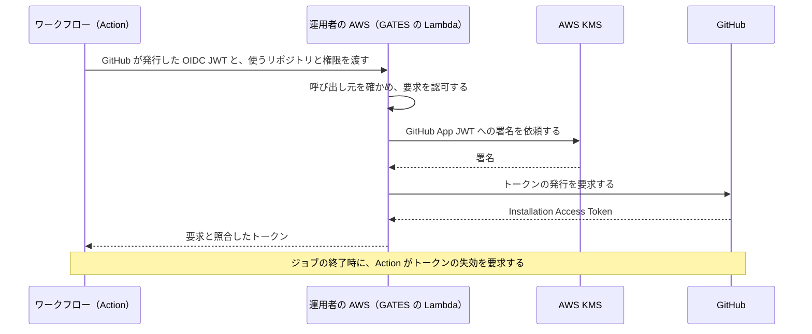

# GATES Overview

GATES の導入を検討している人に向けて、GATES で得られるもの、仕組み、導入の前に知っておく制約、必要な準備を示します。
ユーザーガイドの各文書で使う用語の説明も、本文書にまとめています。

## 1. GATES で得られるもの

GATES（GitHub App Token Exchange System）は、GitHub Actions のワークフローに、指定したリポジトリを指定した権限でだけ操作できる短命なトークンを発行する仕組みです。

ワークフローで別のリポジトリを読んだり書き換えたりするには、ジョブごとの `GITHUB_TOKEN` とは別の資格情報が要ります。
よく使われるのは次の 2 つですが、どちらにも弱点があります。

- **パーソナルアクセストークンを Secrets に置く**：個人のアカウントに紐づき、その人が組織を離れると動かなくなる。権限が広く、期限も長くなりがちである
- **GitHub App Private Key を Secrets に置く**：鍵を手に入れた人は、GitHub App のすべての権限を使える。鍵を置くワークフローの数だけ漏えいの経路が増える

GATES を使うと、ワークフローにはどちらの資格情報も置かずに済みます。
ワークフローは使うリポジトリと権限を GATES に伝え、そのリポジトリと権限だけの 1 時間のトークンを受け取ります。
GitHub App Private Key は運用者の AWS アカウントの KMS から出ません。

## 2. 仕組み

ワークフローは GATES の Action のステップを一つ置くだけで、トークンを受け取れます。

リポジトリポリシーを適用するデプロイでは、GATES は要求を認可するときに、要求されたリポジトリごとにリポジトリポリシーを GitHub から読みます。
読むために GATES が取得するトークンは、GATES の外に出さず、読み終えたら失効を試みます。

ワークフローの身元は、GitHub が実行のたびに発行する OIDC JWT で確かめます。
GATES は呼び出し元を名前ではなく不変 Owner ID で照合するため、改名や手放された名前の取得によって、許可オーナーになりすますことはできません。
GATES の Lambda はインターネットに公開された呼び出し口を持たず、許可オーナーのワークフローだけが AWS の IAM Role を通して呼び出せます。

## 3. 発行されるトークン

- **対象**：要求で列挙したリポジトリだけ。リポジトリポリシーを適用するデプロイでは、1 回の要求で 10 件まで
- **権限**：要求で列挙した権限だけ。要求できるのは、Repository permissions のうち、GitHub App に付与され、発行上限が許す権限である。保護対象への要求では、保護対象の一覧の許可 Caller の権限の上限も許す必要がある。リポジトリポリシーを適用するデプロイでは、要求したリポジトリごとに、そのリポジトリポリシーの許可 Caller の権限の上限も許す必要がある。GitHub がリポジトリの基本情報を読む `metadata:read` を加えることがある
- **期限**：発行から 1 時間。GATES は延長しない
- **使える範囲**：Action を置いたジョブの後続のステップだけ。ほかのジョブには渡せない
- **失効**：ジョブの終了時に、Action が失効を試みる。失効に失敗しても、期限を過ぎれば使えなくなる
- **一部だけの発行はしない**：要求したリポジトリと権限のうち一つでも許可されなければ、トークンを返さない

## 4. 導入の前に知っておく制約

### 4.1 どのワークフローが何をできるかは、リポジトリポリシーの適用で大きく変わる

導入の判断で最も重い制約です。
運用者は、リポジトリポリシーを適用するかしないかを、デプロイごとに決めます。

**リポジトリポリシーを適用しないデプロイでは、インストール対象に含め、保護対象にしていないリポジトリは、許可オーナーのすべてのワークフローから、GitHub App に付与し発行上限が許す権限で操作できるようになります。**
GATES は、それらのリポジトリへの要求では、Caller を許可オーナー単位でしか区別しないためです。
新しく作ったリポジトリも、インストール対象に加えれば、保護対象の一覧に加えるまで同じです。
書き込みの権限を含めれば、どのワークフローもこれらのリポジトリを書き換えられ、その変更はトークンの期限が過ぎても残ります。

リポジトリポリシーを適用するデプロイでは、すべてのリポジトリへの要求に、そのリポジトリのリポジトリポリシーの許可が要ります。
インストール対象に加えただけでは操作されず、リポジトリの管理者が許可 Caller を書いて初めて要求できるようになります。

保護対象の一覧とリポジトリポリシーは、どちらも許可 Caller と権限の上限を書きますが、決める人と効く範囲が違います。
両方が当たるリポジトリへの要求は、両方が許すときだけ通り、どちらかが他方を上書きすることはありません。

| | 保護対象の一覧 | リポジトリポリシー |
|---|---|---|
| 決める人 | 運用者 | リポジトリの管理者 |
| 置き場所 | GATES の設定（Terraform の変数） | そのリポジトリの既定ブランチの `.github/gates-policy.yml` |
| 効く範囲 | 一覧に書いたリポジトリ | 適用するデプロイの、すべてのリポジトリ |
| 変更の経路 | Terraform のレビューと Plan | リポジトリへの書き込み |

リポジトリポリシーは、そのリポジトリの既定ブランチに書き込める人ならだれでも変えられます。
`contents:write` か `administration:write` を許した Caller は、トークンでリポジトリポリシーを書き換えて自分にほかの権限を許せます。
こうした書き換えでも越えられない上限が要るリポジトリは、運用者が保護対象にします。

保護対象の一覧でもリポジトリポリシーでも、GATES は Caller をリポジトリ単位で見分け、ブランチ、イベント、ワークフローは見分けません。
そのため、許可 Caller のリポジトリでワークフローを動かせる人は、その許可 Caller に許した範囲を使えます。
チームやブランチの単位での認可は将来の候補ですが、時期は決まっていません。
この制約のままで使えるかを基準に、導入を判断してください。
利用者の側で守ることは [Security Considerations](security-considerations.md) にあります。

### 4.2 そのほかの制約

- **GitHub.com の GitHub Actions だけ**：GitHub Enterprise Server や、GitHub Actions 以外の実行環境には対応しない
- **権限は Repository permissions だけ**：Organization permissions、Account permissions、Enterprise permissions は発行しない
- **Runner は Linux で Docker を使えるもの**：GitHub がホストする `ubuntu-latest` はこれを満たす
- **リポジトリの OIDC JWT は不変の ID を含む形式に限る**：古いリポジトリは、リポジトリか Organization の設定で切り替える

## 5. 役割と責任

GATES は、次の役割がそれぞれの責任を果たすことを前提に動きます。
リポジトリの管理者は、リポジトリポリシーを適用するデプロイにだけ現れます。

| 役割 | 担うこと |
|---|---|
| **GATES 運用者**（以下、運用者） | GATES を AWS にデプロイして運用する。リポジトリポリシーを適用するかどうか、発行上限、保護対象の一覧を決め、リポジトリの改名に合わせて一覧を直す。リポジトリポリシーの適用に切り替える前に、リポジトリの管理者に周知する。GitHub App Private Key を KMS にインポートし、更新する。接続情報を GitHub に登録し、ワークフロー利用者に Action の参照先を伝える |
| **ワークフロー利用者** | GATES からトークンを受け取るワークフローを書き、ジョブに必要な権限だけを要求する。トークンを受け取るジョブで、信頼できないコードを動かさない |
| **GitHub App とオーナーの管理者** | GitHub App に付与する権限とインストール対象を管理する。リポジトリポリシーを適用しないデプロイでは、保護対象にしないリポジトリを、許可オーナーのどのワークフローから操作されてもよいものだけにする。適用するデプロイでは、`Single file` を `Read-only` で、`.github/gates-policy.yml` のパスだけで付与する。リポジトリの OIDC JWT の形式を設定する |
| **リポジトリの管理者** | GATES のトークンで操作されるリポジトリに、リポジトリポリシーを置く。許可 Caller と権限の上限を必要なものに限り、Caller のリポジトリの改名と作り直しのたびに直す。既定ブランチに書き込める人を絞る |

## 6. 用語

ユーザーガイドの各文書は、次の用語を説明なしで使います。

- **許可オーナー**：GATES がトークンを発行してよいと運用者が設定した GitHub のユーザーアカウントか Organization
- **不変 Owner ID**：GitHub がアカウントに割り当てる数値の ID。名前を変えても変わらない
- **インストール対象**：GitHub App を許可オーナーにインストールするときに選ぶリポジトリ。GATES のトークンで操作できるリポジトリは、この中に限られる
- **発行上限**：運用者が GATES のデプロイで決める、発行してよい権限名と水準の一覧。GitHub App に付与した権限のうち、発行上限が許すものだけを GATES は発行する。水準は `read`、`write`、`admin` の順に高く、高い水準は同じ権限名の低い水準の要求も許す（`contents:write` は `contents:read` の要求を許す）。発行するのは要求した水準である
- **Caller**：GATES にトークンを要求した呼び出し元。GATES は OIDC JWT で、ワークフローを動かしたリポジトリ（Caller のリポジトリ）のオーナー、Repository ID、名前を確かめる
- **Repository ID**：GitHub がリポジトリに割り当てる数値の ID。名前を変えても変わらず、削除して同じ名前で作り直したリポジトリは別の値になる
- **保護対象**：要求できる Caller と権限を限るリポジトリ。運用者が Repository ID と名前で保護対象の一覧に書く
- **許可 Caller**：保護対象の一覧（保護対象ごと）か、リポジトリポリシーに書く、そのリポジトリを要求してよい Caller のリポジトリと、権限の上限の組。Caller のリポジトリの Repository ID と名前が、両方とも許可 Caller のものと一致するときだけ、その Caller は許可 Caller に当たる
- **権限の上限**：許可 Caller ごとに書く、そのリポジトリに要求してよい権限名と水準。発行上限と同じく、高い水準は低い水準の要求も許す
- **保護対象の一覧**：保護対象と許可 Caller を書いた GATES の設定。運用者が Terraform の変数で決める
- **リポジトリポリシー**：トークンで操作されるリポジトリが、自分を要求してよい許可 Caller を書くファイル。そのリポジトリの既定ブランチの `.github/gates-policy.yml` に置く
- **リポジトリポリシーの適用**：GATES がリポジトリポリシーで認可するかどうかの設定。運用者が Terraform の変数で決める。適用するデプロイでは、リポジトリポリシーのないリポジトリにはどの Caller にも発行しない
- **リポジトリの管理者**：トークンで操作されるリポジトリの既定ブランチに書き込め、そのリポジトリポリシーを決める人
- **Installation**：GitHub App をオーナーにインストールした単位
- **トークン**：GATES が受け取って渡す、GitHub App の Installation Access Token
- **Action**：ワークフローがトークンを受け取るために置く、GATES の Docker Action
- **OIDC JWT**：ワークフローがどのオーナーのどのリポジトリで動いているかを、GitHub が署名して示すトークン
- **Audience**：OIDC JWT の宛先を示す値。GATES は、運用者が設定した値の OIDC JWT だけを受け付ける
- **接続情報**：Action が GATES を呼び出すのに使う値（AWS アカウント ID、IAM Role 名、関数名、リージョン、Audience）。運用者が GitHub の Secrets と Variables に登録する
- **監査記録**：GATES が要求ごとに、呼び出し元、要求、結果を、トークンを含めずに CloudWatch Logs に残す 1 行の JSON。応答と注釈に出る `request_id` で探せる
- **鍵素材**：KMS Key にインポートする GitHub App Private Key の中身。インポートした後は、別の鍵素材に入れ替えられない
- **使用中の鍵**：GATES の Lambda が署名に使う KMS Key
- **鍵の更新**：新しい KMS Key に新しい GitHub App Private Key をインポートし、使用中の鍵を切り替える作業
- **配布物**：GitHub Releases に置く、GATES の Lambda の関数のコードの zip
- **Attestation**：配布物をどのリポジトリのどのコミットから、どのワークフローでビルドしたかを示す、署名付きの記録

## 7. 運用者が用意するもの

- **AWS アカウント**：Lambda の関数、KMS Key、IAM Role、CloudWatch Logs のロググループを作る。作業には、セッショントークンを含む一時認証情報を使う
- **IAM OIDC Provider**：AWS が GitHub Actions の OIDC JWT を信頼するための、アカウントに一つだけ置く設定。なければ作る
- **GitHub App**：許可オーナーのワークフローが必要とする Repository permissions だけを付与して、許可オーナーにインストールする
- **発行上限**：GitHub App に付与した権限のうち、ワークフローが要求する権限名と、要求する最も高い水準を、Terraform の変数で決める
- **保護対象の一覧**：保護対象と許可 Caller を、Repository ID と名前で Terraform の変数に書く。保護対象を置かないときも、空の一覧を書く
- **リポジトリポリシーの適用**：適用するかしないかを、Terraform の変数で明示する。適用するなら、GitHub App に `Single file` の権限を加え、インストール対象の各リポジトリにリポジトリポリシーを置いてもらう
- **手元のツール**：Git、`make`、Docker（Docker Compose を含む）、Go、`zip`、`shasum`、AWS CLI、`jq`、`xxd`、OpenSSL 3 以降、GitHub CLI

運用者の AWS アカウントでは、次のリソースに費用が発生します。
金額はリージョンと時期で変わるため、各サービスの料金ページで確かめてください。

| リソース | 課金の単位 |
|---|---|
| [AWS Lambda](https://aws.amazon.com/lambda/pricing/) | 呼び出しの回数と実行時間。トークンの要求 1 回につき 1 回呼び出す。リポジトリポリシーを適用するデプロイでは、要求したリポジトリの数だけ GitHub からファイルを読むため、実行時間が延びる |
| [AWS KMS](https://aws.amazon.com/kms/pricing/) | KMS Key ごとの月額と、署名の回数。鍵の更新のあいだは KMS Key が 2 つになる |
| [Amazon CloudWatch Logs](https://aws.amazon.com/cloudwatch/pricing/) | ログの取り込み量と保存量。保持期間の既定は 7 日 |

## 8. さらに知りたい人へ

- [Constitution](../CONSTITUTION.md)：GATES の存在理由と、設計上の判断原則
- [Scope](../spec/scope.md)：現在の範囲、将来の候補、対象外とする範囲
- [System Architecture](../design/architecture.md)：コンポーネントと処理の流れ
- [AWS Infrastructure Design](../design/aws-infrastructure.md)：作成する AWS リソースの構成
