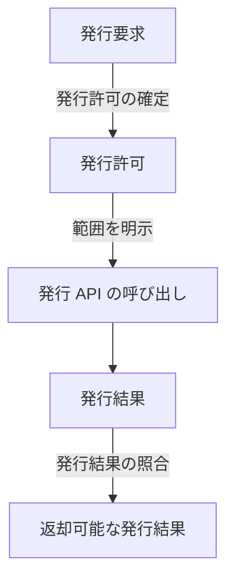
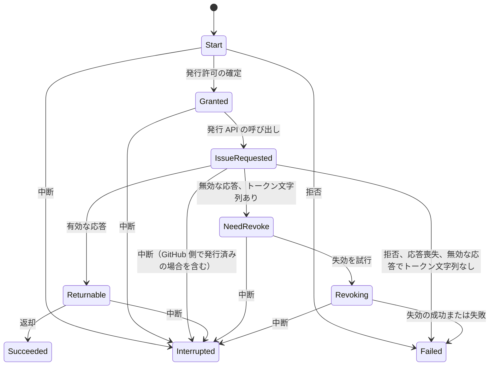

# Formal Models

このディレクトリには、GATES の認可と発行処理の抽象モデルを [Alloy](https://alloytools.org/) で記述しています。
Alloy を読めなくても、何を確かめていて何を確かめていないかを、この文書で把握できます。

仕様の正本は [Requirements](../docs/spec/requirements.md) と `docs/design/` の設計文書です。
モデルと仕様が食い違ったら、どちらが正しいかを検討し、仕様を変える場合は正本を先に直します。
モデルの概念の名前は [Domain Model](../docs/design/domain.md) の英語名に揃えます。

## Alloy が確かめる範囲

Alloy は、指定した大きさの範囲で、モデルの規則を満たす状態をすべて調べます。
範囲内で調べ尽くすので、手で選んだ入力だけを試すテストでは通らない組み合わせも対象になります。

モデルには、目的の異なる 2 種類のコマンドがあります。

- **`check`**：主張に反する状態（反例）を探す。判定の UNSAT は反例なし、SAT は反例ありを表す
- **`run`**：条件を満たす状態（充足例）を探す。モデルの規則が厳しすぎて何も成立しない状態になっていないことや、起こりうる事象が実際に表現できていることを確かめる。判定の SAT は充足例あり、UNSAT は充足例なしを表す

反例が見つからないことは、指定した範囲で反例がないことだけを意味します。
範囲を超える場合の正しさは証明していません。

## 認可のモデル（authorization.als）

このモデルは、発行要求から返却までの各段階で、受け渡す内容が規則を満たすかを確かめます。
時間の経過は扱わず、各段階の内容の関係だけを調べます。



調べる範囲は、各要素が最大 3 個、Owner とオーナー名が最大 2 個です。
権限は `contents:read`、`metadata:read`、`contents:write` と、未知の権限 1 種を調べます。

### 反例がないことを確かめる規則

要件の列は、主に対応する要件を示します。

| コマンド | 確かめること | 要件 |
|---|---|---|
| `NoForeignOwnerGrant` | 許可オーナー以外の Caller に発行許可を作らない | FR-006 |
| `NoOtherInstallationGrant` | 発行許可の Installation はどれも同じで、許可オーナーのものであり、停止していない | FR-024 |
| `OnlyCurrentPermissionGranted` | 発行許可の権限は `contents:read` だけである | FR-008, FR-012 |
| `AllOrNothingGrant` | 発行許可の対象は要求した対象の全件と一致し、一部だけにならない | FR-011 |
| `AllIssueCallsExplicit` | 発行 API の呼び出しは、要求された対象と `contents:read` を明示する | FR-015 |
| `NoOverbroadTokenReturned` | 返却可能な発行結果の権限は `contents:read` と任意の `metadata:read` だけで、対象は `selected` である | FR-008, FR-018 |
| `ExactNamesReturned` | 返却可能な発行結果の対象の完全名と件数は、要求と一致する | FR-010, FR-018 |
| `NoDuplicateEffectiveRepositoriesReturned` | 返却可能な発行結果の実効対象に、同じ Repository ID や同じ完全名の要素はない | FR-018 |
| `ReturnedReposOwnedByAllowedOwner` | 返却可能な発行結果の対象は、すべて許可オーナーのものである | FR-010, FR-018 |
| `CoverageHoldsWhenGitHubEnforces` | GitHub が Installation の対象を強制するなら、要求した名前はすべて、その Installation に含まれる許可オーナーのリポジトリである | FR-007 |
| `ReturnedResultsHaveValidTokenAndExpiry` | 返却可能な発行結果のトークンは空でなく、有効期限は将来である | FR-016 |

表の「返却可能な発行結果」の権限と対象は GitHub の応答が示す値を指し、実際のトークンの権限を GitHub に問い合わせて確かめたものではありません。

これらの多くは、モデルに書いた規則から直接導かれる主張です。
UNSAT で分かるのは、規則を満たす範囲に主張の反例がないことです。
規則が矛盾していても UNSAT になるため、規則が成立しうることは `SuccessfulReturn` などの `run` で別に確かめます。

### 照合の規則が必要なことを確かめる変種

発行結果の照合のうち、Owner ID、完全名、権限、件数の 4 つの規則を 1 つずつ外すと、対応する主張に反例が出ることを確かめます。
その他の照合の規則（トークンの有無、有効期限など）の必要性は確かめていません。
これらのコマンドでは、反例が出るのが正しい結果です。
実際の GATES の設定を表すものではありません。

| コマンド | 外す規則 | 出ることを期待する反例 |
|---|---|---|
| `WithoutOwnerCheckPreservesOwnerBoundary` | 実効対象の Owner ID の照合 | 許可オーナー以外のリポジトリを含むトークンを返却する |
| `WithoutNameCheckPreservesExactNames` | 実効対象の完全名の照合 | 対象の完全名の集合が要求と一致しないトークンを返却する |
| `WithoutPermissionCheckPreservesPermissionBoundary` | 実効権限の照合 | 許可していない権限を含むトークンを返却する |
| `WithoutCountCheckPreservesUniqueEffectiveRepositories` | 実効対象の件数の照合 | 実効対象に重複した要素を含むトークンを返却する |

### 存在することを確かめる状態

| コマンド | 確かめること |
|---|---|
| `SuccessfulReturn` | 正常な発行と返却が成立する |
| `CrossRepositoryWithinOwner` | 同じオーナー内なら、実行元とは別の名前のリポジトリを対象にしたトークンを返却できる。現在のスコープで意図した動作である |
| `IssueCallMayContainUncoveredNames` | Installation の対象外の名前を発行 API に送る場合がある。発行前には対象に含まれるかを確認しないためである |
| `CoverageNotIndependentlyProved` | 発行結果の照合を通っても、返却する対象が Installation の対象に含まれることまでは GATES だけで示せない |
| `InvalidResultCanExist` | `contents:write` を含む発行結果を受け取る状態を表現できる。そのような発行結果を返却しないことは `NoOverbroadTokenReturned` が確かめる |

## 発行処理のモデル（issuance-temporal.als）

このモデルは、発行処理の順序と、失敗や中断が起きたときの状態を確かめます。
1 回の Lambda 呼び出し（Invocation）を 1 回の発行処理として、最初の呼び出しと再試行の 2 つを扱います。

各呼び出しは次のように状態を移ります。
再試行は開始条件を満たすまで待機し、必ず起きるとは限りません。
開始できるのは、最初の呼び出しが処理の途中のとき、失敗か中断で終わったとき、または成功しても呼び出し元に結果が届いていないときです。



調べる範囲は、最大 14 ステップの実行です。
遷移は 2 つの呼び出しを合わせて最大 11 回で終わるため、このモデルの実行はすべてこの範囲に収まります。

### 順序の安全性を確かめる規則

| コマンド | 確かめること | 要件 |
|---|---|---|
| `NoUnverifiedReturn` | 返却したなら、発行許可の確定、発行 API の呼び出し、トークン文字列の取得、発行結果の照合を経ている | QR-003, FR-018 |
| `NoIssueBeforeExplicitGrant` | GitHub 側で発行されたなら、発行許可の確定と発行 API の呼び出しを経ている | QR-007 |
| `NoReturnAfterLostResponse` | 応答を喪失した呼び出しは、トークンを返却しない | QR-003, AC-30 |
| `NoRevokeWithoutKnownToken` | 失効を試みたなら、トークン文字列を取得している | AC-30 |
| `NoFailureWithoutRevokeAttempt` | 照合に失敗したトークン文字列を取得した呼び出しが失敗で終わるなら、失効を試みている | FR-007, FR-018, AC-12 |
| `NoConfirmedRevocationWithoutAttempt` | 失効の成功を確認したなら、失効を試みている | FR-018 |
| `NoInterruptedInvocationReturns` | 中断した呼び出しは、トークンを返却していない | QR-003 |
| `NoObservedSuccessWithoutReturn` | 呼び出し元が成功を受け取ったなら、その呼び出しは返却まで成功している | なし（モデル内の整合性） |

### 起こりうることを確かめる状態

`SuccessfulIssueWitness`、`ObservedSuccessWitness`、`RevocationConfirmedWitness` は、対応する遷移が実行できることを確かめます。
これらがないと、遷移が実行できなくなっても順序の安全性の規則は UNSAT のまま通ります。
残りは、GATES が防がない事象を表します。
SAT は、モデル上でその事象が起こりうることを意味し、GitHub や AWS で実測した結果ではありません。

| コマンド | 起こりうること |
|---|---|
| `SuccessfulIssueWitness` | 正常に発行して返却する |
| `ObservedSuccessWitness` | 返却した成功を呼び出し元が受け取る |
| `RevocationConfirmedWitness` | 失効を試みて、成功を確認する |
| `ResponseLossOrphanWitness` | GitHub 側で発行されたが、応答を喪失してトークン文字列を取得できない |
| `RevokeFailureWitness` | 失効を試みたが、成功を確認できない |
| `InterruptedBeforeRevokeWitness` | 無効な応答からトークン文字列を取得したが、失効を試みる前に中断する |
| `DuplicateIssueAfterRetryWitness` | 最初の呼び出しが応答を喪失し、再試行でも GitHub 側で発行されて、発行が重複する（両者の順序は問わない） |
| `InvalidWithoutTokenIssuedWitness` | トークン文字列のない無効な応答を受け取り、GitHub 側では発行されている |
| `InvalidWithoutTokenNotIssuedWitness` | トークン文字列のない無効な応答を受け取り、GitHub 側では発行されていない |
| `RetryAfterUnobservedSuccessWitness` | 成功が呼び出し元に届かないまま再試行し、2 つ目のトークンが発行される |
| `ConcurrentRetryDuplicateIssueWitness` | 最初の呼び出しが発行 API を呼び出している途中で再試行が始まり、両方で発行される |
| `RetryCallsBeforeOriginalWitness` | 最初の呼び出しが発行 API を呼び出す前に、再試行が発行 API を呼び出す |

## モデルが保証しないこと

モデルが確かめるのは抽象化した規則で、次のことは対象外です。
「形式検証済みなので安全である」とは読めません。

- **Go の実装との一致**：`internal/` のコードがモデルのとおりに動くかは確かめていない。実装の確認はテストが担う
- **GitHub のふるまい**：GitHub が Installation の対象と権限を強制することは事実として仮定せず、証明もしていない。`CoverageHoldsWhenGitHubEnforces` は、強制する場合の帰結だけを確かめる。応答の内容と実際のトークンの権限が一致することは、区別せずに同一視している
- **Installation の一意性**：固定した GitHub App のもとでオーナーごとに Installation が高々一つであることは、規則として仮定している。`NoOtherInstallationGrant` の「どれも同じ」はこの仮定に依存する
- **AWS のふるまい**：呼び出し元の再試行は抽象的な可能性として扱っており、Lambda の呼び出し方を確かめた結果ではない
- **処理の進行**：確かめるのは「起きたなら、その前に〜を経ている」という性質だけである。処理が必ず完了することは確かめていない。無効な応答でトークン文字列を得た呼び出しが、失効を試みる前に中断する場合もある
- **認証と署名の段階**：JWT の署名検証は扱わず、Caller は検証済みの前提で表す。発行処理のモデルに JWT 検証、対象解決、KMS 署名の段階はなく、これらの失敗時に返却しないことは確かめていない
- **監査とエラーの種別**：どちらのモデルも扱わない
- **文字列と件数の規則**：大文字小文字の扱いや要求の件数の上限は扱わない
- **権限名と水準の構造**：権限を名前と水準に分けず、1 つの要素で表す。権限名ごとに水準を一つとする制約がないため `contents:read` と `contents:write` を同時に持つ集合も表現できるが、このような集合は発行許可にも返却可能な発行結果にもならない
- **2 つのモデルの接続**：発行処理のモデルは、発行許可の確定と発行結果の照合を「通ったかどうか」だけで表す。認可のモデルの規則とつなげて検証してはいない
- **Installation の変更**：変更そのものは表さない。変更で起きうる発行の拒否や無効な応答は、原因を区別せず遷移に含まれる。発行済みのトークンへの影響は表さない
- **認可の逆方向**：発行許可があるなら条件を満たすことは確かめるが、条件を満たす要求に必ず発行許可が作られることは確かめていない
- **2 回以上の再試行**：呼び出しは最初と再試行の 2 つだけを扱う

## 実行方法と結果の読み方

Docker が必要です。

```sh
make alloy
```

コマンドごとに次の形で判定を出力します。

```text
00. check NoForeignOwnerGrant      0       UNSAT
11. check WithoutOwnerCheckPreservesOwnerBoundary     0    1/1     SAT
15. run   SuccessfulReturn         0    1/1     SAT
```

期待する判定は、各コマンドの `expect` に書いています。
`expect 0` は UNSAT を、`expect 1` は SAT を期待します。
期待と異なるコマンドがあると、`make alloy` は失敗します。
期待と異なるコマンドが出たら、モデルの誤りか仕様の欠陥かを切り分けます。

Linux ARM64 では `findPlatform unknown Linux aarch64` というエラーログが出ます。
この環境向けのネイティブソルバーがないためで、既定のソルバーの SAT4J による解析には影響しません。

## 仕様を変更したときのモデルの更新

`docs/spec/` や `docs/design/` の変更が認可や発行処理の規則に関わるときは、次の順に更新します。

1. この文書の表から、変更に関わるコマンドを探す
2. `.als` の規則とコマンドを更新し、期待する判定を `expect` に書く
3. この文書の表を、モデルと同じ変更で更新する
4. `make alloy` を実行する

`make alloy` は、この文書とモデルの一致を確かめません。
コマンドを追加、改名、削除したときは、この文書の表も手で直します。
