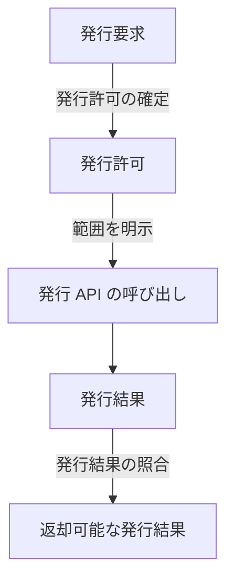
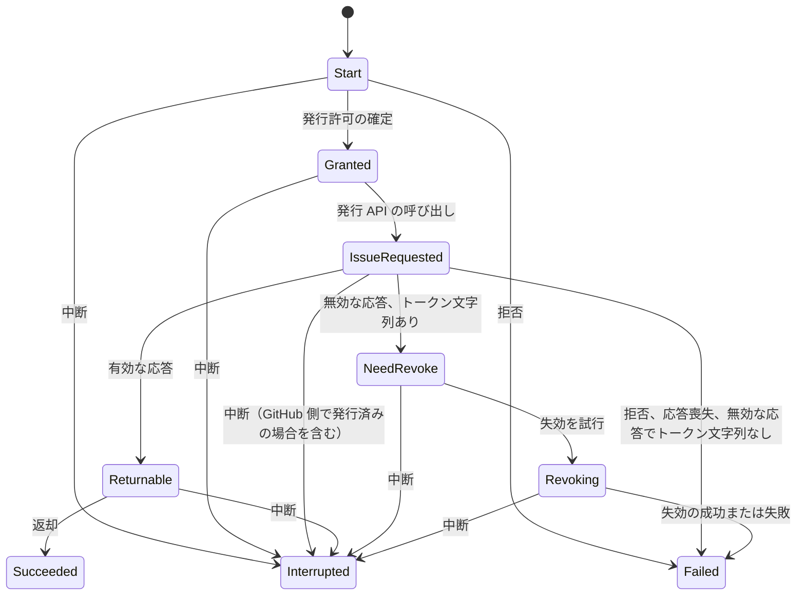

# Alloy Models

このディレクトリには、GATES の認可と発行処理と、署名の検証鍵の受理条件の抽象モデルを [Alloy](https://alloytools.org/) で記述しています。
Alloy を読めなくても、何を確かめていて何を確かめていないかを、この文書で把握できます。
仕様の正本とモデルの関係は [Formal Models](../README.md) に記述しています。

## Alloy が確かめる範囲

Alloy は、指定した大きさの範囲で、モデルの規則を満たす状態をすべて調べます。
範囲内で調べ尽くすので、手で選んだ入力だけを試すテストでは通らない組み合わせも対象になります。

モデルには、目的の異なる 2 種類のコマンドがあります。

- **`check`**：主張に反する状態（反例）を探す。判定の UNSAT は反例なし、SAT は反例ありを表す
- **`run`**：条件を満たす状態（充足例）を探す。モデルの規則が厳しすぎて何も成立しない状態になっていないことや、起こりうる事象が実際に表現できていることを確かめる。判定の SAT は充足例あり、UNSAT は充足例なしを表す

反例が見つからないことは、指定した範囲で反例がないことだけを意味します。
範囲を超える場合の正しさは証明していません。

## 認可のモデル（authorization.als）

このモデルは、発行要求から返却までの各段階で、受け渡す内容が規則を満たすかを確かめます。
時間の経過は扱わず、各段階の内容の関係だけを調べます。



調べる範囲は、各要素が最大 3 個、Owner とオーナー名が最大 2 個です。
権限は、`metadata` を含む 4 つまでの権限名と、`read` と `write` の 2 つの水準を調べます。
権限名は、GATES が許可権限に列挙するものと列挙しないものに分けます。
列挙するものは Repository permissions に当たり、列挙しないものの分類は決めずに調べます。
許可権限が権限名ごとに含める水準も決めずに調べるため、許可権限がその権限名に含めない水準を含む要求も現れます。
発行上限は、空でなく許可権限の一部である Permission Entry の集合として、中身を決めずに調べます。

### 反例がないことを確かめる規則

要件の列は、主に対応する要件を示します。
発行許可と発行 API の呼び出しのコマンド（`NoForeignOwnerGrant` から `AllIssueCallsExplicit` まで）の主張は、モデルの規則から直ちに従います。
これらは、規則がその条件を書き落としていないことを確かめます。

| コマンド | 確かめること | 要件 |
|---|---|---|
| `NoForeignOwnerGrant` | 許可オーナー以外の Caller に発行許可を作らない | FR-AUTHZ-001 |
| `NoOtherInstallationGrant` | 発行許可の Installation はどれも同じで、許可オーナーのものであり、停止していない | FR-OPS-001 |
| `OnlyAllowedPermissionsGranted` | 発行許可の権限は要求した Permissions のままで、どの Permission Entry も許可権限に含まれる。許可権限に含まれないものを除いて成立させない | FR-AUTHZ-006, FR-AUTHZ-003 |
| `OnlyIssuablePermissionsGranted` | 発行許可の権限は、どの Permission Entry も発行上限に含まれる | FR-AUTHZ-008 |
| `AllOrNothingGrant` | 発行許可の対象は要求した対象の全件と一致し、一部だけにならない | FR-AUTHZ-004 |
| `AllIssueCallsExplicit` | 発行 API の呼び出しは、要求された対象と Permissions を明示する | FR-ISSUANCE-003 |
| `NoOverbroadTokenReturned` | 返却可能な発行結果の権限は、要求した Permissions と任意の `metadata:read` だけで、対象は `selected` である | FR-AUTHZ-003, FR-ISSUANCE-004 |
| `NoNarrowedTokenReturned` | 返却可能な発行結果の権限は、要求した Permission Entry を同じ水準ですべて含む。権限が欠けた発行も、水準を下げた発行も返却しない | FR-AUTHZ-007, FR-ISSUANCE-004 |
| `UnrequestedAllowedPermissionsNotReturned` | GitHub App と Installation の権限が要求より広くても、返却可能な発行結果の権限は、要求していない許可権限を `metadata:read` のほかに含まない | FR-ISSUANCE-003, FR-ISSUANCE-004 |
| `NoTokenBeyondIssuablePermissions` | 返却可能な発行結果の権限は、発行上限と任意の `metadata:read` だけである | FR-AUTHZ-008, FR-ISSUANCE-004 |
| `OnlyRepositoryPermissionsReturned` | 返却可能な発行結果の権限は、どれも Repository permissions である | FR-AUTHZ-006 |
| `ExactNamesReturned` | 返却可能な発行結果の対象の完全名と件数は、要求と一致する | FR-ISSUANCE-004 |
| `NoDuplicateEffectiveRepositoriesReturned` | 返却可能な発行結果の実効対象に、同じ Repository ID や同じ完全名の要素はない | FR-ISSUANCE-004 |
| `ReturnedReposOwnedByAllowedOwner` | 返却可能な発行結果の対象は、すべて許可オーナーのものである | FR-ISSUANCE-004 |
| `CoverageHoldsWhenGitHubEnforces` | GitHub が Installation の対象を強制するなら、要求した名前はすべて、その Installation に含まれる許可オーナーのリポジトリである | FR-AUTHZ-005 |
| `RequestedPermissionsHeldWhenGitHubEnforces` | GitHub が Installation の権限を強制するなら、要求した Permission Entry はすべて、その Installation に同じかより高い水準で付与されているか、`metadata:read` である | FR-AUTHZ-007 |
| `ReturnedResultsHaveValidTokenAndExpiry` | 返却可能な発行結果のトークンは空でなく、有効期限は将来である | FR-ISSUANCE-005 |

表の「返却可能な発行結果」の権限と対象は GitHub の応答が示す値を指し、実際のトークンの権限を GitHub に問い合わせて確かめたものではありません。

これらの多くは、モデルに書いた規則から直接導かれる主張です。
UNSAT で分かるのは、規則を満たす範囲に主張の反例がないことです。
規則が矛盾していても UNSAT になるため、規則が成立しうることは `SuccessfulReturn` などの `run` で別に確かめます。

### 照合の規則が必要なことを確かめる変種

発行許可の確定のうち許可権限と発行上限の判定と、発行結果の照合のうち Owner ID、完全名、権限の超過、権限の欠落、件数の規則を外すと、対応する主張に反例が出ることを確かめます。
その他の照合の規則（トークンの有無、有効期限など）の必要性は確かめていません。
これらの変種は、規則を外したモデルであり、実際の GATES の設定を表すものではありません。

返却するトークンを許可権限の中に保つ守りは 2 つあります。
発行許可の確定での許可権限の判定と、発行上限が許可権限の一部であるという固定設定の不変条件（INV-015）です。
片方だけを外しても、もう片方が守るため反例は出ず、両方を外すと反例が出ます。

| コマンド | 外す規則 | 期待する判定 |
|---|---|---|
| `WithoutAllowedPermissionCheckKeepsAllowedPermissions` | 要求の Permissions が許可権限に含まれることの判定 | UNSAT。発行上限の不変条件が守るため、許可権限に含まれない権限のトークンを返却しない |
| `WithoutIssuableSubsetInvariantKeepsAllowedPermissions` | 発行上限が許可権限の一部であるという不変条件 | UNSAT。許可権限の判定が守るため、許可権限に含まれない権限のトークンを返却しない |

次のコマンドでは、反例が出るのが正しい結果です。

| コマンド | 外す規則 | 出ることを期待する反例 |
|---|---|---|
| `WithoutBothAllowedPermissionGuardsPreservesAllowedPermissions` | 許可権限の判定と、発行上限の不変条件の両方 | 許可権限に含まれない権限を含むトークンを返却する |
| `WithoutIssuablePermissionCheckPreservesIssuablePermissions` | 要求の Permissions が発行上限に含まれることの判定 | 発行上限に含まれない権限を含むトークンを返却する |
| `WithoutOwnerCheckPreservesOwnerBoundary` | 実効対象の Owner ID の照合 | 許可オーナー以外のリポジトリを含むトークンを返却する |
| `WithoutNameCheckPreservesExactNames` | 実効対象の完全名の照合 | 対象の完全名の集合が要求と一致しないトークンを返却する |
| `WithoutExcessPermissionCheckPreservesPermissionBoundary` | 実効権限が発行許可の Permissions と付随権限の範囲内であることの照合 | 要求していない権限を含むトークンを返却する |
| `WithoutMissingPermissionCheckPreservesRequestedPermissions` | 実効権限が発行許可の Permissions をすべて含むことの照合 | 要求した権限が欠けたか、水準が下がったトークンを返却する |
| `WithoutCountCheckPreservesUniqueEffectiveRepositories` | 実効対象の件数の照合 | 実効対象に重複した要素を含むトークンを返却する |

### 存在することを確かめる状態

| コマンド | 確かめること |
|---|---|
| `SuccessfulReturn` | 正常な発行と返却が成立する |
| `WriteAndMultiplePermissionsReturned` | `write` の水準を含む複数の権限を要求したトークンを返却できる |
| `IssuableNarrowerThanInstallation` | Installation が発行上限の外の許可権限を持っていても、発行上限の中の要求にトークンを返却できる |
| `ImpliedPermissionOutsideIssuableReturned` | 発行上限が `metadata:read` を含まなくても、GitHub が付与した `metadata:read` を含むトークンを返却できる |
| `ReturnWithoutAllowedPermissionCheck`、`ReturnWithoutIssuableSubsetInvariant` | 守りを片方だけ外した変種でもトークンを返却でき、その変種の UNSAT が素通りでない。不変条件を外した変種では、発行上限が許可権限の外に及ぶ |
| `CrossRepositoryWithinOwner` | 同じオーナー内なら、実行元とは別の名前のリポジトリを対象にしたトークンを返却できる。現在のスコープで意図した動作である |
| `IssueCallMayContainUncoveredNames` | Installation の対象外の名前を発行 API に送る場合がある。発行前には対象に含まれるかを確認しないためである |
| `IssueCallMayContainUnheldPermissions` | Installation に付与されていない権限か水準を発行 API に送る場合がある。発行前には付与されているかを確認しないためである |
| `ResultWithoutUnheldPermissionNotReturned` | Installation に付与されていない権限を GitHub が除いて発行した結果を受け取る状態を表現でき、その発行結果は返却されない |
| `CoverageNotIndependentlyProved` | 発行結果の照合を通っても、返却する対象が Installation の対象に含まれることまでは GATES だけで示せない |
| `InvalidResultCanExist` | 要求していない権限を含む発行結果を受け取る状態を表現できる。そのような発行結果を返却しないことは `NoOverbroadTokenReturned` が確かめる |

## 発行処理のモデル（issuance-temporal.als）

このモデルは、発行処理の順序と、失敗や中断が起きたときの状態を確かめます。
1 回の Lambda 呼び出し（Invocation）を 1 回の発行処理として、最初の呼び出しと再試行の 2 つを扱います。

各呼び出しは次のように状態を移ります。
再試行は開始条件を満たすまで待機し、必ず起きるとは限りません。
開始できるのは、最初の呼び出しが処理の途中のとき、失敗か中断で終わったとき、または成功しても呼び出し元に結果が届いていないときです。



調べる範囲は、最大 14 ステップの実行です。
遷移は 2 つの呼び出しを合わせて最大 11 回で終わるため、このモデルの実行はすべてこの範囲に収まります。

### 順序の安全性を確かめる規則

| コマンド | 確かめること | 要件 |
|---|---|---|
| `NoUnverifiedReturn` | 返却したなら、発行許可の確定、発行 API の呼び出し、トークン文字列の取得、発行結果の照合を経ている | QR-003, FR-ISSUANCE-004 |
| `NoIssueBeforeExplicitGrant` | GitHub 側で発行されたなら、発行許可の確定と発行 API の呼び出しを経ている | FR-ISSUANCE-002 |
| `NoReturnAfterLostResponse` | 応答を喪失した呼び出しは、トークンを返却しない | QR-003, AC-ISSUANCE-006 |
| `NoRevokeWithoutKnownToken` | 失効を試みたなら、トークン文字列を取得している | AC-ISSUANCE-006 |
| `NoFailureWithoutRevokeAttempt` | 照合に失敗したトークン文字列を取得した呼び出しが失敗で終わるなら、失効を試みている | FR-ISSUANCE-004, AC-ISSUANCE-004 |
| `NoConfirmedRevocationWithoutAttempt` | 失効の成功を確認したなら、失効を試みている | FR-ISSUANCE-004 |
| `NoInterruptedInvocationReturns` | 中断した呼び出しは、トークンを返却していない | QR-003 |
| `NoObservedSuccessWithoutReturn` | 呼び出し元が成功を受け取ったなら、その呼び出しは返却まで成功している | なし（モデル内の整合性） |

### 起こりうることを確かめる状態

`SuccessfulIssueWitness`、`ObservedSuccessWitness`、`RevocationConfirmedWitness` は、対応する遷移が実行できることを確かめます。
これらがないと、遷移が実行できなくなっても順序の安全性の規則は UNSAT のまま通ります。
残りは、GATES が防がない事象を表します。
SAT は、モデル上でその事象が起こりうることを意味し、GitHub や AWS で実測した結果ではありません。

| コマンド | 起こりうること |
|---|---|
| `SuccessfulIssueWitness` | 正常に発行して返却する |
| `ObservedSuccessWitness` | 返却した成功を呼び出し元が受け取る |
| `RevocationConfirmedWitness` | 失効を試みて、成功を確認する |
| `ResponseLossOrphanWitness` | GitHub 側で発行されたが、応答を喪失してトークン文字列を取得できない |
| `RevokeFailureWitness` | 失効を試みたが、成功を確認できない |
| `InterruptedBeforeRevokeWitness` | 無効な応答からトークン文字列を取得したが、失効を試みる前に中断する |
| `DuplicateIssueAfterRetryWitness` | 最初の呼び出しが応答を喪失し、再試行でも GitHub 側で発行されて、発行が重複する（両者の順序は問わない） |
| `InvalidWithoutTokenIssuedWitness` | トークン文字列のない無効な応答を受け取り、GitHub 側では発行されている |
| `InvalidWithoutTokenNotIssuedWitness` | トークン文字列のない無効な応答を受け取り、GitHub 側では発行されていない |
| `RetryAfterUnobservedSuccessWitness` | 成功が呼び出し元に届かないまま再試行し、2 つ目のトークンが発行される |
| `ConcurrentRetryDuplicateIssueWitness` | 最初の呼び出しが発行 API を呼び出している途中で再試行が始まり、両方で発行される |
| `RetryCallsBeforeOriginalWitness` | 最初の呼び出しが発行 API を呼び出す前に、再試行が発行 API を呼び出す |

## 署名の検証鍵のモデル（discovery.als、signature.als）

この 2 つのモデルは、GATES 用 OIDC JWT の署名の検証鍵の受理条件（GOJ-DISCOVERY-*、GOJ-JWK-*、GOJ-X5C-*、GOJ-JWKS-*、GOJ-SIGNATURE）を、標準仕様の条項と GitHub の条項に照らして確かめます。
`discovery.als` は Discovery と鍵の取得先を、`signature.als` は JWK、JWK Set、`kid` による鍵の選択、署名の検証、失敗の分類を扱います。

どちらのモデルも、[Z3 Models](../z3/README.md) と同じく 3 つの層を互いに見ずに書きます。

- **標準の層**：RFC 7515、7517、7518、8725、9964、OpenID Connect Core と Discovery の条項。GATES の値を含まず、標準が実装に委ねる選択（受け入れるアルゴリズム、鍵が Issuer に属することの決め方など）は述語の引数にする
- **GitHub の層**：Documented の条項（`iss` と Discovery の公開先）と、Published と Observed の条項（Discovery の値、JWKS の鍵、記録した Header の `kid`）。Unconfirmed の条項は制約しない
- **GATES の層**：GOJ ごとの述語と、JWK Set と JWT から受理、認証失敗、内部障害を決める関数

値はデコード後の JSON の値で、文字列は JSON のエスケープを除いた後の値を一つの原子で表します。
2 つの文字列が等しいのは同じ原子のときだけで、正規化や大文字小文字の同一視はありません。
文字列を Base64urlUInt、Base64 の DER の証明書、URL として読んだ結果は、文字列の属性として表します。
署名は作った主体で表し、ある公開鍵とアルゴリズムで検証できるのは、そのアルゴリズムとその公開鍵の秘密鍵で作った署名に限ります。

条項と GOJ のどれをどの述語が形式化し、どのコマンドが確かめるかは、`.als` の `trace:` の注釈にあり、`make trace-map` で一覧にできます。
コマンドは次の種類に分かれます。

| 種類 | コマンドの名前 | 期待 | 確かめること |
|---|---|---|---|
| 一貫性 | `*LayerConsistent`、`GatesLayerFailures` | SAT | 各層を満たす状態があり、GATES の層で受理、認証失敗、内部障害のどれも起こり得る。同じ範囲のほかの `check` が、満たす状態のないまま UNSAT になっていないことの裏付けにもなる |
| 安全性 | `DiscoveryIssuerMatchesIssuerURL`、`AcceptedSignatureValidates` など | UNSAT | GATES の層が受理するなら、Satisfies の関係にある標準の条項を満たす |
| アルゴリズムの入れ替え | `AlgorithmReplaceable`、`GatesWithAnotherAlgorithm` | UNSAT、SAT | GOJ-HEADER-ALG、GOJ-JWK-ALG、GOJ-SIGNATURE が受理するアルゴリズムを一つの値で表し、その値が RSASSA-PKCS1-v1_5 のどのアルゴリズムでも、暗号操作がその値を使い、署名と鍵の条項を満たす。安全性の検査も同じ値の下で判定し、互換性の検査だけが値を `RS256` とする |
| 性質 | `KeysOnlyFromFixedIssuer`、`AmbiguousKidFails`、`SecretRejectsKeySet`、`NoUsableKeyIsInternalFailure`、`SelectedKeyIsUsableKeyOfKeySet` | UNSAT | 固定 Issuer の JWKS の外の鍵を使わない、`kid` が使用可能な鍵に複数一致すれば認証失敗、秘密鍵か対称鍵の値を含む JWKS は集合全体を拒否、使用可能な鍵がなければ内部障害 |
| 変異 | `Mutant*` | SAT | GATES の層の規則を一つ誤らせると、標準の条項か性質に反例が出る |
| 互換性 | `GitHub*Accepted`、`GitHubKidSelectsOneKey` | UNSAT | GitHub の条項が表す Discovery と JWKS を GATES の層が受理する（Accepts の関係） |
| 拒否し得る発行 | `GitHubX5cChainMayBeRejected` | SAT | GitHub が定めていない `x5c` の証明書の関係で、GATES が鍵を除外し JWT を拒否する場合がある（Possibly Rejects の関係） |
| 依存 | `*NeedsPublished` | SAT | Documented の条項だけでは GATES の受理が決まらず、Published の条項に依存する |
| 例 | `GitHubDiscoveryMeetsStandardMetadata`、`GitHubKeySetMeetsStandard`、`GitHubDiscoveryHasEndpoints` | UNSAT、UNSAT、SAT | Published の Discovery と JWKS が標準の条項を満たし、Discovery の Metadata に `authorization_endpoint` と `token_endpoint` がない |

範囲は、名前を持つ文字列の原子と、GitHub の JWKS（鍵 4 個、証明書 3 個）を表せる大きさにしています。
範囲が小さすぎると、前提を満たす状態がなく `check` が UNSAT のまま素通りします。
範囲を変えたら、一貫性の `run` が SAT のままであることを確かめます。

この 2 つのモデルが表さないことは次のとおりです。

- **通信**：HTTP の要求、TLS、リダイレクト、応答の大きさ、取得の失敗と再取得の規則。これらの条項は `trace:unformalized` とし、関係は Go のテストで確かめる
- **バイト列**：JSON のテキスト、エスケープ、空白、Base64url と Base64 の符号化、X.509 の解析と RSA の計算
- **`x5u` の取得と、証明書の信頼**：証明書は `x5c` の中の関係だけを表す
- **JOSE Header の受理条件**：鍵の選択に進む JWT は GOJ-HEADER-ALG、GOJ-HEADER-KID、GOJ-HEADER-CTY を満たす前提で、これらは Z3 のモデルが確かめる
- **重複したメンバー名の値**：重複したメンバー名を持つ JWK は、秘密の値を含むかと、除外されることだけを表す

## モデルが保証しないこと

モデルが確かめるのは抽象化した規則で、次のことは対象外です。
署名の検証鍵のモデルに固有の対象外は、前の節に書いています。
「形式検証済みなので安全である」とは読めません。

- **Go の実装との一致**：`internal/` のコードがモデルのとおりに動くかは確かめていない。実装の確認はテストが担う
- **GitHub のふるまい**：GitHub が Installation の対象と権限を強制することは事実として仮定せず、証明もしていない。`CoverageHoldsWhenGitHubEnforces` は、強制する場合の帰結だけを確かめる。応答の内容と実際のトークンの権限が一致することは、区別せずに同一視している
- **Installation の一意性**：固定した GitHub App のもとでオーナーごとに Installation が高々一つであることは、規則として仮定している。`NoOtherInstallationGrant` の「どれも同じ」はこの仮定に依存する
- **AWS のふるまい**：呼び出し元の再試行は抽象的な可能性として扱っており、Lambda の呼び出し方を確かめた結果ではない
- **処理の進行**：確かめるのは「起きたなら、その前に〜を経ている」という性質だけである。処理が必ず完了することは確かめていない。無効な応答でトークン文字列を得た呼び出しが、失効を試みる前に中断する場合もある
- **認証と署名の段階**：認可と発行処理のモデルは JWT の署名検証を扱わず、Caller は検証済みの前提で表す。発行処理のモデルに JWT 検証、対象解決、KMS 署名の段階はなく、これらの失敗時に返却しないことは確かめていない
- **監査とエラーの種別**：監査はどのモデルも扱わない。エラーの種別は、署名の検証鍵のモデルの認証失敗と内部障害の区別だけを扱う
- **文字列と件数の規則**：大文字小文字の扱いや要求の件数の上限は扱わない
- **対象の並び**：発行要求と発行許可の対象を完全名の集合で表し、並びは扱わない。発行許可が要求の並びと表記を保つことは確かめていない
- **権限名と水準の具体的な値**：権限名は `metadata` のほかを具体的な名前で表さず、水準は `read` と `write` だけを扱う（`repository_projects` の `admin` は扱わない）。許可権限に列挙する権限名が Repository permissions に当たることは、ユーザーアカウントの Installation に現れたことで確かめる運用を規則として仮定しており、モデルでは確かめていない
- **権限の付与の上限**：GitHub App と Installation に付与された権限が、より低い水準の発行を許すことは、`write` が `read` を含むという順序として仮定している。付与されていない権限への GitHub の応答（拒否か、権限を除くか水準を下げた発行か）は区別しない。`RequestedPermissionsHeldWhenGitHubEnforces` は、GitHub が付与の上限を超えて発行しない場合の帰結だけを確かめる
- **`metadata:read` のほかに加わる権限**：要求にかかわらず `metadata:read` のほかの権限が発行結果に加わる GitHub の振る舞いは、照合で返却しない発行結果の一つとして扱うだけで、正当な要求が照合に失敗するかは確かめていない
- **2 つのモデルの接続**：発行処理のモデルは、発行許可の確定と発行結果の照合を「通ったかどうか」だけで表す。認可のモデルの規則とつなげて検証してはいない
- **Installation の変更**：変更そのものは表さない。変更で起きうる発行の拒否や無効な応答は、原因を区別せず遷移に含まれる。発行済みのトークンへの影響は表さない
- **発行上限の読み込み**：環境変数の書式、初期化の失敗、発行上限の変更は表さない。発行上限が空でなく許可権限の一部であることは、固定設定を読めた状態の規則として仮定する。高い水準が低い水準を含まないことは、Permission Entry の集合の包含で表す
- **認可の逆方向**：発行許可があるなら条件を満たすことは確かめるが、条件を満たす要求に必ず発行許可が作られることは確かめていない
- **2 回以上の再試行**：呼び出しは最初と再試行の 2 つだけを扱う

## 実行方法と結果の読み方

Docker が必要です。

```sh
make alloy
```

コマンドごとに次の形で判定を出力します。

```text
00. check NoForeignOwnerGrant      0       UNSAT
11. check WithoutOwnerCheckPreservesOwnerBoundary     0    1/1     SAT
15. run   SuccessfulReturn         0    1/1     SAT
```

期待する判定は、各コマンドの `expect` に書いています。
`expect 0` は UNSAT を、`expect 1` は SAT を期待します。
期待と異なるコマンドがあると、`make alloy` は失敗します。
期待と異なるコマンドが出たら、モデルの誤りか仕様の欠陥かを切り分けます。

Linux ARM64 では `findPlatform unknown Linux aarch64` というエラーログが出ます。
この環境向けのネイティブソルバーがないためで、既定のソルバーの SAT4J による解析には影響しません。

## 仕様を変更したときのモデルの更新

`docs/spec/` や `docs/design/` の変更が認可や発行処理の規則、または署名の検証鍵の受理条件に関わるときは、次の順に更新します。

1. この文書の表か `trace:` の注釈から、変更に関わるコマンドを探す
2. `.als` の規則とコマンドを更新し、期待する判定を `expect` に書く。`expect` は `check` か `run` と同じ行に書く。追跡の検査は、注釈の次の行のコマンドの `expect` だけを読むためで、主張は `assert` か `pred` に分ける
3. この文書の表を、モデルと同じ変更で更新する
4. `make alloy` と `make trace` を実行する

`make alloy` は、この文書とモデルの一致を確かめません。
コマンドを追加、改名、削除したときは、この文書の表も手で直します。
