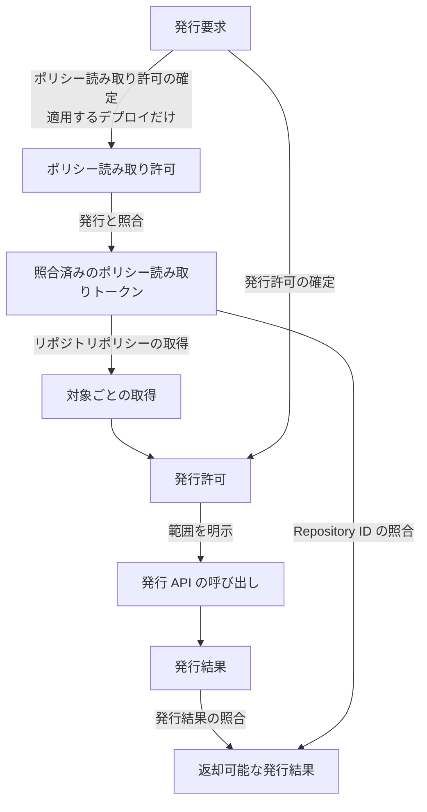
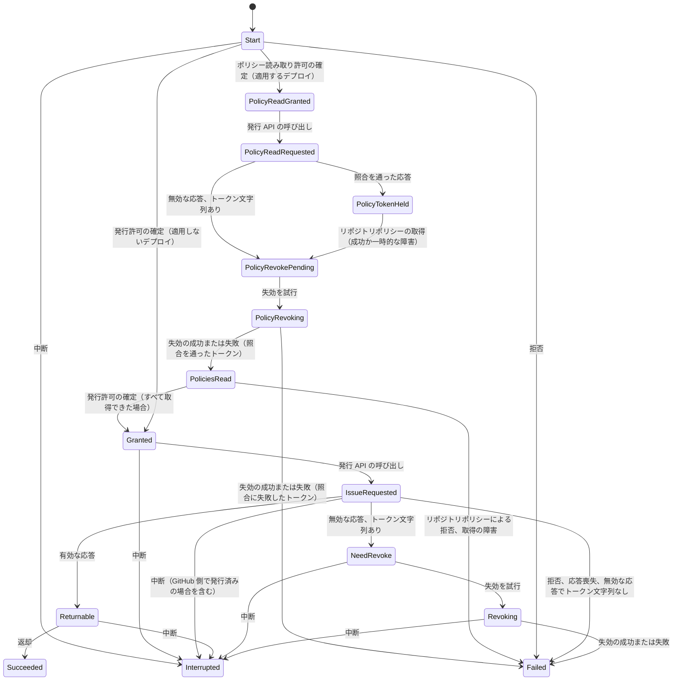

# Alloy Models

このディレクトリには、GATES の認可と発行処理と、署名の検証鍵の受理条件の抽象モデルを [Alloy](https://alloytools.org/) で記述しています。
Alloy を読めなくても、何を確かめていて何を確かめていないかを、この文書で把握できます。
仕様の正本とモデルの関係は [Formal Models](../README.md) に記述しています。

## Alloy が確かめる範囲

Alloy は、指定した大きさの範囲で、モデルの規則を満たす状態をすべて調べます。
範囲内で調べ尽くすので、手で選んだ入力だけを試すテストでは通らない組み合わせも対象になります。

モデルには、目的の異なる 2 種類のコマンドがあります。

- **`check`**：主張に反する状態（反例）を探す。判定の UNSAT は反例なし、SAT は反例ありを表す
- **`run`**：条件を満たす状態（充足例）を探す。モデルの規則が厳しすぎて何も成立しない状態になっていないことや、起こりうる事象が実際に表現できていることを確かめる。判定の SAT は充足例あり、UNSAT は充足例なしを表す

反例が見つからないことは、指定した範囲で反例がないことだけを意味します。
範囲を超える場合の正しさは証明していません。

## 認可のモデル（authorization.als）

このモデルは、発行要求から返却までの各段階で、受け渡す内容が規則を満たすかを確かめます。
時間の経過は扱わず、各段階の内容の関係だけを調べます。



調べる範囲は、各要素（リポジトリ名、保護対象、許可 Caller を含む）が最大 3 個、Owner とオーナー名が最大 2 個です。
リポジトリポリシーは、ないもの、不正なものと、有効なもの最大 2 個を調べます。
権限は、`metadata` と `single_file` を含む 5 つまでの権限名と、`read` と `write` の 2 つの水準を調べます。
`admin` は加えていません。
水準の包含は、要求の水準 1 つと上限の水準 1 つを順序で比べる規則で、3 つ目の水準を加えても規則が別に扱う場合は増えないためです。
権限名は、GATES が許可権限に列挙するものと列挙しないものに分けます。
列挙するものは Repository permissions に当たり、列挙しないものの分類は決めずに調べます。
許可権限が権限名ごとに含める水準も決めずに調べるため、許可権限がその権限名に含めない水準を含む要求も、`write` だけを許可権限に含む権限名も現れます。
発行上限は、空でなく許可権限の一部である Permission Entry の集合として、中身を決めずに調べ、要求をその発行上限に水準の包含で照合します。

リポジトリは Repository ID ごとに一つの要素で、GitHub での現在の名前を持ちます。
保護対象の一覧は、保護対象（Repository ID、リポジトリ名、許可 Caller）の集合として、空の場合も含めて中身を決めずに調べます。
一覧の ID と名前の組も、許可 Caller の ID と名前の組も、GitHub の現在の状態と一致するとは限らないものとして扱います。
こうして、改名（ID が同じで現在の名前が異なる）、作り直し（名前が同じで現在の ID が異なる）、ID や名前の書き誤りが現れます。
Caller のリポジトリ名も、Caller の Repository ID の現在の名前と独立に決めずに調べます。
名前は大文字小文字を区別しない比較の結果として、一致するかどうかだけを表します。

リポジトリポリシーの適用は、適用するデプロイと適用しないデプロイの両方を調べます。
各リポジトリは、既定ブランチのリポジトリポリシーを、「ない」「不正」「有効」の状態のどれかで持ち、有効なものは許可 Caller の集合（空の場合を含む）を持ちます。
許可 Caller は保護対象の一覧と同じ型で表し、同じ許可 Caller が両方に現れる場合も調べます。
Caller が許可 Caller に当たる条件は、両方で一つの述語を使います。
`single_file` はポリシー読み取りトークンの権限として、許可権限に列挙する権限名の一つに固定します。
2 つのリポジトリが同じ完全名を持つ状態も調べ、リポジトリポリシーを読んだ後に対象が削除され、同じ名前で作り直された場合を表します。
リポジトリポリシーの取得は、どのリポジトリを読んだかを決めずに調べ、取得の最中に名前が別のリポジトリを指す競合を表します（[モデルが保証しないこと](#モデルが保証しないこと)）。
取得に失敗した対象は、その対象の取得を表す要素を置かないことで表します。

### 反例がないことを確かめる規則

要件の列は、主に対応する要件を示します。
発行許可と発行 API の呼び出しのコマンド（`NoForeignOwnerGrant` から `AllIssueCallsExplicit` まで）の主張は、モデルの規則から直ちに従います。
これらは、規則がその条件を書き落としていないことを確かめます。

| コマンド | 確かめること | 要件 |
|---|---|---|
| `NoForeignOwnerGrant` | 許可オーナー以外の Caller に発行許可を作らない | FR-AUTHZ-001 |
| `NoOtherInstallationGrant` | 発行許可の Installation はどれも同じで、許可オーナーのものであり、停止していない | FR-OPS-001 |
| `OnlyAllowedPermissionsGranted` | 発行許可の権限は要求した Permissions のままで、どの Permission Entry も許可権限に含まれる。許可権限に含まれないものを除いて成立させない | FR-AUTHZ-006, FR-AUTHZ-003 |
| `OnlyIssuablePermissionsGranted` | 発行許可の権限は、どの Permission Entry も発行上限に水準の包含で含まれる | FR-AUTHZ-008 |
| `AllOrNothingGrant` | 発行許可の対象は要求した対象の全件と一致し、一部だけにならない | FR-AUTHZ-004 |
| `AllIssueCallsExplicit` | 発行 API の呼び出しは、要求された対象と Permissions を明示する | FR-ISSUANCE-003 |
| `NoOverbroadTokenReturned` | 返却可能な発行結果の権限は、要求した Permissions と任意の `metadata:read` だけで、対象は `selected` である | FR-AUTHZ-003, FR-ISSUANCE-004 |
| `NoNarrowedTokenReturned` | 返却可能な発行結果の権限は、要求した Permission Entry を同じ水準ですべて含む。権限が欠けた発行も、水準を下げた発行も返却しない | FR-AUTHZ-007, FR-ISSUANCE-004 |
| `UnrequestedAllowedPermissionsNotReturned` | GitHub App と Installation の権限が要求より広くても、返却可能な発行結果の権限は、要求していない許可権限を `metadata:read` のほかに含まない | FR-ISSUANCE-003, FR-ISSUANCE-004 |
| `NoTokenBeyondIssuablePermissions` | 返却可能な発行結果の権限は、発行上限が水準の包含で含むものと任意の `metadata:read` だけである | FR-AUTHZ-008, FR-ISSUANCE-004 |
| `ReturnedLevelsEqualRequestedLevels` | 返却可能な発行結果の権限は、要求した権限名について要求した水準のままで、発行上限や権限の上限の高い水準に上がらない | FR-AUTHZ-008, FR-ISSUANCE-004 |
| `IssuableWriteAdmitsNoReadOutsideAllowedPermissions` | 発行上限が同じ権限名の `write` を含んでも、許可権限にない `read` の権限を含むトークンを返却しない | FR-AUTHZ-006, FR-AUTHZ-008 |
| `OnlyRepositoryPermissionsReturned` | 返却可能な発行結果の権限は、どれも Repository permissions である | FR-AUTHZ-006 |
| `ExactNamesReturned` | 返却可能な発行結果の対象の完全名と件数は、要求と一致する | FR-ISSUANCE-004 |
| `NoDuplicateEffectiveRepositoriesReturned` | 返却可能な発行結果の実効対象に、同じ Repository ID や同じ完全名の要素はない | FR-ISSUANCE-004 |
| `ReturnedReposOwnedByAllowedOwner` | 返却可能な発行結果の対象は、すべて許可オーナーのものである | FR-ISSUANCE-004 |
| `CoverageHoldsWhenGitHubEnforces` | GitHub が Installation の対象を強制するなら、要求した名前はすべて、その Installation に含まれる許可オーナーのリポジトリである | FR-AUTHZ-005 |
| `RequestedPermissionsHeldWhenGitHubEnforces` | GitHub が Installation の権限を強制するなら、要求した Permission Entry はすべて、その Installation に同じかより高い水準で付与されているか、`metadata:read` である | FR-AUTHZ-007 |
| `ReturnedResultsHaveValidTokenAndExpiry` | 返却可能な発行結果のトークンは空でなく、有効期限は将来である | FR-ISSUANCE-005 |
| `ProtectedTokenNeedsIdAndNameOfAllowedCaller` | 実効対象の Repository ID が保護対象の ID であるトークンを受け取る Caller は、Repository ID とリポジトリ名の両方が、その保護対象のある許可 Caller と一致する。どの許可 Caller とも ID だけ、名前だけが一致する Caller は受け取らない | FR-AUTHZ-009, FR-AUTHZ-010 |
| `ProtectedTokenWithinPermissionLimit` | 実効対象の Repository ID が保護対象の ID であるトークンの権限は、Caller が当たる許可 Caller の権限の上限が水準の包含で含むものと、任意の `metadata:read` だけである | FR-AUTHZ-009, FR-AUTHZ-010 |
| `NoProtectedNameWithOtherIdReturned` | 返却可能な発行結果の実効対象に、リポジトリ名が保護対象の名前で、Repository ID がその保護対象の ID と異なるものはない | FR-AUTHZ-010 |
| `ProtectedRepositoriesAddNothingWhenNotTargeted` | 保護対象に当たる対象を含まない要求には、保護対象の条件がどの Caller にも成り立つ。保護対象の一覧が空なら、発行結果の照合は保護対象の条件のない照合と同じである | FR-AUTHZ-009 |
| `ProtectedRepositoriesKeepPermissionBoundary` | 許可 Caller の権限の上限が発行上限の外の組を含んでも、返却可能な発行結果の権限は、許可権限に含まれ発行上限が水準の包含で含むものと、任意の `metadata:read` だけである | FR-AUTHZ-009 |
| `RepositoryPoliciesOnlyAddConditions` | 適用するデプロイの発行許可も、適用しないデプロイの発行許可の条件（RULE-010、RULE-015、RULE-011）をすべて満たす | FR-AUTHZ-011 |
| `NotEnforcedIgnoresRepositoryPolicies` | 適用しないデプロイでは、ポリシー読み取り許可が作られず、どの発行許可もポリシー読み取りトークンに依らない | FR-AUTHZ-011, FR-OPS-001 |
| `DefaultDenyWithoutValidPolicy` | 適用するデプロイの発行許可の各対象について、発行許可のポリシー読み取りトークンでその名前のリポジトリポリシーを取得しており、読んだリポジトリポリシーは許可 Caller を持つ有効なものである | FR-AUTHZ-011 |
| `ProtectedRepositoriesNeedListAndPolicy` | 適用するデプロイで保護対象に当たる対象を含む発行許可は、保護対象の一覧とリポジトリポリシーの両方の条件を満たす | FR-AUTHZ-009, FR-AUTHZ-011 |
| `EveryTargetAllowedByPolicy` | 適用するデプロイの発行許可は、すべての対象について、そのリポジトリポリシーが Caller と権限を許している | FR-AUTHZ-011, FR-AUTHZ-004 |
| `GrantWithinEveryPermissionLimit` | 発行許可の権限は、許可権限、発行上限、適用するデプロイでは各対象のリポジトリポリシーで Caller が当たる許可 Caller の権限の上限のすべてに含まれる | FR-AUTHZ-008, FR-AUTHZ-011 |
| `PolicyAllowedCallerNeedsIdAndName` | 適用するデプロイの発行許可の各対象のリポジトリポリシーに、Repository ID とリポジトリ名の両方が Caller と一致する許可 Caller がある | FR-AUTHZ-011 |
| `ReturnedRepositoriesArePolicyRepositories` | 適用するデプロイで返却可能な発行結果の各実効対象は、発行許可のポリシー読み取りトークンの実効対象と Repository ID が同じである | FR-AUTHZ-012 |
| `ReturnedRepositoriesAllowedByOwnPolicy` | 取得の最中に名前が別のリポジトリを指さなかったなら、返却可能な発行結果の各実効対象は、それ自身のリポジトリポリシーが Caller と要求した権限を許している | FR-AUTHZ-011, FR-AUTHZ-012 |
| `PolicyTokenWithinPermissionLimit` | 取得の最中に名前が別のリポジトリを指さなかったなら、適用するデプロイで返却可能な発行結果の権限は、各実効対象のリポジトリポリシーで Caller が当たる許可 Caller の権限の上限が水準の包含で含むものと、任意の `metadata:read` だけである | FR-AUTHZ-011, FR-ISSUANCE-004 |
| `PolicyReadTokenOnlyReadsThePolicy` | 照合済みのポリシー読み取りトークンの権限は `single_file:read` と任意の `metadata:read` だけで、読めるファイルはリポジトリポリシーのパスだけである | FR-ISSUANCE-004, FR-ISSUANCE-007 |
| `PolicyReadGrantMeetsOtherConditions` | ポリシー読み取り許可は、適用するデプロイでだけ、発行許可の確定で判定する条件のうちリポジトリポリシーの条件を除くすべてを満たす要求に作られ、権限は要求によらず `single_file:read` である | FR-ISSUANCE-002, FR-ISSUANCE-007 |

表の「返却可能な発行結果」の権限と対象は GitHub の応答が示す値を指し、実際のトークンの権限を GitHub に問い合わせて確かめたものではありません。

これらの多くは、モデルに書いた規則から直接導かれる主張です。
UNSAT で分かるのは、規則を満たす範囲に主張の反例がないことです。
規則が矛盾していても UNSAT になるため、規則が成立しうることは `SuccessfulReturn` などの `run` で別に確かめます。

### 照合の規則が必要なことを確かめる変種

発行許可の確定のうち許可権限、発行上限、保護対象の名前、許可 Caller の名前、権限の上限の判定と、発行結果の照合のうち Owner ID、完全名、権限の超過、権限の欠落、件数、保護対象の Repository ID の規則を外すと、対応する主張に反例が出ることを確かめます。
リポジトリポリシーの規則は、下の表に挙げた規則を外すと反例が出ることを確かめます。
その他の照合の規則の必要性は確かめていません。
利用者に返すトークンの照合ではトークンの有無と有効期限が、ポリシー読み取りトークンの照合ではトークンの有無、有効期限、対象の件数と完全名、Owner ID、`repository_selection`、保護対象の名前と ID の対応が、これに当たります。
発行許可が、同じ Caller、発行要求、Installation のポリシー読み取りトークンに結び付くことの必要性も確かめていません。
これらの変種は、規則を外したモデルであり、実際の GATES の設定を表すものではありません。

返却するトークンを許可権限の中に保つ守りは 2 つあります。
発行許可の確定での許可権限の判定と、水準の包含が要求の組に許可権限に含まれることを求める条件です。
片方だけを外しても、もう片方が守るため反例は出ず、両方を外すと反例が出ます。
発行上限が許可権限の一部であるという固定設定の不変条件（INV-015）は、この守りになりません。
包含の規則では、発行上限が許可権限の中にあっても、発行上限の `write` が、許可権限にない同じ権限名の `read` を許し得るためです。

| コマンド | 外す規則 | 期待する判定 |
|---|---|---|
| `WithoutAllowedPermissionCheckKeepsAllowedPermissions` | 要求の Permissions が許可権限に含まれることの判定 | UNSAT。水準の包含の条件が守るため、許可権限に含まれない権限のトークンを返却しない |
| `WithoutInclusionAllowedConditionKeepsAllowedPermissions` | 水準の包含のうち、要求の組が許可権限に含まれることの条件 | UNSAT。許可権限の判定が守るため、許可権限に含まれない権限のトークンを返却しない |
| `WithoutIssuableSubsetInvariantKeepsAllowedPermissions` | 発行上限が許可権限の一部であるという不変条件 | UNSAT。2 つの守りがどちらも残るため、許可権限に含まれない権限のトークンを返却しない |
| `WithoutAllowedPermissionCheckAndIssuableSubsetInvariantKeepsAllowedPermissions` | 許可権限の判定と、発行上限の不変条件の両方 | UNSAT。水準の包含の条件が守るため、発行上限が許可権限の外の組を含んでも、その組のトークンを返却しない |
| `WithoutEnforcementSwitchDeniesWithoutPolicy` | リポジトリポリシーの取得と条件を、適用するデプロイに限ること | UNSAT。取得の最中に名前が別のリポジトリを指さない限り、適用しないデプロイでも、リポジトリポリシーのないリポジトリのトークンを返却しない。`NotEnforcedTokenWithoutPolicy` と比べ、この変種の判定がリポジトリポリシーに依ることを示す |

次のコマンドでは、反例が出るのが正しい結果です。

| コマンド | 外す規則 | 出ることを期待する反例 |
|---|---|---|
| `WithoutBothAllowedPermissionGuardsPreservesAllowedPermissions` | 許可権限の判定と、水準の包含の条件の両方 | 発行上限の不変条件が成り立ったまま、発行上限の `write` が許した、許可権限にない `read` の権限を含むトークンを返却する |
| `WithoutIssuablePermissionCheckPreservesIssuablePermissions` | 要求の Permissions が発行上限に水準の包含で含まれることの判定 | 発行上限が含まない権限を含むトークンを返却する |
| `WithoutOwnerCheckPreservesOwnerBoundary` | 実効対象の Owner ID の照合 | 許可オーナー以外のリポジトリを含むトークンを返却する |
| `WithoutNameCheckPreservesExactNames` | 実効対象の完全名の照合 | 対象の完全名の集合が要求と一致しないトークンを返却する |
| `WithoutExcessPermissionCheckPreservesPermissionBoundary` | 実効権限が発行許可の Permissions と付随権限の範囲内であることの照合 | 要求していない権限を含むトークンを返却する |
| `WithoutMissingPermissionCheckPreservesRequestedPermissions` | 実効権限が発行許可の Permissions をすべて含むことの照合 | 要求した権限が欠けたか、水準が下がったトークンを返却する |
| `WithoutCountCheckPreservesUniqueEffectiveRepositories` | 実効対象の件数の照合 | 実効対象に重複した要素を含むトークンを返却する |
| `WithoutAllowedCallerNameCheckPreservesAllowedCallers` | 許可 Caller のリポジトリ名と Caller のリポジトリ名の照合 | 一覧の名前が示すリポジトリとは別のリポジトリ（Repository ID の誤記が指すもの）が、保護対象のトークンを受け取る |
| `WithoutAllowedCallerIdCheckPreservesAllowedCallers` | 許可 Caller の Repository ID と Caller の Repository ID の照合 | リポジトリ名だけが許可 Caller と一致する Caller が、保護対象のトークンを受け取る |
| `WithoutProtectedNameCheckPreservesAllowedCallers` | 発行前に、要求のリポジトリ名で保護対象を見分けて判定すること | 許可 Caller でない Caller に、名前と ID が一覧どおりの保護対象のトークンを返却する |
| `WithoutProtectedIdCheckPreservesAllowedCallers` | 発行後に、実効対象の名前の一致と ID の一致が同値であることの照合 | 許可 Caller でない Caller に、改名した保護対象を新しい名前で要求したトークンを返却する |
| `WithoutPermissionLimitCheckPreservesPermissionLimit` | 要求の Permissions が許可 Caller の権限の上限に水準の包含で含まれることの判定 | 許可 Caller に、権限の上限が含まない権限を含む保護対象のトークンを返却する |
| `WithoutProtectedCheckWhenEnforcedOnlyAddsConditions`、`WithoutProtectedCheckWhenEnforcedNeedsListAndPolicy` | 適用するデプロイでの、ポリシー読み取り許可と発行許可の両方の保護対象の条件 | リポジトリポリシーだけが許す Caller に、保護対象の発行許可を作る |
| `WithoutEnforcementSwitchIgnoresRepositoryPolicies` | リポジトリポリシーの取得と条件を、適用するデプロイに限ること | 適用しないデプロイが、ポリシー読み取り許可を作り、リポジトリポリシーを読んだポリシー読み取りトークンに依る発行許可を作る |
| `WithoutRepositoryPolicyCheckDeniesByDefault`、`WithoutRepositoryPolicyCheckNeedsListAndPolicy` | リポジトリポリシーの条件の全体 | 有効なリポジトリポリシーのない対象と、リポジトリポリシーが許さない保護対象に、発行許可を作る |
| `WithoutPolicyAllTargetsNeedsEveryTarget` | すべての対象のリポジトリポリシーを判定すること（一つの対象だけを判定する） | リポジトリポリシーが許さない対象を含む要求に、発行許可を作る |
| `WithoutPolicyPermissionLimitCheckKeepsLimit`、`WithoutPolicyPermissionLimitCheckKeepsReturnedLimit` | 要求の Permissions がリポジトリポリシーの許可 Caller の権限の上限に含まれることの判定 | 権限の上限を超える発行許可を作り、その権限のトークンを返却する |
| `WithoutAllowedCallerNameCheckNeedsIdAndName`、`WithoutAllowedCallerIdCheckNeedsIdAndName` | 許可 Caller に当たる条件のうち、リポジトリ名の照合か Repository ID の照合 | Repository ID だけ、またはリポジトリ名だけが一致する Caller に、リポジトリポリシーによる発行許可を作る |
| `WithoutPolicyRepositoryIdCheckReturnsPolicyRepositories`、`WithoutPolicyRepositoryIdCheckAllowedByOwnPolicy` | 発行結果の照合のうち、実効対象とポリシー読み取りトークンの実効対象の Repository ID の一致 | リポジトリポリシーを読んだ後に同じ名前で作り直されたリポジトリのトークンを、前のリポジトリのリポジトリポリシーの許可で返却する |
| `WithoutPolicyReadPermissionCheckOnlyReadsThePolicy` | ポリシー読み取りトークンの照合のうち、実効権限の照合 | `single_file:read` のほかの権限を持つポリシー読み取りトークンを使う |
| `WithoutPolicyReadPathCheckOnlyReadsThePolicy` | ポリシー読み取りトークンの照合のうち、読めるファイルのパスの照合 | リポジトリポリシーのパスのほかのファイルを読めるポリシー読み取りトークンを使う |
| `WithoutPolicyReadAuthorizationMeetsOtherConditions` | ポリシー読み取り許可の確定での、リポジトリポリシーの条件を除く認可条件 | リポジトリポリシーの条件を除く認可条件を満たさない要求に、ポリシー読み取り許可を作る |

発行前の名前の判定と発行後の ID の照合は、片方を外すとどちらも反例が出ます。
発行前の判定だけでは改名した保護対象を新しい名前で要求した場合を、発行後の照合だけでは名前と ID が一覧どおりの保護対象を許可 Caller でない Caller が要求した場合を、拒否できないためです。

適用するデプロイでは、保護対象の条件をポリシー読み取り許可の確定と発行許可の確定の両方で判定し、発行許可は同じ要求のポリシー読み取り許可で得たトークンを要します。
そのため、保護対象の条件を発行許可の確定からだけ外しても、ポリシー読み取り許可の確定が守り、反例は出ません。
`WithoutProtectedCheckWhenEnforced` の変種は、リポジトリポリシーが保護対象の一覧を上書きする設計を表すため、両方から外します。
許可 Caller に当たる条件は保護対象の一覧とリポジトリポリシーで共有するため、`WithoutAllowedCallerNameCheck` の変種は名前の照合を、`WithoutAllowedCallerIdCheck` の変種は Repository ID の照合を、両方の判定から外します。

### 存在することを確かめる状態

| コマンド | 確かめること |
|---|---|
| `SuccessfulReturn` | 正常な発行と返却が成立する |
| `WriteAndMultiplePermissionsReturned` | `write` の水準を含む複数の権限を要求したトークンを返却できる |
| `IssuableNarrowerThanInstallation` | Installation が発行上限の外の許可権限を持っていても、発行上限の中の要求にトークンを返却できる |
| `IssuableWriteAdmitsRead` | 同じ権限名の `write` だけを含めた発行上限で、`read` の要求に `read` のトークンを返却できる |
| `ImpliedPermissionOutsideIssuableReturned` | 発行上限が水準の包含で `metadata:read` を含まなくても、GitHub が付与した `metadata:read` を含むトークンを返却できる |
| `ReturnWithoutAllowedPermissionCheck`、`ReturnWithoutInclusionAllowedCondition`、`ReturnWithoutIssuableSubsetInvariant`、`ReturnWithoutAllowedPermissionCheckAndIssuableSubsetInvariant` | 反例のないことを期待する変種でもトークンを返却でき、その変種の UNSAT が素通りでない。不変条件を外した変種では、発行上限が許可権限の外に及ぶ |
| `ReturnWithoutEnforcementSwitch` | リポジトリポリシーの取得と条件を適用しないデプロイにも課す変種で、取得の最中に名前が別のリポジトリを指さないまま、適用しないデプロイがトークンを返却でき、`WithoutEnforcementSwitchDeniesWithoutPolicy` の UNSAT が素通りでない |
| `CrossRepositoryWithinOwner` | リポジトリポリシーを適用しないデプロイでは、同じオーナー内なら、実行元とは別の名前のリポジトリを対象にしたトークンを返却できる。現在のスコープで意図した動作である |
| `AllowedCallerReceivesProtectedToken` | 許可 Caller が保護対象のトークンを受け取る |
| `WriteLimitAdmitsReadToken` | 権限の上限が同じ権限名の `write` だけを含む許可 Caller が、`read` のトークンを受け取る |
| `PermissionLimitBeyondIssuableReturnsWithinIssuable` | 発行上限の外の組を権限の上限に含む許可 Caller も、発行上限の中の要求で保護対象のトークンを受け取る |
| `UnlistedRepositoryTokenToAnyCaller` | リポジトリポリシーを適用しないデプロイでは、保護対象の一覧が空でなくても、一覧にないリポジトリのトークンを、どの保護対象の許可 Caller でもない Caller が受け取る。現在のスコープで意図した動作である |
| `RenamedProtectedRepositoryIssuedButNotReturned` | 改名した保護対象を新しい名前で要求すると、発行許可の確定を通って発行 API の呼び出しまで進み、GitHub 側で発行され得る。その発行結果は、保護対象の ID の照合のほかの照合をすべて通っても返却されない |
| `MixedTargetsReturnedToAllowedCaller` | 保護対象とそうでない対象を混ぜた要求で、許可 Caller が両方を対象にしたトークンを受け取る |
| `SharedAllowedCallerIdWithDifferentNames` | 異なる保護対象の間で、同じ Repository ID の許可 Caller が異なる名前を持つ一覧でも、片方の保護対象のトークンを返却できる。INV-016 が禁じていない組み合わせである |
| `PolicyAllowedTokenReturned` | 適用するデプロイで、リポジトリポリシーが許す Caller にトークンを返却できる |
| `PolicyAllowedProtectedTokenReturned` | 適用するデプロイで、保護対象の一覧とリポジトリポリシーの両方が許す Caller が、保護対象のトークンを受け取る |
| `OwnRepositoryNeedsPolicy` | 適用するデプロイでは、自分のリポジトリを対象にする Caller もリポジトリポリシーを経て、リポジトリポリシーが許すならトークンを受け取れる |
| `RecreatedTargetIssuedButNotReturned` | リポジトリポリシーを読んだ後に同じ名前で作り直された対象は、発行許可の確定を通って GitHub 側で発行され得る。その発行結果は、ポリシー読み取りトークンの実効対象との Repository ID の照合のほかをすべて通っても返却されない |
| `NameRaceDuringReadMayUseOtherPolicy` | 取得の最中に名前が別のリポジトリを指すと、そのリポジトリのリポジトリポリシーを読み、それ自身のリポジトリポリシーが Caller を許さないリポジトリのトークンを返却し得る。Security Design が受容したリスクである |
| `NotEnforcedTokenWithoutPolicy` | 適用しないデプロイでは、リポジトリポリシーのないリポジトリのトークンを返却できる |
| `IssueCallMayContainUncoveredNames` | Installation の対象外の名前を発行 API に送る場合がある。発行前には対象に含まれるかを確認しないためである |
| `IssueCallMayContainUnheldPermissions` | Installation に付与されていない権限か水準を発行 API に送る場合がある。発行前には付与されているかを確認しないためである |
| `ResultWithoutUnheldPermissionNotReturned` | Installation に付与されていない権限を GitHub が除いて発行した結果を受け取る状態を表現でき、その発行結果は返却されない |
| `CoverageNotIndependentlyProved` | 発行結果の照合を通っても、返却する対象が Installation の対象に含まれることまでは GATES だけで示せない |
| `InvalidResultCanExist` | 要求していない権限を含む発行結果を受け取る状態を表現できる。そのような発行結果を返却しないことは `NoOverbroadTokenReturned` が確かめる |

## 発行処理のモデル（issuance-temporal.als）

このモデルは、発行処理の順序と、失敗や中断が起きたときの状態を確かめます。
1 回の Lambda 呼び出し（Invocation）を 1 回の発行処理として、最初の呼び出しと再試行の 2 つを扱います。

各呼び出しは次のように状態を移ります。
再試行は開始条件を満たすまで待機し、必ず起きるとは限りません。
開始できるのは、最初の呼び出しが処理の途中のとき、失敗か中断で終わったとき、または成功しても呼び出し元に結果が届いていないときです。

リポジトリポリシーを適用するデプロイと適用しないデプロイの両方を調べます。
適用するデプロイでは、図のように、発行許可の確定の前に、ポリシー読み取り許可の確定から、リポジトリポリシーの取得とポリシー読み取りトークンの失効までを経ます。
ポリシー読み取りトークンの発行での、トークン文字列のない無効な応答、応答の喪失、拒否、中断は、GitHub 側で発行されたかどうかだけを区別して表し、図では省きます。
リポジトリポリシーを読んだ後、発行 API を呼ぶ前に対象が作り直される出来事（GATES の外の出来事）は、状態を変えずに記録だけを加える遷移で表します。



調べる範囲は、最大 26 ステップの実行です。
遷移は、適用するデプロイの 1 つの呼び出しで最大 12 回、再試行の開始を加えて 2 つの呼び出しで最大 25 回で終わるため、このモデルの実行はすべてこの範囲に収まります。

規則が空虚に通っていないことを確かめるため、リポジトリポリシーの経路の順序の規則を一つずつ破る変種（規則を外したモデルで、GATES の動作を表すものではない）を置きます。
変種で破れる規則は、変種でないモデル（baseline）について主張します。
既存の規則のうち `NoUnverifiedReturn` だけは、ポリシー読み取りトークンを返却する変種でも破れるため、その変種を除いて主張し、ほかの既存の規則はどの変種でも成り立ちます。

### 順序の安全性を確かめる規則

| コマンド | 確かめること | 要件 |
|---|---|---|
| `NoUnverifiedReturn` | 返却したなら、発行許可の確定、発行 API の呼び出し、トークン文字列の取得、発行結果の照合を経ている | QR-003, FR-ISSUANCE-004 |
| `NoIssueBeforeExplicitGrant` | GitHub 側で発行されたなら、発行許可の確定と発行 API の呼び出しを経ている | FR-ISSUANCE-002 |
| `NoReturnAfterLostResponse` | 応答を喪失した呼び出しは、トークンを返却しない | QR-003, AC-ISSUANCE-006 |
| `NoRevokeWithoutKnownToken` | 失効を試みたなら、トークン文字列を取得している | AC-ISSUANCE-006 |
| `NoFailureWithoutRevokeAttempt` | 照合に失敗したトークン文字列を取得した呼び出しが失敗で終わるなら、失効を試みている | FR-ISSUANCE-004, AC-ISSUANCE-004 |
| `NoConfirmedRevocationWithoutAttempt` | 失効の成功を確認したなら、失効を試みている | FR-ISSUANCE-004 |
| `NoInterruptedInvocationReturns` | 中断した呼び出しは、トークンを返却していない | QR-003 |
| `NoObservedSuccessWithoutReturn` | 呼び出し元が成功を受け取ったなら、その呼び出しは返却まで成功している | なし（モデル内の整合性） |
| `NoUserTokenBeforePolicyGrant` | 利用者に返すトークンの発行 API を呼んだなら、発行許可を経ており、適用するデプロイでは、照合を通ったポリシー読み取りトークンですべてのリポジトリポリシーを取得している | FR-ISSUANCE-002, FR-AUTHZ-011 |
| `NoPolicyTokenBeforePolicyReadGrant` | ポリシー読み取りトークンの発行 API を呼んだなら、適用するデプロイであり、ポリシー読み取り許可を経ている | FR-ISSUANCE-002, FR-ISSUANCE-007 |
| `NoPolicyTokenReturned` | どの経路でも、ポリシー読み取りトークンを返却しない | FR-ISSUANCE-005, FR-ISSUANCE-007 |
| `PolicyTokenRevokeAttempted` | トークン文字列を取得したポリシー読み取りトークンは、成功でも失敗でも、呼び出しが終わる前に失効を試みられている（中断を除く） | FR-ISSUANCE-007 |
| `NoReturnForRecreatedTarget` | リポジトリポリシーを読んだ後に作り直された対象を含む呼び出しは、トークンを返却しない | FR-AUTHZ-012 |
| `NoIssueAfterPolicyFetchFailure` | リポジトリポリシーの取得に失敗した呼び出しは、利用者に返すトークンの発行 API を呼ばず、返却もしない | FR-AUTHZ-011, QR-003 |
| `NoFetchWithUnverifiedPolicyToken` | リポジトリポリシーを取得したなら、成功でも失敗でも、照合を通ったポリシー読み取りトークンで取得している | FR-ISSUANCE-004, FR-ISSUANCE-007 |

次のコマンドでは、反例が出るのが正しい結果です。

| コマンド | 破る規則 | 出ることを期待する反例 |
|---|---|---|
| `GrantWithoutPolicyBreaksOrder` | 適用するデプロイで、リポジトリポリシーを読む前に発行許可を確定する | リポジトリポリシーを読まずに利用者に返すトークンを発行する |
| `PolicyReadWithoutGrantBreaksOrder` | ポリシー読み取り許可の確定を経ずにポリシー読み取りトークンを発行する | ポリシー読み取り許可の確定を経ずに、ポリシー読み取りトークンの発行 API を呼ぶ |
| `PolicyReadWhenNotEnforcedBreaksOrder` | 適用しないデプロイでもポリシー読み取りトークンを発行する | 適用しないデプロイでポリシー読み取りトークンを発行する |
| `ReturnPolicyTokenBreaksNonReturn` | 照合を通ったポリシー読み取りトークンを返却する | ポリシー読み取りトークンを返却する |
| `SkipPolicyRevokeBreaksRevocation` | ポリシー読み取りトークンの失効を省く | 失効を試みずに終わる |
| `WithoutRepositoryIdMatchBreaksRecreation` | 照合で、ポリシー読み取りトークンの実効対象との Repository ID の一致を確かめない | 作り直された対象のトークンを返却する |
| `FetchFailureAllowsBreaksFailure` | 取得に失敗した対象を、リポジトリポリシーが許したものとして扱う | 取得に失敗した呼び出しで、利用者に返すトークンを発行する |
| `FetchWithUnverifiedTokenBreaksVerification` | 照合に失敗したポリシー読み取りトークンでリポジトリポリシーを取得する | 照合を通っていないポリシー読み取りトークンでリポジトリポリシーを取得する |

### 起こりうることを確かめる状態

`SuccessfulIssueWitness`、`ObservedSuccessWitness`、`RevocationConfirmedWitness` は、対応する遷移が実行できることを確かめます。
これらがないと、遷移が実行できなくなっても順序の安全性の規則は UNSAT のまま通ります。
残りは、GATES が防がない事象を表します。
SAT は、モデル上でその事象が起こりうることを意味し、GitHub や AWS で実測した結果ではありません。

| コマンド | 起こりうること |
|---|---|
| `SuccessfulIssueWitness` | 正常に発行して返却する |
| `ObservedSuccessWitness` | 返却した成功を呼び出し元が受け取る |
| `RevocationConfirmedWitness` | 失効を試みて、成功を確認する |
| `ResponseLossOrphanWitness` | GitHub 側で発行されたが、応答を喪失してトークン文字列を取得できない |
| `RevokeFailureWitness` | 失効を試みたが、成功を確認できない |
| `InterruptedBeforeRevokeWitness` | 無効な応答からトークン文字列を取得したが、失効を試みる前に中断する |
| `DuplicateIssueAfterRetryWitness` | 最初の呼び出しが応答を喪失し、再試行でも GitHub 側で発行されて、発行が重複する（両者の順序は問わない） |
| `InvalidWithoutTokenIssuedWitness` | トークン文字列のない無効な応答を受け取り、GitHub 側では発行されている |
| `InvalidWithoutTokenNotIssuedWitness` | トークン文字列のない無効な応答を受け取り、GitHub 側では発行されていない |
| `RetryAfterUnobservedSuccessWitness` | 成功が呼び出し元に届かないまま再試行し、2 つ目のトークンが発行される |
| `ConcurrentRetryDuplicateIssueWitness` | 最初の呼び出しが発行 API を呼び出している途中で再試行が始まり、両方で発行される |
| `RetryCallsBeforeOriginalWitness` | 最初の呼び出しが発行 API を呼び出す前に、再試行が発行 API を呼び出す |
| `EnforcedSuccessWitness` | 適用するデプロイで、リポジトリポリシーを読み、ポリシー読み取りトークンの失効を試みてから、トークンを返却する |
| `PolicyRevokeFailureStillSucceedsWitness` | ポリシー読み取りトークンの失効に失敗しても、呼び出しの結果は変わらない |
| `PolicyFetchFailureWitness` | リポジトリポリシーの取得に失敗し、ポリシー読み取りトークンの失効を試みて終わる |
| `PolicyTokenVerificationFailureWitness` | 照合に失敗したポリシー読み取りトークンの失効を試みて終わる。取得に使わないことは `NoFetchWithUnverifiedPolicyToken` が確かめる |
| `RecreatedTargetRevokedWitness` | リポジトリポリシーを読んだ後に作り直された対象のトークンが GitHub 側で発行され、照合に失敗して失効を試みられる |
| `InterruptedPolicyTokenLeftWitness` | ポリシー読み取りトークンの失効を試みる前に中断し、GitHub 側にトークンが残り得る |
| `PolicyTokenResponseLossWitness` | ポリシー読み取りトークンの発行の応答を喪失し、GitHub 側に GATES の知らないトークンが残り得る |

## 署名の検証鍵のモデル（discovery.als、signature.als）

この 2 つのモデルは、GATES 用 OIDC JWT の署名の検証鍵の受理条件（GOJ-DISCOVERY-*、GOJ-JWK-*、GOJ-X5C-*、GOJ-JWKS-*、GOJ-SIGNATURE）を、標準仕様の条項と GitHub の条項に照らして確かめます。
`discovery.als` は Discovery と鍵の取得先を、`signature.als` は JWK、JWK Set、`kid` による鍵の選択、署名の検証、失敗の分類を扱います。

どちらのモデルも、[Z3 Models](../z3/README.md) と同じく 3 つの層を互いに見ずに書きます。

- **標準の層**：RFC 7515、7517、7518、8725、9964、OpenID Connect Core と Discovery の条項。GATES の値を含まず、標準が実装に委ねる選択（受け入れるアルゴリズム、鍵が Issuer に属することの決め方など）は述語の引数にする
- **GitHub の層**：Documented の条項（`iss` と Discovery の公開先）と、Published と Observed の条項（Discovery の値、JWKS の鍵、記録した Header の `kid`）。Unconfirmed の条項は制約しない
- **GATES の層**：GOJ ごとの述語と、JWK Set と JWT から受理、認証失敗、内部障害を決める関数

値はデコード後の JSON の値で、文字列は JSON のエスケープを除いた後の値を一つの原子で表します。
2 つの文字列が等しいのは同じ原子のときだけで、正規化や大文字小文字の同一視はありません。
文字列を Base64urlUInt、Base64 の DER の証明書、URL として読んだ結果は、文字列の属性として表します。
署名は作った主体で表し、ある公開鍵とアルゴリズムで検証できるのは、そのアルゴリズムとその公開鍵の秘密鍵で作った署名に限ります。

条項と GOJ のどれをどの述語が形式化し、どのコマンドが確かめるかは、`.als` の `trace:` の注釈にあり、`make trace-map` で一覧にできます。
コマンドは次の種類に分かれます。

| 種類 | コマンドの名前 | 期待 | 確かめること |
|---|---|---|---|
| 一貫性 | `*LayerConsistent`、`GatesLayerFailures` | SAT | 各層を満たす状態があり、GATES の層で受理、認証失敗、内部障害のどれも起こり得る。同じ範囲のほかの `check` が、満たす状態のないまま UNSAT になっていないことの裏付けにもなる |
| 安全性 | `DiscoveryIssuerMatchesIssuerURL`、`AcceptedSignatureValidates` など | UNSAT | GATES の層が受理するなら、Satisfies の関係にある標準の条項を満たす |
| アルゴリズムの入れ替え | `AlgorithmReplaceable`、`GatesWithAnotherAlgorithm` | UNSAT、SAT | GOJ-HEADER-ALG、GOJ-JWK-ALG、GOJ-SIGNATURE が受理するアルゴリズムを一つの値で表し、その値が RSASSA-PKCS1-v1_5 のどのアルゴリズムでも、暗号操作がその値を使い、署名と鍵の条項を満たす。安全性の検査も同じ値の下で判定し、互換性の検査だけが値を `RS256` とする |
| 性質 | `KeysOnlyFromFixedIssuer`、`AmbiguousKidFails`、`SecretRejectsKeySet`、`NoUsableKeyIsInternalFailure`、`SelectedKeyIsUsableKeyOfKeySet` | UNSAT | 固定 Issuer の JWKS の外の鍵を使わない、`kid` が使用可能な鍵に複数一致すれば認証失敗、秘密鍵か対称鍵の値を含む JWKS は集合全体を拒否、使用可能な鍵がなければ内部障害 |
| 変異 | `Mutant*` | SAT | GATES の層の規則を一つ誤らせると、標準の条項か性質に反例が出る |
| 互換性 | `GitHub*Accepted`、`GitHubKidSelectsOneKey` | UNSAT | GitHub の条項が表す Discovery と JWKS を GATES の層が受理する（Accepts の関係） |
| 拒否し得る発行 | `GitHubX5cChainMayBeRejected` | SAT | GitHub が定めていない `x5c` の証明書の関係で、GATES が鍵を除外し JWT を拒否する場合がある（Possibly Rejects の関係） |
| 依存 | `*NeedsPublished` | SAT | Documented の条項だけでは GATES の受理が決まらず、Published の条項に依存する |
| 例 | `GitHubDiscoveryMeetsStandardMetadata`、`GitHubKeySetMeetsStandard`、`GitHubDiscoveryHasEndpoints` | UNSAT、UNSAT、SAT | Published の Discovery と JWKS が標準の条項を満たし、Discovery の Metadata に `authorization_endpoint` と `token_endpoint` がない |

範囲は、名前を持つ文字列の原子と、GitHub の JWKS（鍵 4 個、証明書 3 個）を表せる大きさにしています。
範囲が小さすぎると、前提を満たす状態がなく `check` が UNSAT のまま素通りします。
範囲を変えたら、一貫性の `run` が SAT のままであることを確かめます。

この 2 つのモデルが表さないことは次のとおりです。

- **通信**：HTTP の要求、TLS、リダイレクト、応答の大きさ、取得の失敗と再取得の規則。これらの条項は `trace:unformalized` とし、関係は Go のテストで確かめる
- **バイト列**：JSON のテキスト、エスケープ、空白、Base64url と Base64 の符号化、X.509 の解析と RSA の計算
- **`x5u` の取得と、証明書の信頼**：証明書は `x5c` の中の関係だけを表す
- **JOSE Header の受理条件**：鍵の選択に進む JWT は GOJ-HEADER-ALG、GOJ-HEADER-KID、GOJ-HEADER-CTY を満たす前提で、これらは Z3 のモデルが確かめる
- **重複したメンバー名の値**：重複したメンバー名を持つ JWK は、秘密の値を含むかと、除外されることだけを表す

## モデルが保証しないこと

モデルが確かめるのは抽象化した規則で、次のことは対象外です。
署名の検証鍵のモデルに固有の対象外は、前の節に書いています。
「形式検証済みなので安全である」とは読めません。

- **Go の実装との一致**：`internal/` のコードがモデルのとおりに動くかは確かめていない。実装の確認はテストが担う
- **GitHub のふるまい**：GitHub が Installation の対象と権限を強制することは事実として仮定せず、証明もしていない。`CoverageHoldsWhenGitHubEnforces` は、強制する場合の帰結だけを確かめる。応答の内容と実際のトークンの権限が一致することは、区別せずに同一視している
- **Installation の一意性**：固定した GitHub App のもとでオーナーごとに Installation が高々一つであることは、規則として仮定している。`NoOtherInstallationGrant` の「どれも同じ」はこの仮定に依存する
- **AWS のふるまい**：呼び出し元の再試行は抽象的な可能性として扱っており、Lambda の呼び出し方を確かめた結果ではない
- **処理の進行**：確かめるのは「起きたなら、その前に〜を経ている」という性質だけである。処理が必ず完了することは確かめていない。無効な応答でトークン文字列を得た呼び出しが、失効を試みる前に中断する場合もある
- **認証と署名の段階**：認可と発行処理のモデルは JWT の署名検証を扱わず、Caller は検証済みの前提で表す。発行処理のモデルに JWT 検証、対象解決、KMS 署名の段階はなく、これらの失敗時に返却しないことは確かめていない
- **監査とエラーの種別**：監査はどのモデルも扱わない。エラーの種別は、署名の検証鍵のモデルの認証失敗と内部障害の区別だけを扱う
- **文字列と件数の規則**：大文字小文字の扱い（名前は比較した結果の一致だけを表す）や要求の件数の上限は扱わない
- **対象の並び**：発行要求と発行許可の対象を完全名の集合で表し、並びは扱わない。発行許可が要求の並びと表記を保つことは確かめていない
- **権限名と水準の具体的な値**：権限名は `metadata` と `single_file` のほかを具体的な名前で表さず、水準は `read` と `write` だけを扱う（`repository_projects` の `admin` は扱わない）。許可権限に列挙する権限名が Repository permissions に当たることは、ユーザーアカウントの Installation に現れたことで確かめる運用を規則として仮定しており、モデルでは確かめていない
- **権限の付与の上限**：GitHub App と Installation に付与された権限が、より低い水準の発行を許すことは、`write` が `read` を含むという順序として仮定している。付与されていない権限への GitHub の応答（拒否か、権限を除くか水準を下げた発行か）は区別しない。`RequestedPermissionsHeldWhenGitHubEnforces` は、GitHub が付与の上限を超えて発行しない場合の帰結だけを確かめる
- **`metadata:read` のほかに加わる権限**：要求にかかわらず `metadata:read` のほかの権限が発行結果に加わる GitHub の振る舞いは、照合で返却しない発行結果の一つとして扱うだけで、正当な要求が照合に失敗するかは確かめていない
- **2 つのモデルの接続**：発行処理のモデルは、発行許可の確定と発行結果の照合を「通ったかどうか」だけで表す。認可のモデルの規則とつなげて検証してはいない
- **Installation の変更**：変更そのものは表さない。変更で起きうる発行の拒否や無効な応答は、原因を区別せず遷移に含まれる。発行済みのトークンへの影響は表さない
- **発行上限と保護対象の一覧の読み込み**：環境変数の書式、YAML の受理条件、初期化の失敗、発行上限と一覧の変更は表さない。発行上限が空でなく許可権限の一部であること（INV-015）と、保護対象の一覧の重複と権限の上限の条件（INV-016）は、固定設定を読めた状態の規則として仮定する。INV-016 のうち ID と名前の形式は扱わない
- **Repository ID の再割り当て**：リポジトリの要素は Repository ID ごとに一つで、同じ ID を別のリポジトリが持つ状態は表さない。再び割り当てられた ID を持ち、許可 Caller と同じ名前のリポジトリは、モデルでは許可 Caller と区別できない。Security Design が受容したリスクとして扱う
- **Caller の名前と ID の出どころ**：Caller のリポジトリ名を `sub` から得ることと、その名前が GitHub の現在の名前と一致するかは扱わない。名前は ID の現在の名前と独立に調べ、どちらであっても主張が成り立つことを確かめる
- **認可の逆方向**：発行許可があるなら条件を満たすことは確かめるが、条件を満たす要求に必ず発行許可が作られることは確かめていない
- **2 回以上の再試行**：呼び出しは最初と再試行の 2 つだけを扱う
- **取得の最中の名前の競合**：リポジトリポリシーの取得の応答は Repository ID を含まないため、認可のモデルは、取得したリポジトリをポリシー読み取りトークンの実効対象に結び付けずに調べる。`ReturnedRepositoriesAllowedByOwnPolicy` は、名前が取得の最中に別のリポジトリを指さなかった場合の帰結だけを確かめ、指した場合に起き得ることは `NameRaceDuringReadMayUseOtherPolicy` が示す。Security Design が受容したリスクとして扱い、取得の前後で対象の情報を取り直す照合はモデルにも置かない
- **リポジトリポリシーの読み込み**：ファイルの書式、YAML の受理条件、大きさの上限、シンボリックリンク、取得の応答の分類は表さない。読んだ結果を、「ない」「不正」「有効」の状態と、取得の失敗に抽象化する。有効なリポジトリポリシーの許可 Caller の重複と権限の上限の条件（INV-017）は、有効なものの規則として仮定し、ID と名前の形式は扱わない
- **時間の経過とリポジトリポリシーの変更**：認可のモデルの各リポジトリは、読んだ時点のリポジトリポリシーを一つだけ持つ。読んだ後の変更と、発行済みのトークンへの影響は表さない。発行処理のモデルは、読んだ後の対象の作り直しだけを出来事として表す
- **失効が効くまでの時間**：失効の試行と成否だけを表し、失効の後もトークンが短い間使えることは表さない
- **ポリシー読み取りトークンで読める範囲**：`single_file:read` のトークンが固定のパスのほかを読めないことは、照合で読めるファイルのパスを確かめることとして表し、GitHub がそれを強制することは仮定も証明もしない

## 実行方法と結果の読み方

Docker が必要です。

```sh
make alloy
```

コマンドごとに次の形で判定を出力します。

```text
00. check NoForeignOwnerGrant      0       UNSAT
11. check WithoutOwnerCheckPreservesOwnerBoundary     0    1/1     SAT
15. run   SuccessfulReturn         0    1/1     SAT
```

期待する判定は、各コマンドの `expect` に書いています。
`expect 0` は UNSAT を、`expect 1` は SAT を期待します。
期待と異なるコマンドがあると、`make alloy` は失敗します。
期待と異なるコマンドが出たら、モデルの誤りか仕様の欠陥かを切り分けます。

Linux ARM64 では `findPlatform unknown Linux aarch64` というエラーログが出ます。
この環境向けのネイティブソルバーがないためで、既定のソルバーの SAT4J による解析には影響しません。

## 仕様を変更したときのモデルの更新

`docs/spec/` や `docs/design/` の変更が認可や発行処理の規則、または署名の検証鍵の受理条件に関わるときは、次の順に更新します。

1. この文書の表か `trace:` の注釈から、変更に関わるコマンドを探す
2. `.als` の規則とコマンドを更新し、期待する判定を `expect` に書く。`expect` は `check` か `run` と同じ行に書く。追跡の検査は、注釈の次の行のコマンドの `expect` だけを読むためで、主張は `assert` か `pred` に分ける
3. この文書の表を、モデルと同じ変更で更新する
4. `make alloy` と `make trace` を実行する

`make alloy` は、この文書とモデルの一致を確かめません。
コマンドを追加、改名、削除したときは、この文書の表も手で直します。
