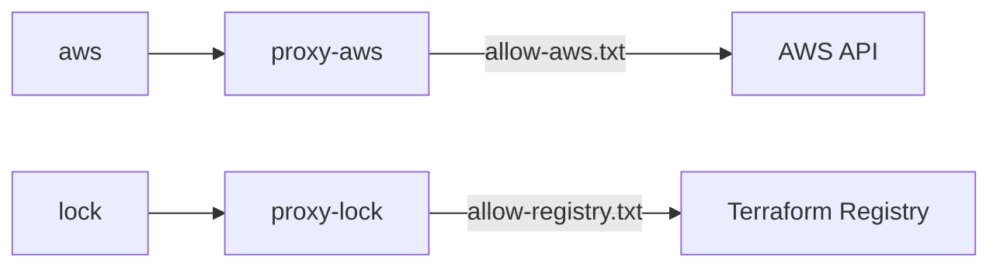

# Terraform

AWS のインフラを管理する Terraform を、隔離したコンテナで実行します。
AWS と Terraform Registry への通信は、許可リストを持つ squid の forward proxy だけを経由します。

## ラップしているもの

| 対象 | 取得元 | バージョンの固定先 |
|---|---|---|
| Terraform | `docker.io/hashicorp/terraform` | `Dockerfile` の `FROM` のタグと digest、`terraform/versions.tf` の `required_version` |
| AWS Provider | Terraform Registry | `terraform/versions.tf` と `terraform/.terraform.lock.hcl` |
| squid | Alpine のパッケージ | `proxy/Dockerfile` の `apk add` のバージョン |
| Alpine | `docker.io/library/alpine` | `proxy/Dockerfile` の `FROM` のタグと digest |

Terraform のバージョンを変えるときは、`FROM` と `required_version` を一緒に書き換えます。
Provider のバージョンを変えるときは、`terraform/versions.tf` を書き換え、lock ファイルを作り直します。

## 使い方

リポジトリのルートで、環境変数とマウント先のディレクトリを用意します。

```sh
export TF_HOST_DIR="$PWD/terraform" TF_HOST_LOCAL_DIR="$PWD/terraform/local" TF_HOST_DIST_DIR="$PWD/dist"
export TF_HOST_UID="$(id -u)" TF_HOST_GID="$(id -g)"
mkdir -p terraform/local dist
```

実行の形式は次のとおりで、`<サービス>` の後に Terraform のコマンドを続けます。

```sh
docker compose -f scripts/terraform/compose.yaml run --build --rm -T --interactive=false <サービス> <Terraform のコマンド>
```

| 処理 | サービス | Terraform のコマンド |
|---|---|---|
| lock ファイルの作り直し | `lock` | `providers lock -platform=linux_arm64 -platform=linux_amd64` |
| 初期化 | `offline` | `init -input=false -lockfile=readonly` |
| フォーマット | `fmt` | `fmt -recursive` |
| フォーマットの確認 | `fmt-check` | `fmt -check -recursive` |
| 検証 | `offline` | `validate` |
| テスト | `offline` | `test` |
| Plan の作成 | `aws` | `plan -var-file=local/terraform.tfvars -var=lambda_package_path=../dist/lambda.zip -out=local/plan.tfplan` |
| Plan の表示 | `offline` | `show local/plan.tfplan` |
| Plan の適用 | `aws` | `apply local/plan.tfplan` |

`providers lock` は固定中のバージョンから変更できないため、lock ファイルを作り直すときは先に `terraform/.terraform.lock.hcl` を削除します。
Plan の前に、`terraform/terraform.tfvars.example` を参考に `terraform/local/terraform.tfvars` を作り、デプロイパッケージを `dist/lambda.zip` に用意します。

サービス `aws` と `lock` を実行すると、proxy が起動したまま残ります。
実行後に proxy のログで通信した宛先を確かめてから、proxy を止めます。
止めるとログが消えるため、この順に実行します。

```sh
docker compose -f scripts/terraform/compose.yaml logs --no-log-prefix proxy-aws
docker compose -f scripts/terraform/compose.yaml down
```

`lock` のログは `proxy-lock` で確認します。

## 環境変数

次の変数をすべて指定します。

| 変数 | 内容 |
|---|---|
| `TF_HOST_DIR` | `terraform/` にあたるディレクトリの絶対パス。ビルドはこの値によらず、リポジトリの `terraform/` の lock ファイルを使う |
| `TF_HOST_LOCAL_DIR` | `terraform/local/` にあたるディレクトリの絶対パス |
| `TF_HOST_DIST_DIR` | `dist/` の絶対パス |
| `TF_HOST_UID` | コンテナを実行するユーザーの UID |
| `TF_HOST_GID` | コンテナを実行するユーザーの GID |

サービス `aws` を実行するときは、次の AWS の一時的な認証情報もシェルに設定します。
`compose.yaml` は値の有無を確かめないため、長期のアクセスキーを渡さないよう、`AWS_SESSION_TOKEN` があることを設定する側で確かめます。

| 変数 | 内容 |
|---|---|
| `AWS_ACCESS_KEY_ID` | アクセスキー ID |
| `AWS_SECRET_ACCESS_KEY` | シークレットアクセスキー |
| `AWS_SESSION_TOKEN` | セッショントークン |

## 設計と実装

全コンテナに共通する方針は [コンテナのセキュリティ設計](../container-design.md) に定めています。

### サービスの分割

処理が必要とする権限ごとにサービスを分けます。

| サービス | 通信 | AWS の認証情報 | 書き込める場所 |
|---|---|---|---|
| `offline` | なし | なし | `terraform/local/` |
| `fmt-check` | なし | なし | なし |
| `fmt` | なし | なし | `terraform/` |
| `aws` | `proxy-aws` 経由 | あり | `terraform/local/` |
| `lock` | `proxy-lock` 経由 | なし | `terraform/`、`terraform/local/` |

`fmt-check` と `fmt` は、`-recursive` が State や `.tfvars` などの手元の値に触れないよう、`terraform/local/` を空の tmpfs で覆います。
proxy を除くどのサービスもホストのユーザーで実行し、State と lock ファイルを運用者のファイルとして残します。

### Provider の取得と実行の分離

認証情報を持つプロセスに Provider を取得させないよう、取得の処理を次のように分けます。

- `lock` は AWS の認証情報を持たず、Registry から Provider を取得してハッシュを lock ファイルに書く
- `provider` ステージは、ビルド時に lock ファイルで検証した Provider をイメージへ展開する
- `aws` と `offline` は `terraformrc` の `filesystem_mirror` により、イメージの中の Provider だけを使う

`lock` が使う `base` ステージは lock ファイルに依存しません。
`provider` ステージを使うと、lock ファイルがまだない状態でビルドできないためです。

`terraform/local/.terraform/` の Provider はイメージの中へのシンボリックリンクです。
ホストからはリンク切れに見えますが、異常ではありません。

### 通信の許可リスト

`aws` と `lock` は `internal: true` のネットワークだけに接続し、外へ出られるのは proxy だけです。



許可リストはホスト名の完全一致です。
AWS の宛先はリージョンまで絞っているため、新しい AWS サービスを使うときやリージョンを変えるときは `proxy/allow-aws.txt` を変更します。
`squid.conf` は 443 番ポートへの `CONNECT` だけを通し、TLS を復号しません。

### Plan と Apply の整合

確認していない変更を適用しないよう、保存した Plan だけを適用します。
Apply は実行時点の `dist/lambda.zip` を読むため、Plan と Apply のあいだにこのファイルを変更しません。

### lock のための一時ディレクトリ

`providers lock` は全プラットフォームの Provider を一時ディレクトリへ展開するため、`/tmp` の tmpfs に収まりません。
そのため `lock` だけは `TMPDIR` を `terraform/local/` に向けます。
